# Spire — Herz aus Splittern

## Idle Bastion ausprobieren

[Mara in der Taverne ansehen — Idle und Berührungsreaktion](https://emfau88.github.io/TD/idle-bastion/mara-check.html) · Separate T01-Animationsprobe mit antippbarer Schulter und Einzelbildansicht. Noch nicht im Hauptspiel; visuell freigegeben am 21.10.2026.

[▶ Im Browser spielen](https://emfau88.github.io/TD/idle-bastion/) · [Frische Probe starten](https://emfau88.github.io/TD/idle-bastion/?fresh=1)

[Ilyras Lauf- und Zauberanimationen ansehen](https://emfau88.github.io/TD/idle-bastion/ilyra-check.html) · Separate Vorschau neben Mara; die Figurenanimationen werden auch im Spiel verwendet.

**Aktuelle Nachbesserung:** Ilyras Speerzwischenräume sind transparent korrigiert, die Sternensalve ist 35 % langsamer sichtbar. [Fortlaufende Roadmap](experiments/idle-bastion/ROADMAP.md) mit Effekt-Sortierung und den vorgemerkten Idle-Animationen; alte Nachweise bleiben archiviert.

**Taverne I ab Welle 12, Ilyra nach Boss 25:** Nach erfolgreich gemeisterter **Welle 12** unter Siedlung den **kostenlosen Tavernenbausatz** platzieren. Nach dem tatsächlichen Sieg über **Boss 25** für **1.200 Gold auf Taverne II ausbauen**. Bereits früher bezahlte Tavernen sind automatisch Stufe II, ohne zweite Zahlung. Dort Ilyra kennenlernen und **kostenlos rekrutieren**. Einen Standort am Weg wählen, danach mit „Sternensalve zielen“ eine Gegnergruppe treffen: 28 Sekunden Abklingzeit, besonders wirksam gegen Flieger. Nach der ersten Anwendung lässt sich eine gegnerabhängige Automatik einschalten. **Mara, Wisp und Ilyra** sind mit Rolle und Status in derselben Tavernenübersicht zu finden. Bestehende Saves bleiben erhalten. [Kompakter B15b-Bericht](artifacts/idle-bastion/acceptance/b15b/REPORT.md).

<details open>
<summary>B15b – Gefährten und Sternensalve im Spiel</summary>

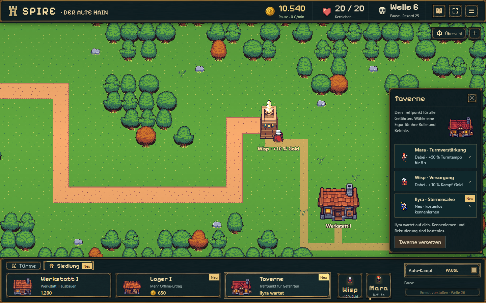

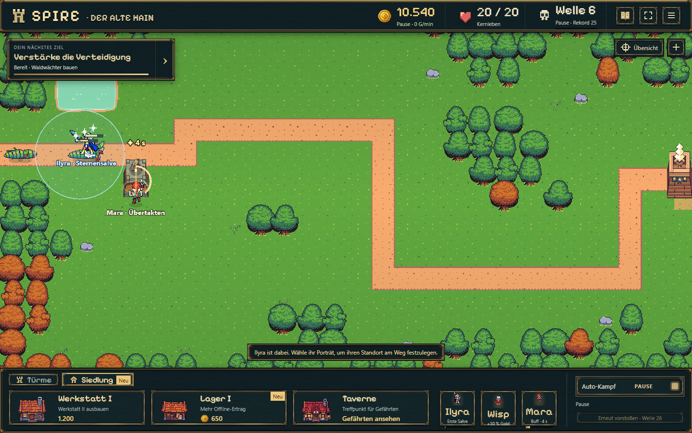

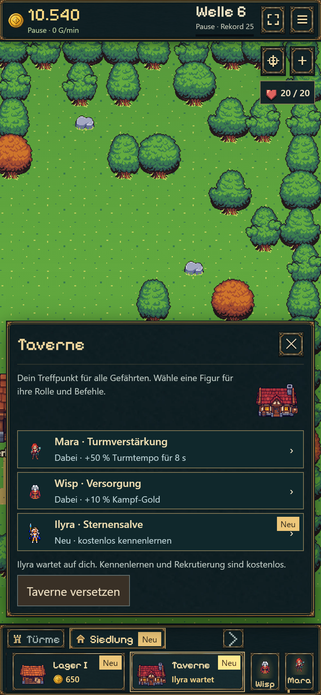 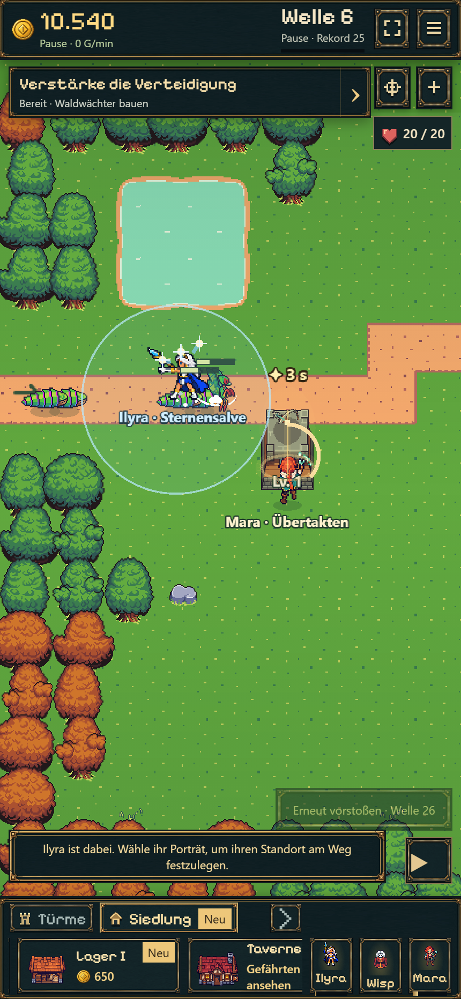

Vorbereiteter Funktionsprüfstand mit Boss-25-Freischaltung und Farmwelle 6; keine erspielte Balanceabnahme. Hochkant: Browseremulation 430 × 932 bei DPR 2.
</details>

**Neu – Siedlung am Kern:** Neue Partien haben rechts vom Kern Platz für Werkstatt, Lager und Taverne. Bestehende Spielstände behalten ihre Gebäudeplätze: **Pause → Siedlung → Siedlung am Kern → kostenlos verlegen** zieht die vorhandenen Gebäude gemeinsam um. Gold, Stufen, Türme und laufende Gegner bleiben erhalten. Ein alter Lichtungskauf wird mit 900 Gold auf den späteren Ostzugang angerechnet. Karte per Mausziehen/Touch verschieben; keine zusätzlichen Navigationsbuttons und noch keine Ostangriffe. [Kompakter Prüfbericht](artifacts/idle-bastion/acceptance/b17a/REPORT.md).

<details>
<summary>Siedlung am Kern – aktuelle Ansichten</summary>

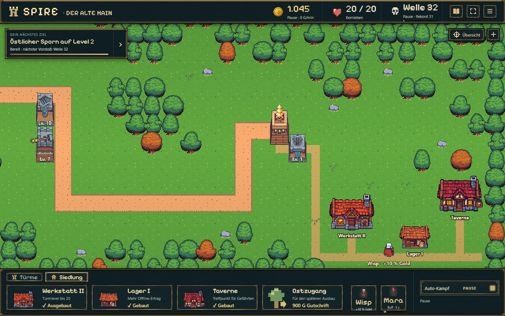

Der erste Werkstattbau bleibt während der Lernpause frei sichtbar:

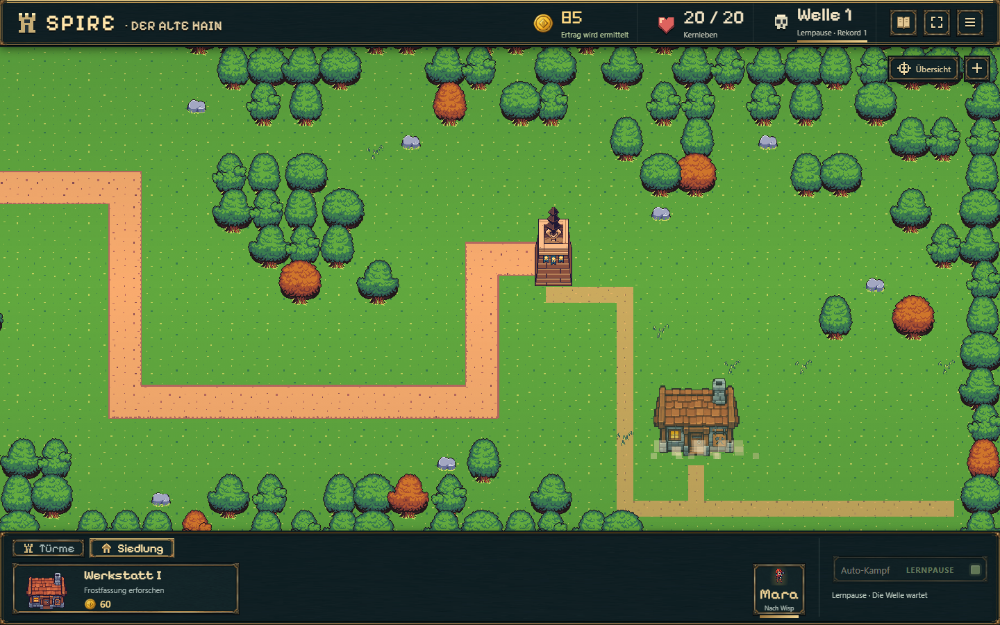

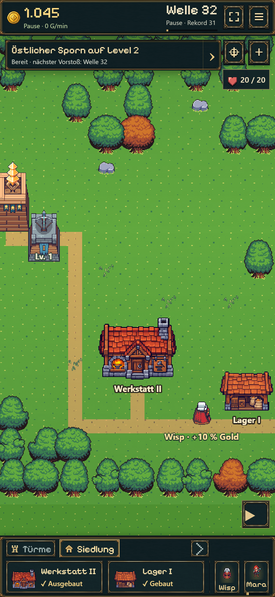

Die späte Siedlungsansicht verwendet einen vorbereiteten Besitz-/Umzugsprüfstand. Hochkant: Browseremulation 430 × 932, kein physischer Gerätetest.
</details>

**Darstellung korrigiert:** Der Frostturm sitzt in Bauvorschau und allen drei Ausbaustufen auf gleicher Bodenhöhe wie seine Nachbartürme. [Kompakter Nachweis](artifacts/idle-bastion/acceptance/f01/REPORT.md).

**B15a – ursprünglicher Stand der Siedlung nach Boss 25:** Nach dem tatsächlichen Sieg wird die **Taverne für 1.200 Gold** unter Siedlung freigeschaltet. Frei platzierbar und dauerhaft gespeichert; damals zunächst optionaler Treffpunkt **ohne Ilyra oder Kampfbonus**. B15b ergänzt jetzt die oben beschriebene kostenlose Rekrutierung. Werkstatt II hat ein eigenes Imagegen-Gebäude erhalten; Werkstatt I/II, Lager und Taverne sind direkt auf der Karte beschriftet. [Prüfumfang und Nachweise](artifacts/idle-bastion/acceptance/b15/REPORT.md) · [Aktuelle Roadmap](experiments/idle-bastion/ROADMAP.md).

<details>
<summary>B15 – frühere Spielaufnahmen vor dem Siedlungsumzug</summary>

Siedlungsübersicht mit Werkstatt II, Lager und neuer Taverne:

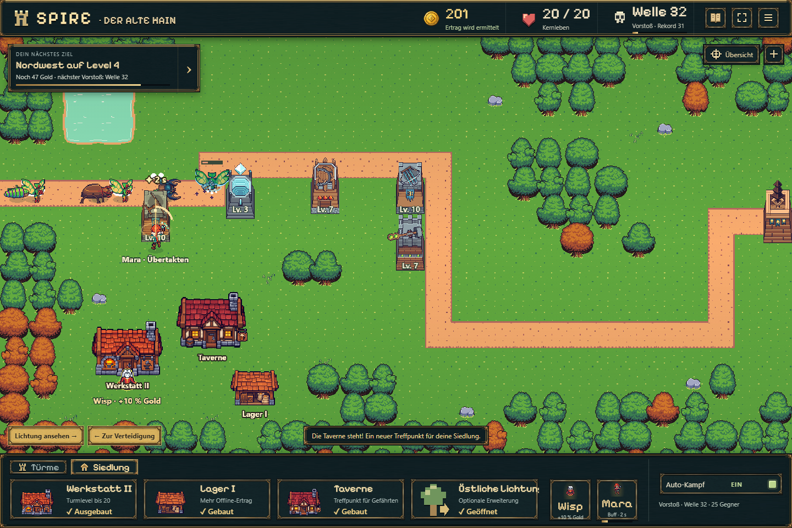

Der Aufbau bleibt nach dem direkten Kartenklick sichtbar:

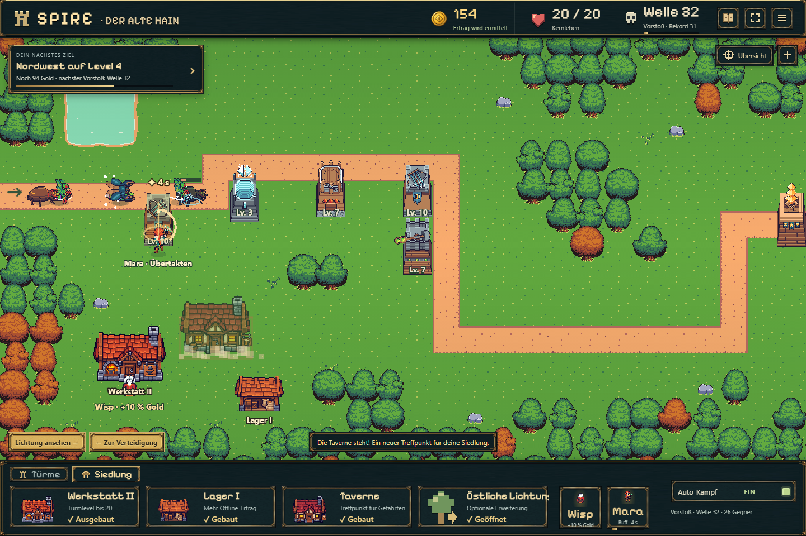

Hochkant: Gebäudeansicht und ehrliche Kaufbeschreibung. Browseransicht 430 × 932; kein Test auf einem physischen Smartphone.

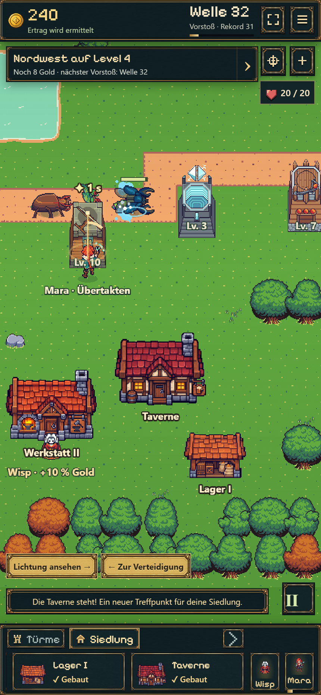 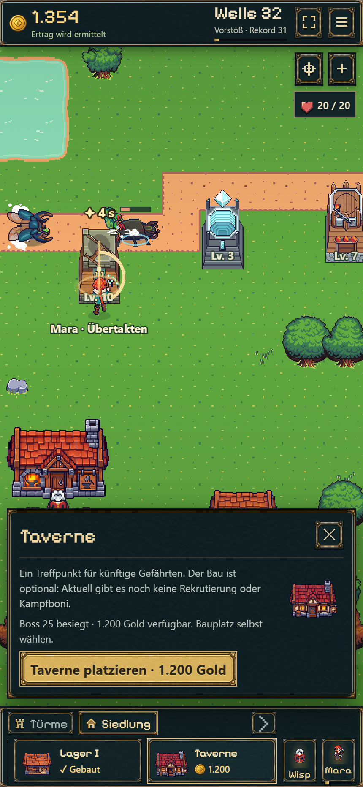

</details>

**Geführter Einstieg:** Ein mitwandernder Pfeil zeigt die echten Menüpunkte: **Siedlung → Werkstatt → Kartenplatz**; entsprechend Türme, Upgrade und Forschung. Nach Level 2 und der ersten geschafften Welle gibt es den einmaligen kostenlosen Werkstatt-Bausatz. Kurze Hinweise und Lernpausen lassen Zeit zum Orientieren; die Bauanimation bleibt sichtbar. [Klickfolge, Prüfung und Aufnahmen](artifacts/idle-bastion/acceptance/onboarding/menu-guide/REPORT.md).

**Nach dem Frostturm:** Wisp läuft nach Welle 5 vom eigenen Kern an und stellt sich in Ruhe vor. Erst nach ihrer Ankündigung zeigt Mara ihren echten Zauber am Turm mit Ring und kompakter, schließbarer Restzeitanzeige. Pfeile führen anschließend zur optionalen Steinschleuder und später über **Siedlung → Lager** zur Offline-Vorsorge. Beides darf auf später verschoben werden. [Ablauf, Prüfung und neue Aufnahmen](artifacts/idle-bastion/acceptance/onboarding/followup/REPORT.md).

Neu: Mara begrüßt dich zuerst auf einer ruhigen Karte. Baue deinen kostenlosen Startturm selbst und starte die Verteidigung bewusst; die 75 Startgold bleiben erhalten. Danach führt sie dich mit Lernpausen durch Upgrade, Werkstatt und die erste Frost-Kombination; ihren ersten Zauber zeigt sie erst nach Wisps Einführung. Bestehende Partien laufen unverändert weiter — den Einstieg testest du mit **„Frische Probe starten“** oben. [Ablauf und neue Spielaufnahmen](artifacts/idle-bastion/acceptance/onboarding/REPORT.md).

Die Idle-Vorschau enthält automatischen Kampf, Mara, Wisp, vier Turmrollen, Upgrades, Werkstatt I/II, Turmlevel bis 20, Frostforschung und Vorratslager I sowie Rosenspiegel als ersten Boss in Welle 15. Wisp bringt nach Frostfassung und Welle 5 automatisch +10 % Kampf-Gold und die Steinschleuder; ab Welle 10 kommt der Scharfschütze hinzu. Nach dem geführten ersten Bau sind geeignete Felder bis zu drei Reihen beidseits des Wegs bebaubar. Überlappende Schussbereiche verbinden Frost- und Schadenstürme. Folge Maras Hinweisen bis zum ersten Frosttreffer. Nach Wisps Ankunft erklärt sie Übertakten; neue Lageroptionen werden mit „Neu“ im Siedlungsmenü angekündigt. Gold und Kampf werden lokal im Browser gespeichert; „Frische Probe“ öffnet eine getrennte neue Partie und bewahrt den bisherigen Stand. Nur ein Tab pro Partie kann gleichzeitig spielen.

Die Karte steht im Mittelpunkt: illustriertes Messing-/Schiefer-HUD, Baudock und Details erst bei Auswahl. Vier erzeugte UI-Assets, einheitliche Pixel-Symbole und eine lokal geladene Pixelschrift greifen die Mockups auf. Goldzufluss, Wellenrekord, Vorstoß/Farmen und nächstes Ziel sind direkt sichtbar; das Buchsymbol öffnet Ertragsdetails, Begleiter und die gespeicherte Wellenchronik. Alte Spielstände bleiben erhalten, frühere nicht aufgezeichnete Versuche werden als unbekannt behandelt. Hochkant gibt es einen verschiebbaren Kartenausschnitt und große Aktionsflächen. Funktional in schmalen Browseransichten geprüft; eine vollständige Smartphone-/Safari-Abnahme steht noch aus. [Aktuelle Premium-Oberfläche und Prüfung](artifacts/idle-bastion/acceptance/ui/PREMIUM.md) · [Fortschrittsinformationen](artifacts/idle-bastion/acceptance/ui/PROGRESS.md).

Nach der freigegebenen ersten Zwischenabnahme sind B08–B13 zum Testen enthalten. [Auftrag und Roadmap](experiments/idle-bastion/ROADMAP.md) · [Gemessener Ablauf und bekannte Grenzen](artifacts/idle-bastion/acceptance/90s/REPORT.md). Der Playlink wird aus `codex/idle-bastion-vertical-slice` veröffentlicht.

Rosenspiegels Verführung zeigt das Tanzfenster mit dem Original-HD-Tanzatlas aus dem Hauptspiel. Das Fenster ist jetzt 15 % kleiner; Frost verlangsamt sie, ohne den Tanz abzubrechen. Der betroffene Turm leuchtet und wackelt; Herzfaden, aufsteigende Herzen und Restdauer zeigen die Wirkung. [Darstellung und Spielaufnahmen](artifacts/idle-bastion/acceptance/p4/B10_VISUALS.md).

Nach dem Turmbau schließt die Verwaltung automatisch; Antippen eines Turms öffnet sie wieder. Skorpione schauen in Laufrichtung. Eine höhere interne Zeichenauflösung auf dichten Displays und kräftigere Spielfeldbeschriftungen verbessern die mobile Lesbarkeit. [Änderungen, Prüfung und neue Spielaufnahmen](artifacts/idle-bastion/acceptance/p4/USABILITY.md).

Mobil wurde die Oberfläche zusätzlich verdichtet: weniger Rahmen, einklappbare Hinweise und Vollbild oben rechts. Gold oder Welle öffnen die Chronik. [Mobile Ansicht und Prüfung](artifacts/idle-bastion/acceptance/ui/MOBILE.md).

Werkstatt II wird nach der Frostforschung unabhängig von der Lichtung für **1.200 Gold** unter **Siedlung → Werkstatt** ausgebaut. Der sichtbare Anbau schaltet Turmlevel **7–20** frei; ab Level 7 wechseln die vier Turmrollen zur dritten Originalgrafikstufe. In **Welle 25** kehrt Rosenspiegel mit mehr Begleitern und einer eigenen einmaligen 1.200-Gold-Prämie zurück. Alte Spielstände bleiben erhalten. [B12: Regeln, Spielaufnahmen und Prüfgrenzen](artifacts/idle-bastion/acceptance/p4/B12.md).

Die Ergänzung nach B12 erlaubt freie Turmkombinationen auf bis zu drei Feldern beidseits des Wegs. Baukarte wählen, Reichweitenvorschau prüfen und durch Antippen eines gültigen Feldes direkt bauen. Mara unterstützt aus der Entfernung, wartet automatisch auf Gegner und kann unabhängig laufen; manuelles Zaubern ist optional. Wisp stellt sich kurz vor. Werkstatt und Lager lassen sich in der Siedlung platzieren und bei Pause versetzen. Die östliche Lichtung ist optional. Frost zeigt einen einzelnen Kristall; Originaltreffer und Bauanimationen machen Aktionen deutlicher. [Regeln und Prüfung](artifacts/idle-bastion/acceptance/p4/REDESIGN.md).

Der Nordbogen liegt jetzt zwei Felder tiefer: drei zusammenhängende Baureihen oberhalb des Wegs und mehr Kameraspielraum auf dem Handy. Vorhandene Verteidigungen werden beim Wellenwechsel erhalten bzw. kostenlos in der Nähe versetzt. [Karte, mobile Bauprobe und Migration](artifacts/idle-bastion/acceptance/p4/MAP.md).

Sechs weitere vorhandene Gegnertypen erscheinen gestaffelt: **Flugheuschrecke (6), Feuerwespe (9), Magmakrabbe (13), Panzerflieger (17), Laternenqualle (21), Leerenfalter (28)**. Schwarm, Tempo, Rüstung, Heilung und Frostresistenz sorgen für unterschiedliche Kombinationen. Alle Türme treffen Flieger. Die Chronik erklärt Zusammensetzung und Gegenmittel. [Gegnerregeln](experiments/idle-bastion/docs/ENEMIES.md) · [Prüfung und Spielaufnahmen](artifacts/idle-bastion/acceptance/p4/ENEMIES.md).

B13 stimmt die neue Gegnermischung auf die ersten 15 Minuten ab: mehr gewöhnliches Gold und sanfteres HP-Wachstum ab Welle 16, ein leicht stärkerer erster Boss sowie zuverlässigere Neuwahl der Farmbasis nach Upgrades. Die Chronik erklärt die Erträge. Laufende alte Wellen enden mit ihren bisherigen Werten; Käufe und Offline-Ansprüche bleiben erhalten. [15-Minuten-Verlauf, Rückkehrprobe und Grenzen](artifacts/idle-bastion/acceptance/15min/REPORT.md).

Niederlagenhinweise lassen sich schließen und bleiben für denselben Versuch auch nach Neuladen geschlossen. Tutorialpfeile halten Erklärungstexte frei. Die Pixelziffern 2/5/8 sind klarer gezeichnet; Maras aktiver Boost verbindet sie golden mit dem leicht leuchtenden Turm. [Aktuelle Ansichten und kompakte Prüfung](artifacts/idle-bastion/acceptance/onboarding/readability/REPORT.md).

### Entwicklung von Idle Bastion

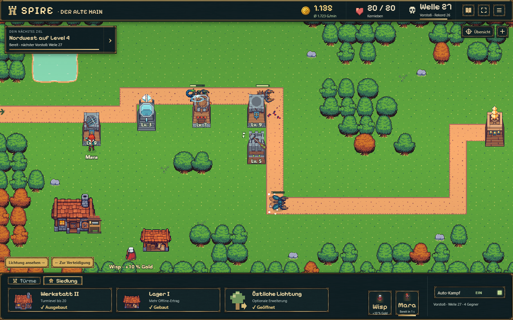

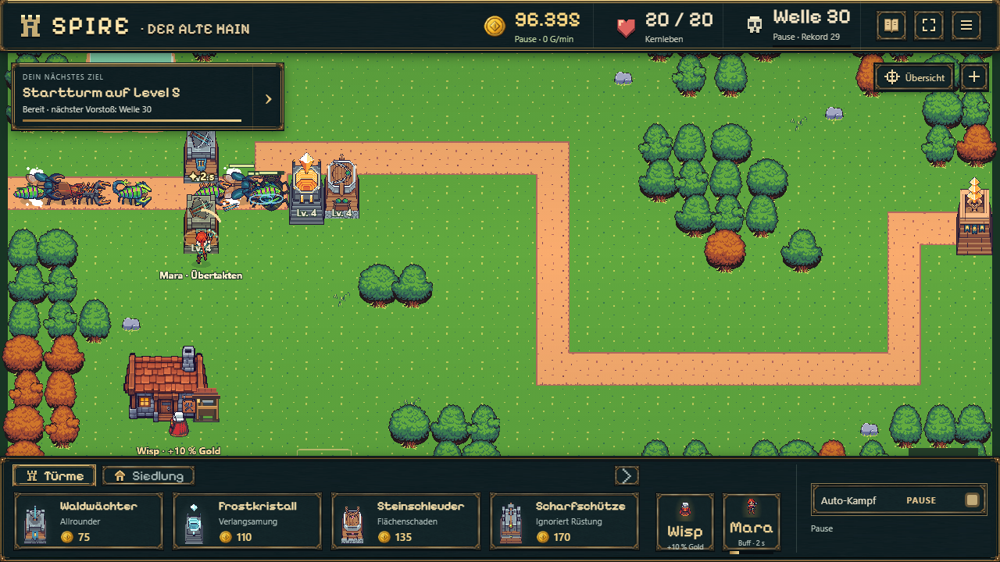

Gegnerdarstellung aus einer gezielt vorbereiteten Welle-30-Probe; künstliches Testguthaben, kein Nachweis des regulären Fortschrittstempos.


[Neue Bauflächen und Figurenbedienung nach B12](artifacts/idle-bastion/acceptance/p4/REDESIGN.md):

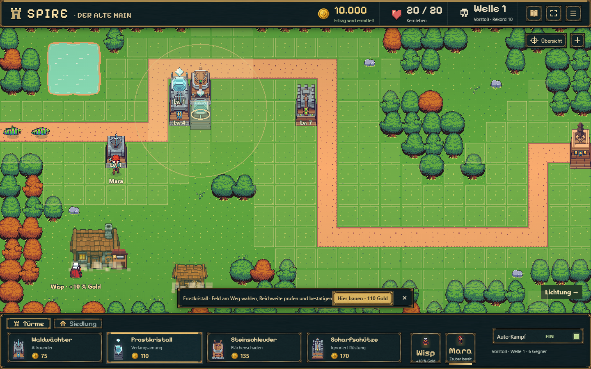

Echte Spielaufnahmen der bisherigen Entwicklung, keine Mockups. B07a führte die große Kartenansicht ein, B07b ergänzt verständliche Fortschrittsinformationen und die warme Spieloberfläche. Die älteren Aufnahmen bleiben als Vergleich erhalten.

| B01 · Kartenrahmen und reservierte Flächen | B02 · Automatischer Kampf und Turmkäufe |
| --- | --- |
| 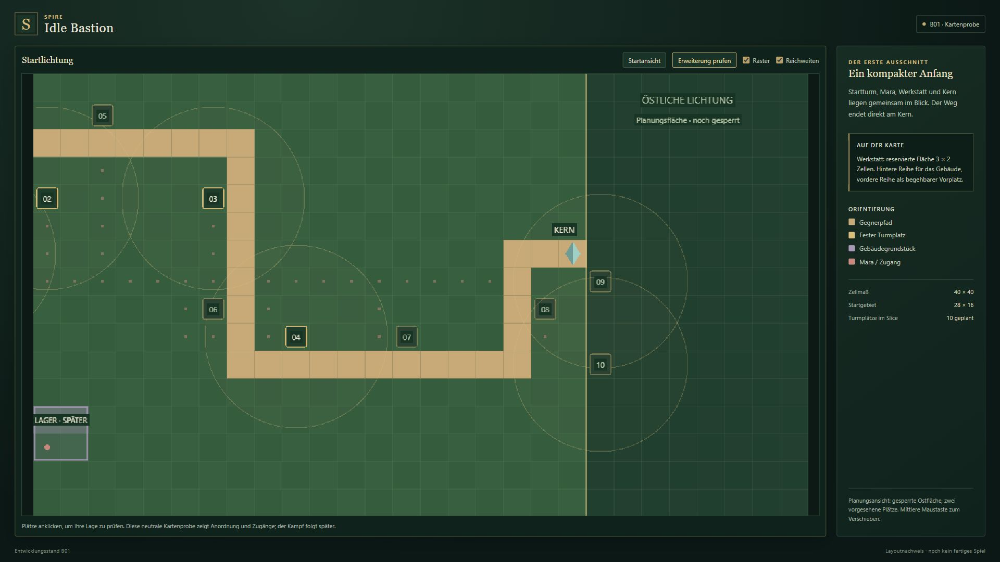 | 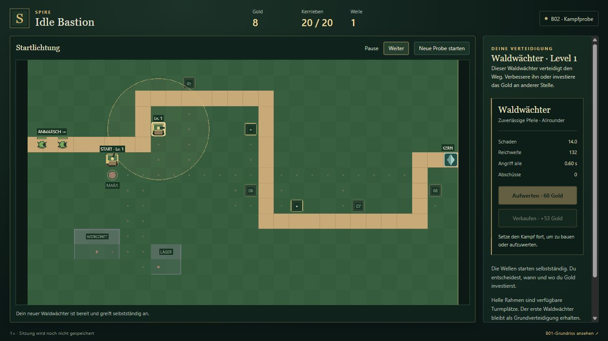 |

| B05 · Waldlichtung und Mara | B07 · Werkstatt, Forschung und Frost |
| --- | --- |
| 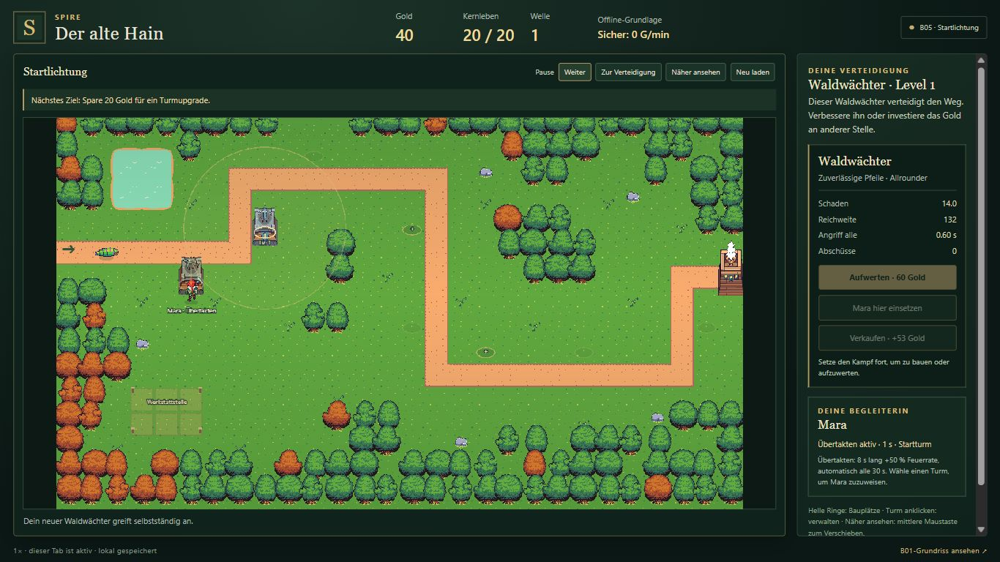 | 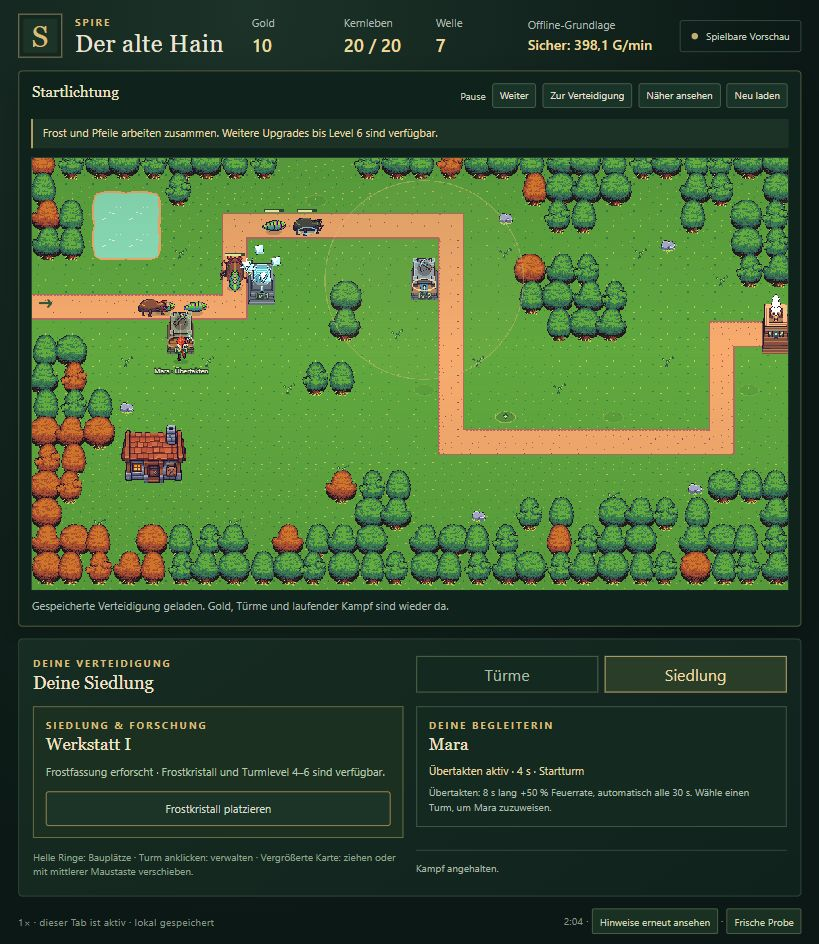 |

[Weitere Aufnahmen und technische Entwicklung B01–B05](artifacts/idle-bastion/acceptance/p1/REPORT.md) · [B06–B07: gemessene Spielabläufe, Reload und Kameraprüfung](artifacts/idle-bastion/acceptance/90s/REPORT.md).

**B07a · Karte im Mittelpunkt**

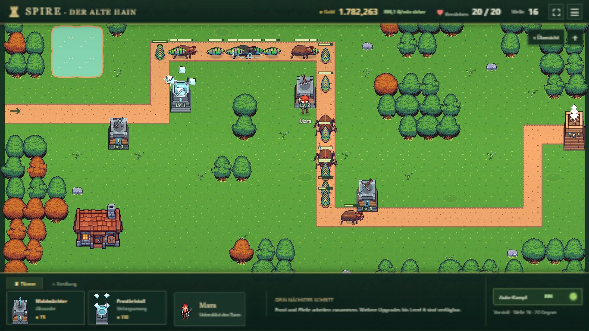

| Hochkant · Kartenausschnitt und Bauplatzwahl | Hochkant · Aktionen nach Turmauswahl |
| --- | --- |
| 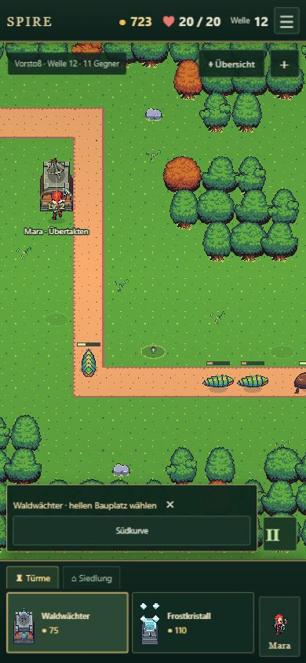 | 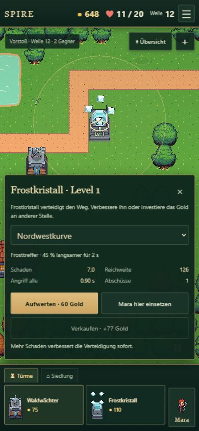 |

**B07b · Fortschritt im Blick**

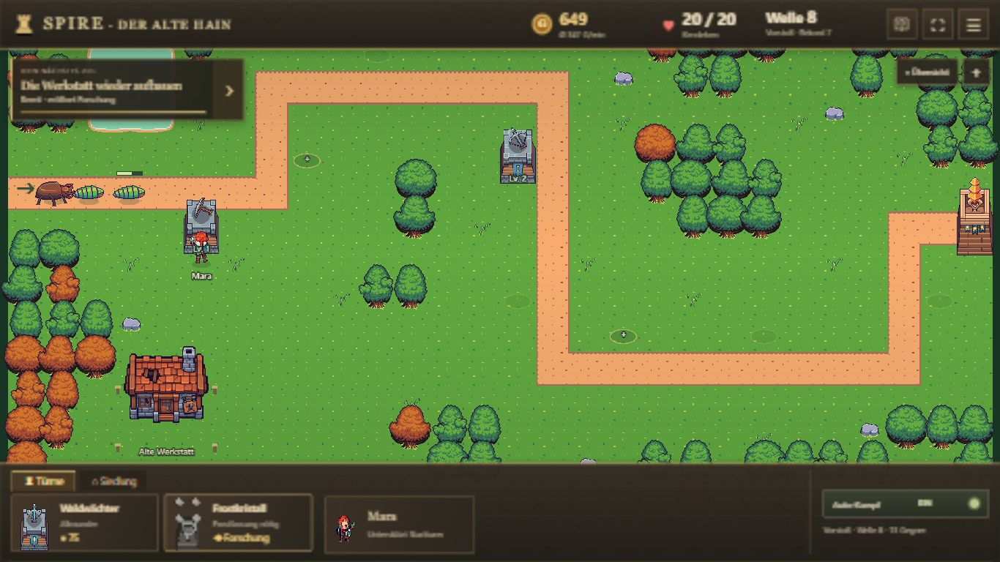

| Chronik · Ertrag, Begleiter und Wellen | Hochkant · kompakte Informationen am Spielfeld |
| --- | --- |
| 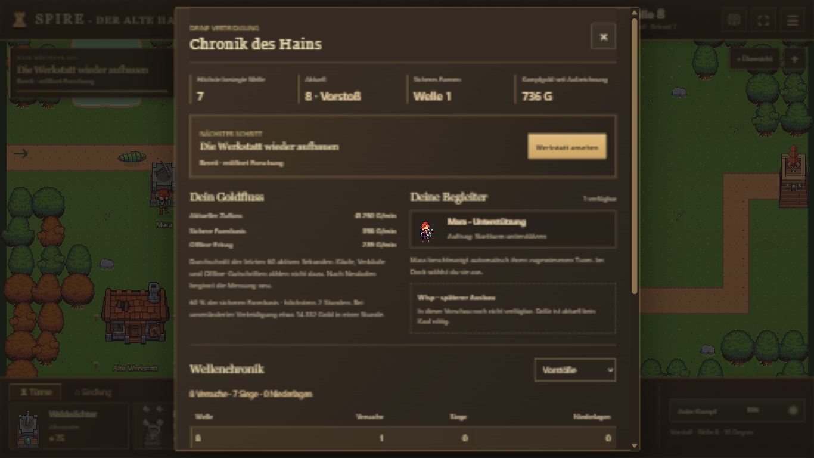 | 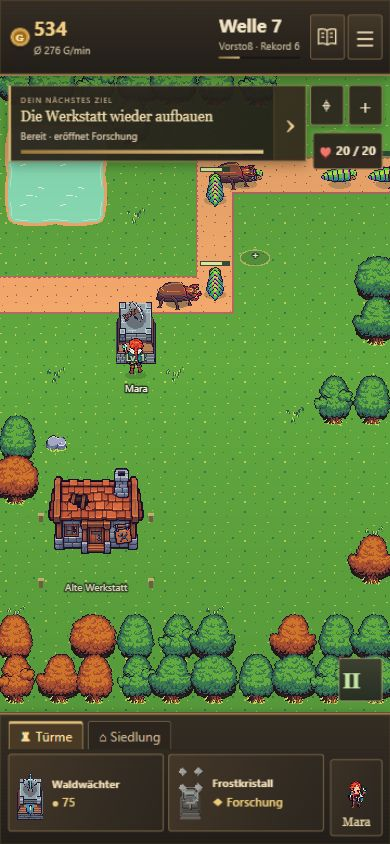 |

**Premium-Überarbeitung · vier Imagegen-Assets und kompakte mobile Ansicht**

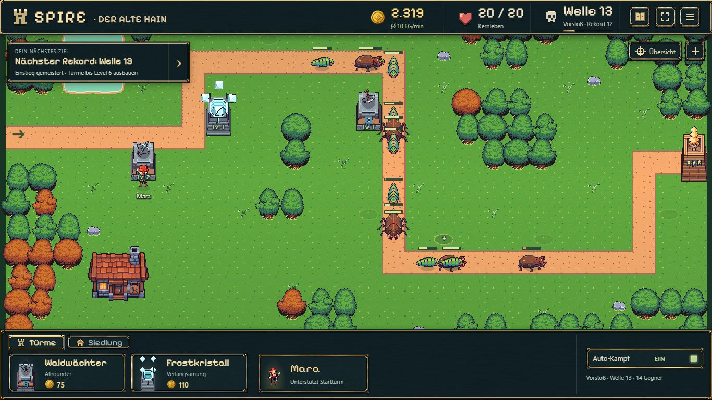

| Hochkant · weiterhin viel Spielfläche | Hochkant · klar hervorgehobene Hauptaktion |
| --- | --- |
| 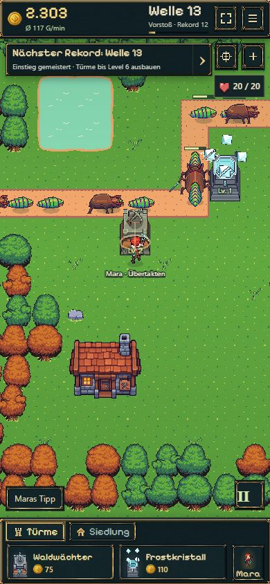 | 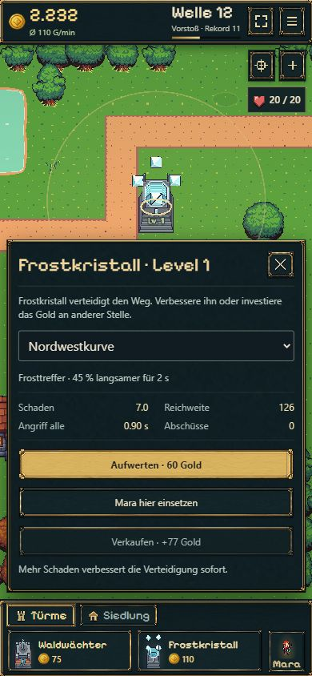 |

[Asset-Quellen und vollständige Prompts](experiments/idle-bastion/assets/ui/README.md) · [Gezielter Prüfbericht](artifacts/idle-bastion/acceptance/ui/PREMIUM.md).


**B11 · Die östliche Lichtung**

Nach dem ersten echten Sieg über Rosenspiegel öffnest du unter **Siedlung → Östliche Lichtung** für **900 Gold** vier weitere Kartenspalten. Östlicher Sporn und Ostbogen ergänzen zwei Bauplätze am letzten Wegabschnitt: zusammen mit der Kernwache lassen sich Frost und Schaden kombinieren. Die Welt wächst von 28×16 auf 32×16 Zellen. „Lichtung ansehen“ und „Zur Verteidigung“ wechseln den Ausschnitt; du kannst die Karte auch ziehen. Weg, Kern und Objektmaßstab bleiben erhalten. Alte Spielstände übernehmen den Ausbau zunächst als geschlossen.

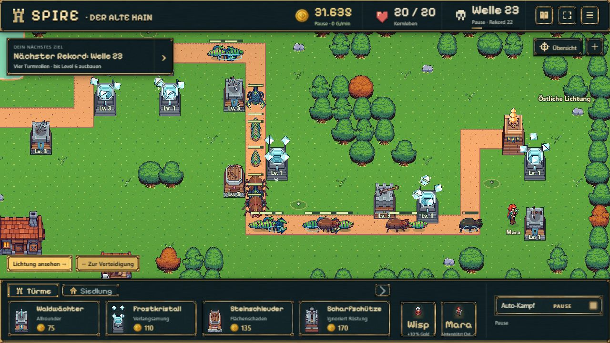

[Prüfung, gespeicherte Erweiterung und Hochkantaufnahme](artifacts/idle-bastion/acceptance/p4/B11.md).

**B10 · Rosenspiegel, der erste Boss**

In Welle 15 kündigt die Succubus ihren Ziel-Turm per Herzfaden an und schwächt kurz dessen Feuerrate. Frost unterbricht den Zauber, Fläche hilft gegen die Begleiter und Scharfschützen durchdringen Rüstung. Bossbalken, Restdauer und Unterbrechung sind direkt am Spielfeld sichtbar. Der erste vollständige Sieg bringt einmalig 750 Gold. Nach einer Niederlage wird sicher gefarmt; den nächsten Versuch startest du bewusst.

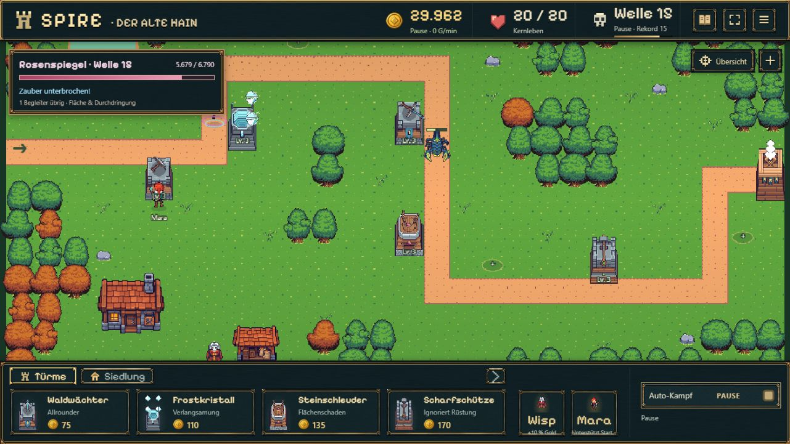

[Bossprüfung und mobile Ansicht](artifacts/idle-bastion/acceptance/p4/B10.md). Alte Wellenrekorde sind keine nachträglichen Bosssiege: Über Gold/Welle oder das Buch die Chronik öffnen und Rosenspiegel herausfordern. Bereits verdientes Gold und bestehende Offline-Ansprüche bleiben erhalten.

**B09 · Vorratslager und Rückkehr**

Nach Wisp und Welle 8 lässt sich für 650 Gold das Vorratslager bauen. Es erhöht künftige Offline-Erträge auf 65 % der sicheren Farmbasis für bis zu acht Stunden. Vor dem Kauf erscheint eine konkrete Stundenvorschau; bei Rückkehr zeigt der Beleg Gold, Abwesenheit, angerechnete Zeit und die tatsächlich geltenden Werte.

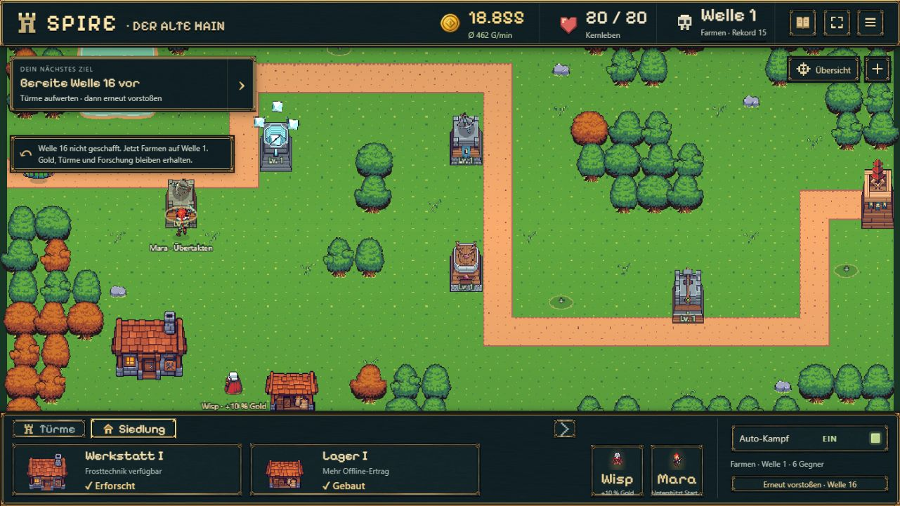

[Prüfung, Rückkehrbeleg und mobile Aufnahmen](artifacts/idle-bastion/acceptance/p3/B09.md) · [Lagerasset mit Original und Prompt](experiments/idle-bastion/assets/warehouse/README.md).

**B08 · Wisp, vier Turmrollen und acht Bauplätze**

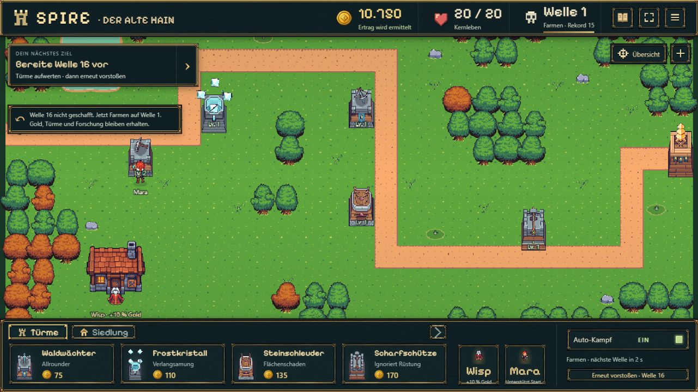

[Änderungen, kompakte Prüfung und mobile Aufnahme](artifacts/idle-bastion/acceptance/p3/B08.md). Bestehende Spielstände werden übernommen; die sichere Farmbasis wird nach dem Regelupdate neu erspielt. Bereits entstandene Offline-Ansprüche bleiben erhalten.

## Bestehendes klassisches Spiel

**Aktueller Spielstand: vier zusammenhängende Regionen.** Der alte Hain, Laternenmoor, Spiegelwinter und Windbruch sind sofort frei auswählbar, mit Wisp, Mara, acht Türmen und jeweils 10 Wellen. Mausradzoom von 100 bis 120 %, getrennte Bauphasen-Spielstände und animierte Wolken/Felsinseln in Windbruch sind integriert. Die Waldkarte ist vom Nutzer abgenommen; die drei neuen Regionen sind umgesetzt und gezielt geprüft, ihre optische Nutzerabnahme steht aus. Mobile Optimierung ist zurückgestellt.

**Start nach dem Klonen:** `npm ci`, dann `npm run reference:regions:build`, anschließend `REGIONEN STARTEN.cmd` doppelklicken. Die erzeugte HTML-Datei enthält Code und Grafiken und funktioniert ohne Server. Entwicklung: `npm run reference:dev`, dann `http://127.0.0.1:5180/woodland.html` öffnen. [Spielanleitung](reference/README.md), [Roadmap](ROADMAP.md), [Moorbericht](artifacts/m3/REPORT.md), [Winterbericht](artifacts/m3-winter/REPORT.md), [Windbruch mit Asset- und Animationsnachweis](artifacts/m3-wind/REPORT.md).

**Neuer Moorgegner:** Die Laternenqualle ergänzt die acht Originalgegner als fliegender Heiler in Welle 4, 7 und 9. Ihr abgenommener Pixelentwurf wurde mit drei Ansichten, Bewegung, Heilung und Tod vervollständigt. Separate Animations- und Kampfvorschau: `npm run reference:enemy:build`, danach `GEGNERPROBE STARTEN.cmd`. [Produktionsnachweis und Quellen](artifacts/enemies/lantern-jelly/v1/REPORT.md).

**Neuer Windbruch-Gegner:** Die gewählte Succubus „Rosenspiegel“ erscheint in Welle 6 und 9 und schwächt kurz die Feuerrate eines Turms. Herzfaden und ein größeres Tanzfenster zeigen die Fähigkeit. Die aktuelle dritte Grafikfassung korrigiert den Beinwechsel beim Hoch-/Runterlaufen und ergänzt ein eigenes höher aufgelöstes Tanzsheet; die kleine Spielfigur behält ihren Stil. Die Nutzerabnahme steht aus. Damit sind zehn Gegnertypen aktiv. Separate Animations- und Kampfvorschau ohne Spielstandzugriff: `npm run reference:succubus:build`, danach `SUCCUBUS STARTEN.cmd` (`reference/Spire-Succubus.html`). [Umsetzung, Quellen und Grafikgrenzen](artifacts/enemies/succubus/production-v3/REPORT.md).

Der Plan für die Überarbeitung auf Basis der ursprünglichen Karten steht in [ROADMAP.md](ROADMAP.md): fünf zusammenhängende Spielkarten, verbindliche Asset-Vorgaben und schrittweise Abnahmen. **M0 ist abgeschlossen:** Die drei ursprünglichen Karten sind separat unter [reference/](reference/README.md) rekonstruiert. Zum Spielen `ORIGINAL SPIEL STARTEN.cmd` öffnen; [Prüfbericht und Screenshots](artifacts/m0/REPORT.md) dokumentieren Herkunft und Grenzen. **Die M1-Grafikprobe ist abgenommen:** `GRAFIKPROBE STARTEN.cmd` bleibt als Vergleich mit Originalgelände, Wisp, Mara und Turmkampf erhalten; [Grafikvorgaben](reference/STYLE_GUIDE.md) halten Maße und Grenzen fest. Die Archivsektion unter der Galerie beschreibt den erhaltenen älteren Stand mit fünf Karten.

## Die vier spielbaren Karten

Aktuelle Spielansichten der Zehn-Wellen-Version. Alle Karten sind sofort anwählbar; vorhandene Bauphasen wurden für die Aufnahmen geladen.

| Der alte Hain · Wald und Lichtungen | Laternenmoor · Wasser und Holzstege |
| --- | --- |
| 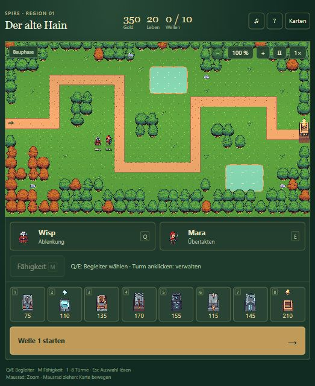 | 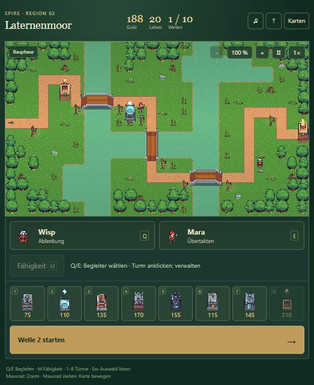 |

| Spiegelwinter · Schnee und zwei Anmarschwege | Windbruch · Schwebende Inseln und Steinbrücken |
| --- | --- |
| 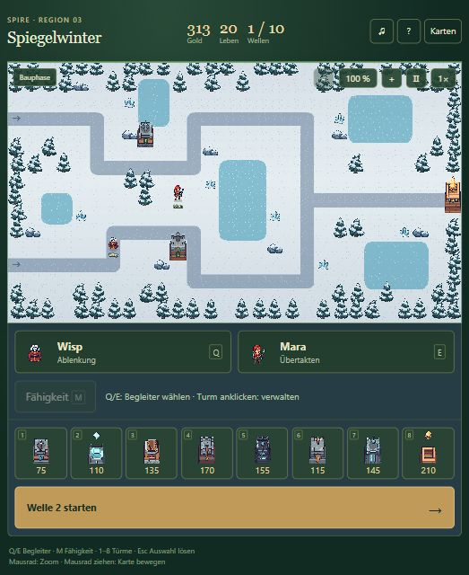 | 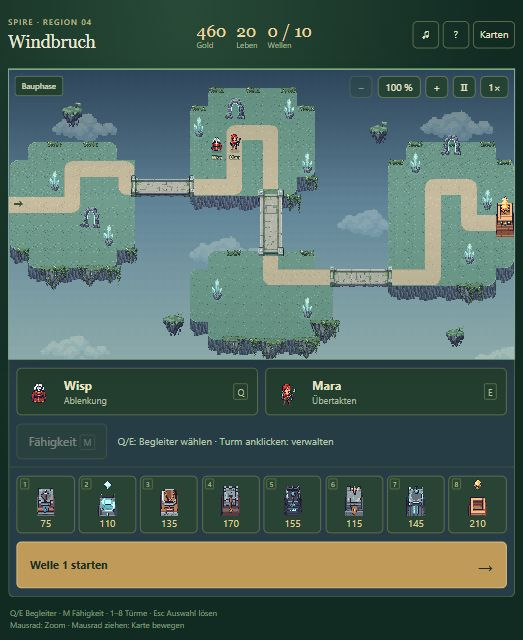 |

## Archiv: älterer Fünf-Karten-Entwurf

Die folgenden Angaben und `SPIEL STARTEN.cmd` gehören zum erhaltenen älteren Entwurf, nicht zum aktuellen Vier-Regionen-Spiel oben.

Ein lokales Tower-Defense-Spiel mit fünf eigenständigen Spielkarten und vier steuerbaren Begleitern. Die größere Kampagne „Herz aus Splittern“ ist als separat gekennzeichneter Entwurf erhalten. Ihre Geschichte verbindet Wisp, Mara, Runa, Ilyra und die Astronomin Vesper.

## Spielen

- `SPIEL STARTEN.cmd` oder `Spire.html` öffnen. Die erzeugte Einzeldatei enthält Spielcode und Grafiken und benötigt keinen Server.
- Lokaler Test: `npm run preview` und die ausgegebene Adresse öffnen, standardmäßig `http://127.0.0.1:5175/`.
- Entwicklung: `npm ci`, danach `npm run dev`.
- `npm run build` aktualisiert `dist/` und die Offline-Datei `Spire.html`.

Das Hauptmenü öffnet „Karten testen“. Direkt auswählbar sind **Mooshain, Laternenmoor, Windbruch, Spiegelwinter und Mondwarte**. Jede Karte hat zehn Wellen und verlangt zusätzlich die Aktivierung des markierten Kerns durch einen Begleiter. Alle fünf Karten sind ohne Freischaltungen zugänglich. Ein Kartensieg führt zur Auswahl der nächsten Karte, ohne Kampagnenfortschritt zu vergeben.

Unter „Kampagne · Entwurf“ bleiben die geplante Folge aus 18 Missionen in sechs Regionen und die vorhandenen Geschichten einsehbar. Diese Ansicht startet keine zusätzlichen Missionen und wird nicht als fertige Kampagne ausgewiesen. Auch die ursprünglichen Karten- und Fortschrittsdaten bleiben im Projekt erhalten. Türme haben drei Ausbaustufen; ihr Verkauf erstattet 70 % der investierten Kosten. Drei Sterne erfordern mindestens 18 verbleibende Spire-Leben, zwei Sterne mindestens zehn.

## Begleiter und Steuerung

Pro Karte reisen genau zwei Begleiter mit. **Wisp, Mara, Runa und Ilyra sind für alle fünf Karten sofort verfügbar.** Die Auswahl erfolgt vor dem Start. Um eine Figur zu ersetzen, zuerst eine gewählte Figur abwählen und danach ihre Nachfolgerin wählen.

| Eingabe | Aktion |
| --- | --- |
| Porträt oder Q / E | Ersten bzw. zweiten Begleiter auswählen |
| Boden anklicken | Ausgewählte Figur über begehbare Flächen zum Ziel bewegen |
| Kiste / Rune anklicken | Zum Objekt laufen und vor Ort sammeln / aktivieren |
| M oder Fähigkeit-Button | Fähigkeit vorbereiten; gegebenenfalls danach einen Zielort anklicken |
| Mit Mara einen Turm anklicken | Zum Turm laufen und ihn während einer Welle übertakten |
| 1–8 | Turmtyp auswählen; anschließend auf einen freien Bauplatz klicken |
| Gebauten Turm anklicken | Aufwertung, Zielpriorität und Verkauf anzeigen; bei ausgewählter Figur zuerst Escape |
| Escape | Bau- oder Figurenauswahl und Fähigkeitszielmodus aufheben |
| Leertaste | Pause / Fortsetzen |
| N | Nächste Welle starten |
| U | Ausgewählten Turm aufwerten |
| F | Zwischen 1× und 2× wechseln |

Das Spielfeld nutzt die verfügbare Fensterfläche mit einer schmalen HUD-Leiste oben und einem kompakten Dock unten. Gold, Leben und aktuelle Welle bleiben im HUD sichtbar. Das Dock enthält die zwei Begleiter, ihre Fähigkeit, die acht Turmtypen samt Preisen und den Wellenstart. Turmnamen und Rollen erscheinen beim Darüberfahren oder beim Tastaturfokus. „Aufträge & Route“ links oben lässt sich aufklappen; Turmdetails erscheinen nur bei ausgewähltem Turm als schwebendes Fenster rechts. Über den Vollbildknopf im HUD kann der Browser nach einem bewussten Klick in den Vollbildmodus wechseln, sofern er dies unterstützt.

Die Begleiterleiste zeigt Auswahl, Auftrag und Abklingzeit. Figuren können auch in der Bauphase bewegt werden und Vorräte oder Runen bearbeiten. Kampffähigkeiten funktionieren während aktiver Wellen. Ein Auftrag wirkt erst nach dem Weg zum Ziel und der dortigen Aktionsanimation. Unerreichbare Ziele werden abgelehnt. Pause und Kartenmenü halten Bewegung und Fähigkeiten an; 2× beschleunigt die gesamte Simulation.

- **Wisp — Panikmanöver:** Läuft zum gewählten Ort und lenkt nahe Bodengegner ab; sie werden fünf Sekunden lang verlangsamt. Er bearbeitet Kisten und Runen schneller und erhält aus Kisten einen Goldbonus.
- **Mara — Übertakten:** Läuft zu einem gebauten Turm. Nach Ankunft feuert dieser acht Sekunden lang 50 % schneller. Ab dann läuft die 30-sekündige Abklingzeit.
- **Runa — Nebelschleier:** Verlangsamt nahe Gegner am Zielort sechs Sekunden lang. 25 Sekunden Abklingzeit.
- **Ilyra — Sternensalve:** Trifft nahe Gegner am Zielort; Fluggegner nehmen doppelten Schaden. 28 Sekunden Abklingzeit.

## Storyvision, Entwurf und Kartenregeln

Die Storyvision: Vesper hat das Spire-Netz getrennt, um einen Sternensturm von den Dörfern fernzuhalten. Das Team repariert seine sechs Kerne und entdeckt einen Weg, den Sturm in der Mondwarte abzuleiten. Die vorbereiteten 18 Missionsbriefings und Abschlüsse sowie sechs Lagerfeuergespräche erzählen diesen Bogen. Sie sind ein narrativer Entwurf, keine abgenommene vollständige Kampagne. Bestehende Dialogtexte bleiben unverändert und sind optional aufklappbar; situative Sprechblasen lassen sich im Menü abschalten. Vesper ist eine Storyfigur, keine fünfte steuerbare Begleiterin.

Die Karten kombinieren regionales Gelände, verschiedene Wegverläufe, angekündigte Routenwechsel, Flugrouten und Aufgaben für die Begleiter. Auf Insel- und Plattformkarten stimmen begehbare Flächen und Bauflächen mit dem Gelände überein. Die Mondwarte besitzt schwebende Steininseln und Portalzugänge; in ihrem Finale öffnen sich zuerst die Nord-, dann die Südportale, anschließend alle Portale.

Im Mooshain, Laternenmoor und Spiegelwinter gibt es zusätzlich eine wiederholt bedienbare Station. Schicke während einer Welle einen Begleiter dorthin: Im Wald verlangsamt sie nahe Bodengegner, im Moor unterdrückt sie Gegnerheilung und im Eis stoppt sie vorübergehend die Turmstörung durch Frostwidder. Nach der Aktion benötigt die Station 30 Sekunden zum erneuten Aufladen. Die Auftragsliste zeigt Wirkung und Abklingzeit. Windbruch verändert seine Flugrouten, die Mondwarte ihre Portalzuflüsse. Glutgarten samt seiner Verstärkerstation gehört weiterhin zum Kampagnengerüst und ist keine der fünf auswählbaren Spielkarten.

Zusätzliche Gegner bringen eigene Prioritäten: Sternenrichter schützen bis zu zwei nahe Gegner mit Schilden, Laternenquallen heilen Verbündete, Wurzeltrommler beschleunigen nahe Schwärme und Frostwidder stören nahe Türme. Ihre Effekte und die angekündigten Wellenkombinationen ergänzen die ursprünglichen Boden- und Fluggegner.

## Speichern und Fortsetzen

Der Browser speichert Kartensiege, Sterne, beste Wellen, gewählte Begleiter und Audio-/Dialogeinstellungen. Die aktuellen Kartenergebnisse liegen getrennt von alten Kampagnenwerten und schalten keine Kampagnenmissionen frei. Zusätzlich wird die aktuelle **Bauphase** mit Karte, Türmen, Gold, Leben, Begleiterpositionen und erfüllten Aufgaben gespeichert. Im Menü lässt sie sich über „Gespeicherte Karte laden“ wiederherstellen. Ein Moduskennzeichen verhindert eine Vermischung mit älteren Kampagnen-Zwischenständen; Zwischenstände außerhalb der fünf ausgewählten Karten werden nicht zum Laden angeboten.

Wird eine laufende Welle durch Schließen oder Neuladen unterbrochen, wird beim Fortsetzen die vorherige Bauphase geladen. Bewegungsaufträge werden dabei nicht fortgeführt; die Figuren stehen an den gespeicherten Positionen und warten auf neue Befehle. Siege und Niederlagen entfernen den zugehörigen Zwischenstand. „Laufendes Spiel fortsetzen“ kehrt innerhalb derselben geöffneten Seite exakt zum angehaltenen Spiel zurück.

Alte Speicherstände der ersten drei Waldkarten bleiben lesbar. Ein früherer Mondwarte-Sieg allein schaltet nicht die ganze neue Kampagne frei. Die Offline-Datei und die Server-Version können getrennte Browser-Speicher verwenden. Das Löschen der Browserdaten entfernt lokale Spielstände.

## Prüfung und Build

```text
npm test
npm run test:ui
npm run test:scene
npm run balance:sim
npm run build
npm run test:package
```

Die Simulationstests prüfen Kampf, Bauwirtschaft, Richtungswechsel, Begleiterwege, Aktionen erst nach Ankunft, Missionsziele und die Wiederherstellung einer Bauphase. Die Balanceprüfung der fünf kuratierten Karten verwendet eine reproduzierbare legale Bau- und Aufwertungsstrategie einschließlich realer Geländehindernisse.

Die UI-Prüfung nutzt eine simulierte DOM-Umgebung mit der echten Spielsimulation. Sie prüft die fünf direkten Kartenstarts, die getrennte Entwurfsansicht, freie Teamauswahl, Q/E-Steuerung, Fähigkeitsaufträge, Bauverwaltung, Pause, Ergebnis und Speichern/Laden ohne Kampagnenfreischaltung. Die Szenenprüfung führt die echte Szenenklasse mit einer simulierten Zeichen-API aus. Beide ersetzen keine visuelle Browserprüfung von Grafik, Animationen oder Layout.

## Projektstruktur und Grafik

- `src/data.ts`: Karten, Kampagnenreihenfolge, Türme, Gegner und Wellen.
- `src/simulation.ts`: Kampf, Wirtschaft, Missionsziele und speicherbare Bauphasen.
- `src/companions.ts`: Begleiter, Wegfindung und Aufträge.
- `src/scene.ts`, `src/campaign-world.ts`: Phaser-Darstellung, Landschaft, Eingabe und Animationen.
- `src/main.ts`, `src/campaign-ui.css`: Kampagnenmenü, Teamleiste und Spieloberfläche.
- `src/story.ts`: Missionsbriefings, Abschlüsse, Lagerfeuergespräche und Freischaltungen.
- `src/assets.ts`: Gemeinsames Laden für Server und Offline-Datei.
- `scripts/package-offline.mjs`: Einbettung der Spiel- und UI-Grafiken in `Spire.html`.

Die Originalordner der Foozle-Pakete bleiben erhalten. Die jeweiligen `Readme.txt` nennen CC0; die mitgelieferte Pixelgrafik stammt von Foozle und Baldur. Zusätzliche Konzept- und Spielgrafiken wurden mit dem eingebauten Imagegen-Werkzeug erzeugt. Referenzen und Prompts liegen im Ordner `concepts/`; die Runtime-Grafiken unter `public/assets/`, UI-Grafiken unter `public/ui/`. Die vier neuen Figuren verwenden eigene Atlanten mit einheitlichen Animationszellen. Umgebungsbauteile und Props werden in den regionalen Karten zusammengesetzt.

Soundeffekte werden lokal erzeugt. Es werden keine externen Schrift- oder Sounddateien benötigt. Node.js 22 oder neuer wird für die Entwicklungswerkzeuge verwendet.

Die [Nordbogen-Anpassung und mobile Kamera](artifacts/idle-bastion/acceptance/p4/MAP.md) schaffen drei freie Reihen oberhalb des Wegs und erleichtern die Turmauswahl auf dem Handy.
