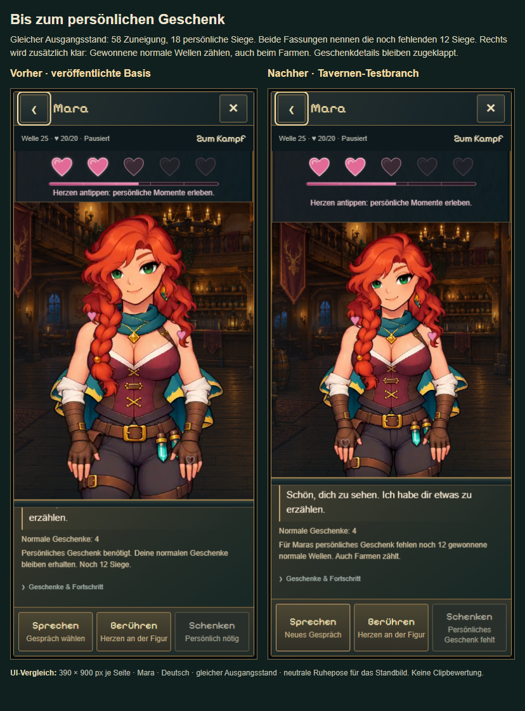
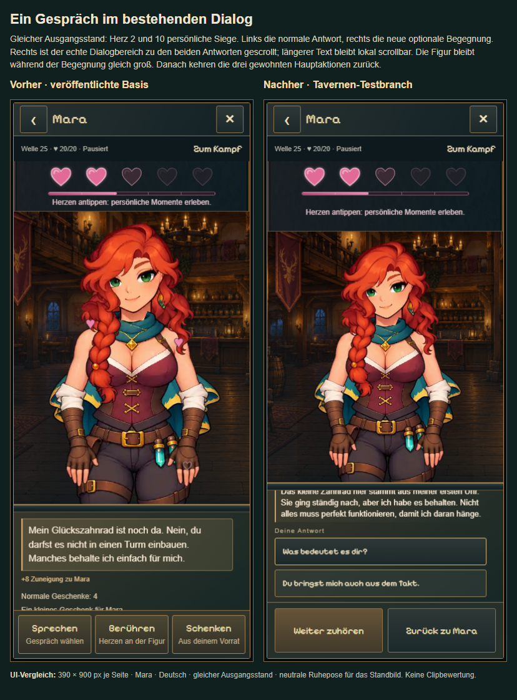
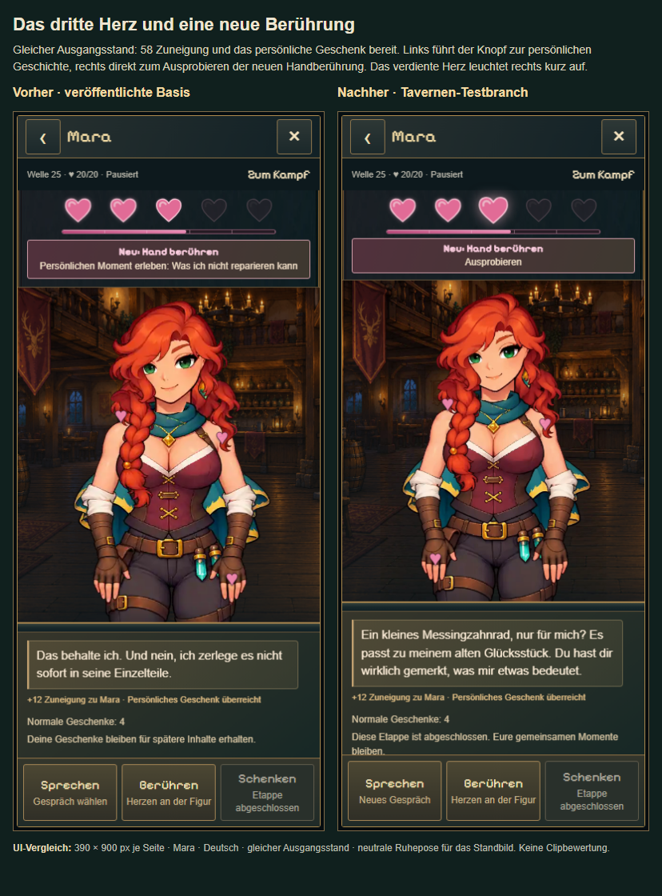
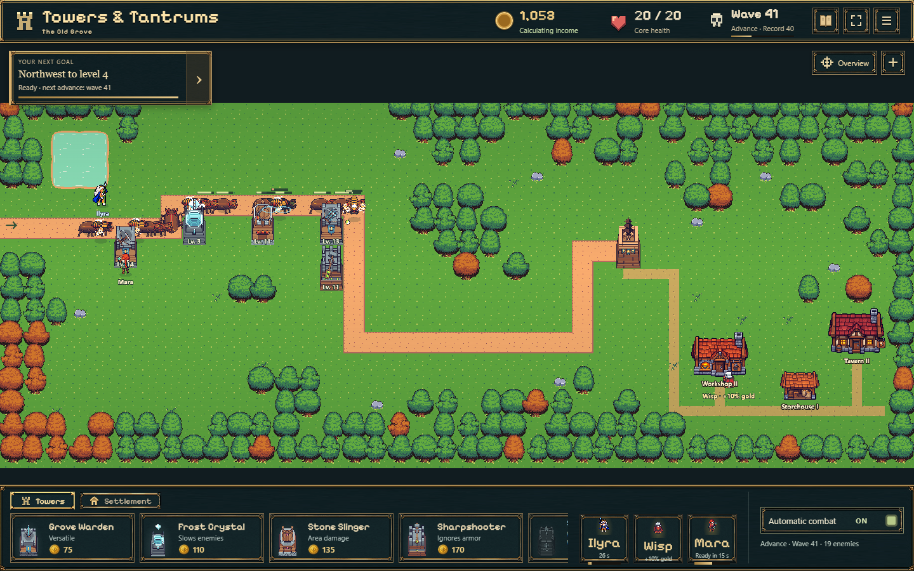
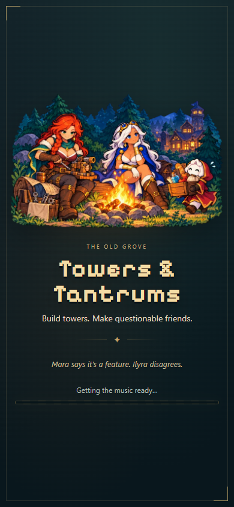
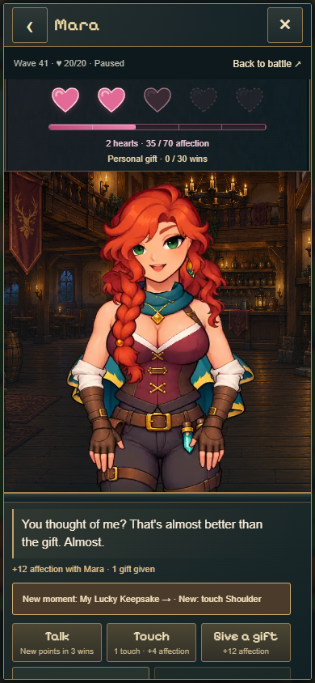
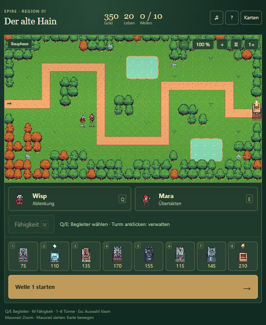
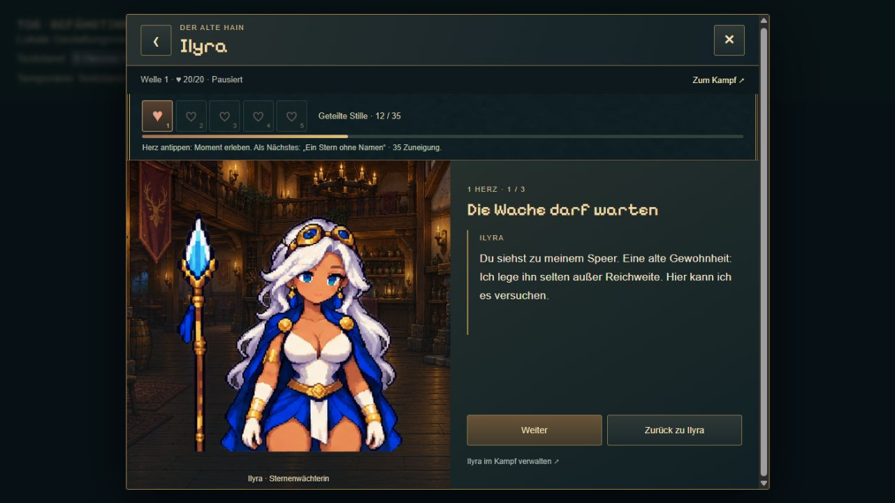

# Towers & Tantrums

*Build towers. Make questionable friends.*


Ein Idle-Tower-Defense-Spiel im Pixelwald: Türme bauen, automatische Wellen abwehren,
die Siedlung ausbauen und zwischen den Kämpfen die Gefährten in der Taverne kennenlernen.
**In Entwicklung · Stand 31.10.2026 · veröffentlicht von `main`.**
Bisheriger Projektname: SPIRE · Idle Bastion.

**[▶ Spielen / fortsetzen](https://emfau88.github.io/TD/)** ·
**[✦ Frische Partie](https://emfau88.github.io/TD/?fresh=1)** ·
**[⚔ Erster Boss · Welle 15](https://emfau88.github.io/TD/feature-check.html?scenario=boss)** ·
**[✧ Ilyra freischalten](https://emfau88.github.io/TD/feature-check.html?scenario=ilyra-unlock)**

Der Frischstart legt einen separaten Spielstand an und erhält deine bisherige Partie.
Seine erzeugte `?probe=…`-Adresse kannst du als Lesezeichen speichern.
Die beiden Teststarts erzeugen ebenfalls jeweils eine separate Partie und starten
pausiert: beim ersten Boss beziehungsweise direkt nach Boss 25 mit vorbereiteter
Taverne II. Oben auf ▶ drücken; Ilyra lässt sich über **Siedlung → Taverne** mit
**„Ilyra kennenlernen“** selbst freischalten. Dein normaler Spielstand bleibt erhalten.
Spielstände liegen lokal im Browser. Englisch ist voreingestellt; Deutsch lässt sich im Spielmenü wählen.

<!-- tavern-preview-start -->
## Taverne und direkte Testzugänge · 07.11.2026

**Beide neuen Szenen direkt testen:** [Mara am Tresen und Ilyra am Fenster – lokale Clipprobe](http://127.0.0.1:5292/) · [einzelne Offline-Datei und Hinweise](artifacts/idle-bastion/tavern-scene-preview-2026-11-07/README.md). Ohne Durchspielen oder Spielstandzugriff. IF01–IF05 freigegeben und als Fensterort integriert. [Ilyra: Einbau und Desktop-/Handyprüfung](artifacts/idle-bastion/ilyra-window-integration-2026-11-07/REPORT.md). [Mara: aktuelle echte Ingame-Screenshots auf Desktop/Handy](artifacts/idle-bastion/tavern-counter-visual-audit-2026-11-07/REPORT.md).

**Auf Main veröffentlicht (`6a2e9fc5`):** Alle sieben Mara-Tresenclips und fünf Ilyra-Fensterclips sind freigegeben und als zusammengehörige Orte eingebunden. Lokal im [Teststarter](http://127.0.0.1:5278/tavern-test.html) „Früher verdiente 4 Herzen“ und Mara oder Ilyra wählen, dann **Sprechen → Zum Tresen / Zum Fenster**. [Prüfbericht und Ingame-Bilder](artifacts/idle-bastion/tavern-counter-completion-2026-11-07/REPORT.md). [Pages-Deploy](https://github.com/emfau88/TD/actions/runs/42401670300) und öffentliche Desktop-/Handyprobe erfolgreich. Der neue Fortschritt von Herz 3 auf 4 bleibt offen; die Orte sind für bereits verdiente vier/fünf Herzen erreichbar.

**Aktueller Hostinghinweis:** Das [Hauptspiel](https://emfau88.github.io/TD/) enthält den übernommenen Tavernenstand. Die beiden öffentlichen Direktlinks unten sind nach der Main-Veröffentlichung vorübergehend nicht erreichbar: GitHub Pages brach die Wiederherstellung nach zehn Minuten ab. Am Entwicklungs-PC funktioniert der [lokale Teststarter](http://127.0.0.1:5278/tavern-test.html). Der Wiederherstellungspunkt bleibt in der Roadmap offen.

**[▶ Taverne direkt im Spiel testen](https://emfau88.github.io/TD/previews/tavern/tavern-test.html)** ·
**[▷ Maras neue Tresenclips ansehen](https://emfau88.github.io/TD/previews/tavern/tavern-counter-check.html)**

Der geprüfte Tavernenstand ist nach `main` übernommen. Die direkten Testlinks zeigen
weiterhin [`codex/tavern-comfy-integration`](https://github.com/emfau88/TD/tree/codex/tavern-comfy-integration)
mit getrennten Testspielständen und der zusätzlichen Tresenprobe.
Der normale Spielen-Link oben führt zum Hauptspiel; dessen aktueller Veröffentlichungsnachweis steht in der Roadmap.

Im Teststarter ist **Herz 3** vorausgewählt: Mara oder Ilyra wählen, Besuch starten
und den gewöhnlichen Rückkehrbeleg bestätigen. Danach öffnet sich die Figur im
**echten Spiel**, mit neuen Clips, Dialogen und Fortschrittshinweisen. Beide Figuren
sind rekrutiert. Jeder Start erzeugt einen eigenen Testspielstand; die Hauptpartie
bleibt erhalten. Die erzeugte Spieladresse lässt sich zum Fortsetzen speichern.
Der Kampf startet pausiert. Weitere Siege gibt es nach Schließen der Taverne und ▶.

Weitere Startpunkte: erster Besuch, Herz 2 mit 10 oder 20 Siegen, 58 Punkte/18 Siege
und 58 Punkte/30 Siege. „Früher verdiente 4 Herzen“ macht zusätzlich Maras bereits vorhandenes Necken prüfbar; es ist kein neuer Herz-4-Ausbau. Damit lassen sich die neuen Gespräche, ein fehlendes
persönliches Geschenk und der tatsächliche Aufstieg zu Herz 3 direkt prüfen.

### Ungefähres Beziehungstempo

Die Zeiten gelten **ab dem ersten Tavernenbesuch**, zusätzlich zum Erspielen der
Taverne nach Welle 12 beziehungsweise Ilyras Rekrutierung nach Boss 25.

| Ziel | Voraussetzung | Größenordnung |
| --- | --- | --- |
| Herz 2 | Drei Gespräche: 0→8→16→23; normales Geschenk→35 | Ein kurzer Besuch, bei ruhigem Lesen grob 30–90 Sekunden. Das ist eine Lese-Schätzung; schnelle Klicks können kürzer sein. Keine Mindestzeit. |
| Herz 3 | 58 Zuneigung, 30 gewonnene normale Livewellen seit dem eigenen Herz 2, persönliches Geschenk bewusst überreichen | Drei geprüfte reguläre Farmaufbauten brauchen etwa 10–12 Minuten Kampfzeit, dazu Besuche und Lesen. Beide bereits auf Herz 2 stehenden Figuren sammeln dieselben Siege parallel. |

Normale Geschenke ersetzen die 30 Siege nicht. Farmen zählt; Bosskämpfe, Niederlagen
und Offlinegold zählen nicht. In der offenen Taverne pausiert der Kampf. Eine harte
Fünf-Minuten-Grenze existiert nicht: ein eigens gesetzter Einstiegwellen-Randfall
benötigte 4:41 Minuten. [Messung und Grenzen](artifacts/idle-bastion/tavern-implementation-2026-11-07/bulk4-timing/REPORT.md).
Die vorhandene Siegebremse wurde erhalten; neu sind vor allem ihre klare Erklärung
und die Begegnungen bei 10/20 Siegen. Geschenkzufluss und Vorratsgrenze bleiben
vorerst bei einem normalen Geschenk je zehn Siege und höchstens 20 im Vorrat.

### Was enthalten ist und was noch fehlt

| Bereich | Stand in diesem Branch |
| --- | --- |
| Bestehende Taverne | 17 freigegebene Standardanimationen inklusive eigener Handreaktionen M09/I08. Berührungsherzen am PC größer; I07-Größenkorrektur zur Sichtprüfung. Direkte Fortsetzung nach Fensterwechsel. Originale im Repo archiviert. |
| Verständlichkeit | Kurzer passender Fortschrittshinweis, erklärbare gesperrte Herzen, sichtbare persönliche Geschenkübergabe und dezenter Herzglanz. Details bleiben im vorhandenen aufklappbaren Bereich. |
| Mobile Darstellung | Die Figur bleibt beim Öffnen von Herzmomenten und Gesprächen gleich groß. Längere Texte und Antworten lassen sich im Textbereich scrollen. Der dunkle Übergang bei Komplimenten wurde durch die normale kurze Bildüberblendung ersetzt. |
| Weg Herz 2→3 | Je Figur zwei neue optionale Gespräche mit gleichwertigen Antworten, gespeicherter Erinnerung und neutralem Zweig. Beide Antworten stehen direkt in der unteren Aktionsleiste. Siedlung/Taverne und Figuren zeigen neue oder fortsetzbare Gespräche an. Keine zusätzlichen Aufstiegspflichten. |
| Mara am Tresen | MC01–MC07 freigegeben. Vollständige lokale Szene mit eigenem Raum, passenden Berührungspunkten und vorhandenen Stimmen. Für bereits verdientes Herz 4 über Sprechen erreichbar. |
| Weitere Tresenrollen | MC04/Schulter, MC06/Lachen, neue MC07/Annäherung ausdrücklich freigegeben und integriert. Alte Vorbeuge-V2 bleibt erhalten. |
| Ilyra am Fenster, Herz 4/5 | [IF01–IF03 als geprüfte Proben fertig](artifacts/idle-bastion/ilyra-window-probes-2026-11-07/REPORT.md), Nutzerfreigabe offen. Keine Integration des Teilsets. Restliche Clips, neue Fortschrittsbedingungen, Begegnungen und Geschenkbilanz bleiben offen. |
| Outfits und weitere Posen | Zukunftsideen. Keine laufende Generierung. |
| Abschließende Abnahme | Main-Übernahme vom Nutzer beauftragt und erfolgt. Der lokale Testzugang ist verfügbar; die öffentlichen Direktlinks müssen nach dem Pages-Fehler wiederhergestellt werden. Eine ausdrückliche Sichtabnahme der letzten I07-Größenkorrektur und eine gemeinsame Bewertung des Tempos werden dadurch nicht als erfolgt behauptet. |

### Reaktionssounds

Mara verwendet ihren bestehenden Pool aus **10 WAVs**, Ilyra ihren eigenen aus
**7 MP3s**. Zufällige Auswahl ohne unmittelbare Wiederholung; laufende Stimmen
werden nicht überlagert oder durch neue Taps neu gestartet, mindestens 2,5 Sekunden
zwischen Starts. Stimmenregler, Stummschalten, Figurenwechsel und Schließen gelten
weiter. Die englischen Poolzeilen sind Reaktionsstimmen, keine wortgetreue Vertonung
der geschriebenen deutschen/englischen Dialoge.

| Situation | Verknüpfung |
| --- | --- |
| Schulter, Haare, Hand; auch neue M09/I08 | Jeweils der Pool der ausgewählten Figur. |
| Zusammen lachen, Kompliment | Jetzt ebenfalls der passende Figurenpool. |
| Mara necken | Maras Pool, sobald die Geste tatsächlich freigeschaltet ist. |
| Neue Flirtantworten | Mara: „Du bringst mich auch aus dem Takt.“ und „Weniger Werkzeug, mehr Ablenkung?“; Ilyra: „Such mich ruhig öfter.“ Jeweils erst nach erfolgreichem Speichern der Auswahl. |
| Ruhige/ernste Antworten, normales Plaudern, Weiter, Fortsetzen, Rückblicke und Idle | Keine zusätzliche zufällige Stimme. Geschenk-/Herzklänge bleiben erhalten. |
| Separate Tresenprobe | MC05/Hand und MC03/Haare verwenden Maras Pool; MC01/Idle und MC02/Gespräch bleiben ohne zusätzliche Reaktionsstimme. |

### UI vorher und nachher

Drei echte Vergleiche mit gleichem Ausgangsstand; links veröffentlichte Basis,
rechts der Testbranch. Die vertrauten drei Hauptaktionen bleiben erhalten.

**1. Fehlende Siege verständlicher:** Schon vorher wurden die zwölf fehlenden Siege genannt. Jetzt sind normale Wellen und Farmen ausdrücklich erklärt.



**2. Neue Begegnung im vorhandenen Dialog:** Zwei persönliche Antworten auf dem Weg zu Herz 3; nach dem Gespräch kehren die gewohnten drei Aktionen zurück. Dieses Vergleichsbild dokumentiert den ersten Dialogstand mit gescrollten Antworten. Nach dem anschließenden Nachschliff stehen sie sofort sichtbar in der unteren Leiste: [aktuelle Handyansicht](artifacts/idle-bastion/tavern-discovery-2026-11-07/local/de-320-mara-answers.png). Der bestehende Tavernenzugang zeigt außerdem [neue Gespräche](artifacts/idle-bastion/tavern-discovery-2026-11-07/local/de-320-notice.png) an.



**3. Neue Berührung direkt ausprobieren:** Nach Herz 3 führt „Ausprobieren“ zur Handreaktion. Der persönliche Herzmoment bleibt über das Herz erreichbar; das verdiente Herz leuchtet kurz auf.



[Quellen, unveränderte Einzelaufnahmen und Vergleichsmethode](artifacts/idle-bastion/tavern-ui-comparison-2026-11-07/NOTES.md).

[Tavernenplan mit aktuellem Status](experiments/idle-bastion/docs/TAVERNE_AUSBAUPLAN_2026-11-06.md) ·
[Technische Nachweise](artifacts/idle-bastion/tavern-implementation-2026-11-07/REPORT.md)
<!-- tavern-preview-end -->

## Turmentwicklung

Alle fünf Türme entwickeln sich sichtbar auf Level **1 · 2 · 3 · 5 · 10 · 15 · 20 · 25**,
mit kompakten Skins, passenden Projektilen und abgestuften Impacts. Kampfwerte,
Speicherformat und Offline-Regeln bleiben erhalten.
[Integrationsprüfung](artifacts/idle-bastion/acceptance/tower-evolution-playtest/MAIN_INTEGRATION.md).

Der [separate Teststarter](https://emfau88.github.io/TD/previews/tower-evolution/tower-test.html)
bleibt im Branch `codex/tower-evolution-playtest` isoliert. Seine Probe-Links verwenden
eigene Spielstände und Testgold; sie werden nicht in Hauptspielstände umgewandelt.
Lokal nur mit `VITE_FEATURE_PREVIEW=1` starten (PowerShell: `$env:VITE_FEATURE_PREVIEW='1'`),
dann `npm run idle:dev` und `/tower-test.html`. Normale Builds enthalten keinen Turmteststarter.

## So sieht es heute aus · 27.10.2026

**Verteidigung und Siedlung auf Desktop:** mehrere Turmrollen, Gefährten am Weg und
Werkstatt, Lager sowie Taverne beim Kern. Welle 40 ist ein Zwischenziel; das Spiel geht danach weiter.



| Neuer Ladebildschirm | Mara in der Taverne |
| --- | --- |
| <a href="artifacts/idle-bastion/acceptance/loading-polish-2026-10-27/loading-390.png"></a> | <a href="artifacts/idle-bastion/readme/2026-10-27/tavern-mobile.png"></a> |
| Freigestelltes Lagerfeuer mit Mara, Ilyra und Wisp; drei zufällige Ladezeilen. | Gespräche, persönliche Momente und schrittweise freigeschaltete Berührungen. |

Alle drei Aufnahmen zeigen den Spielcode vom **27.10.2026**. Desktop und Taverne stammen
aus dem lokalen Produktionsbuild mit einem vorbereiteten Testspielstand nach Welle 40.
Der Ladescreen wurde für die Aufnahme kurz angehalten; sein Fortschritt bleibt im Spiel an das tatsächliche Laden gebunden.
Hochkant wurde im Browser aufgenommen. Bilder anklicken für die volle Größe.

## Was bereits spielbar ist

- **Fünf Türme:** Grove Warden, Frost Crystal, Stone Slinger, Sharpshooter und Stormlight;
  Forschung, Upgrades, verschiedene Gegnergruppen und Bosskämpfe.
- **Idle-Fortschritt:** sichere Wellen farmen, mit Upgrades weiter vorstoßen und
  Offline-Gold erhalten. Das Vorratslager verlängert die Offline-Zeit.
- **Siedlung und Gefährten:** Werkstatt, Lager und Taverne; Mara verstärkt Türme,
  Wisp verbessert den Goldnachschub, Ilyra nutzt ihre Sternensalve.
  Taverne I wird nach Welle 12 verfügbar, Taverne II und Ilyra nach Boss 25.
- **The Last Cozy Corner:** unsere Taverne mit getrennten Beziehungen zu Mara und Ilyra, Gespräche, Geschenke und
  wiederholbare Herzmomente. Die aktuelle Etappe reicht bis **drei Herzen**;
  weitere Etappen folgen später. Freigeschaltete Berührungen bleiben gemeinsam nutzbar.
- **Desktop und Hochkant:** verschiebbare Karte, kompakter Baukatalog,
  14 Tutorialschritte sowie getrennte Regler für Musik, Effekte und Stimmen.

Neuer Name und Ladebild: **Towers & Tantrums** mit einem Lagerfeuerbild und drei Ladezeilen.
Zuletzt verbessert: frühe Musik- und Klickrückmeldung, Tutorialzähler und Buttons,
automatischer Kampffortgang nach dem ersten Upgrade, Maras Kamerafokus,
mittige Gebäudeplatzierung und das Geschenksymbol an der Tavernenkachel.
Die alte Umzugsoption für frühere Spielstände ist entfernt.

## Entwicklung in Bildern

Die Bilder oben sind der aktuelle Stand. Frühere Aufnahmen zeigen andere Regeln,
Oberflächen oder reine Entwürfe; sie sind **kein Abbild der heutigen Version**.

| Dokumentiert am | Früherer Stand |
| --- | --- |
| 16.10.2026 | [Klassische Karten](artifacts/screenshots): der Vorgänger mit mehreren Regionen, vor dem heutigen Idle-Spiel. |
| 20.10.2026 | [Siedlung am Kern](artifacts/idle-bastion/acceptance/b17a/REPORT.md): frühe Gebäude- und Kartenanordnung, damals mit Umzugsoption. |
| 21.10.2026 | [Ilyras erste Tavernenansicht](artifacts/idle-bastion/acceptance/t06/REPORT.md): ältere Oberfläche und damalige Fünf-Herzen-Proben. |
| 25.10.2026 | [Zaubereffekt-Entwürfe V3](artifacts/idle-bastion/previews/ability-art/REVIEW.md): Vergleichsaufnahmen vor der Integration ins Hauptspiel. |

<details>
<summary>Zwei ältere Bildstände zum Vergleichen</summary>

**Vorgänger · im Repository seit 16.10.2026**



**Ilyras frühe Tavernenansicht · dokumentiert am 21.10.2026**



[Archiv der bisherigen ausführlichen README](README_HISTORY_2026-10-27.md) ·
[Klassischer Code vom 21.10.2026](https://github.com/emfau88/TD/tree/archive/classic-td-2026-10-21)

</details>

## Teststarts und Dokumentation

[Figuren und Frost ausprobieren](https://emfau88.github.io/TD/feature-check.html) ·
[Bewegte Gegnervorschau](https://emfau88.github.io/TD/enemy-lab.html) ·
[Audioquellen](https://emfau88.github.io/TD/audio-credits.html) ·
[Gegnergrafiken und Lizenzen](https://emfau88.github.io/TD/enemy-credits.html)

Die Figuren-/Frost-Teststarts legen separate Spielstände an.
Die [fortlaufende Roadmap](experiments/idle-bastion/ROADMAP.md) ist die einzige aktuelle Aufgabenliste.
[Technik und Speicherung](experiments/idle-bastion/docs/TECHNIK.md) ·
[Tavernenfortschritt](artifacts/idle-bastion/acceptance/t12/REPORT.md) ·
[Letzte Bedienprüfung mit Screenshots](artifacts/idle-bastion/acceptance/entry-polish-2026-10-27/REPORT.md).

## Lokal entwickeln

Node.js 22 und npm:

```sh
npm ci
npm run dev       # Entwicklung
npm run build     # Produktionspaket in dist/
npm run preview   # Gebautes Spiel ansehen
npm test          # Tests des aktuellen Spiels
```

Aktiver Spielcode: `experiments/idle-bastion/`. GitHub Pages veröffentlicht ausschließlich
`main`. `classic:*` und `reference:*` gehören zu den erhaltenen Vorgängern.
Prüfergebnisse und bekannte Einschränkungen stehen in den jeweiligen Berichten;
eine vollständige Smartphone-Hardwareabnahme wird daraus nicht abgeleitet.
