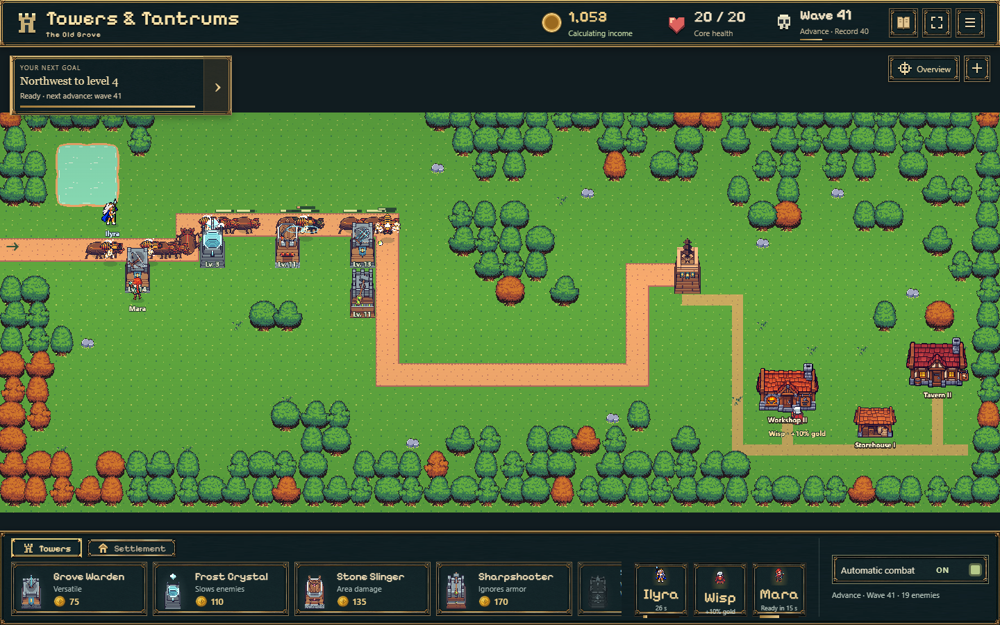
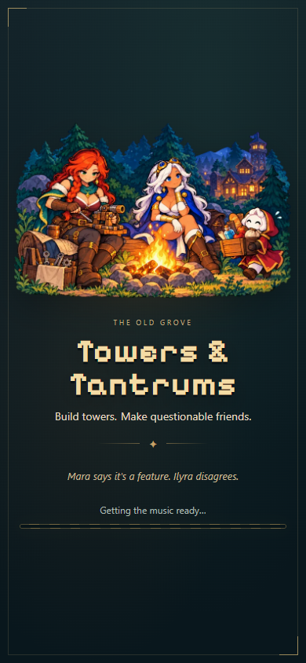
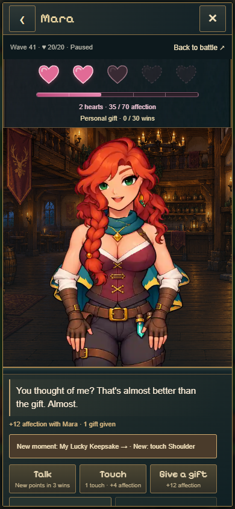

# Towers & Tantrums · isolierter Turmtest

**Branch: `codex/tower-evolution-playtest` · nicht in `main` integriert.**

## [▶ Beide erweiterten Türme lokal testen](http://127.0.0.1:5192/tower-test.html)

Der lokale Testserver läuft während der Abnahme. **[Vorgesehener öffentlicher Testlink](https://emfau88.github.io/TD/previews/tower-evolution/tower-test.html): noch nicht freigeschaltet.** GitHub Pages erlaubt bislang nur Main und ältere Testbranches. Die automatische Freigabeprüfung verlangt eine ausdrückliche Zustimmung, genau diesen neuen Branch in die bestehende Freigabeliste aufzunehmen.

Waldwächter und Frostkristall mit den kompakten Skins **1 · 2 · 3 · 5 · 10 · 15 · 20 · 25**, passenden Projektilen und Frost-Angriffsanimationen.

1. Auf der Testseite beide Turmarten, Waldwächter oder Frostkristall wählen. Alle acht Stufen oder eine bestimmte Stufe sind direkt verfügbar.
2. „Zur pausierten Verteidigung“ / „Return to paused defense“ bestätigen. Mit ▶ oben den echten Kampf starten; Türme anklicken, aufwerten, Pause/Zoom und Reload ausprobieren.
3. Die erzeugte `?probe=tower-…`-Adresse als Lesezeichen speichern, um genau diesen Test fortzusetzen. Über das Spielmenü zur Testauswahl zurückkehren.

Jeder Start erstellt einen **separaten Spielstand**. Auch [eine frische normale Partie dieses Branches](https://emfau88.github.io/TD/previews/tower-evolution/?fresh=1) bleibt vollständig von deiner Hauptpartie getrennt. Der vorbereitete Grafiktest verwendet eine Karte nach Welle 40 mit neu zusammengestellten Türmen und 100.000 Testgold; er ist kein Balancetest. Kampfwerte, Saveformat und Offline-Regeln wurden nicht geändert. Kein Kongregate-Export.

**Geprüft:** 428/428 Tests, Produktionsbuild; [Prüfbericht und echte Spielaufnahmen](artifacts/idle-bastion/acceptance/tower-evolution-playtest/REPORT.md).

Der Testlink ist eine temporäre Pages-Unterseite. Nach einer späteren Main-Veröffentlichung gegebenenfalls den Workflow **Deploy SPIRE** auf diesem Branch erneut ausführen. Lokal selbst starten: `npm ci`, `npm run idle:dev -- --port 5193`, dann `http://127.0.0.1:5193/tower-test.html` (separater Port zum Hauptspiel).

---

## Beschreibung der unveränderten Hauptfassung

*Build towers. Make questionable friends.*

Ein Idle-Tower-Defense-Spiel im Pixelwald: Türme bauen, automatische Wellen abwehren,
die Siedlung ausbauen und zwischen den Kämpfen die Gefährten in der Taverne kennenlernen.
**In Entwicklung · Stand 27.10.2026 · veröffentlicht von `main`.**
Bisheriger Projektname: SPIRE · Idle Bastion.

**[▶ Spielen / fortsetzen](https://emfau88.github.io/TD/)** ·
**[✦ Frische Partie](https://emfau88.github.io/TD/?fresh=1)**

Der Frischstart legt einen separaten Spielstand an und erhält deine bisherige Partie.
Seine erzeugte `?probe=…`-Adresse kannst du als Lesezeichen speichern.
Spielstände liegen lokal im Browser. Englisch ist voreingestellt; Deutsch lässt sich im Spielmenü wählen.

## So sieht es heute aus · 27.10.2026

**Verteidigung und Siedlung auf Desktop:** mehrere Turmrollen, Gefährten am Weg und
Werkstatt, Lager sowie Taverne beim Kern. Welle 40 ist ein Zwischenziel; das Spiel geht danach weiter.



| Neuer Ladebildschirm | Mara in der Taverne |
| --- | --- |
| <a href="artifacts/idle-bastion/acceptance/loading-polish-2026-10-27/loading-390.png"></a> | <a href="artifacts/idle-bastion/readme/2026-10-27/tavern-mobile.png"></a> |
| Freigestelltes Lagerfeuer mit Mara, Ilyra und Wisp; drei zufällige Ladezeilen. | Gespräche, persönliche Momente und schrittweise freigeschaltete Berührungen. |

Alle drei Aufnahmen zeigen den Spielcode vom **27.10.2026**. Desktop und Taverne stammen
aus dem lokalen Produktionsbuild mit einem vorbereiteten Testspielstand nach Welle 40.
Der Ladescreen wurde für die Aufnahme kurz angehalten; sein Fortschritt bleibt im Spiel an das tatsächliche Laden gebunden.
Hochkant wurde im Browser aufgenommen. Bilder anklicken für die volle Größe.

## Was bereits spielbar ist

- **Fünf Türme:** Grove Warden, Frost Crystal, Stone Slinger, Sharpshooter und Stormlight;
  Forschung, Upgrades, verschiedene Gegnergruppen und Bosskämpfe.
- **Idle-Fortschritt:** sichere Wellen farmen, mit Upgrades weiter vorstoßen und
  Offline-Gold erhalten. Das Vorratslager verlängert die Offline-Zeit.
- **Siedlung und Gefährten:** Werkstatt, Lager und Taverne; Mara verstärkt Türme,
  Wisp verbessert den Goldnachschub, Ilyra nutzt ihre Sternensalve.
  Taverne I wird nach Welle 12 verfügbar, Taverne II und Ilyra nach Boss 25.
- **The Last Cozy Corner:** unsere Taverne mit getrennten Beziehungen zu Mara und Ilyra, Gespräche, Geschenke und
  wiederholbare Herzmomente. Die aktuelle Etappe reicht bis **drei Herzen**;
  weitere Etappen folgen später. Freigeschaltete Berührungen bleiben gemeinsam nutzbar.
- **Desktop und Hochkant:** verschiebbare Karte, kompakter Baukatalog,
  14 Tutorialschritte sowie getrennte Regler für Musik, Effekte und Stimmen.

Neuer Name und Ladebild: **Towers & Tantrums** mit einem Lagerfeuerbild und drei Ladezeilen.
Zuletzt verbessert: frühe Musik- und Klickrückmeldung, Tutorialzähler und Buttons,
automatischer Kampffortgang nach dem ersten Upgrade, Maras Kamerafokus,
mittige Gebäudeplatzierung und das Geschenksymbol an der Tavernenkachel.
Die alte Umzugsoption für frühere Spielstände ist entfernt.

## Entwicklung in Bildern

Die Bilder oben sind der aktuelle Stand. Frühere Aufnahmen zeigen andere Regeln,
Oberflächen oder reine Entwürfe; sie sind **kein Abbild der heutigen Version**.

| Dokumentiert am | Früherer Stand |
| --- | --- |
| 16.10.2026 | [Klassische Karten](artifacts/screenshots): der Vorgänger mit mehreren Regionen, vor dem heutigen Idle-Spiel. |
| 20.10.2026 | [Siedlung am Kern](artifacts/idle-bastion/acceptance/b17a/REPORT.md): frühe Gebäude- und Kartenanordnung, damals mit Umzugsoption. |
| 21.10.2026 | [Ilyras erste Tavernenansicht](artifacts/idle-bastion/acceptance/t06/REPORT.md): ältere Oberfläche und damalige Fünf-Herzen-Proben. |
| 25.10.2026 | [Zaubereffekt-Entwürfe V3](artifacts/idle-bastion/previews/ability-art/REVIEW.md): Vergleichsaufnahmen vor der Integration ins Hauptspiel. |

<details>
<summary>Zwei ältere Bildstände zum Vergleichen</summary>

**Vorgänger · im Repository seit 16.10.2026**


**Ilyras frühe Tavernenansicht · dokumentiert am 21.10.2026**


[Archiv der bisherigen ausführlichen README](README_HISTORY_2026-10-27.md) ·
[Klassischer Code vom 21.10.2026](https://github.com/emfau88/TD/tree/archive/classic-td-2026-10-21)

</details>

## Teststarts und Dokumentation

[Figuren und Frost ausprobieren](https://emfau88.github.io/TD/feature-check.html) ·
[Bewegte Gegnervorschau](https://emfau88.github.io/TD/enemy-lab.html) ·
[Audioquellen](https://emfau88.github.io/TD/audio-credits.html) ·
[Gegnergrafiken und Lizenzen](https://emfau88.github.io/TD/enemy-credits.html)

Die Figuren-/Frost-Teststarts legen separate Spielstände an.
Die [fortlaufende Roadmap](experiments/idle-bastion/ROADMAP.md) ist die einzige aktuelle Aufgabenliste.
[Technik und Speicherung](experiments/idle-bastion/docs/TECHNIK.md) ·
[Tavernenfortschritt](artifacts/idle-bastion/acceptance/t12/REPORT.md) ·
[Letzte Bedienprüfung mit Screenshots](artifacts/idle-bastion/acceptance/entry-polish-2026-10-27/REPORT.md).

## Lokal entwickeln

Node.js 22 und npm:

```sh
npm ci
npm run dev       # Entwicklung
npm run build     # Produktionspaket in dist/
npm run preview   # Gebautes Spiel ansehen
npm test          # Tests des aktuellen Spiels
```

Aktiver Spielcode: `experiments/idle-bastion/`. GitHub Pages veröffentlicht ausschließlich
`main`. `classic:*` und `reference:*` gehören zu den erhaltenen Vorgängern.
Prüfergebnisse und bekannte Einschränkungen stehen in den jeweiligen Berichten;
eine vollständige Smartphone-Hardwareabnahme wird daraus nicht abgeleitet.
