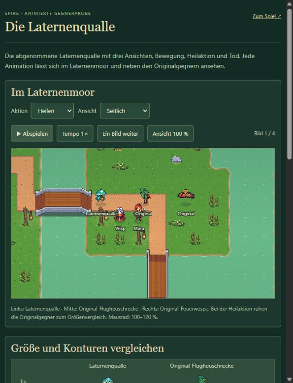

# Laternenqualle – abgenommener Pixelstil und vollständige Einheit

Stand: 17. Oktober 2026. Die erste seitliche Bewegungsprobe wurde mit **„ja passt gut“** vom Nutzer abgenommen. Anschließend sind weitere Ansichten, Heilung, Tod und die Integration ins Laternenmoor umgesetzt. Die Abnahme der Probe wird nicht als pauschale Abnahme der abschließenden Kampfbalance ausgegeben.

## Grafikproduktion

Fünf Aufträge mit dem eingebauten Imagegen-Werkzeug, alle Rohquellen erhalten:

| Auftrag | Prompt | Quelle | Verwendung |
| --- | --- | --- | --- |
| Erste Seitenprobe | [prompt.txt](prompt.txt) | [movement-source.png](movement-source.png) | Sechs vom Nutzer abgenommene Bewegungsbilder |
| Weitere Ansichten | [directions-prompt.txt](directions-prompt.txt) | [directions-source.png](directions-source.png) | Sechs Rückansichten; Frontposen berührten einander und wurden verworfen |
| Heilung | [heal-prompt.txt](heal-prompt.txt) | [heal-source.png](heal-source.png) | Vier Körperposen je Ansicht |
| Tod | [death-prompt.txt](death-prompt.txt) | [death-source.png](death-source.png) | Fünf zusammenfallende Körperposen je Ansicht |
| Getrennte Frontbewegung | [down-prompt.txt](down-prompt.txt) | [down-source.png](down-source.png) | Sechs Frontposen mit ausreichenden Abständen |

`scripts/prepare-jelly-atlas.mjs` verwendet einzeln vermessene Rechtecke und Anker, einen gemeinsamen Maßstab je Sequenz sowie dieselbe 14-Farben-Palette. Konturen sind im Laufzeitexport vollständig transparent oder deckend. Die ursprünglichen sechs Seitenframes werden bytegleich aus dem abgenommenen Export übernommen; keine pro Pose unabhängig gestreckten Figuren und kein pauschales Raster über die Generationsbilder.

Laufzeit: [Lantern Jelly Pixel v1.png](../../../../public/assets/Lantern%20Jelly%20Pixel%20v1.png), **512 × 384 Pixel mit 48 Rahmen à 64 × 64**. 45 unterschiedliche Posen; die drei Ruheframes verwenden jeweils die erste Bewegungspose erneut. Pro Richtung: Ruhe 1, Bewegung 6, Heilen 4, Tod 5, je 100 ms. Darstellung 0,83, zentraler Ursprung. [Metadaten mit Quellenmaßen](complete-metadata.json), [vergrößerter Atlas](complete-atlas-2x.png).

## Fähigkeit und Einsätze

Die Qualle fliegt und besitzt 85 Basisleben, Tempo 43, keine Rüstung, 20 Gold Belohnung und verursacht einen Lebenspunkt Schaden am Ziel. Bestehende Wellenskalierung gilt weiterhin. Alle zwei Sekunden heilt sie bis zu zwei verletzte Verbündete um sechs Lebenspunkte im Radius 100. Ihre Aktion dauert 0,4 Sekunden, der Puls erfolgt nach 0,2 Sekunden. Sie schwebt dabei weiter; Blickrichtung und Körperaktion bleiben für diese kurze Zeit stabil.

Heiler, Bosse, tote Gegner und Selbstheilung sind ausgeschlossen. Heilung überschreitet keine maximalen Lebenspunkte. Ein Ziel wird innerhalb von zwei Sekunden höchstens einmal geheilt. Schadensbedingte Todesfälle werden vor dem Heilpuls aufgelöst. Kurze Linien, Ringe und Zahlen kennzeichnen die tatsächlich geheilten Ziele.

Nur Laternenmoor: Welle 4 enthält einen Heiler, Welle 7 und 9 je zwei. Das Moor hat dadurch 138 Gegner; die anderen Karten behalten 133. Die Wellenvorschau nennt die neue Einheit, Welle 4 erklärt die Heilrolle und Luftabwehr. Neue Speicherformate oder ein Zurücksetzen bestehender Bauphasen sind nicht nötig.

## Ansehen und bauen

- Normales Spiel: `npm run reference:regions:build`, dann `REGIONEN STARTEN.cmd`.
- Animations- und Kampfvorschau: `npm run reference:enemy:build`, dann `GEGNERPROBE STARTEN.cmd`.
- Entwicklung: `/enemy-preview.html`; erzeugte Vorschau: `/Spire-Gegnerprobe.html`.

Die separate Probe bietet Aktionen, Richtungen, Pause, Tempo, Einzelbilder und Zoom sowie vorbereitete Moorwellen 4 und 7 mit sichtbarem Heilzähler. Beide Vorschau-Simulationen sind unabhängig von den Nutzer-Spielständen.

## Gezielte Prüfung

- Sieben Logikprüfungen bestanden: fünf Heilerchecks plus zwei vorhandene Prüfungen zu Zehn-Wellen-Plan und alter Speicherübernahme. Heilobergrenze, Zielauswahl, Stapelung, Castzeit und Tod sind abgedeckt.
- Moor mit bestehendem Budget und vorhandenem Turmkader vollständig im Modell gewinnbar: 20 Leben, 138 Kills, acht Türme, 295 simulierte Kampfsekunden. Das ist kein Nachweis abgeschlossener manueller Balance.
- Ein Atlascheck bestanden: binäres Alpha, freie Rahmenränder, verschiedene Aktionsposen, sichtbares Zusammenfallen beim Tod und bytegleiche abgenommene Seitenbewegung.
- TypeScript, Regionsbuild und Gegnerprobe gebaut. Beide Offline-Prüfungen bestätigen 92 bytegleiche eingebettete Spielbilder plus sieben UI-Bilder und keine externen Skript-/Stil-/Bildabhängigkeiten.
- Im Browser drei Ansichten, Heilpose und einmalige Todesfolge angesehen. Prüfwelle 4 lief vollständig mit acht Impulsen und 48 geheilten Lebenspunkten; Prüfwelle 7 mit 16 Impulsen und 109 geheilten Lebenspunkten. Keine anderen Karten vollständig nachgetestet.
- Offline-Bundles werden über den lokalen Server angesehen. Direkter Start mit `file://` ist nicht zusätzlich getestet. Vorhandene Nutzer-Spielstände bleiben unangetastet.

Die erste Seitenprobe und ihre Aufnahme [moor-preview.jpg](moor-preview.jpg) bleiben als abgenommene Vergleichsbasis erhalten. Die vollständige Einheit ist die Grundlage für mögliche weitere Spezialgegner; deren Grafikproduktion erfolgt erst nach konkreter Auswahl.
