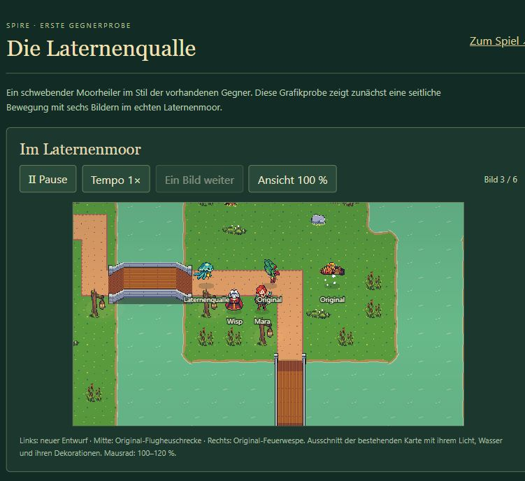

# Laternenqualle – erste animierte Stilprobe

Stand: 17. Oktober 2026. **Sechs seitliche Bewegungsframes erstellt und im Laternenmoor angesehen; visuelle Nutzerabnahme offen.** Die Einheit besitzt noch keine weiteren Ansichten, Heil- oder Todesanimation und ist noch kein Gegner im normalen Spiel.

## Ergebnis und Herkunft

Eine Generation mit dem eingebauten Imagegen-Werkzeug. Die alte Laternenqualle wurde ausschließlich als Motivvorlage verwendet; Original-Blattkäfer und Leerenfalter bestimmten den Pixelstil. Vollständiger Auftrag: [prompt.txt](prompt.txt). Unveränderte Generationsquelle: [movement-source.png](movement-source.png).

Die sechs tatsächlichen Quellausschnitte und Glockenanker wurden einzeln vermessen. `scripts/prepare-jelly-preview.mjs` exportiert sie mit einheitlichem Maßstab 0,1 in 64er Rahmen, reduziert die Laufzeitpalette auf 14 Farben und normalisiert Alpha bei 128 auf 0/255. Es werden keine unabhängig auf gleiche Breite gestreckten Posen verwendet. Die Quelle bleibt erhalten.

Export: [Lantern Jelly Pixel Preview v1.png](../../../../public/assets/Lantern%20Jelly%20Pixel%20Preview%20v1.png), 384 × 64 Pixel. Metadaten: [movement-metadata.json](movement-metadata.json). Animationsfolge: sechs Frames zu je 100 ms; Darstellung mit Maßstab 0,83. Die sichtbare Silhouette ist je nach Tentakelstellung 27–39 Quellpixel breit und 30–32 hoch. [Vergrößerte Bildfolge](movement-frames-3x.png).

## Ansehen und bauen

- Laufender Entwicklungsserver: `http://127.0.0.1:5180/enemy-preview.html`.
- Offline bauen: im Projektverzeichnis `npm run reference:enemy:build`.
- Danach `GEGNERPROBE STARTEN.cmd` öffnen; Ausgabe: `reference/Spire-Gegnerprobe.html`.

Die eigene Vorschauseite verwendet den echten Moor-Renderer und eine eigene Simulation. Sie importiert keine Speicherverwaltung und verändert keine Spielstände. Neue Qualle, Original-Flugheuschrecke und Original-Feuerwespe werden gemeinsam gezeigt. Es gibt Pause, 1×/2×, Einzelbilder, 100/120-%-Zoom, einen Größenvergleich und die sechs Einzelbilder.

## Gezielte Prüfung

- TypeScript-Prüfung und eigener Offline-Build; keine vollständige Kartentestserie.
- Im Browser Bewegung, Originalgegnervergleich, Pause, Einzelbild, Tempoauswahl und 120-%-Darstellung angesehen. Keine Warnungen oder Fehler im Vorschautab während dieser Prüfung.
- Export kontrolliert Rahmenüberläufe; alle sechs Figuren halten Abstand zum Frame-Rand.
- Erzeugte Offline-Ausgabe `Spire-Gegnerprobe.html` separat über den lokalen Browser geöffnet: Moor, Qualle und Originalflieger werden aus dem Bundle angezeigt; keine Warnungen oder Fehler im Vorschautab. Ausgabe enthält 92 eingebettete Spielbilder und sieben UI-Bilder, etwa 15,83 MB. Der direkte Start über `file://` wurde nicht zusätzlich geprüft.

## Nächster Schritt

Stil, Größe und Bewegung anhand der animierten Probe beurteilen. Gemäß [Produktionsplan](../../../../GEGNER_PRODUKTIONSPLAN.md) folgt nach der visuellen Abnahme die Vervollständigung der Richtungen, Heilaktion und Todesanimation. Weitere Gegnerpakete wurden nicht erzeugt. Regionale Wellenpläne und Heillogik bleiben unverändert.
