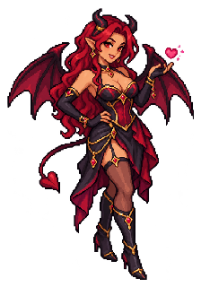
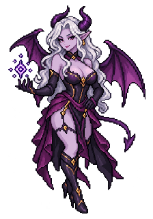
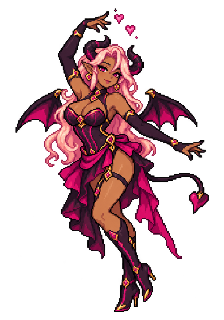

# Succubus – Designauswahl

Stand: 17. Oktober 2026. **Der Nutzer hat Variante 3 gewählt: „die nummer 3 soll es werden“.** Die anschließende Umsetzung wurde ausdrücklich beauftragt und ist als „Rosenspiegel“ in Windbruch integriert. Diese Datei erhält die ursprüngliche Entwurfsentscheidung. [Aktueller Produktionsstand mit dritter Grafikfassung](../production-v3/REPORT.md); die Nutzerabnahme dieser Überarbeitung steht aus.

| 1 · Rubinflügel | 2 · Nachtbeschwörerin | 3 · Rosenspiegel – gewählt |
| --- | --- | --- |
|  |  |  |
| Rot-schwarz, Kussgeste; möglicher Schwerpunkt Verführung | Silber-violett, Runengeste; möglicher Schwerpunkt kleine Beschwörungen | Rosa-schwarz, Tanzpose; gewählt als Erscheinungsbild |

## Gewähltes Erscheinungsbild

Erwachsene Dämonin mit langen hellrosa Haaren, dunklen gebogenen Hörnern, schwarz-magentafarbenen Flügeln, herzförmiger Schwanzspitze, magentafarbenem Korsettkostüm, Stiefeln und Handschuhen. Selbstbewusste, spielerische Tanzpose. Diese Designmerkmale bilden die Grundlage der anschließenden Pixelumsetzung.

Die Bilder sind Designentwürfe. Ihre Detailschärfe ist höher als beim Laufzeitstil des Spiels. Für die Laufzeitfassung wurde das Motiv auf klare Pixelgruppen, passende Körpergröße und Perspektive gebracht. Ein verkleinertes Konzeptbild allein gilt nicht als fertiger Sprite. Nach dem Feedback zur ersten Produktion wurde die zweite Fassung auf zwölf Farben und eine kürzere, klarere Gehfolge vereinfacht.

## Ursprüngliche Fähigkeitsidee

Der Nutzer schlägt eine humorvolle Verführung vor: ein pinker Herzfaden zum betroffenen Turm und eine kurze Tanzdarstellung; gegebenenfalls vergrößerte Darstellung während der Fähigkeit. Als erste Variante bietet sich an, genau einen Turm kurz in seiner Feuerrate zu schwächen. Der Turm könnte mit Herzsymbol und einem kleinen verlegenen Wackeln reagieren. Ein kurzer separater Ausschnitt über der Einheit wäre lesbarer, als die eigentliche Spielfigur samt Trefferfläche plötzlich riesig zu machen.

Eine feste, begrenzte Verführungsreichweite muss Gegenwehr erlauben. Ein pauschales „immer außerhalb jeder Turmreichweite“ würde die Einheit unangreifbar wirken lassen. Erste Gegenwehr: erkennbare Vorbereitung und Unterbrechung durch Ausschalten der Succubus, begrenzte Dauer und eine Erholungszeit für denselben Turm.

**Anschließend umgesetzt:** Reichweite 200, 0,8 Sekunden Vorbereitung, 4,5 Sekunden Verführung mit 40 % geringerer Turmfeuerrate, elf Sekunden Quellen-Abklingzeit und sechs Sekunden Schutz für denselben Turm nach Ende. Das separate Tanzfenster nutzt inzwischen acht neue 128er Posen mit 190 ms je Bild bei Maßstab 1,1; die normale Spielfigur behält ihren Maßstab und die kleine Tanzfolge. Herzfaden, Zustand und Abbruch folgen der echten Simulation. [Aktuelle Details und Nachweise](../production-v3/REPORT.md).

Beschwörung kleiner Diener und Illusionsdoppelgänger bleiben alternative Ideen. Die Wahl des dritten Bildes legt diese Mechaniken nicht automatisch fest.

## Quellen

Drei Bilder wurden mit dem eingebauten Imagegen-Werkzeug erstellt. Die ersten freizügigeren Promptfassungen wurden für A abgewiesen und haben keine Bilder geliefert. Danach wurden alle drei als bekleidete erwachsene Fantasyfiguren erzeugt. Die ursprünglichen und tatsächlich verwendeten Prompts sind separat gespeichert:

- A: [verwendeter Prompt](rubinfluegel-costume-prompt.txt), [Quelle](rubinfluegel-source.png).
- B: [verwendeter Prompt](nachtbeschwoererin-costume-prompt.txt), [Quelle](nachtbeschwoererin-source.png).
- C: [verwendeter Prompt](rosenspiegel-costume-prompt.txt), [Quelle](rosenspiegel-source.png).

Die 224 × 320 Vorschauen sind ausschließlich proportional zugeschnittene und verkleinerte Prüfkopien. Rohquellen bleiben unverändert. `prepare-thumbnails.mjs` reproduziert die Vorschauen.

Der zuvor fertige Laternenquallen-Stand wurde vor der Entwurfsproduktion als Commit `bfbbc70` nach `emfau88/TD` gepusht.
