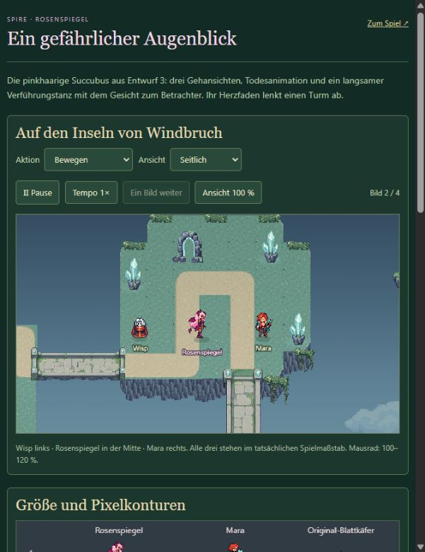
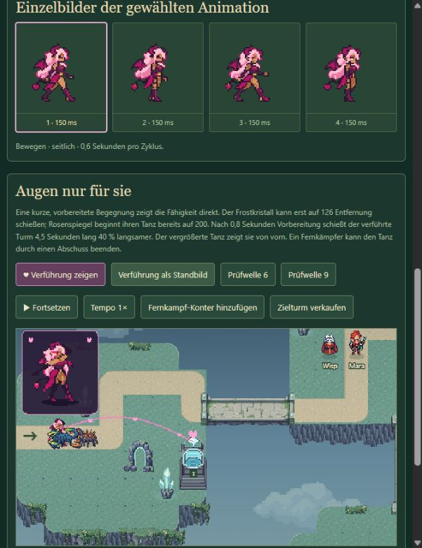

# Rosenspiegel – Umsetzung und zweite Grafikfassung

Stand: 17. Oktober 2026. Entwurf 3 wurde als Gegner umgesetzt. Anschließend verlangte der Nutzer einen größeren, langsameren und längeren Tanz, weniger Details in Spielgröße und einen saubereren Seitengang. Diese Korrekturen sind in **v2** enthalten. Die abschließende visuelle Nutzerabnahme dieser Fassung steht aus.

## Ergebnis

- Normalansicht mit zwölf statt zwanzig Palettenfarben und größeren zusammenhängenden Farbflächen. Körperhöhe ungefähr 40–42 Pixel bei unverändertem Spielmaßstab.
- Vier ausgewählte Gehposen je Ansicht, 150 ms pro Bild, Zyklus 600 ms. Fußpunkte bleiben stabil. Zu ähnliche Zwischenposen wurden verworfen. Es bleibt eine kurze Spritefolge; ein vollständig von Hand ausgearbeiteter anatomischer Lauf ist damit nicht belegt.
- Acht Tanzposen mit 190 ms pro Bild: ein ruhigerer Zyklus von 1,52 Sekunden mit Handgesten und Gewichtsverlagerung. Beim Verführen blickt sie unabhängig von der Laufrichtung zum Betrachter.
- Vergrößertes Tanzfenster von 112 × 122 Pixeln mit 2,2-facher Figurendarstellung; die normale Einheit behält ihre Größe. Das Fenster wird innerhalb des sichtbaren Kameraausschnitts gehalten.
- Drei Gehansichten, Ruhepose und sechs Todesbilder je Ansicht. Der Tod verwendet vorhandene v1-Posen mit der vereinfachten Palette.

## Fähigkeit im Spiel

Rosenspiegel ist ein Bodengegner; ihre kleinen Flügel sind dekorativ. Grundwerte: 140 Lebenspunkte, Tempo 42, Rüstung 10 %, Belohnung 30 Gold, Verlust bei Durchbruch zwei Leben. Die normale Wellenskalierung bleibt wirksam.

Sie beginnt innerhalb einer festen Reichweite von 200 einen Tanz für genau einen verfügbaren Turm. Nach 0,8 Sekunden sichtbarer Vorbereitung schießt dieser **4,5 Sekunden mit 60 % seiner normalen Feuerrate**. Sie bleibt dabei stehen. Der pinke Herzfaden und das Herz am Turm zeigen das Ziel. Die Wirkung addiert keine mehrfachen Verführungen auf demselben Turm.

Die Fähigkeit kann frühestens elf Sekunden nach ihrem Beginn erneut starten. Nach Ende oder Abbruch ist der Zielturm sechs Sekunden vor neuer Verführung geschützt. Abschuss, Verkauf des Zielturms, Reichweitenverlust und Wellenende lösen die Verbindung. Fernkampftürme ermöglichen Gegenwehr. Maras Übertakten kombiniert sich als Faktor 1,5 × 0,6 = 0,9; seine eigene Ablaufzeit bleibt erhalten.

Windbruch enthält je eine Rosenspiegel in Welle 6 und 9, insgesamt nun 135 Gegner. Wald und Winter bleiben bei 133, das Moor bei 138. Die zehn Wellen bleiben erhalten.

## Dateien und Reproduktion

- [Laufzeitatlas](../../../../public/assets/Succubus%20Pixel%20v2.png), [zweifache Atlasansicht](atlas-2x.png), [Metadaten mit Quellen, Ausschnitten und Zeiten](metadata.json).
- [Deterministischer Export](../../../../scripts/prepare-succubus-atlas.mjs): 512 × 576 Pixel, 64er Rahmen, Fußpunkt (32/56), Maßstab 1, Alpha ausschließlich 0/255. Von 72 reservierten Atlasplätzen werden 57 genutzt; 38 Posen sind unterschiedlich. Die Tanzbilder sind in den drei Richtungsblöcken identisch.
- Separate Vorschau: `npm run reference:succubus:build`, danach `SUCCUBUS STARTEN.cmd`. Entwicklung: `/succubus-preview.html`; Einzeldatei: `reference/Spire-Succubus.html`.
- Hauptspiel: `npm run reference:regions:build`, danach `REGIONEN STARTEN.cmd`.

Die Vorschau bietet Bewegung, Ruhe, Tanz und Tod, Richtungswahl, Pause, Einzelbilder und 100–120-%-Zoom. Eine eigene Kampfprobe zeigt echte Simulation, Windbruch-Wellen 6/9, Fernkampf-Konter und Turmverkauf. „Verführung als Standbild“ pausiert beim ersten aktiven Herzfaden. Vorschauproben greifen nicht auf Spielstände zu.

## Gezielte Prüfung

- Ein Atlas-Test: Palette, transparente Rahmenränder, reservierte Plätze, unterschiedliche Posen, Tanzdauer und Todesfolge bestanden.
- 17 Simulationstests für Succubus, Laternenqualle und Wald: Reichweite, Vorbereitung, vollständige Kanaldauer, Abbruchgründe, Erholung, Abklingzeit, Pause/Zeitschritte, Mara und Speicherdaten bestanden. Eine legale Windbruch-Strategie erreicht mit normalem Budget nach rund 276 Simulationssekunden den Sieg mit 20 Leben und 135 Abschüssen. Das ist ein Funktionsnachweis, keine abschließende Schwierigkeitsabstimmung.
- TypeScript und beide relevanten Builds erfolgreich. Vorschau und Regionenpaket enthalten je 93 Spiel- und sieben UI-Grafiken. Paketprüfung bestätigt identische Asset-Bytes und keine externen Bild-, Skript-, Stil- oder Schriftabhängigkeiten.
- Die erzeugte Vorschau wurde im tatsächlichen Browser angesehen: normale Spielgröße, vergrößerter Tanz ohne Kameraanschnitt, aktiver Herzfaden und Abbruch durch Turmverkauf. Die Bilder oben stammen aus dieser v2-Fassung. Lokale HTTP-Ausgabe geprüft; kein zusätzlicher vollständiger Kartentest und kein mobiler Test.

## Herkunft und Produktionsgrenzen

Neue Rohbilder wurden mit dem eingebauten Imagegen-Werkzeug aus dem gewählten [Entwurf 3](../concepts-v1/README.md) erzeugt. Quellen und vollständige Prompts bleiben erhalten. Technischer Export beschneidet vermessene Posen, setzt gemeinsame Fußpunkte, verkleinert proportional ohne Glättung und ordnet Farben einer festen Palette zu.

Verwendete v2-Quellen: [Seitengang](move-side-fix-source.png) mit [Prompt](move-side-fix-prompt.txt), [Rückansicht](up-source.png) mit [Prompt](up-prompt.txt), [Vorderansicht](down-source.png) mit [Prompt](down-prompt.txt), [Tanz](dance-source.png) mit [Prompt](dance-prompt.txt). Der Tod stammt aus [v1](../production-v1/death-source.png) mit [Prompt](../production-v1/death-prompt.txt).

In v1 und v2 entstanden jeweils sechs Rohbilder. Die gemeinsame v1-Richtungsquelle wurde wegen kollidierender Flügel verworfen und durch getrennte Ansichten ersetzt. v2 reduzierte auf Nutzerfeedback den Detailgrad. Die [erste Seitenstudie](move-side-study-source.png) mit [Prompt](move-side-prompt.txt) und die [zusätzliche Einzelpose](opposite-step-source.png) mit [Prompt](opposite-step-prompt.txt) lieferten keine ausreichend unterschiedliche Schrittstellung und sind nicht im Laufzeitatlas. Statt weiterer Generationsversuche verwendet v2 vier brauchbare Posen pro Richtung. Die v1-Fassung bleibt einschließlich [Atlas](../production-v1/runtime-atlas.png), Rohbildern, Prompts und Exportrezept erhalten.

Eine weitere Verfeinerung des Seitengangs sollte gezielt die Beinüberdeckung und die beiden entgegengesetzten Bodenkontakte bearbeiten. Zusätzliche generierte Gesamtbögen allein lösen diese Grenze nicht zuverlässig.
