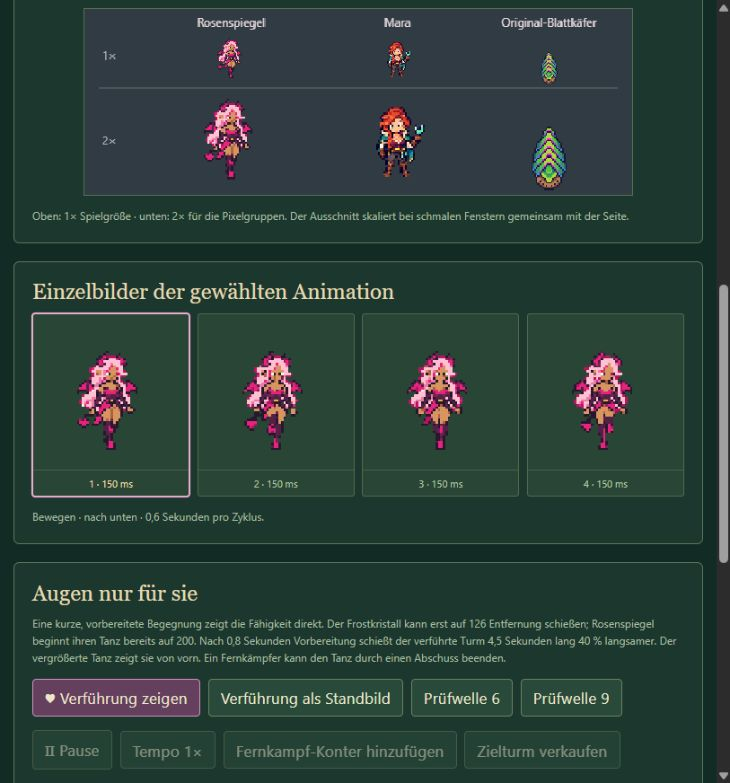
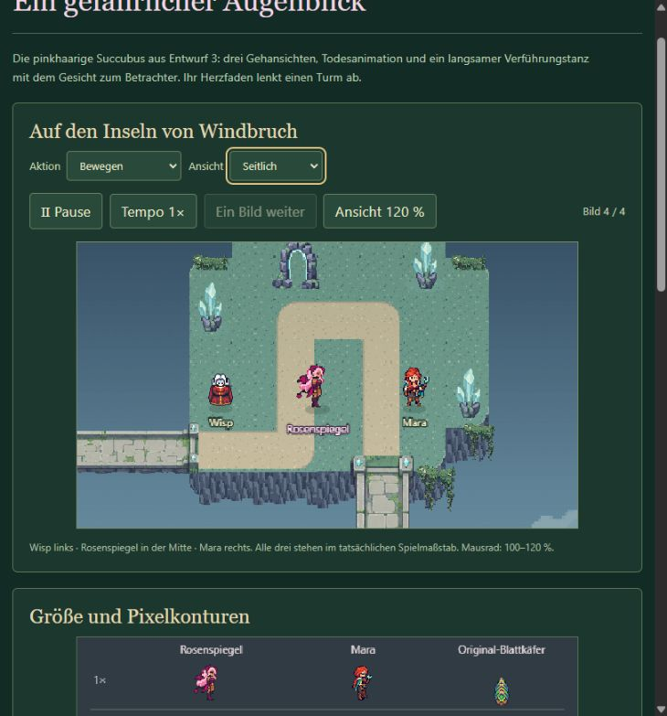
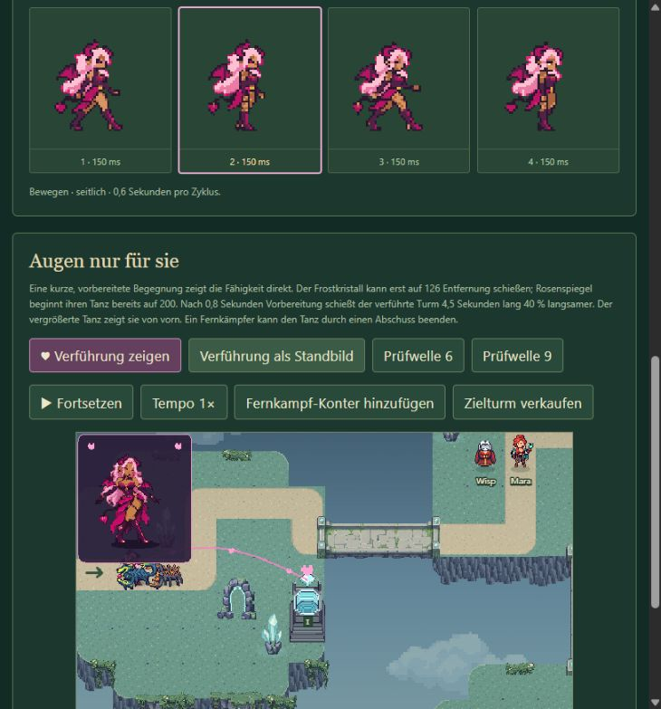

# Rosenspiegel – vertikaler Lauf und feinere Tanzgrafik

Stand: 17. Oktober 2026. Auf das erneute Nutzerfeedback wurden die bemängelten Front- und Rückansichten beim Laufen sowie die große Tanzdarstellung überarbeitet. Die Nutzerabnahme dieser dritten Fassung steht aus. [Vorherige Fassung](../production-v2/REPORT.md).

## Was falsch war und was sich ändert

In den vorherigen Front- und Rückansichten wiederholte sich fast dieselbe gekreuzte Beinstellung. Die Folge wirkte dadurch wie Wippen, ohne deutlich wechselnde Beine. Das neue Blatt enthält pro Richtung vier Posen: erster Bodenkontakt, angehobener linker/rechter Stiefel, anderer Bodenkontakt und entgegengesetzte angehobene Seite. Die Perspektive ist gerader ausgerichtet. Vier Bilder mit je 150 ms ergeben weiterhin einen 600-ms-Zyklus. Der Lauf bleibt eine kompakte stilisierte Animation; er wird nicht als perfekte anatomische Gangstudie ausgegeben.

Der bereits verbesserte Seitengang bleibt pixelgleich. Ebenso bleiben Körper-Tanz, Todesfolge, Spielmaßstab und zwölf Farben der normalen Spielfigur erhalten. Der kompatible Dateiname lautet weiterhin [Succubus Pixel v2.png](../../../../public/assets/Succubus%20Pixel%20v2.png); seine aktuellen Zuschnitte stehen in [metadata.json](metadata.json). Die vorherigen Pixel bleiben im [archivierten v2-Atlas](../production-v2/runtime-atlas.png) erhalten.

## Eigene größere Tanzbilder

Das bisherige Tanzfenster vergrößerte dieselben 64er Rahmen, die für die kleine Spielfigur gedacht sind. Mehr Darstellungsskalierung allein liefert dort keine zusätzlichen Gesichtszüge oder Handdetails.

Die große Darstellung verwendet jetzt **acht eigenständige Bilder in 128 × 128 Pixeln**, mit 33 Palettenfarben und ungefähr 90–99 Pixeln sichtbarer Figurenhöhe. Gesicht, Haare, Hände, Kostüm und Schattenflächen enthalten damit mehr tatsächliche Bildinformation. Die kleine Weltfigur behält ihre klaren großen Farbflächen. Beide Folgen laufen synchron mit 190 ms je Bild und 1,52 Sekunden pro Zyklus; die Verführung dauert unverändert 4,5 Sekunden nach 0,8 Sekunden Vorbereitung.

Der neue [Tanzatlas](../../../../public/assets/Succubus%20Dance%20HD%20v1.png) ist 1024 × 128 Pixel groß, Fußpunkt (64/112), Anzeigeskalierung 1,1. Das Fenster misst 128 × 144 Pixel und bleibt innerhalb des sichtbaren Kameraausschnitts. [Metadaten und exakte Quellrechtecke](dance-hd-metadata.json), [Atlas-Prüfkopie](dance-hd-atlas.png), [Packrezept](../../../../scripts/prepare-succubus-dance.mjs).

In der separaten Vorschau zeigt die Auswahl „Verführungstanz“ zusätzlich eine größere Detailansicht und die acht feineren Einzelbilder. Spielkörper und Größenvergleich bleiben im tatsächlichen Weltmaßstab.

## Quellen und Aufwand

Alle neuen Rohbilder wurden mit dem eingebauten Imagegen-Werkzeug erstellt; Originale bleiben unverändert erhalten. Für die vertikalen Schritte gab es ein [erstes Blatt](vertical-walk-study-source.png) mit [Prompt](vertical-walk-prompt.txt) und genau eine [gezielte Korrektur](vertical-walk-source.png) mit [Prompt](vertical-walk-fix-prompt.txt), da zunächst beide angehobenen Posen dieselbe Seite betonten. Die Tanzgrafik entstand in einem [eigenen Auftrag](dance-hd-source.png) mit [vollständigem Prompt](dance-hd-prompt.txt), anhand des gewählten Designs und der vorhandenen Tanzfolge.

Technische Aufbereitung: individuelle Rechtecke vermessen, feste proportionale Quellskalierung und Fußpunkte, Abtasten ohne Glättung, feste Palette, Alpha bei 128 auf 0/255 normalisiert. Das ist keine nachträgliche Vergrößerung des alten kleinen Sprites. Weitere Generationsversuche waren nicht nötig.

## Gezielte Prüfung und Start

- Zwei Atlasprüfungen bestanden: freie transparente Ränder, binäres Alpha, Paletten, verschiedene Posen, pixelgleich erhaltene Folgen, echte zusätzliche Tanzauflösung und Timing.
- TypeScript ohne Fehler. Regionen- und Succubus-Build einschließlich Paketprüfung erfolgreich: je 94 Spielgrafiken und sieben UI-Bilder, Assets bytegleich und ohne externe Dateiabfragen.
- Im Browser Front-/Rückansicht als Einzelbildfolge und die separate feinere Tanzansicht angesehen; der kurze echte Kampf zeigt den neuen Tanz und Herzfaden ohne abgeschnittenen Fensterrand. Aktuelle Screenshots oben.
- Keine Mechanikänderung, keine erneute vollständige Kartentestserie. Die 17 Logikprüfungen der Vorfassung wurden für diese reine Grafikänderung nicht wiederholt. Mobile bleibt zurückgestellt.

Start: `npm run reference:succubus:build`, danach `SUCCUBUS STARTEN.cmd`; Browser: `/Spire-Succubus.html`. Hauptspiel: `npm run reference:regions:build`, danach `REGIONEN STARTEN.cmd`. Beide Packrezepte sind im normalen Buildablauf enthalten.
