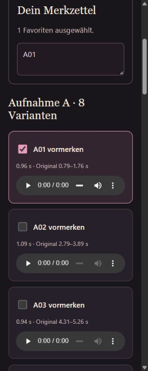

# A02 · Bauklänge und Stimmenauswahl

21.10.2026 · aktuelles Hauptspiel, keine Save-/Gameplayänderung.

- Turmbau einschließlich kostenlosem Startturm: Hammer on wood, Ausschnitt 0,23–1,75 s, Tempo ×1,3 ohne Tonhöhenänderung, kurze Blenden. Ergebnis laut ffprobe 1,173854 s. Upgrade: Ding.wav unverändert. Siedlungsaktionen behalten craft.
- Rosenspiegel: ausgewähltes KatjaSavia-Lachen bei Windup-Beginn; Windup und Channel zeigen bereits das Tanzfenster. Einmal je Vorgang, getrennte Stimmenlautstärke, Stopp bei Ende/Unterbrechung/Pause. Kein Überlappen und kein Nachholen geladener Zauber.
- Hmms: 8 + 16 Clips mit Originalzeitbereichen und Quellhashes. Keine Tavernenstimme eingebaut. [Manifest](../../../../experiments/idle-bastion/assets/voice-audition/manifest.json) und Reproduktionsskript im Repo. Alle Clips ca. 0,74–1,48 s, WAV zusammen 2,09 MB; nur in der separaten Hörseite geladen.
- Spielaudio insgesamt 20 Dateien / 15.045.847 Byte, Zuwachs 676.052 Byte. Quellen und Bearbeitungen auf Audioquellenseite dokumentiert; Pixabay-Lachen Bestandteil des Spiels, kein Teil der separaten Clipbibliothek.

## Kompakte Prüfung

- `npx tsx --test experiments/idle-bastion/tests/audio.test.ts`: 6/6 bestanden, inklusive verschiedener Bau-/Upgradeklänge und Bosszustandsübergängen, Wiederholung desselben Ziels sowie stiller Savefortsetzung.
- `node experiments/idle-bastion/scripts/check-audio.mjs`: bestanden. Gesture/Laden, Musikwechsel, Mute/Pause/Tab-/Speicherbesitz, eigenständiger Stimmenkanal bei Effekte=0, kein doppeltes Lachen und Stopp bei Zauberende.
- `npm run build`: TypeScript, Vite und Pages-Paket erfolgreich; Hörseite eigener Einstieg.
- Browser bei 319 px Breite: 24 Clips, kein horizontaler Überlauf, Checkbox schreibt A01 in Merkzettel. A01 nach echtem Wiedergabeklick: `readyState=4`, `currentTime=duration=0,961859`, kein Medienfehler. Sichtbare native Bedienelemente und Beschriftung geprüft.
- Keine subjektive Hörabnahme behauptet. Nutzerauswahl und endgültiger Mischungs-/Schnittgeschmack bleiben offen. Keine vollständige Kampfrunde bis Boss 15 wiederholt; Bossanbindung gezielt über die obigen Zustands-/Playbacktests geprüft.

