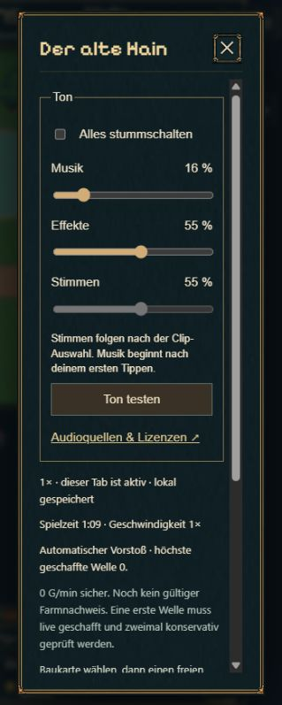
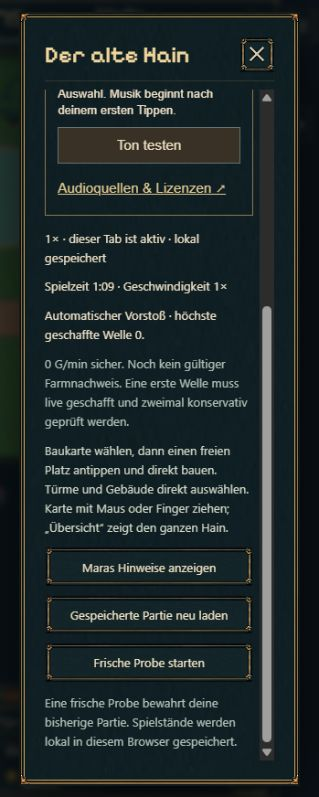

# Audiostufe A01 · 21.10.2026

## Umfang

Ausgewählte lokale Audiodateien eingebunden, Lautstärke je Klang, Musikwechsel Karte/Taverne, getrennte Regler, Stummschaltung, begrenzte Kampfklänge und kontextabhängiges Laden. Keine Stimmen, neuen Spielregeln oder Save-Migrationen. [Vollständige Zuordnung und Quellen](../../../../experiments/idle-bastion/docs/AUDIO.md).

## Kompakte Prüfung

- Vier gezielte Audiotests: Ereignisse/Flächentreffer, Wiederholungs-/Gleichzeitigkeitslimit und unabhängiger Alarm, neue gegenüber geladenen Zaubern/Geschenken, robuste Reglereinstellungen.
- `scripts/check-audio.mjs`: Audiofreigabe erst nach Geste, Musikwechsel, stumm/an, Pause/Kampf, verborgener Tab, Speicherbesitz, Persistenz und Aufräumen mit kontrollierten Browser-Audio-Doubles.
- `scripts/check-tavern-loading.mjs`: bestehende gezielte DOM-Regression für Nachladen, Zuneigungsbalken und stabile UI bei Autosave.
- Reale Chromium-Wiedergabe: Exploration und Inn Music jeweils `readyState=4`, `paused=false`, fortschreitende Wiedergabezeit nach Bedienung; Stummschaltung pausiert den Player. Toneinstellungen und Testknopf bedienbar.
- Produktionsbuild mit TypeScript-Prüfung. Keine umfassende Balance- oder Langzeit-Testserie.

Keine subjektive Hörprüfung behauptet. Mobile Layoutprüfung ist Browser-Hochkant, kein physischer Gerätetest. Die ursprünglichen Quellen bleiben unverändert, Runtime-OGGs wurden ohne zusätzliche verlustbehaftete Kompression dekodiert.

## Nachtrag: Menürahmen beim Scrollen

Vom Nutzer gemeldeten Fehler reproduziert: Die absolut positionierte Rahmengrafik war nur so hoch wie der sichtbare Dialog und scrollte mit dem überlangen Inhalt weg. Das Spielmenü hat jetzt eine feste äußere Hülle mit Überschrift/Schließen und einen separaten inneren Scrollbereich. Visuell bis zum unteren Text geprüft: äußerer Scrollstand 0, innerer Scrollstand erreicht das Ende, vollständiger Rahmen und Schließen-Button bleiben sichtbar. Produktionsbuild erneut bestanden; keine zusätzliche Testsuite für diese kleine Layoutkorrektur.

