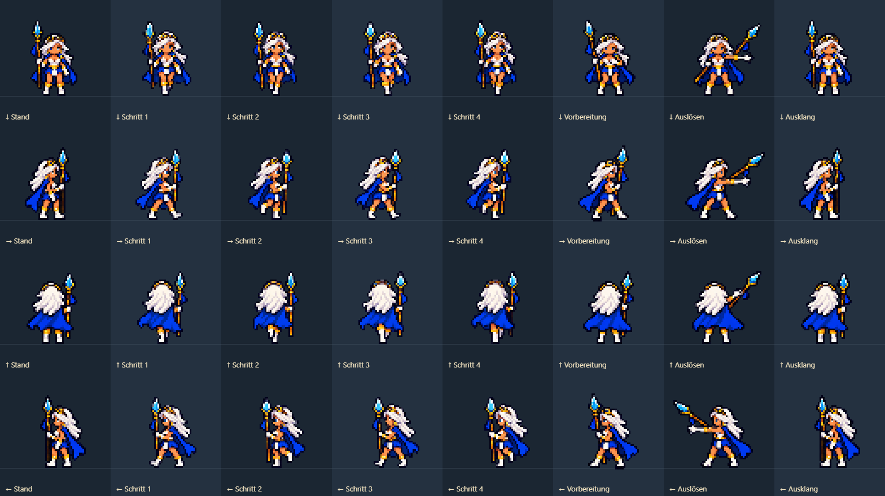
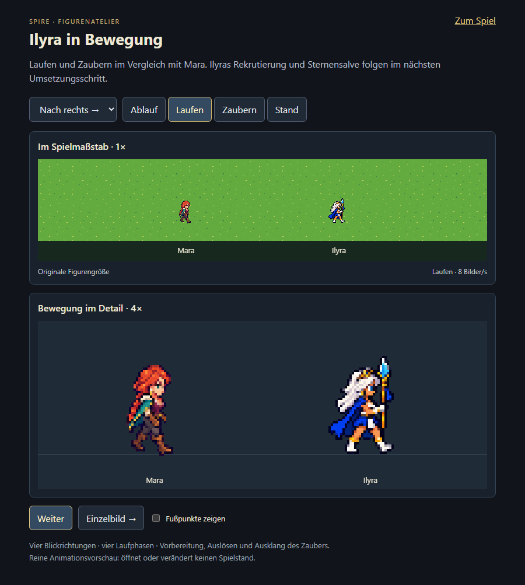
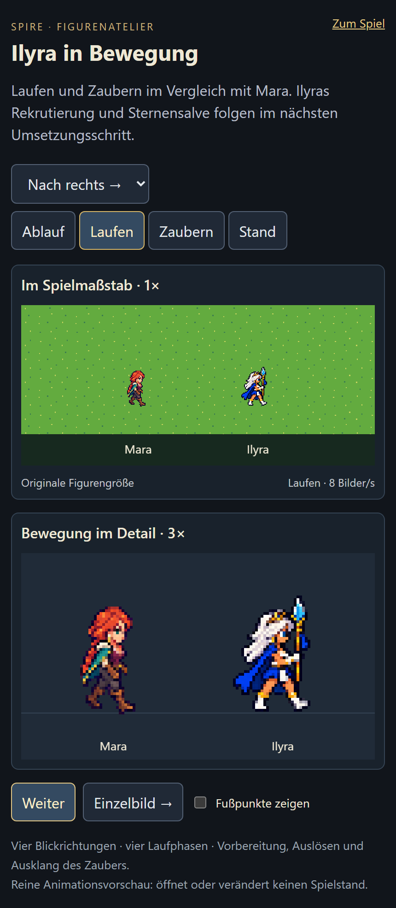

# Ilyra — Animationsprobe vom 20.10.2026

Prüfumfang ausschließlich Grafikaufbereitung und getrennte Vorschau, keine Änderungen an Kampf, Balance oder Spielständen. Die Vorschau importiert weder Simulation noch Speicherzugriff.

- Produktionsbuild `npm run idle:build`: bestanden.
- Reproduzierbare Packung: 32 belegte 64×64-Rahmen, keine Grafik am Rahmenrand abgeschnitten; Lauf-/Zauberquelle gemeinsam auf Faktor 0,13 reduziert.
- Ein kompakter Browserdurchlauf mit vier Richtungen und jeweils vier Lauf-/drei Zauberphasen, Pause/Einzelschritt und Rückkehr des einmaligen Zaubers zum Stand: bestanden; [Messdaten](check.json).
- Desktop 900×950 und Hochkant 430×932 bei DPR 2 ohne JavaScriptfehler oder horizontales Überlaufen. Browseremulation, kein physisches Smartphone.
- Figuren neben der unveränderten Mara in Spielgröße sowie vergrößert angesehen. Linke Ansicht ist bewusst gespiegelt. Laufzeit-Standpose verwendet den Ausklang der jeweiligen Zauberrichtung, um den Übergang zu beruhigen; die ursprünglich freigegebene Standgrafik bleibt als Referenz archiviert.
- Keine Rekrutierung oder Sternensalve im Spiel. Nutzerabnahme der neuen Bewegung steht noch aus.

[Assetvertrag und vollständige Prompts](../../../../experiments/idle-bastion/assets/ilyra/README.md) · [Vorschau](https://emfau88.github.io/TD/idle-bastion/ilyra-check.html)
