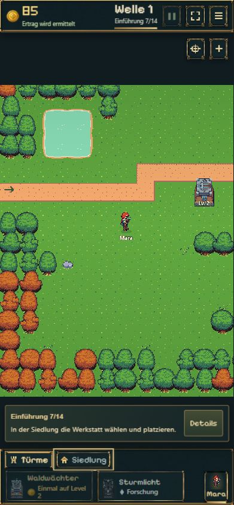
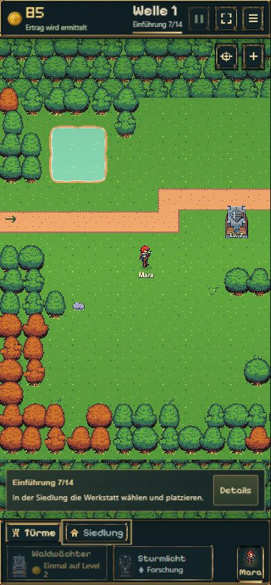

# Kamerafläche ohne dunkle Streifen · 31.10.2026

Ausgangsstand: `f3ce55510872e637c532e6ff8e1a6b32850187b7` (Main). Ursache war die Viewport-Verkleinerung aus `e2a1575`: Im geführten Hochkantfokus war die Karte kürzer als die verfügbare Bildschirmfläche. Die Tutorialkarte lag dadurch optisch auf einem dunklen Balken.

Der Viewport bleibt jetzt vollständig geöffnet. Wenn eine Achse die gesamte Karte zeigt, wird ausschließlich der notwendige Rand ergänzt und die Karte darin zentriert; es entsteht kein zusätzlicher Verschiebespielraum. Eine kleine 160×160-Textur aus bestehenden Gras-/Baumgrafiken füllt die Randflächen als Waldkulisse. Vier statische Flächen, keine neuen Assets, Akteure oder Animationen. Das Kartenmodell einschließlich Bauflächen und Navigation, Turmmaßstab, Kampf, Speicherung und Offline-Regeln bleibt unverändert. Die frühere Kontrolle auf beschnittene Viewports wurde durch genaue Vollflächen-/Randgrenzenprüfungen ersetzt; übrige Kamera-/Legacy-Fälle bleiben bestehen.

## Tatsächliche Prüfung

- 23/23 Kamera-/Intro-/Tutorialfortschrittstests bestanden. Enthält gemessene HUD-/Dock-Abstände bei Pixeldichte 1/2, minimale Randgrenzen, Zoom ohne Randwachstum, gespeicherte Turmpositionen und unverändertes Kartenmodell.
- 10/10 Wald-/Layouttests bestanden. Produktionsbuild einschließlich TypeScript erfolgreich.
- Reale Oberfläche bei 390×844, 360×800 und 1280×720 visuell geprüft. Ein ergänzender 320×568-Screenshot wurde vor der Nutzerpräzisierung aufgenommen; keine Sonderoptimierung dafür vorgenommen.
- Von einem validen lokalen Schritt-5-Prüfstand aus Welle 1 tatsächlich gestartet, ersten Abschuss abgewartet, Turm für 60 Gold aufgewertet und Schritt 7 erreicht. Tutorialkarte liegt über Landschaft, Spawn und Turm bleiben im bisherigen Maßstab sichtbar.
- Übersicht und Zoom bedient, Reload erhält Schritt 7, Turmlevel 2, 85 Gold und 20 Kernleben. Keine Browserfehler oder Warnungen protokolliert.
- Kameraschwenken/Begrenzung durch bestehende Scene-Tests geprüft; kein neuer vollständiger manueller Durchlauf aller 14 Schritte behauptet. Die lokalen Tutorial-Galeriehelfer bleiben außerhalb dieses Fix-Commits.

## Bildvergleich

Der Vorher-Screenshot stammt aus der unmittelbar vorausgehenden Sichtprüfung desselben Main-Ausgangsstands, Schritt 7. Der Nachher-Screenshot zeigt denselben Schritt nach tatsächlich durchgeführtem Wellenstart/Upgrade.

| Vorher · 390×844 | Nachher · 390×844 |
| --- | --- |
|  |  |

[360×800](after-360.png) · [Desktop](after-desktop.png) · [Übersicht](overview-desktop.png) · [Reload](reload-390.png)

Veröffentlichungsnachweis und der anschließend zusätzlich beauftragte Kongregate-Export werden nach Abschluss ergänzt. Keine Kongregate-Einreichung.
