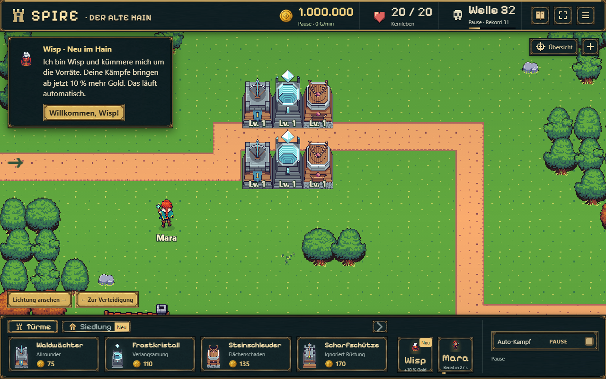
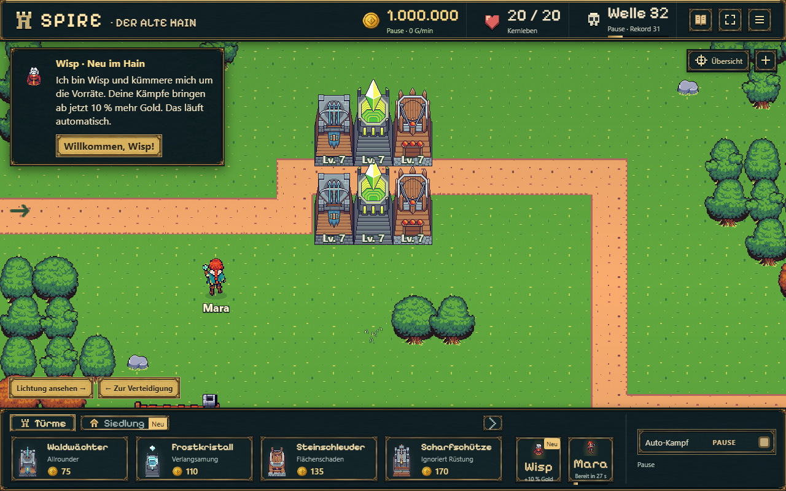
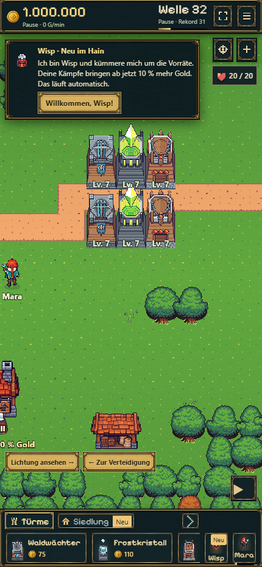

# F01 — Frostturm-Bodenanker, 20.10.2026

Ursache: Der Frostsockel verwendet 192 Pixel hohe Frames, die anderen drei Turmbasen 128 Pixel. Der bisherige relative Anker 0,81 setzte seine Unterkante bei gleicher Skalierung 6,8544 Spieleinheiten tiefer. Das galt für Bauvorschau und alle drei Ausbaustufen.

`towerMount()` in `src/art.ts` vereinheitlicht die Montage für Vorschau, erste Erzeugung und laufende Darstellung. Der vorhandene Vordergrundabstand der anderen Türme bleibt erhalten: 25,6 Quellpixel. Frost erhält den Anker 166,4 / 192; sein Kristall wird um denselben Betrag mitgeführt. Andere Türme behalten ihre bisherigen Montagewerte. Auswahlzellen, Reichweiten, Simulation und Spielstandschema sind unverändert.

Kompakte Prüfung:

- `npm run idle:build`: bestanden.
- Eine isolierte Browserprobe mit dem vorhandenen B15-Snapshot, künstlichem Baubudget und angehaltener Simulation. Nur die Vergleichsprobe verwendet diese Daten, kein Benutzerspielstand. Beobachtungszugriff im Testbrowser eingeschleust; kein Debugzugriff im ausgelieferten Spiel.
- Je ein Waldwächter, Frostkristall und eine Steinschleuder in derselben Reihe direkt ober- und unterhalb des Wegs. Stufen 1, 2 und 3 über Level 1, 4 und 7 verglichen.
- Die tatsächlichen Sprite-Unterkanten liegen in allen Fällen 29,128 Spieleinheiten unter der jeweiligen Zellenmitte. Frost stimmt exakt mit seinen Nachbarn überein. Kristallposition relativ zum eigenen Sockel bleibt erhalten.
- Bauvorschau und fertiger Frostturm besitzen identische Unterkante/Kristallposition. Baustaub beim tatsächlichen Build-Ereignis angesehen; die Darstellung bleibt am gemeinsamen Bauort.
- Desktop 1280×800 und Hochkant 430×932 angesehen, keine JavaScriptfehler. Keine physische Smartphoneprüfung.
- [Gemessene Werte](report.json). Keine zusätzliche Volltestsuite für diese reine Darstellungskorrektur.

