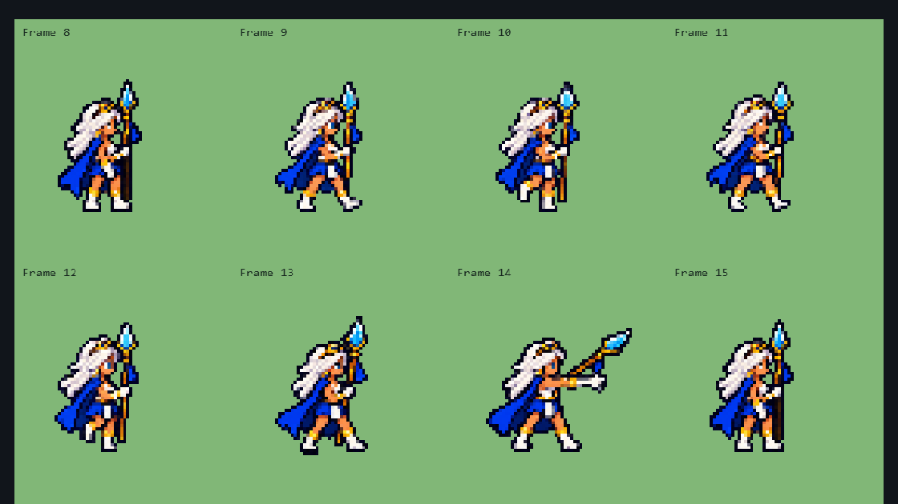
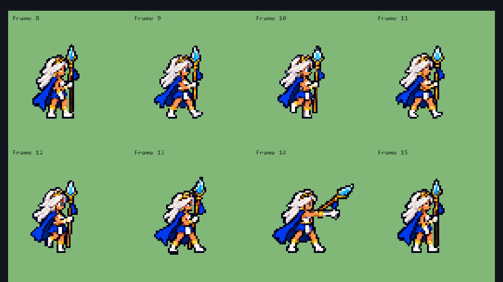
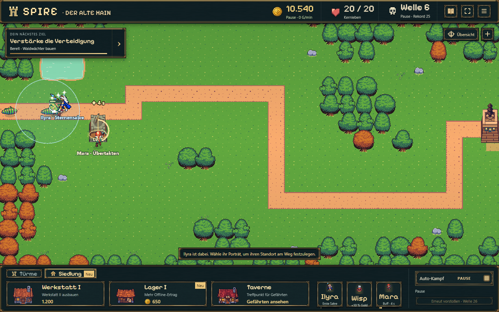
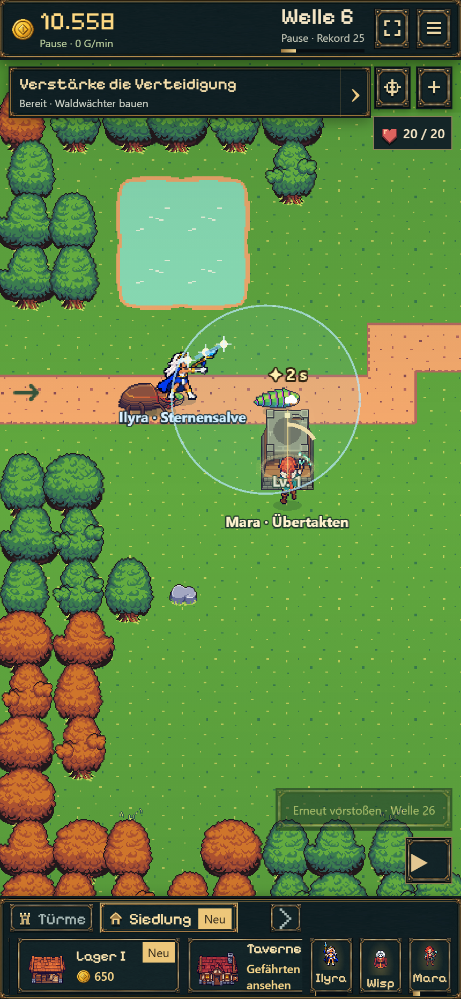

# F02 — Ilyras Transparenz und Sternensalve

20.10.2026 · Kleine Nachbesserung auf `codex/idle-bastion-vertical-slice`.

## Ergebnis

- Stand-/Ausklangpose rechts/links und die seitliche Vorbereitung haben saubere Zwischenräume am Speer. Exakt **78 dunkle Pixel** wurden transparent; alle anderen Pixel und alle Rahmenmaße/Fußpunkte bleiben unverändert. Betroffene Atlasframes: 8, 13, 15, 24, 29, 31. Originalquellen erhalten. Die eng begrenzten `clearRuns` in der vorhandenen Packung sind reproduzierbar und brechen ab, falls sie nach einer Quellenänderung farbige Grafik treffen würden.
- Ein eingebauter Imagegen-Reparaturversuch veränderte weitere Figurendetails und wurde verworfen. Keine neue Figurengestaltung ausgeliefert. [Prompt, Alpha-Maske und Assetdokumentation](../../../../experiments/idle-bastion/assets/ilyra/README.md).
- Neue Sternensalven dauern **35 % länger**: Vorbereitung 243 ms, Einschlag bei 810 ms, Ende nach 1.282,5 ms. Schaden, Reichweite und 28-s-Abklingzeit unverändert; der reale Einschlag bleibt mit dem gezeichneten Flug synchron. Der Zielpunkt bleibt fest, Gegner bewegen sich während der längeren Flugphase regulär weiter.
- Snapshot 22 speichert den Zeitfaktor neuer Salven. Schema-21-Salven behalten ihr altes Timing und ihren Trefferstatus; keine verlorenen oder erneut ausgezahlten Treffer. Die separate Figuren-Vorschau verwendet dieselben neuen Phasendauern.
- [Roadmap](../../../../experiments/idle-bastion/ROADMAP.md) als eine fortlaufende priorisierte Liste geordnet. Gesamte vorherige Fassung unverändert in einem verlinkten Archiv erhalten. Effekt-Sortierung als F03, Ilyras Idle als F04, Maras Idle als F05 **nur geplant**. Keine dieser drei Aufgaben wurde vorweggenommen.

## Kompakte Prüfung

- `node node_modules/tsx/dist/cli.mjs --test experiments/idle-bastion/tests/ilyra.test.ts`: 7 bestanden, einschließlich echter Einmaltreffer, Reload im Flug, alter Salven vor/nach Treffer, unverändertem Schaden und Farmnachweis.
- Ein gezielter bestehender `battle-save`-Test zur Ablehnung ungültiger/neuerer Speicherformate: bestanden. Keine volle Regression.
- `npm run idle:build`: TypeScript und Produktionsbuild bestanden.
- Assetpackung: 32 nichtleere, unbeschnittene Frames; Vergleich gegen vorherigen Atlas bestätigt ausschließlich die 78 Alpha-Entfernungen. Rechtsposen auf hellem Hintergrund kontrolliert, Spiegelung verwendet die korrigierten Frames.
- Kurze echte UI-Folge auf Desktop 1440×900 und Hochkant 430×932/DPR 2: rekrutieren, bewegen, Salve zielen, im Flug pausieren/speichern/laden, beenden und optionale Automatik. Keine Browserfehler, kein horizontaler Überlauf. [Messprotokoll](browser.json).
- Links der aktuellen Roadmap/Fachdokumentation geprüft. Vorherige Gesamt-Roadmap bleibt im Archiv; historische offene Kästchen sind keine zweite aktuelle Aufgabenliste.

Die Spielprobe verwendet einen vorbereiteten Veteranenstand mit Boss-25-Freischaltung und Farmwelle 6; keine neue Balance- oder Langzeitabnahme und kein physischer Mobilgerätetest. Der gemeldete Effekt-Layer-Fehler bleibt offen und ist für F03 konkret eingegrenzt (`combat-effects.ts`: feste Tiefe 5502 gegenüber Türmen bei Welt-Y + 1000).

## Aufnahmen

Vorher — schwarze Verbindung zwischen Körper und Speer:

Nachher — transparente Lücke, unveränderte Posen:

Auslieferung über den bestehenden Branch-Workflow; [Playlink](https://emfau88.github.io/TD/idle-bastion/) und [Workflow-Läufe](https://github.com/emfau88/TD/actions/workflows/idle-bastion-pages.yml). Veröffentlichungsstatus wird nach Push separat kontrolliert, nicht aus dem lokalen Build abgeleitet.
