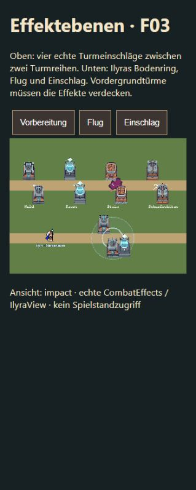

# F03 / A03 · Weltebenen und Mara-Stimme

21.10.2026 · Nur Darstellung/Audio, keine Änderungen an Kampfwerten, Spielständen oder Berührungsfreischaltungen.

## Ursache und Änderung

Turmeinschläge hatten feste Tiefe 5502, Projektile 5501 und Ilyras gesamter Zauber eine einzige Graphics-Ebene 5501. Türme liegen dagegen bei Boden-Y + 1000/1001. Dadurch übermalten selbst dahinter liegende Treffer die Vordergrundtürme.

- Einschlag und Staub: Boden-Y + 1003. Staub verwendet den tatsächlichen Turmfuß, nicht seinen optischen Offset.
- Fluggeschosse: laufende Welttiefe, mit auslaufendem 12-Pixel-Abschussoffset; dadurch nicht hinter der eigenen Turmwaffe versteckt. Verkauf des Ursprungsturms bleibt ohne Fehler möglich.
- Ilyra: Bodenring auf 900, Vorbereitung bei ihrem Fußpunkt, drei Flugsterne mit interpoliertem Bodenpunkt und unveränderter optischer Flugkurve; Einschlag am Zielpunkt. Diese Bestandteile besitzen separate Graphics-Objekte und werden beim Ende/Entfernen geleert.
- Bewusste Status-/Auswahl-/Tutorialanzeigen weiterhin über der Welt. Keine pauschale Absenkung des HUD.

## Kompakte Prüfung

- 6 vorhandene/erweiterte Audiotests plus 3 fokussierte Welttiefentests bestanden. Letztere rufen echte CombatEffects/IlyraView mit kleinen Render-Doubles auf: alle vier Einschläge, Staub, Start-/Zieltiefe der Projektile, verkaufter Turm, getrennte Ilyra-Ebenen und Leeren beim Entfernen.
- `check-audio.mjs`: bestanden, zusätzlich Zufallsauswahl ohne direkte Wiederholung, kein Mara-Laden auf Karte/Übersicht, Vorladen ohne Autoplay, Wiedergabe bei pausiertem Kampf, blockierte Folge-Taps und Stopp bei Figurenwechsel.
- `check-tavern-loading.mjs`: bestanden, inklusive tatsächlicher bestätigter Berührung → genau ein Stimmenereignis und blockiertem Folgetap. Bestehende Autosave-/Balken-/Nachladeregressionen bleiben grün.
- TypeScript und Produktionsbuild bestanden.
- Echte Phaser-Vergleichsszene `effects-check.html` mit Originaltürmen, echten Impact-Atlanten und IlyraView: hintere/vordere Turmreihe, Bodenkreis, Flugphase und Einschlag bei 319 px Browserbreite sichtbar geprüft. Keine komplette Kampagne wiederholt.
- Tavernen-Vorschau über echte UI: Mara → Berühren → Hand. +4 Zuneigung, Reaktion und `flirty_admiring_02.wav` gleichzeitig; Media `paused=false`, `readyState=4`, Zeit 0,189453 s bei 5,133016 s Dauer. Kein Medienfehler. Keine subjektive Hörabnahme behauptet.

## A03 / Umfang

Zehn unveränderte TopmadeMarti-WAVs, Quellen-/Lizenzangabe im Spiel. Nur ein vorausgeladener nächster Clip; Zufall ohne direkte Wiederholung, mindestens 2,5 s Abstand, keine überlappenden Sätze. Eigener Stimmenregler, Ende bei Figurenwechsel/Schließen/Mute/Tabwechsel. Englische freie Reaktionssätze, keine wortgetreue Vertonung des deutschen Texts. Hmms-Auswahl und Ilyra-Stimme weiterhin offen. T09/T10 bleiben reine Planung.

