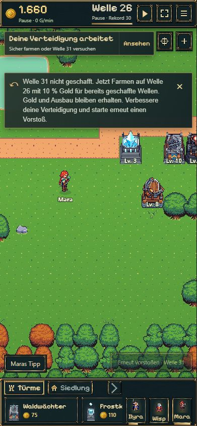
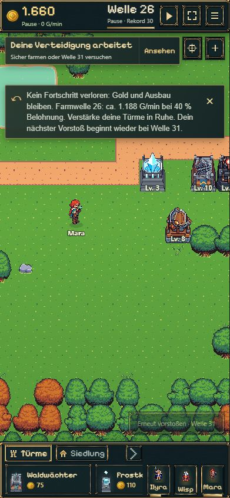
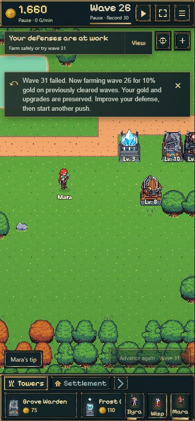
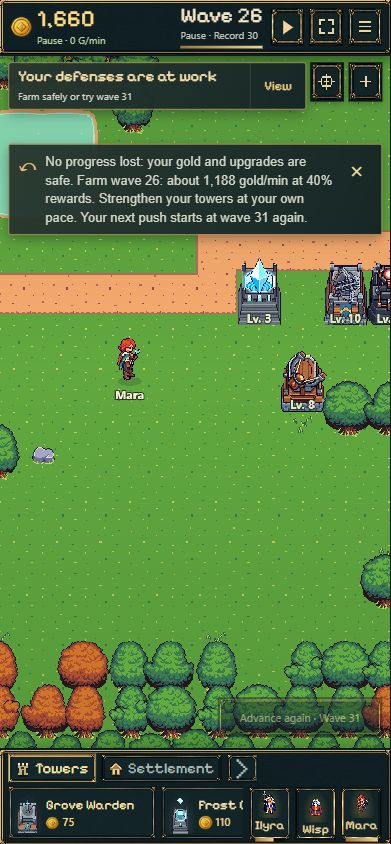
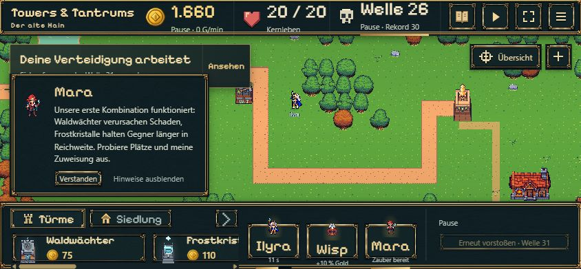
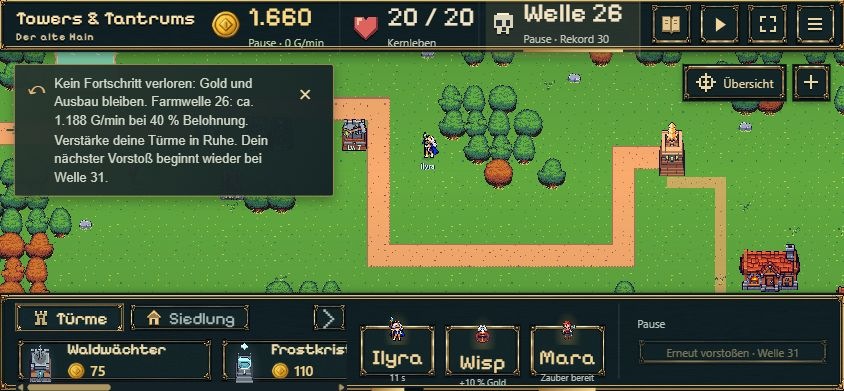
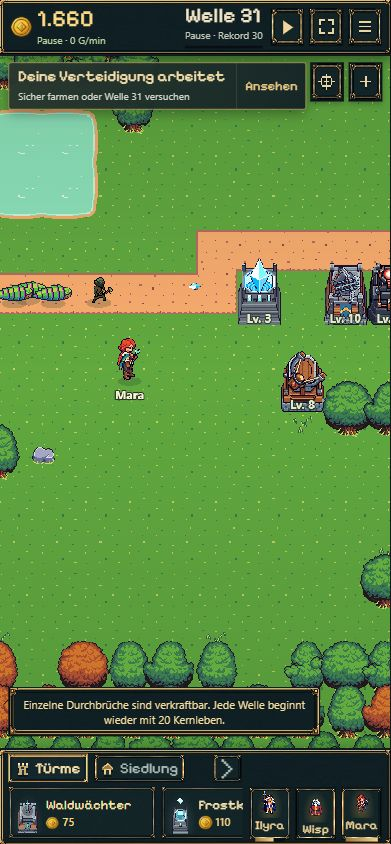
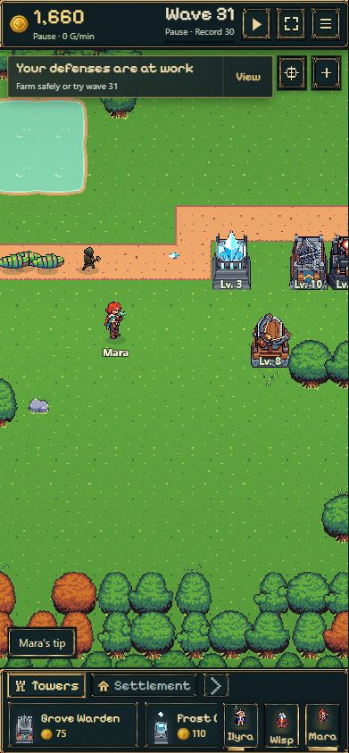

# Farmbelohnung und Spielerhinweise · 14.11.2026

Lokale Umsetzung auf `codex/kongregate-leaderboards`, Ausgangsstand `c839cc36`.
Die Umsetzung und Bildprüfung erfolgten zunächst lokal. Anschließend hat der
Nutzer am 14.11.2026 Commit und Push ausdrücklich beauftragt. Kein Upload oder
Publish. Bestehende uncommittete Nachweise zum früheren Upload wurden erhalten.

## Umfang

- Wiederholungsbelohnung 10 → 40 %. Beispiel ohne Wisp: Welle 1 erstmals 70 Gold,
  beim Wiederholen jetzt 28 statt 7 Gold. Gegner, Kosten, HP, Spawnzeiten,
  Farmkandidaten und Erstprämien unverändert.
- DE-/EN-Niederlagenmeldung im bestehenden Absatz: kein verlorener Fortschritt,
  sichere Farmwelle mit Gold/Minute, in Ruhe verstärken und nächster Vorstoß
  wieder an der bisher erreichten Grenze.
- Vorhandene Meldung im niedrigen Querformat sichtbar; dort vorübergehend anstelle
  des gewöhnlichen Zielhinweises. Die konkurrierenden allgemeinen Tipps warten.
  Keine Änderungen an Schriftfamilien, Schriftgrößen, Farben, Rahmen oder Assets.
- Einmaliger kurzer DE-/EN-Kampfhinweis bei einzelnen durchgelassenen Gegnern:
  jede Welle startet erneut mit 20 Kernleben. Keine Änderungen an Kernleben
  oder Niederlagenmechanik. Der Hinweis wartet bei Einführung, Dialogen,
  Bauvorschau, Bosskampf und anderen laufenden Meldungen.
- Zugehörige Chronik-/Farmtexte in beiden Sprachen auf 40 % angepasst.

## Speicherstände und Gold

Schema 38 → 39 / Regeln 21 → 22. Bestehende Daten und laufende alte Wellen
bleiben exakt erhalten. Die höhere Wiederholungsbelohnung greift für neue
Versuche, nicht rückwirkend mitten in einer geladenen Welle. Historische
Offlineansprüche werden unverändert und nur einmal ausgezahlt.
Neue Offline-Erträge steigen mit der höheren Farmbasis; Effizienz und Zeitlimits
bleiben unverändert. Sichere Farmnachweise werden unter den neuen Regeln erneuert.

## Prüfung

- **126/126 gezielte Tests bestanden:** Farmrechnung, Live-Belohnung, Migrationen,
  laufende Kämpfe, atomare Speicherung, Offlineansprüche, Session, Übersetzungen,
  unveränderte Gegnerparameter und einmaliger/deferierter Durchbruch-Hinweis.
  [Testprotokoll](tests-final.txt). Zwei anfangs alte Test-Erwartungswerte
  (14 statt 56 Gold je zwei Farmzyklen, Version 22 als angeblich unbekannt)
  passend zur neuen Regel aktualisiert; danach vollständig grün.
- **`npm run build` bestanden**, einschließlich TypeScript: [Buildprotokoll](build.txt).
- Echter lokaler Browser, DE/EN, angeforderte Viewports 390×844 und 844×390
  (Browser-Rundung in JPEGs: 391×844 bzw. 844×391). Keine physische Handyprobe.
- Niederlagenhinweis passt im Querformat oberhalb der Bauleiste.
  Weiterhin Arial 13px / Gewicht 400 / Zeilenhöhe 18,85px.
  [DOM-Messung](landscape-check.json).
- Schließen des Niederlagenhinweises überlebt Neuladen; einmaliger
  Durchbruch-Hinweis wiederholt sich nach Neuladen nicht. Keine erfassten
  Browserfehler. [Browserprotokoll](browser-checks.json).

## Vergleichsbilder

Unveränderte Bildschirmaufnahmen aus isolierten lokalen Probe-Speicherplätzen.
Grundlage ist ein früher erspielter Stand vor Welle 31. Für reproduzierbare
Vergleiche wurden ein Rückzug auf Welle 26 sowie 19/20 Kernleben vorbereitet
und die Partie pausiert. Dies sind keine Aufnahmen eines tatsächlichen
Kongregate-Nutzers. Der Teststarter unter `tests/browser/farm-feedback-review.html`
gehört nicht zum Produktionsbuild. Vorher wurde vor jeder Produktionsänderung
aufgenommen; nachher nutzt dieselben vorbereiteten Zustände.

| Ansicht | Vorher | Nachher |
| --- | --- | --- |
| Niederlage DE |  |  |
| Niederlage EN |  |  |
| Querformat DE |  |  |
| Erster Durchbruch DE |  |  |
| Erster Durchbruch EN |  |  |

Zusätzliche [englische Querformat-Aufnahme](after-en-landscape.jpg).

Die Bildprüfung wurde durchgeführt; eine Nutzerfreigabe des Ergebnisses steht aus.
