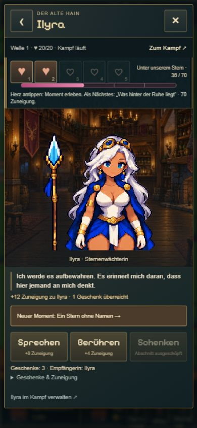

# Animierter Zuneigungsbalken

21.10.2026 · Zusätzlich ausdrücklich beauftragt. Rosafarbene Füllung, fünf gleich breite Abschnitte für die tatsächlichen Herzschwellen 10/35/70/110/160. Innerhalb eines Abschnitts wird proportional zum benötigten Punktestand gefüllt. Neue Zuneigung läuft per CSS 700 ms weich zum Ziel, auch über Abschnittsgrenzen. Bei Figurenwechsel/erneutem Öffnen wird der bestehende Stand ohne künstliches Neuauffüllen gezeigt. Die zugängliche Fortschrittsanzeige behält echte Punkte und fünf Herzen als Beschreibung. `prefers-reduced-motion` schaltet die Bewegung ab.

Prüfung: bestehender kompakter DOM-Check ergänzt um initiales Setzen, Belohnung, Schwellenübertritt und fünf volle Herzen. Browser im isolierten tatsächlichen Spiel: Ilyra 16→24 durch Gespräch, dann 24→36 durch Geschenk und zweites Herz. Direkt während des Übergangs: Ziel 40,5714 %, gerenderte Breite rund 276,5 von 819,5 px (ca. 33,7 %, also zwischen altem und neuem Stand), CSS-Dauer 0,7 s. Hochkantansicht kontrolliert.

Hand/Haare/Schulter weiterhin sofort zugänglich; spätere Herzen öffnen persönliche Momente. Gesprächspflicht und gestaffelte Berührungen ausdrücklich nicht umgesetzt, noch zu besprechen.

