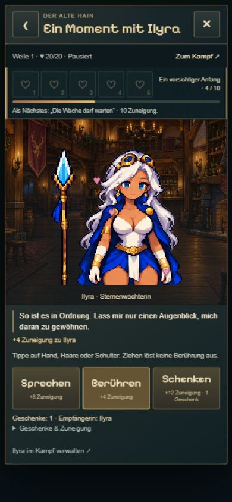

# Verlustfreie Bilder und gezieltes Nachladen

21.10.2026 · Branch `codex/idle-bastion-vertical-slice`, Basis `a7a226a`. Umsetzung/Commit/Push ausdrücklich beauftragt; main-Übernahme und Button-Flackerfix noch nicht beauftragt.

## Ergebnis

Sechs große PNG-Laufzeitbilder werden als verlustfreies WebP ausgeliefert. Zusätzlich zwei native, unverändert ausgeschnittene 170×200-Porträts. Die Tavernenübersicht lädt nur die Porträts; die beiden Animationsbilder einer Figur erst bei deren Auswahl. Original-PNGs bleiben für spätere Bearbeitung erhalten, werden nicht als große Duplikate in den Build kopiert. Keine Größen-/Paletten-/Framezeit-/Ankeränderung; Maras vorhandene Umwandlung in den kleinen Spielatlas bleibt unverändert.

- Vollständiger Idle-Produktionsbuild einschließlich Vorschauseiten: 15.948.836 → **12,770,470 Bytes**, Einsparung **3,178,366 Bytes / 19.9 %**.
- Porträts beim ersten Tavernenöffnen: 5.285.917 Bytes vollständige Atlanten → **103.144 Bytes** separate Porträts (98,0 % weniger für diese beiden Anfragen).
- Einschließlich Hintergrund: 7.632.035 → **1.898.664 Bytes** Bilddaten der Übersicht (75,1 % weniger). Tatsächliche Übertragungszeit hängt von Netz und Cache ab; keine Sekunden- oder FPS-Verbesserung behauptet.
- Gesamtbildgröße und dekodierter Speicher der großen Atlanten bleiben gleich. Ein allgemeines FPS-/Speicherprojekt oder neue Cacheverwaltung ist nicht Teil dieser Änderung.

## Kompakte Prüfung

- Generator validiert alle acht Derivate nach WebP-Dekodierung gegen die Quellen bzw. exakten Porträtausschnitte: Maße und sämtliche RGBA-Bytes identisch, einschließlich RGB unter transparenten Pixeln. Wiederholbar mit `python experiments/idle-bastion/scripts/optimize-runtime-images.py --check`.
- `node experiments/idle-bastion/scripts/check-tavern-loading.mjs`: tatsächliche Tavernenoberfläche mit simuliertem Bilddecoder im DOM; vor Öffnung keine Bildanfrage, Übersicht nur zwei Porträts, Auswahl Mara/Ilyra jeweils nur deren Atlanten. Kein realer Spielstand angefasst.
- `npm run idle:build`: TypeScript und Produktionsbuild bestanden; keine großen ursprünglichen PNG-Duplikate im Build.
- Browser: Übersicht mit beiden Porträts, Ilyras Handreaktion in Hochkant, Wechsel zu Mara und Haarreaktion. WebP wird korrekt dekodiert; Hintergrund, Transparenz und Figuren erhalten. Desktop 1280×720 / Hochkant 390×844 angefordert, kein physischer Gerätetest.

## Button-Flackern: Ursache reproduziert, bewusst nicht behoben

Der reguläre Speichercheckpoint wird nach einer Sekunde aktiver Spielzeit ausgelöst; wirtschaftliche Ereignisse können zusätzliche Schreibvorgänge erzeugen. `BattleSession.busy` umfasst auch diese kurzen Hintergrundschreibvorgänge. `TavernUI.update()` nimmt `session.busy` in die gemeinsame `blocked`-Bedingung auf. Dadurch wechseln verfügbare Herz-/Aktionsbuttons kurz auf `disabled`; CSS reduziert deren Deckkraft auf 0,48. Gesperrte Herzen sind ohnehin deaktiviert und ändern ihre Darstellung nicht.

Reproduktion mit tatsächlichem Session-Koordinator und tatsächlicher Tavernen-DOM-Logik, ohne Bildbewegung oder Nutzeraktion:

| Zeitpunkt | busy | Sprechen deaktiviert | Freies Herz deaktiviert | Gesperrtes Herz deaktiviert |
| --- | --- | --- | --- | --- |
| Vor Checkpoint | false | false | false | true |
| Während Checkpoint | true | true | true | true |
| Nach Abschluss | false | false | false | true |

Auch `main.ts:syncUI()` koppelt Bauen, Upgrade, Verkauf, Pause, Vorstoß, Forschung und weitere Aktionen an `live.busy`. Das erklärt denselben Mechanismus an weiteren Stellen; nicht jede einzelne beobachtete Stelle wurde im Browser vermessen. Das normale Sperren während einer echten Berührungsreaktion ist dagegen beabsichtigt und gesondert zu behandeln.

Empfohlener separater Fix: Hintergrundcheckpoint von einer tatsächlich laufenden Benutzertransaktion unterscheiden. Buttons bei Autosave optisch/bedienbar stabil halten; Aktionen gegebenenfalls hinter den Schreibvorgang stellen und danach erneut validieren. Doppelte Käufe/Geschenke, echte Speicherfehler und Tab-Eigentümerschaft weiter absichern. Nicht einfach Autosave abschalten oder alle Sperren entfernen. Diagnose enthält keine entsprechende Produktionsänderung.

