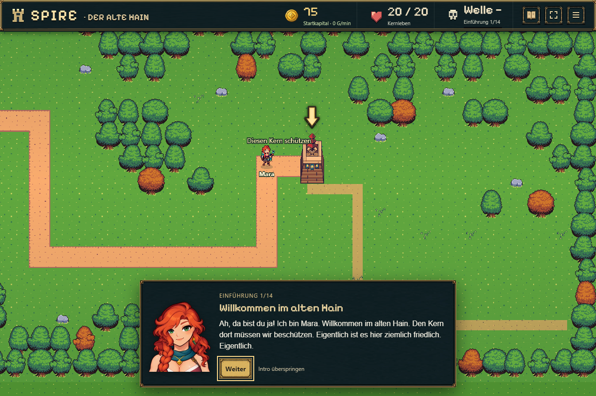
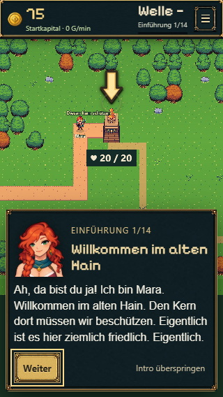
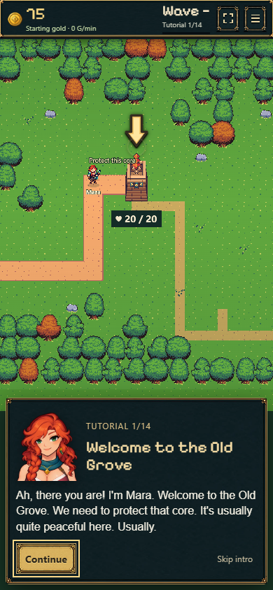
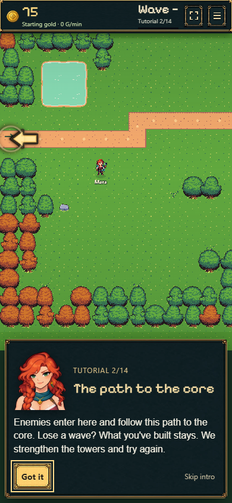
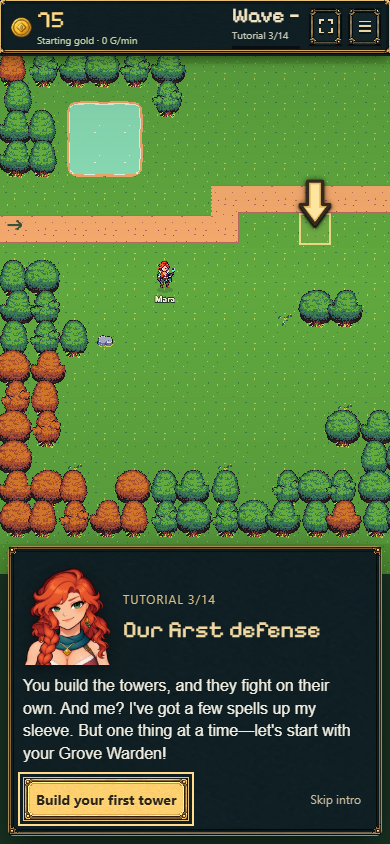
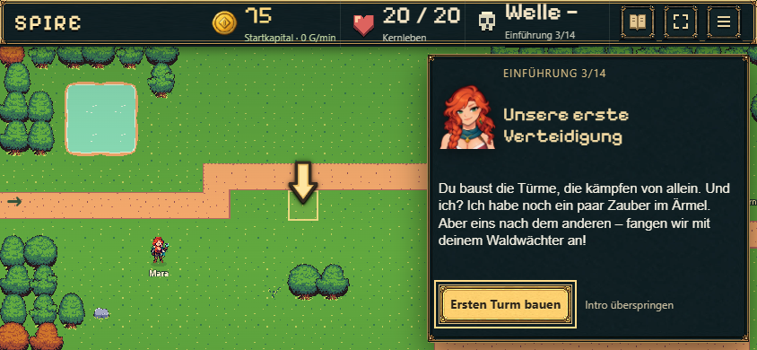
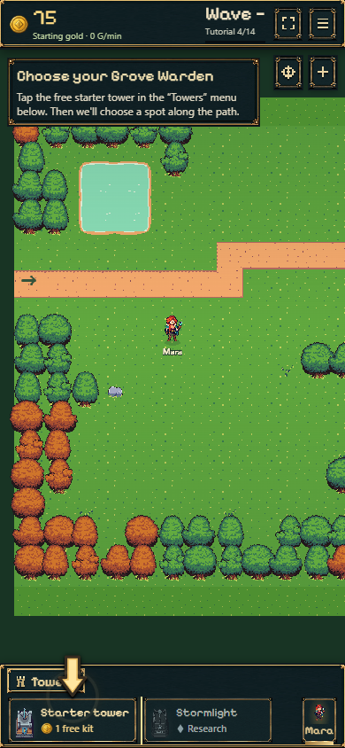

# Einstieg: HQ, Hinweise, Mara und Gesamtfortschritt

26.10.2026 · beauftragte Darstellungskorrektur am aktuellen Main-Spiel.

## Verhalten

- Die bestehende animierte Kernspitze läuft bereits vor dem ersten Kampf. Dafür wird die bereits gespeicherte Vorbereitungszeit zusätzlich zur Kampfzeit als Animationsuhr verwendet. Kampf, Einnahmen und Gegner starten weiterhin erst nach der Spieleraktion.
- In der Begrüßung steht dieselbe Mara-Figur neben dem HQ. Beim vorhandenen Kameraschwenk blendet sie aus, wechselt unsichtbar an den normalen Startpunkt und blendet dort ein. Ein Sprite, ein Name, ein Schatten; ihre gespeicherte Position und Wegliste bleiben unverändert. Überspringen, Reload und reduzierte Bewegung benötigen keine Sonderdaten im Spielstand.
- Die vorhandenen Tutorialpfeile zeigen Kernspitze, Spawn und ersten Bauplatz. Laufende Wegpunkte bleiben erhalten. Am Bildschirmrand dreht der Pfeil nach innen; Kopfzeile und Dialogtext werden nicht überdeckt. Erster Bauplatz und anschließende Platzierung verwenden ein leicht pulsierendes, genau ein Rasterfeld großes Quadrat.
- Nach Nutzerfeedback sind alle Karten- und Menü-Pfeile einheitlich 34 × 51 CSS-Pixel groß. Identisches SVG, gleiche Kontur/Schatten und vorhandene dezente Hinweisimpulse. Der zunächst ergänzte Helligkeits-/Transparenzpuls wurde entfernt. Direkt innerhalb eines Aktionsbuttons bleiben die vorhandenen 20 × 30 px erhalten.
- Eine fortlaufende Zählung erscheint in der Kopfzeile und den Einstiegskarten. Ein Schritt ist ein Lernziel, nicht jeder einzelne Klick. Die beiden letzten, bereits vorhandenen Hinweise bleiben optional. Nach Abschluss/Ausblenden verschwindet die Anzeige; alte Spielstände bekommen keinen neuen Einstieg.

## Die 14 Schritte

1. Begrüßung am Kern
2. Gegnerroute
3. Erste Verteidigung erklären
4. Startturm auswählen und platzieren
5. Verteidigung starten
6. Erstes Gefecht und Upgrade
7. Werkstatt bauen
8. Frost erforschen
9. Frostturm bauen und beobachten
10. Wisp begrüßen
11. Maras ersten Zauber kennenlernen und wirken lassen
12. Maras freie Steuerung
13. Steinschleuder (optional)
14. Vorratslager (optional)

## Tatsächliche Prüfung

- `node --import tsx --test experiments/idle-bastion/tests/tutorial-progress.test.ts experiments/idle-bastion/tests/mara-intro.test.ts experiments/idle-bastion/tests/i18n.test.ts`: **14/14 bestanden**. Verdienter Modellfortschritt einschließlich Wisp/Mara, optionale Schritte, Ende, Restore, ältere Saves, Überspringen und Sprachschlüssel. Abfrage verändert keine Spieldaten.
- `npm run build`: TypeScript, Vite-Produktionsbuild und Pages-Verpackung erfolgreich.
- [check-browser.mjs](check-browser.mjs): **24 echte Phaser-/DOM-Ansichten** mit frischen getrennten nativen Saves, DE/EN bei 1280×850, 390×844, 320×568 und 844×390. Mehrere Kernframes vor Kampfbeginn; genau eine Mara bei allen Szenen und während des Schwenks; echte gespeicherte Position/Gold/Türme/Kampfzeit unverändert. Dialogbuttons erreichbar, Figur sichtbar, Pfeile im Bild und außerhalb von Text/Kopfzeile. Gespeicherte zweite Introszene nach Reload wiederhergestellt; normaler Übergang zu Schritt 4/14. Keine Browserfehler. [Messwerte](browser-results.json).
- [check-transitions.mjs](check-transitions.mjs): reduzierte Bewegung ohne Kamerafahrt, Formatwechsel während des Schwenks und Überspringen direkt aus der Begrüßung. Danach normale einzelne Mara bei (220,300), Alpha 1, unverändertes Gold/keine Kampfzeit, regulärer Bauschritt. Berechnete Darstellung der neuen Einstiegspfeile und bisherigen Menü-Pfeile identisch. Keine Browserfehler. [Messwerte](transition-results.json).
- Fertige Screenshots auf Desktop, schmalem Hochkant und Querformat visuell geprüft. Keine Videoaufnahme. Browserprüfung ist keine physische Smartphone-Prüfung und keine zusätzliche Nutzerfreigabe der Optik.

## Ausgewählte Ansichten

Die Prüfskripte verwenden den lokalen Main-Entwicklungsserver auf Port 5235 und instrumentieren die Szene ausschließlich in der Testantwort. Keine Testbrücke im Produktionscode.
