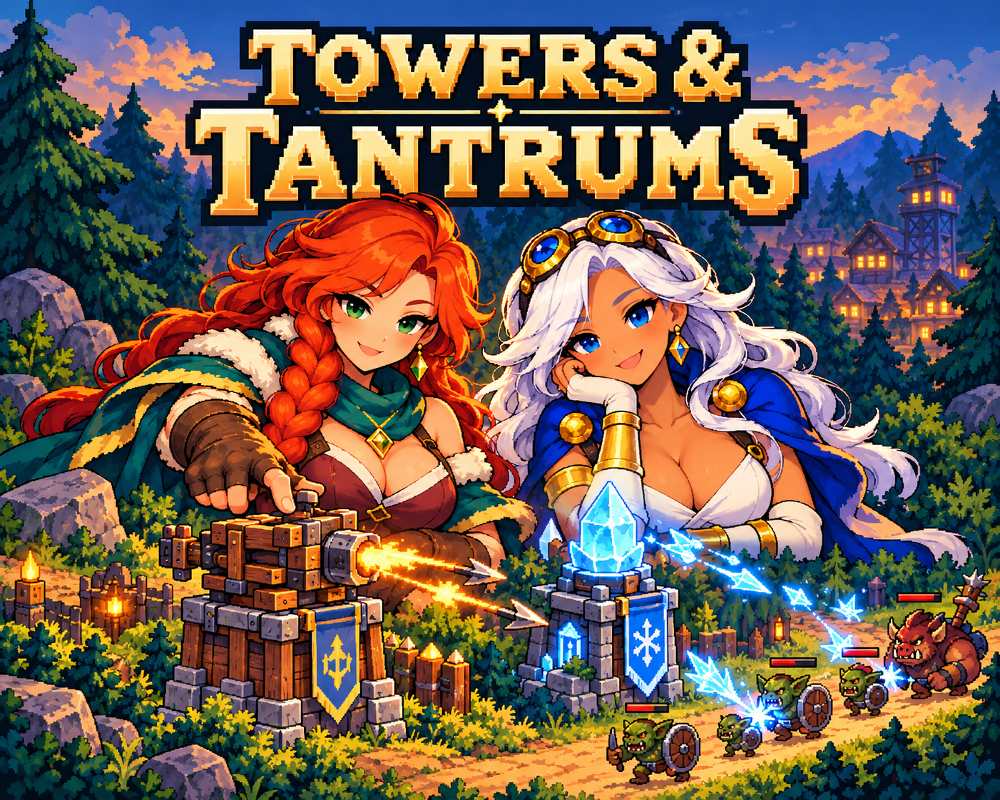
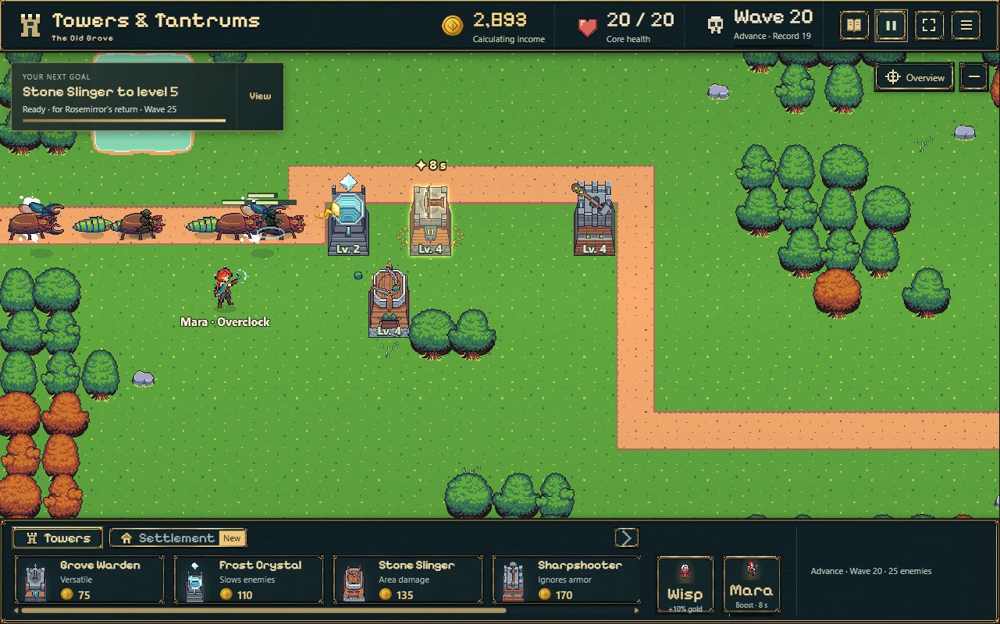
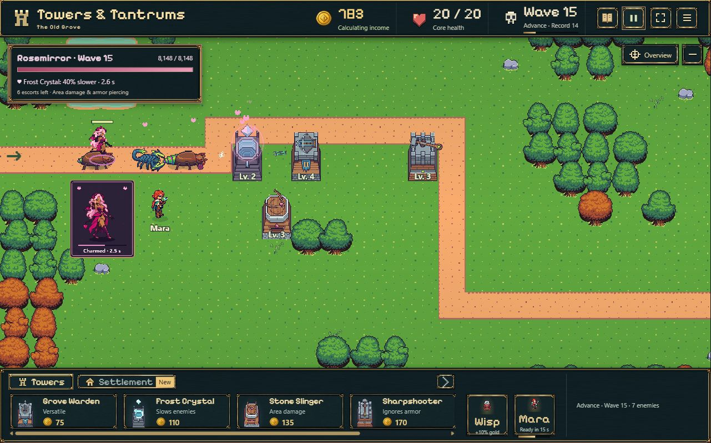
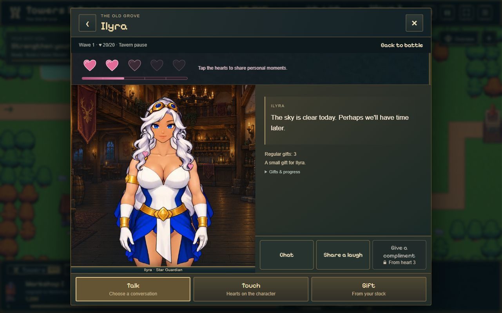

# Kongregate-Medien · 28.10.2026

Finale Auswahl nach Nutzerkorrektur: **neues Icon + drei echte Desktop-Screenshots**.

- Icon: Titel **TOWERS & / TANTRUMS**, größere wiedererkennbare Figuren, sichtbare Verteidigungstürme; mit eingebautem Imagegen erstellt. Vollständiger Prompt: [ICON-PROMPT.txt](ICON-PROMPT.txt). Lesbarkeit bei 500/250/150 px visuell geprüft; kein gemessener Klicksteigerungsanspruch.
- Screenshot 1: Welle 20, Gegnergruppe, vier Turmtypen und Maras Verstärkung.
- Screenshot 2: Rosenspiegel in Welle 15 mit Bossanzeige und Charmeffekt.
- Screenshot 3: Ilyra und das aktuelle Gesprächsmenü bei Herz 2.
- Alle Screenshots unveränderte Aufnahmen der aktuellen Spieloberfläche, 1281×800 px, Englisch. Isolierte Review-Spielstände; Kämpfe aus aufgezeichneten erspielten Zuständen, Tavernenstand aus vorheriger UI-Abnahme. Keine generierten oder retuschierten Spielaufnahmen.
- Dateien vollständig dekodiert, Maße/Hashes und bytegleiche Lieferung geprüft. Letztes beobachtetes Browserprotokoll ohne Warnungen/Fehler. Spielcode unverändert; deshalb kein neuer Build oder Testlauf nötig. ZIPs entsprechen weiterhin ihren geprüften SHA-256-Werten.
- Lieferung: `C:/Users/madde/Documents/Towers-and-Tantrums-Kongregate-2026-10-28-Hearts-d73ed50/02-media/`. Frühere und nicht ausgewählte Medien separat erhalten. Kein Upload.

