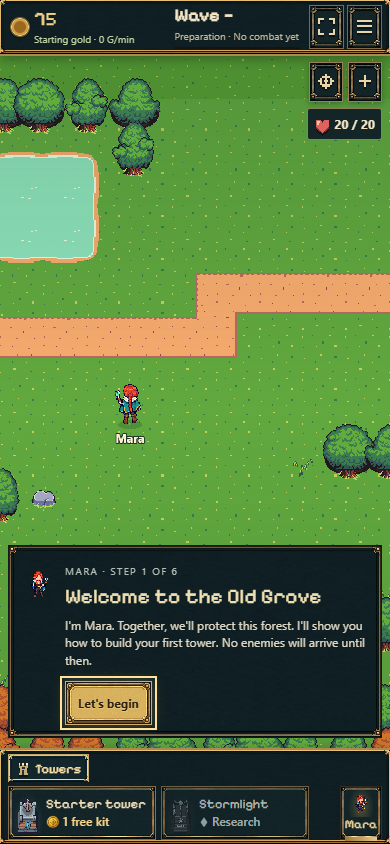

# L01 — Englisch als Standard, Deutsch auswählbar

23.10.2026 · Branch `codex/english-default`, ab main `96a005b`.
Commit/Push/Merge nach main am 23.10.2026 ausdrücklich freigegeben. Parallele Tavernenarbeiten bleiben
im eigenen Arbeitsbereich; hier sind ausschließlich ihre vorhandenen Texte angebunden.

## Ergebnis

Englische Spieloberfläche ab dem ersten Start, auch in einem deutschen Browser.
Die Auswahl **Menu → Language → Deutsch** wirkt sofort und bleibt nach Neuladen
erhalten. Tutorial, Bau/Forschung, HUD, Chronik/Farm-/Offline-Anzeigen, Gegnernamen,
Kartenbeschriftungen, Mara/Ilyra einschließlich Dialogen und Herzmomenten verwenden
denselben Katalog. Zahlen erscheinen passend zur Sprache. Keine neue Abhängigkeit.

Die Sprache ist eine separate localStorage-Präferenz (`spire-language-v1`).
Spielstände, interne IDs, Schema 29/Regeln 15, historische Ansprüche und gültige
Farmnachweise bleiben unverändert. Die Tests vergleichen echte erspielte Saves,
nicht nur erfundene Minimalzustände. Kein Eingriff in Wellen, Wirtschaft oder Kampf.

## Tatsächlich gefundene Layoutfehler

- Lange Turmnamen reichten bis zum Rahmen; Sturmlichts Rollenbeschreibung stand auf
  Desktop ungefähr 20 px darüber. Karten etwas verbreitert, Beschreibung darf umbrechen.
- Gebäudekarten wurden oberhalb der Handy-Breakpointbreite zusammengeschoben:
  Überstand teilweise über 100 px. Mindestbreite verhindert das; vorhandener horizontaler
  Katalog bleibt scrollbar. Kompakte Grafikhöhe im Querformat.
- Der englische kostenlose Starterbausatz erzeugte auf kleinen Handys einen zu hohen
  Preisblock. Kurze englische Beschriftung und passende Zeilenhöhen für Kartentexte.
- Keine kleinere Schrift als Ausweg; Langnamen bleiben lesbar. Teilweise sichtbare
  Nachbarkarten am horizontalen Scrollrand sind beabsichtigt, keine herausragenden Texte.

## Prüfungen

- `npm run build`: erfolgreich, inklusive TypeScript und Pages-Paketierung.
- Relevante Regressionen: **156 erfolgreich / 168 insgesamt**, zwölf exakt bekannte
  Fehler aus dem Farmsearch-Baselinebericht; keine neue Fehlerbezeichnung, keine
  bestehenden Tests abgeschwächt. Fünf neue Sprachtests und zwei Prüfungen der Goldformatierung erfolgreich.
- **90 Ansichtsproben** in Deutsch/Englisch bei 320×844, 390×844, 768×960,
  844×390 und 1440×960: Karten, Siedlung, Menü, Chronik, Sturmlicht, Mara und Ilyra.
  Gemessene Kartengrenzen horizontal/vertikal eingehalten; kein Dokumentüberlauf
  und kein JavaScript-Fehler. Sprachwahl nach Reload erhalten.
- Native Chrome/IndexedDB, Desktop/Mobil: erspielter Welle-50-Stand,
  unveränderter Nachweis für Farmwelle 26, exakter Reload; reservierter historischer
  Anspruch von 2.820 Gold genau einmal ausgezahlt, auch bei Sprachwechsel vor
  erneutem Auszahlungsversuch. Keine zweite Gutschrift nach Reload.
- Separater Produktionsbrowser-Test prüft frischen Einstieg, englischen Standard,
  tatsächliche Menüauswahl, deutsche Wiederherstellung und Starter-Kartenränder.

Die zwölf bekannten Fehler werden getrennt unten aufgeführt. Es wird keine komplett
grüne Gesamtsuite behauptet. Browserprofile ersetzen keine physische Smartphone-Abnahme.

## Rückkehrgold und README — ergänzender Auftrag

Die Einheiten waren korrekt (1.000 interne Einheiten = 1 Gold); die Anzeige mit bis
zu drei Nachkommastellen und großer Schrift war schwer zu lesen. Jetzt zeigt die
Hauptzeile ganze Goldstücke, z. B. **+2 877 Gold**, mit schmalen Leerzeichen als
Tausendertrennung. Bruchteile bleiben im aufklappbaren **Genauer Betrag** sichtbar,
hier **+2 877,998 Gold**. Schriftgröße 22–28 px, normale lesbare Ziffern.

Erst ab einer tatsächlich erreichten Million wird die Hauptzeile ausdrücklich als
Näherungswert mit Größenangabe dargestellt; z. B. **≈ +1,3 Mio. Gold**.
Der genaue Wert bleibt vollständig verfügbar. Keine Rundung der Auszahlung,
keine Änderung an Offline-Formeln, Goldvorrat oder Nachweisen. Werte unter einem
Gold heißen entsprechend „Weniger als 1 Gold“, statt eine nullwertige Belohnung vorzutäuschen.

20 gezielte Sprach-/Offline-/Darstellungstests erfolgreich. Zwölf echte
Rückkehr-Ansichten aus erspielter Farmbasis (61,234 Sekunden bzw. acht Stunden),
320/844/1440 Pixel, Deutsch/Englisch: exakte Details, kein Randüberstand,
Dialog auch im Querformat scrollbar und vollständig innerhalb des Bildschirms.
[Messwerte](return-browser.json) · [Mobil](return-320-de.png) · [Großer Betrag](return-1440-en.png).

Die GitHub-README beschreibt jetzt fünf Türme, Gegnererweiterungen, aktuelle Farmsuche,
fortlaufende Upgrades und den tatsächlichen main-/Pages-Ablauf. Alte Notizen sind
klar als historischer Abschnitt eingeklappt erhalten. Der prominente Frischstart-Link
`https://emfau88.github.io/TD/?fresh=1` erzeugt eine getrennte Partie und löscht den
Hauptstand nicht. Die Produktionsprobe prüft auch die erzeugte `probe`-Adresse.

## Ansichten



[Desktop-Einstieg](desktop-english.png) · [Deutsches Menü](menu-390-de.png) ·
[Deutsche Turmkarten](catalog-390-de.png) · [Gebäude auf Tabletbreite](settlement-768-en.png) ·
[Gebäude im Querformat](settlement-844-en.png) · [Englische Charakteransicht](tavern-390-en.png).

## Reproduzieren

`npm run dev -- --host 127.0.0.1 --port 5202`, dann mit vorhandenem Playwright:

```powershell
$env:PLAYWRIGHT_MODULE='<file-URL zum installierten Playwright-Modul>'
node experiments/idle-bastion/tests/browser/language.mjs
```

Für die Produktionsprobe `npm run build`, anschließend `npm run preview -- --port 5203`
und `node experiments/idle-bastion/tests/browser/language-production.mjs`.
`SPIRE_TEST_URL` kann die jeweilige Adresse überschreiben. Beide Prüfungen verwenden
isolierte Browserkontexte und Probe-Datenbanken; keine echten Nutzerstände.

Einzeltests: `npx tsx --test experiments/idle-bastion/tests/i18n.test.ts`.
[Maschinenlesbare Zusammenfassung](verification-summary.json),
[Ansichts-/Speicherprüfungen](layout-browser.json), [Produktionsprobe](production-browser.json).

## Grenzen

Die Übernahme ist vom Nutzer freigegeben. Weitere sprachliche Feinabstimmung
und echte Geräteprüfungen bleiben möglich. Technische Vergleichsseiten, historische Dokumentation und
Lizenz-/Quellentexte bleiben in der Originalsprache. Vorhandene Stimmdateien wurden
nicht ersetzt. Extrem große Endloszahlen, Browserzoom und sämtliche Safari-/Android-
Varianten sind hier keine vollständige Testmatrix. Die gespeicherten Ansichten sind
gezielte Belege, keine Garantie für jede mögliche Auflösung oder spätere neue Texte.

Der Sprachkatalog samt kleinem Laufzeitmodul beträgt im Build rund **180 kB / 59 kB gzip**.
Keine neuen Grafik-/Audiodownloads. Neue Texte müssen weiterhin in den Katalog;
fehlende Übersetzungen fallen sichtbar auf den deutschen Quelltext zurück.

## Zwölf unveränderte bekannte Fehler

1. `bundled B05 atlases retain original dimensions and logical enemy frame maps`
2. `the real idle route uses the accepted connecting source quadrants for each turn and straight segment`
3. `snapshot v1 migration retains combat exactly and invents neither a certificate nor live-clear history`
4. `free conscious recruitment preserves veteran saves and rejects repeats; core settlement also supports it`
5. `saved windup and flight hit once, reward ground/air kills once, and reject forged damage`
6. `slower volleys remain in flight at the old hit time; legacy saves finish once at their old pace`
7. `real v14 veteran and its historical offline basis survive the schema-only migration`
8. `schema 15 saves preserve preparation and completed play without forcing the extended lessons`
9. `intro command waits for a background write, then rechecks and consumes the kit once`
10. `envelope one migrates read-only without production evidence and retains CAS revision protection`
11. `battle schema two migrates without rewriting the historical absence proof or pending receipt`
12. `session return across the Mara rule update pays the historical rate once and starts with no invented current proof`
