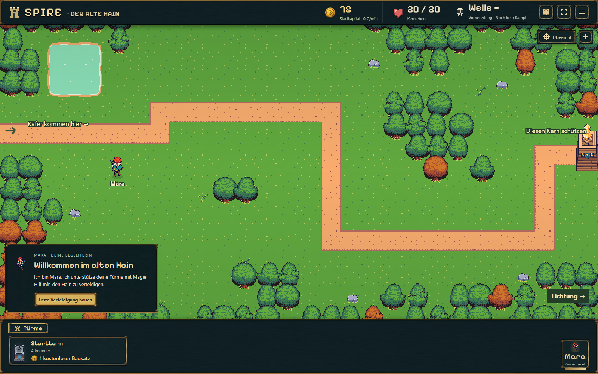
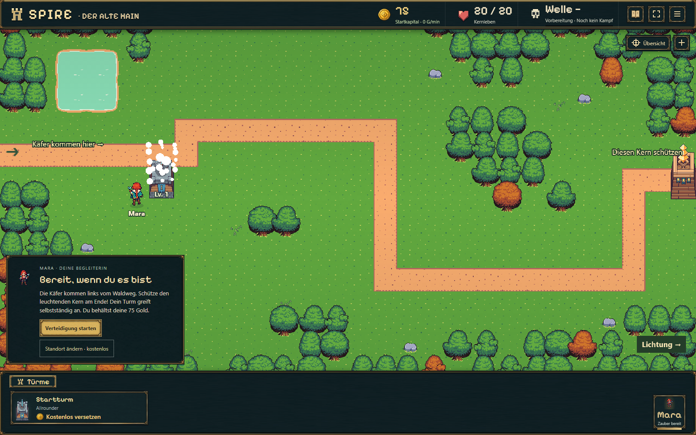
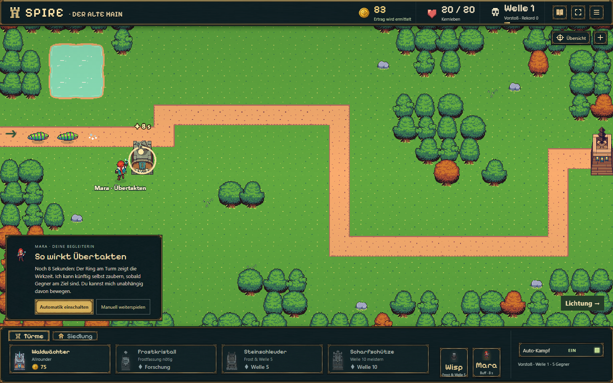
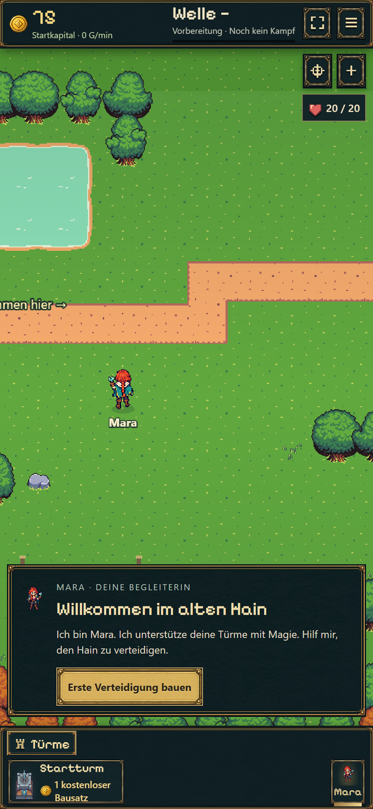
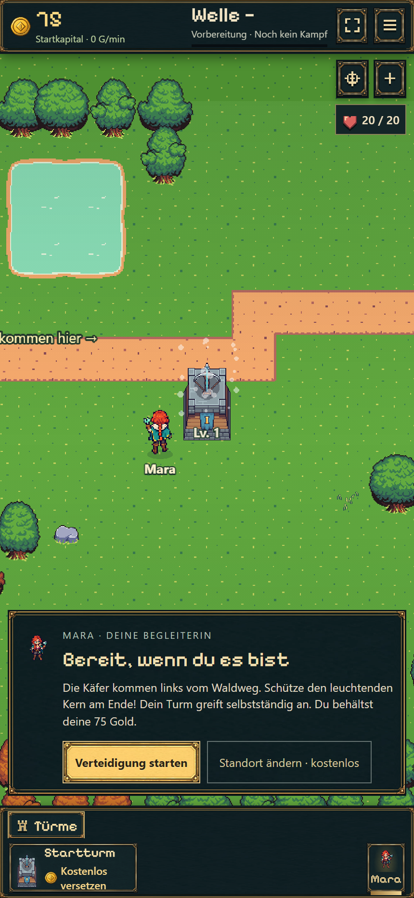
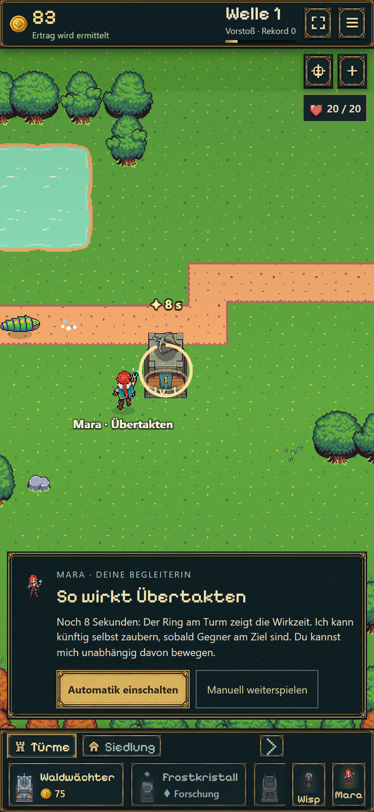

# Neuer Einstieg mit Mara — 19.10.2026

Diese erste Fassung wurde als `f538b5c` veröffentlicht ([erfolgreicher Pages-Lauf](https://github.com/emfau88/TD/actions/runs/39252243815)). Die anschließende [Erweiterung mit Lernpausen bis Frost](lessons/REPORT.md) ersetzt die manuelle Zauberlektion dieser ersten Fassung; aktuelle Veröffentlichungsnachweise stehen in der [Roadmap](../../../../experiments/idle-bastion/ROADMAP.md).

## Ergebnis

Neue Partien öffnen ruhig und ohne fertigen Turm. Mara stellt sich direkt vor; der Spieler baut einen kostenlosen Waldwächter auf einem von neun geprüften frühen Feldern. Die 75 Startgold bleiben erhalten. Vor dem ersten Kampf ist der Turm kostenlos versetzbar. Erst „Verteidigung starten“ beginnt Welle 1; danach folgen die bisherigen automatischen Wellen.

Der erste Fernzauber wird bei tatsächlichen Gegnern in Reichweite angeboten. Ring und Restdauer zeigen seine Wirkung; anschließend erklärt Mara die gegnerabhängige Automatik. Der Spieler kann sie einschalten, direkt zur Automatik wechseln oder manuell weiterspielen. Die spätere Bau-/Werkstattführung bleibt bestehen.

Alte Partien werden ohne erneutes Tutorial weitergeführt. Begrüßung, Geschenk, Position und Startzustand werden atomar gespeichert. Kein Kampf oder Offline-Ertrag vor dem Start. Einführungsklicks warten auf laufende Hintergrundspeicherungen, damit der Zauberknopf nicht beim Antippen deaktiviert wird.

## Kompakte Prüfung

- Produktionsbuild: `npm run idle:build` erfolgreich.
- Neun gezielte Prüfungen in `tests/onboarding.test.ts`: Vorbereitung/Reload, alle neun Startfelder ohne Mara verlustfrei durch Welle 1, echter Zauber samt gespeichertem Effekt, ungültige Vorbereitungszustände, echter Schema-14-Spielstand einschließlich historischem Offline-Beleg, Session-Rückkehr, atomarer Rollback, Einstiegsökonomie und Eingabe während einer laufenden Speicherung. Der letzte Fall wurde nach Korrektur seiner Test-Synchronisierung einzeln erfolgreich wiederholt.
- Vier bestehende Regressionen gezielt ausgeführt: laufender Schema-13-Boss, Kampf/Projektile durch JSON-Roundtrip, Kaufbestätigung/Parallelklick, Rollback bei Schreibfehler. Alle bestanden.
- Chromium: Desktop 1600×1000 und Hochkant 430×932 mit Touch und DPR 2. Jeweils turmloser Start, Platzierung auf `cell-6-6`, 75 Gold, Reload vor Welle 1, ausdrücklicher Start, manueller Zauber, anschließende Automatik. Keine Seitenfehler oder horizontaler Überlauf. [Maschinenlesbares Ergebnis](browser.json).
- Echter B13-Spielstand im Browser geladen: Welle 27, keine neue Einführung. Exakter Erhalt von Kampf/Wirtschaft/Offline-Daten zusätzlich im Modell geprüft.
- Kein erneuter 15-Minuten-Durchlauf, keine umfassende Geräte-/Safari-Abnahme. Die kurzen Browserklicks messen keine menschliche Lesezeit.

## Zeitmessung einschließlich Einführung

Legal finanzierter Modelllauf mit acht Sekunden angenommener Begrüßungs-/Bauzeit: **Werkstatt 86 Sekunden**, **Frostforschung 102,25 Sekunden**. Die vorbereitende Zeit zählt ausdrücklich mit und erscheint auch in der Spielzeit. Keine Veränderung der Preise oder Kampfregeln. Wer länger liest oder andere Käufe wählt, braucht entsprechend länger; dies ist keine neue reale 90-Sekunden-Nutzerabnahme.

## Spielaufnahmen

| Hochkant: Ankommen | Hochkant: selbst gebaut | Hochkant: Zauber verstehen |
| --- | --- | --- |
|  |  |  |

## Testen

[Normale Partie fortsetzen](https://emfau88.github.io/TD/idle-bastion/) · [Neue getrennte Partie für den Einstieg](https://emfau88.github.io/TD/idle-bastion/?fresh=1)

Die frische Probe verwendet einen eigenen Speicherbereich. Der vorhandene Fortschritt wird dadurch nicht zurückgesetzt.
