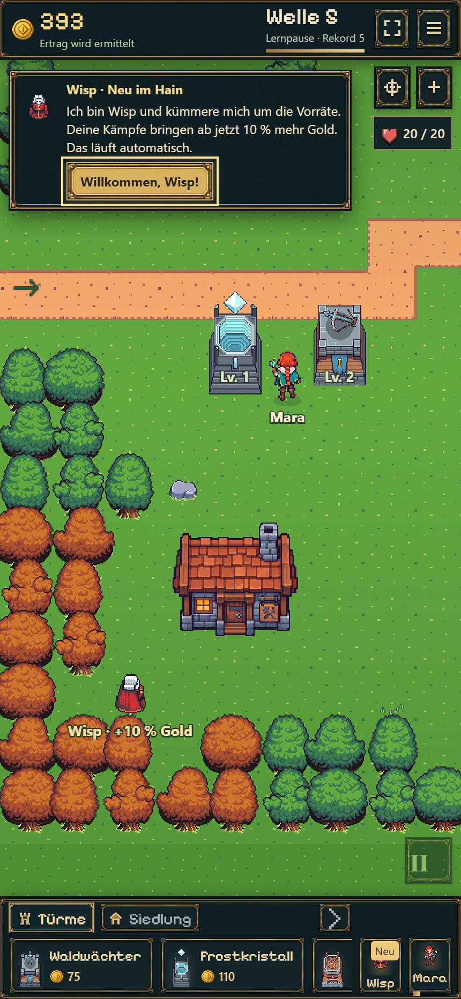
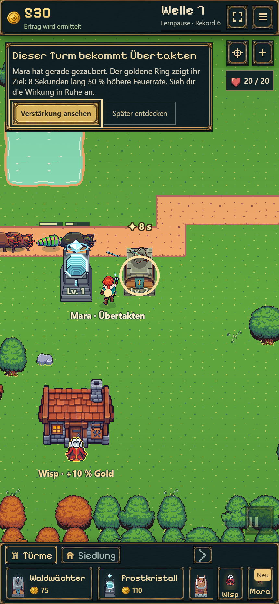
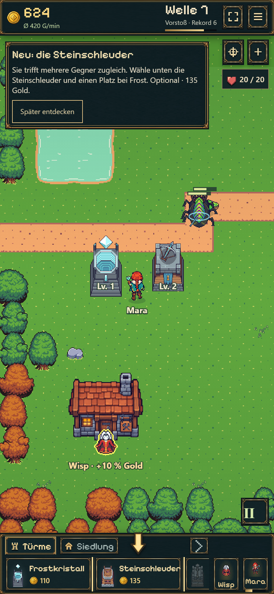
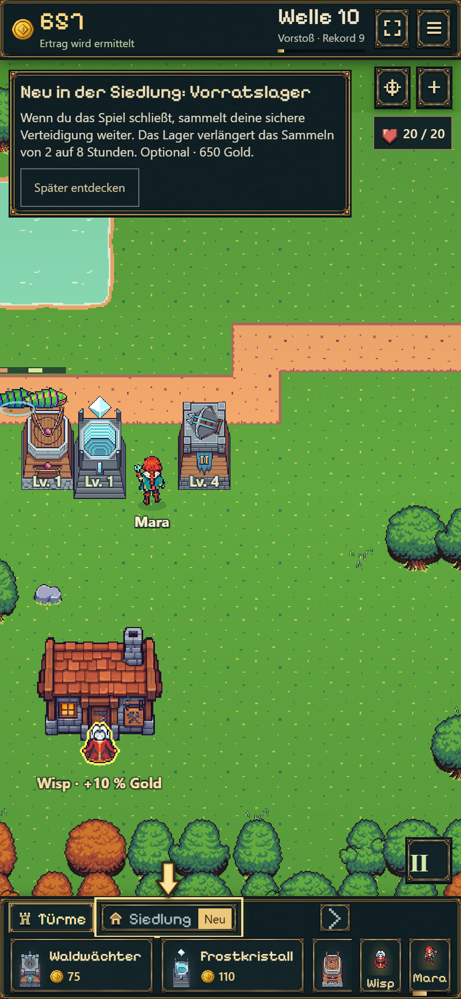
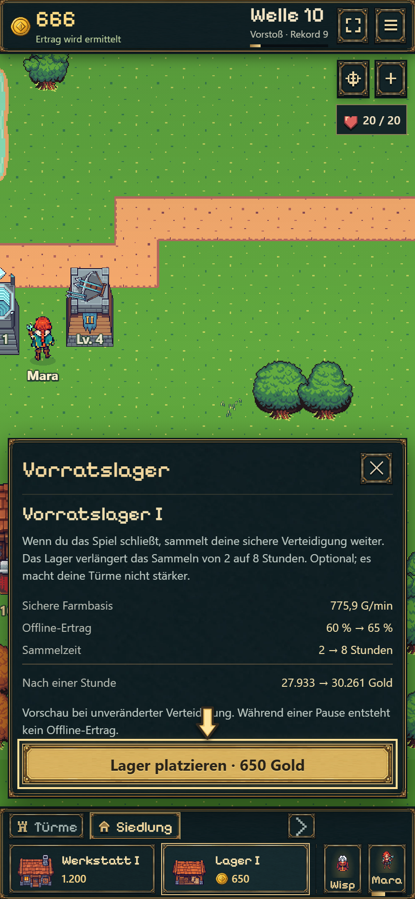
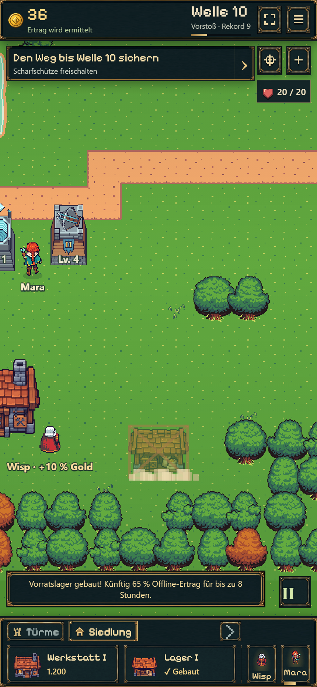

# Anschlussführung nach Frost

19.10.2026 · Branch `codex/idle-bastion-vertical-slice`. Keine neue G2-/15-Minuten-Abnahme.

## Ergebnis

Nach der Frostlektion sind Bau und Upgrades frei; das nächste Ziel ist Welle 5. Wisp wird an der Wellengrenze in einer gespeicherten Lernpause begrüßt. Sein dauerhaft automatischer Goldbonus steht im Vordergrund, ohne gleichzeitig einen neuen Pflichtkauf zu verlangen.

Danach wartet Mara auf ihre nächste reguläre Aktivierung. Die kurze Beobachtungspause beginnt mit dem tatsächlichen achtsekündigen Effekt; Kamera, Ring und Restsekunden zeigen den betroffenen Turm. „Verstärkung ansehen“ setzt fort, der normale Cooldown bleibt erhalten. Danach kann der Spieler über das echte Porträt Automatik, manuelles Zaubern und Bewegung ansehen oder weitergehen.

Steinschleuder und Lager sind ausdrücklich optional: Pfeile führen durch die echten Menüs zum Kartenplatz; „Später entdecken“ beendet die jeweilige Empfehlung ohne Zielschleife. Die Lagerbeschreibung erklärt zuerst das Sammeln während der Abwesenheit und die Verlängerung von 2 auf 8 Stunden. Preis und detaillierte Vorschau stehen in der tatsächlichen Gebäudeansicht. Beim Aufbau bleiben Sicht und Erfolgsmeldung frei.

Hinweisbit 15 führt nun auch im Fortschrittsziel zu Mara; vorher öffnete es fälschlich die Lichtung. Snapshot 17 speichert die Anschlussphasen. Geld, Käufe und laufender Kampf alter Saves werden erhalten; Veteranen erhalten keine neue Pflichtlektion. Lernpausen erzeugen keinen Offline-Ertrag. Vorhandene UI-Assets werden wiederverwendet, keine neuen Bilder erzeugt.

## Kompakte Prüfung

- `node --import tsx --test experiments/idle-bastion/tests/discovery.test.ts experiments/idle-bastion/tests/onboarding.test.ts`: **15 bestanden**. Vier neue Anschlussprüfungen: Reihenfolge/echter Zauber und Cooldown, freiwilliges Überspringen und korrigiertes Ziel, Session-Rückkehr nach Lernpause ohne Ertrag, vollständiger Erhalt eines Schema-16-Veteranen. Enthält außerdem die elf vorhandenen Einstiegsprüfungen.
- Zwei gezielte `battle-save.test.ts`-Prüfungen: JSON-Roundtrip mit deterministischem Weiterlauf sowie Ablehnung ungültiger/neuer Formate bestanden.
- `npm run idle:build` erfolgreich; final `battle-Be2-A0Xw.js`, `battle-CgsNXWgT.css`.
- **430×932, Touch/DPR2, Chromium:** Ausgangsstand aus dem früheren echten Frost-Durchlauf regelkonform im Modell bis Wisp weitergespielt. Ab dort echte UI-Klicks/1×: Wisp begrüßen einschließlich Reload davor → nächsten echten Zauber beobachten → Mara-Porträt → Steinschleuder auswählen und neben Frost bauen. 20/20 Leben; keine erfundenen Goldreserven oder Cooldown-Abkürzungen.
- Lager separat aus demselben legalen Modell mit bezahlten Waldwächter-Upgrades und regulär verdientem Gold vorbereitet; UI-Folge Siedlung → Lager → Vorschau → Kartenplatz bis sichtbarer Konstruktion geprüft. 650 Gold normal bezahlt; danach nächstes Verteidigungsziel. Kein überlagernder mobiler Tippknopf auf der Bauerfolgsmeldung.
- Desktopansicht 960×900: Wisp-Begrüßung geprüft. Finale Bestätigungskarten zusätzlich aus legalen Modellständen aufgenommen. Kein horizontaler Seitenüberlauf und keine JavaScriptfehler in den abgeschlossenen Proben. [Zustände und Messdaten](browser.json).
- Die erste Lagerprobe musste den regulären Rückkehrdialog des vorbereiteten Stands berücksichtigen. Ein späterer automatisierter Wiederholungslauf überschritt die Wartezeit auf den Platzierungspfeil; die erneute finale Lagerfolge einschließlich Konstruktion und UI-Prüfung lief durch. Das ist keine umfangreiche Geräte-/Zuverlässigkeitsabnahme.

Kein neuer vollständiger Browserdurchlauf vom Start bis Welle 10, kein physisches Smartphone-/Safari-Testing und keine neue Langzeitbalanceabnahme. Ältere Berichte bleiben historische Nachweise.

## Ansichten

[Desktop: Wisp](desktop-wisp.png) · [Maras Bedienmöglichkeiten](mobile-mara-controls.png)

## Veröffentlichung

Codecommit `5db8cc6` wurde erfolgreich gepusht. [Pages-Lauf 39279803452](https://github.com/emfau88/TD/actions/runs/39279803452) wartet am 19.10.2026 um 15:44 UTC noch auf einen Runner (`queued`, keine gestarteten Build-Schritte). Die anschließende öffentliche Prüfung liefert weiterhin die vorige Fassung `battle-OzF1aTOT.js` / `battle-BDiJOrpc.css`. Deshalb noch keine Behauptung eines abgeschlossenen Deployments oder eines öffentlichen Hash-Abgleichs. Nach erfolgreichem Lauf soll der Playlink automatisch den neuen Stand liefern; dieser Schritt ist in der Roadmap noch offen. [Normale Partie](https://emfau88.github.io/TD/idle-bastion/) · [Unabhängige frische Probe](https://emfau88.github.io/TD/idle-bastion/?fresh=1).
