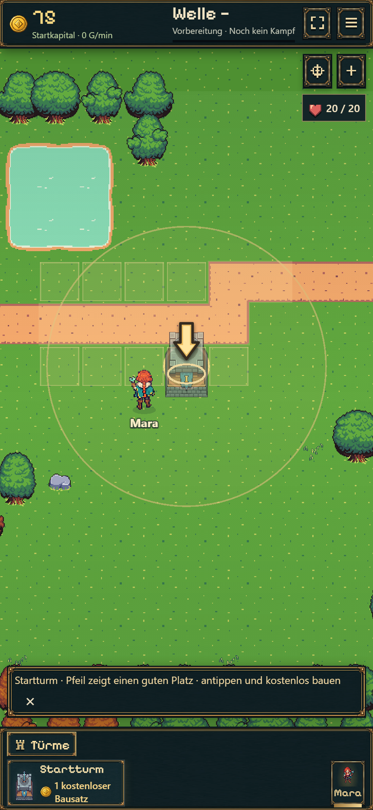
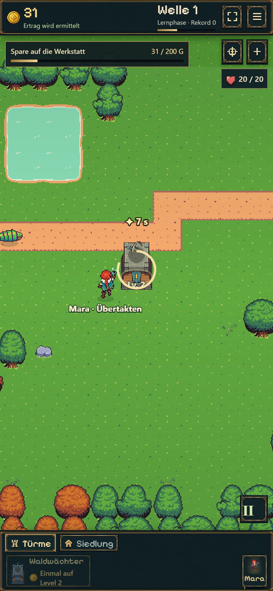
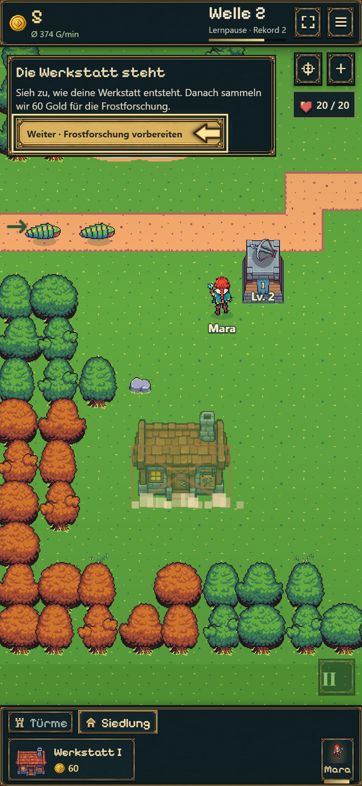
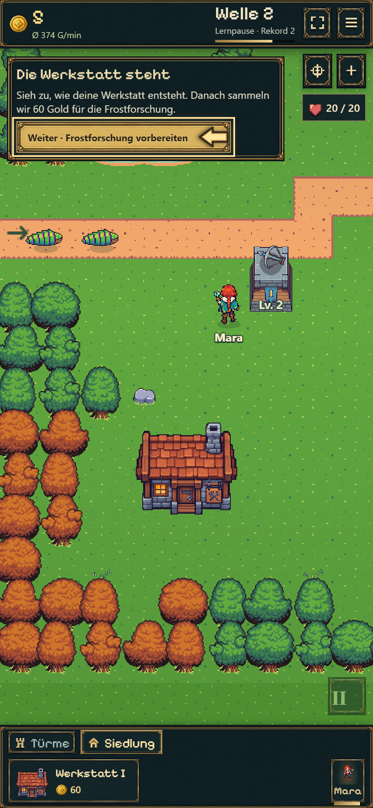
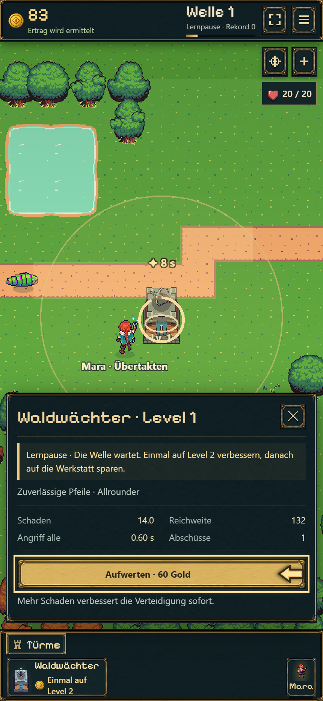
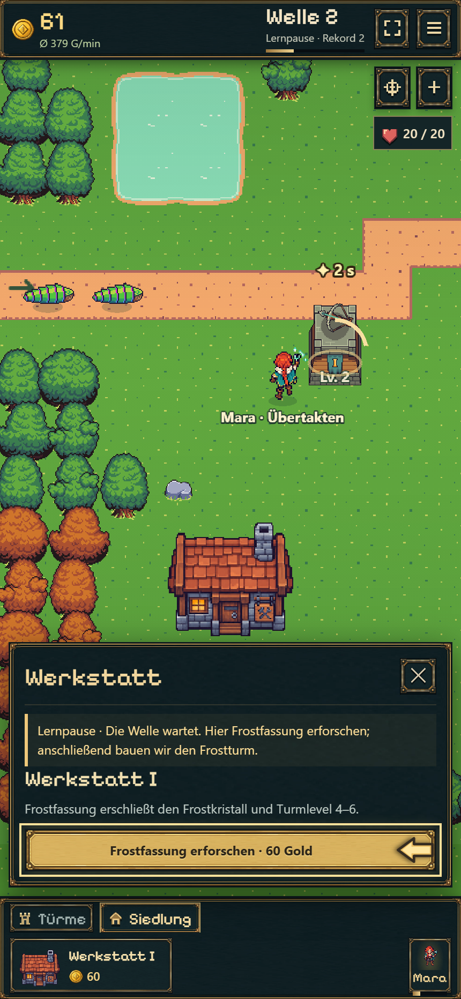
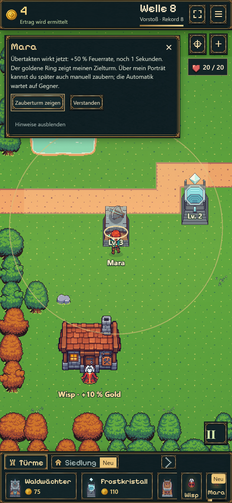
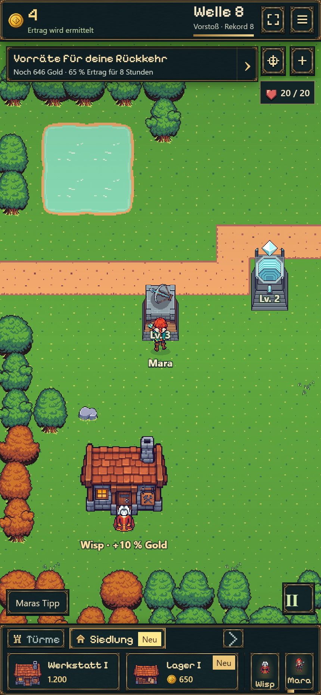
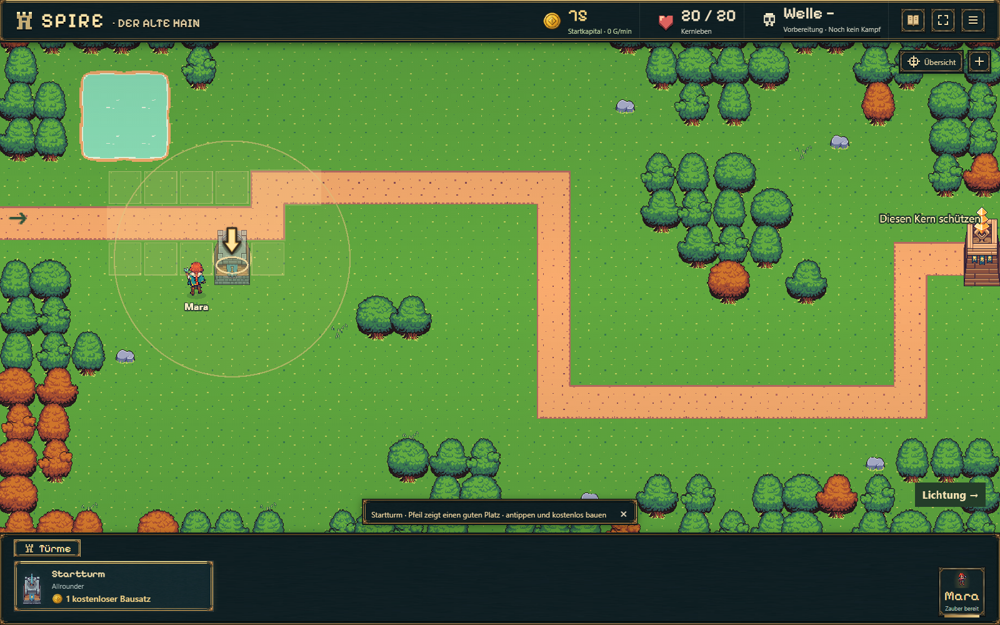

# Interaktive Lernführung und freie Sicht — 19.10.2026

[Frische Probe starten](https://emfau88.github.io/TD/idle-bastion/?fresh=1). Veröffentlichungsstatus und Commit stehen in der [Roadmap](../../../../../experiments/idle-bastion/ROADMAP.md).

## Änderungen aus der Spielprobe

- Ein gut sichtbarer Pfeil wandert zwischen empfohlenem Kartenfeld, Turm, Upgrade und Forschung. Immer nur ein Klickziel; keine Aufforderung beim bloßen Goldsammeln. Vorschau und Reichweite sind schon vor dem Bau sichtbar. Das erste empfohlene Feld liegt neben Mara, ohne sie zu verdecken.
- Turm oder Gebäude wählen, gültiges Feld antippen: sofort bauen. Die zweite Bestätigung entfällt bei Neubauten. Bestehende Gebäude werden weiterhin ausdrücklich versetzt.
- Keine dauerhaften Pfähle, Werkbank, Bauschilder oder Lagerkästen auf leeren Flächen; auch die unsichtbaren Anklickbereiche sind entfernt. „Käfer kommen hier“ entfällt.
- Sparen beansprucht auf Hochkant **41 Pixel** am oberen Rand. Werkstatt I kostet **200 statt 400 Gold**. Der übrige Kampfbereich bleibt frei.
- Nach dem Bau bleibt das Gebäude sichtbar. Die etwa 1,6 Sekunden lange Aufbau-/Staubanimation läuft unabhängig von der pausierten Kampfzeit. Eine kompakte Rückmeldung oben wartet auf „Weiter“, bevor Forschung und weiteres Sparen folgen.
- Nach Wisps bestätigter Ankunft folgt Maras eigene Übertakten-Erklärung mit tatsächlicher Restzeit bei aktivem Effekt und einem Kamerasprung zum Zielturm. Während der Baulektion unterstützt sie weiterhin automatisch.
- Das Lager wird ab seiner bisherigen Freischaltung mit **„Neu“** am Siedlungsmenü und an der Baukarte angekündigt. Öffnen bestätigt den Hinweis dauerhaft. Der gefundene Konflikt mit gleichzeitigen Speichervorgängen ist behoben.

Bestehende Spielstände und gekaufte Gebäude bleiben erhalten. Der neue Preis gilt für künftige Käufe; alte Käufe werden weder zurückgenommen noch erstattet. Keine neue Save-Version oder Kampfregeländerung erforderlich.

## Kompakte Prüfung

- Produktionsbuild und TypeScript erfolgreich.
- Gezielter vollständiger Modellablauf an allen neun Startplätzen: 20/20 Leben bis zur ersten Frost-Kombination. Separater Preis-/Forschungs-/Speicherrundlauf bestanden. Ausgangsplatz des Modells: Werkstatt nach 27,85 statt 52,55 Sekunden Kampfzeit.
- Reale mobile Chromium-Folge, **430×932, Touch/DPR 2**, ohne Testgold oder Beschleunigung: erster Bau per Pfeil, Turmauswahl und echtes Upgrade, Sparen, Werkstatt per einem Kartentipp, sichtbarer Aufbau in Lernpause, Forschung, Frostbau und erster verlangsamender Treffer. **20/20 Leben, 3 Restgold, 56,075 Sekunden Kampfzeit**. Werkstatt am neuen empfohlenen Platz nach 30.475 Sekunden Kampfzeit. Kein horizontaler Überlauf oder Seitenfehler. Die Zeiten sind keine garantierten Lesegeschwindigkeiten.
- Desktop 1600×1000: Bauempfehlung und sichtbare Reichweitenvorschau kontrolliert. [Browserdaten und erspielte Zwischenstände](browser.json).
- Kurze separate Freischaltungsprobe mit einem legal im Modell erspielten Welle-8-Stand in einem isolierten Browser-Speicher: Wisp zuerst, danach Mara; beide Lager-Neuhinweise sichtbar, Bestätigung und Reload erfolgreich. Dies ist kein weiterer Echtzeitdurchlauf bis Welle 8. [Ergebnis](discovery.json).
- Frühere Automationsversuche wurden durch zu kurze bzw. zu frühe Wartebedingungen abgebrochen; danach korrigiert. Die Freischaltungsprobe fand zusätzlich den echten Bestätigungs-/Speicherkonflikt; nach dessen Korrektur erfolgreich wiederholt. Kein kompletter 15-Minuten-Retest und keine umfassende Geräte-/Safari-Abnahme.

## Aufnahmen

| Klickziel statt Suchaufgabe | Kleine Sparanzeige |
| --- | --- |
|  |  |

| Sichtbare Aufbauanimation in Lernpause | Fertige Werkstatt bleibt sichtbar |
| --- | --- |
|  |  |

| Echter Upgradebutton | Forschung in der Werkstatt |
| --- | --- |
|  |  |

| Mara erst nach Wisp | Lager im Baumenü entdecken |
| --- | --- |
|  |  |

