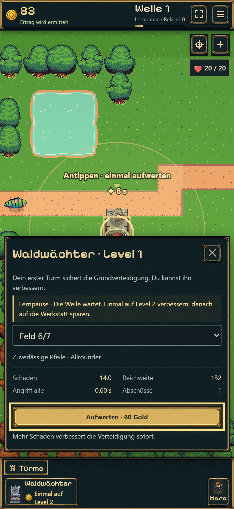
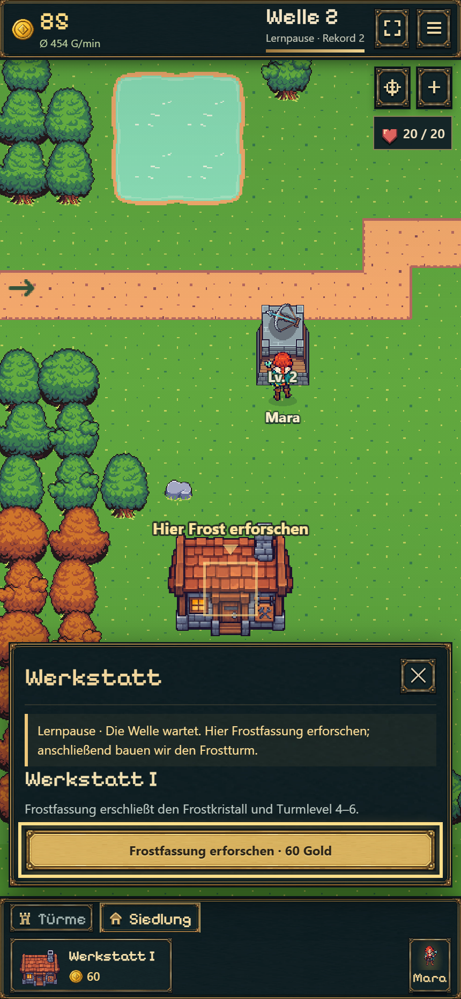
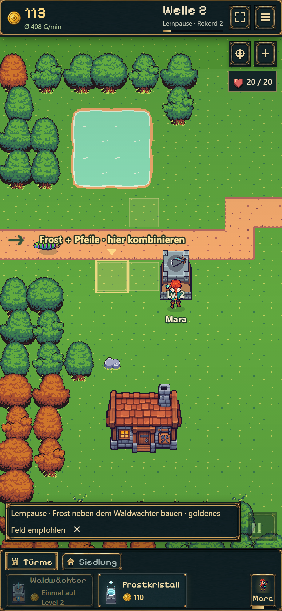
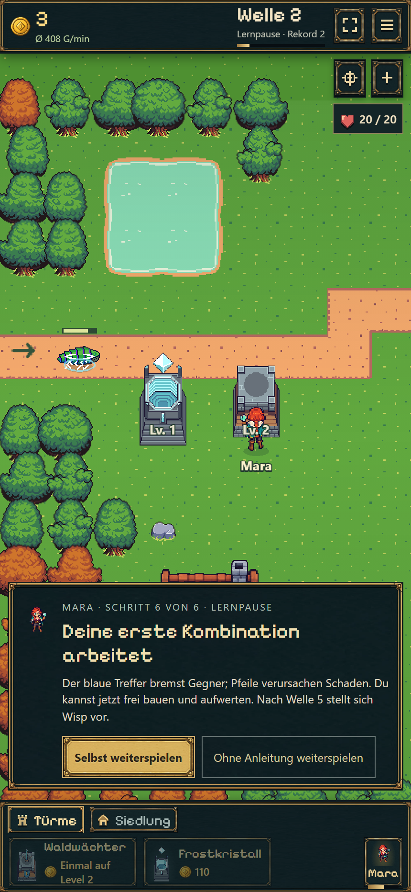
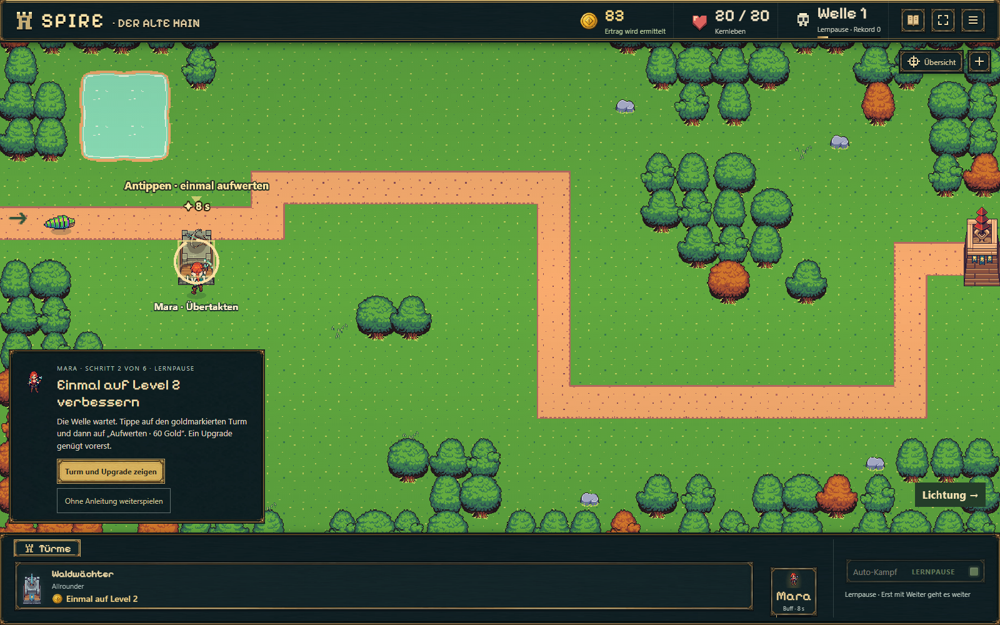
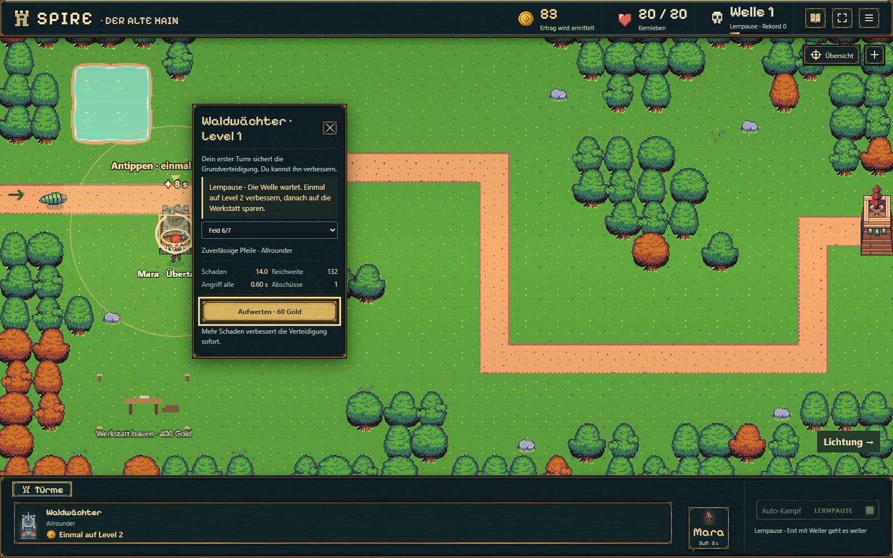

# Geführte Lernfolge bis Frost — 19.10.2026

Getrennte neue Partie: [Frische Probe](https://emfau88.github.io/TD/idle-bastion/?fresh=1). Commit und Veröffentlichungsnachweis stehen in der [Roadmap](../../../../../experiments/idle-bastion/ROADMAP.md).

## Was ein neuer Spieler erlebt

1. Mara begrüßt; ein goldener Rahmen mit Pfeil zeigt den empfohlenen kostenlosen Waldwächter-Platz. Erst der ausdrückliche Start lässt Gegner erscheinen.
2. Nach dem ersten verdienten Gold hält die Welle an. Startturm auswählen; der echte Upgradebutton ist hervorgehoben. **Einmal Level 2**, danach auf Werkstatt sparen. Erst „Weiter“ nimmt den Kampf wieder auf.
3. Fehlender Betrag und Fortschrittsanzeige erklären das **400-Gold-Sparziel**. Gewöhnliche Wellen 1–2 werden wiederholt, solange die Lernfolge läuft. Keine Gratis-Gutschriften, vereinfachten Gegnerwerte oder Unverwundbarkeit.
4. Sobald bezahlbar: **Werkstatt bauen**, danach in einem eigenen Schritt **Frostfassung für 60 Gold erforschen**. Platz und Forschungsschaltfläche sind klar markiert; bei fehlendem Gold läuft die Produktion weiter.
5. **110 Gold für den Frostturm** sammeln. Dann Lernpause und empfohlenes Feld vor dem Waldwächter: Frost soll zuerst treffen und die Gegner in dessen Reichweite halten.
6. Ersten verlangsamenden Frosttreffer mit kurzer Erklärung ansehen, danach freie Verteidigung. Mara unterstützt währenddessen automatisch; manuelle Zauber sind keine zusätzliche Pflichtlektion. Wisp erscheint später regulär nach Frostforschung und Welle 5.

Die Hilfe lässt sich ab dem Kampfbeginn überspringen. Während der Anleitung sind die passenden Käufe geführt; danach gelten wieder die bisherigen freien Bauflächen und Upgrades. Lernen erzeugt keinen Zeitdruck: Gegner, Projektile und Wellentimer bleiben während einer Lernpause stehen. Die Pause endet erst durch die ausdrückliche Fortsetzung nach der jeweiligen Aktion.

## Kompakte Nachweise

- Produktionsbuild erfolgreich, `git diff --check` ohne Fehler.
- **Zehn gezielte Modell-/Speicherfälle** in `tests/onboarding.test.ts`: darunter die gesamte Lernfolge an allen **neun** angebotenen Startplätzen mit 20/20 Leben, zehn Sekunden simulierte Lesezeit je Pause, atomarer Bausatz/Schreibfehler, Fortsetzen und Altspielstände aus Schema 14/15. Die zunächst ungeeignete Frostempfehlung wurde durch einen Platz vor dem Waldwächter ersetzt und die vollständige Feldprüfung danach erfolgreich wiederholt.
- Zwei zusätzliche vorhandene Regressionen: laufender Schema-13-Boss und JSON-Roundtrip mit Projektilen. Beide bestanden.
- **Ein vollständiger realer Browserdurchlauf auf Hochkant 430×932, Touch/DPR 2**, ohne Testgold oder Zeitbeschleunigung: kostenlos bauen, starten, Upgrade, Reload in Lernpause, Sparen, Werkstatt, Forschung, Frostbau, verlangsamender Treffer und Freigabe zum freien Spiel. Ergebnis: **20/20 Leben**, Rekord 2, 3 Restgold; Wisp noch nicht erschienen. Keine Seitenfehler oder horizontaler Überlauf.
- Desktop 1600×1000: denselben tatsächlich erspielten Upgrade-Pausenstand in einem getrennten Speicherbereich geöffnet; Markierung, echte Upgradeoberfläche und Lesbarkeit geprüft. [Browserergebnis](browser.json).
- Kein neuer 15-Minuten-Lauf, keine umfassende Geräte-/Safari-Abnahme. Der Veröffentlichungsnachweis wird separat in der Roadmap geführt.

## Zeit und Speicherschutz

Am empfohlenen Startplatz: Werkstatt nach **52,55 Sekunden aktiver Kampfzeit**, erste Frost-Kombination nach **79,425 Sekunden**. Mit acht Sekunden Begrüßung/Bau und fünfmal zehn Sekunden Lesezeit sind das **137,425 Sekunden insgesamt**. Die Browserautomation klickt schneller als ein Mensch; ihre Gesamtzeit ist deshalb kein Lesbarkeitstest mit echten Spielern. Das frühere 90-Sekunden-Ziel begrenzt diese neue Lernfolge nicht. Die sichtbare Spielzeit enthält Kampf- und Lernzeit.

Snapshot **16** speichert Lernschritt und Lernpause. Eine Lernpause erzeugt auch bei Abwesenheit kein Gold. Bereits gestartete ältere Partien behalten ihren Kampf, ihre Käufe und ihren Fortschritt; die neue Führung wird ihnen nicht nachträglich aufgezwungen. Eine alte noch ungestartete Partie bleibt dagegen in ihrer Vorbereitung. Der normale Playlink und getrennte frische Proben behalten ihre bisherigen Speicherbereiche.

## Echte Aufnahmen

| Erster Upgrade-Schritt | Forschung in der Werkstatt |
| --- | --- |
|  |  |

| Frostplatz vor dem Waldwächter | Erste sichtbare Kombination |
| --- | --- |
|  |  |

