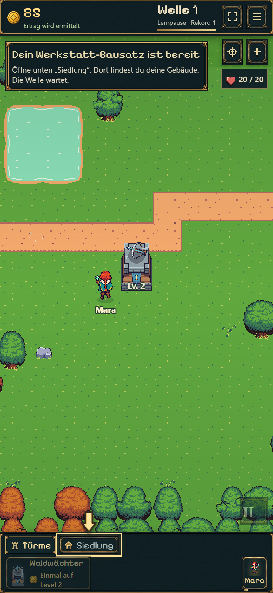
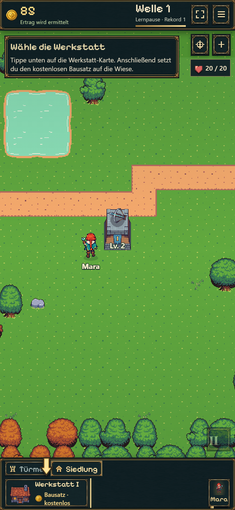
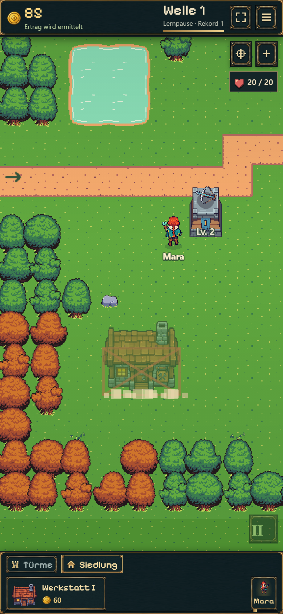
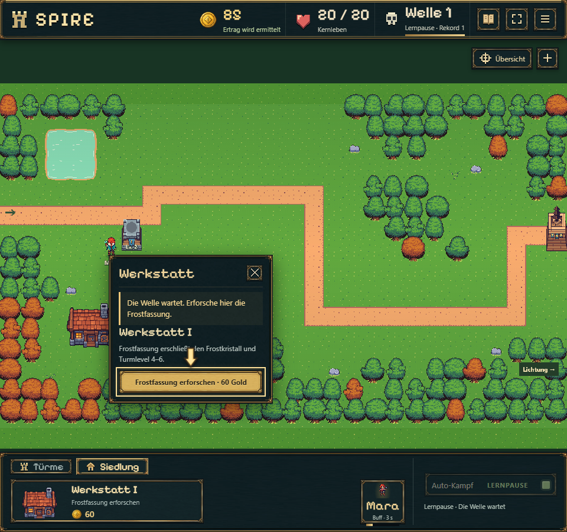
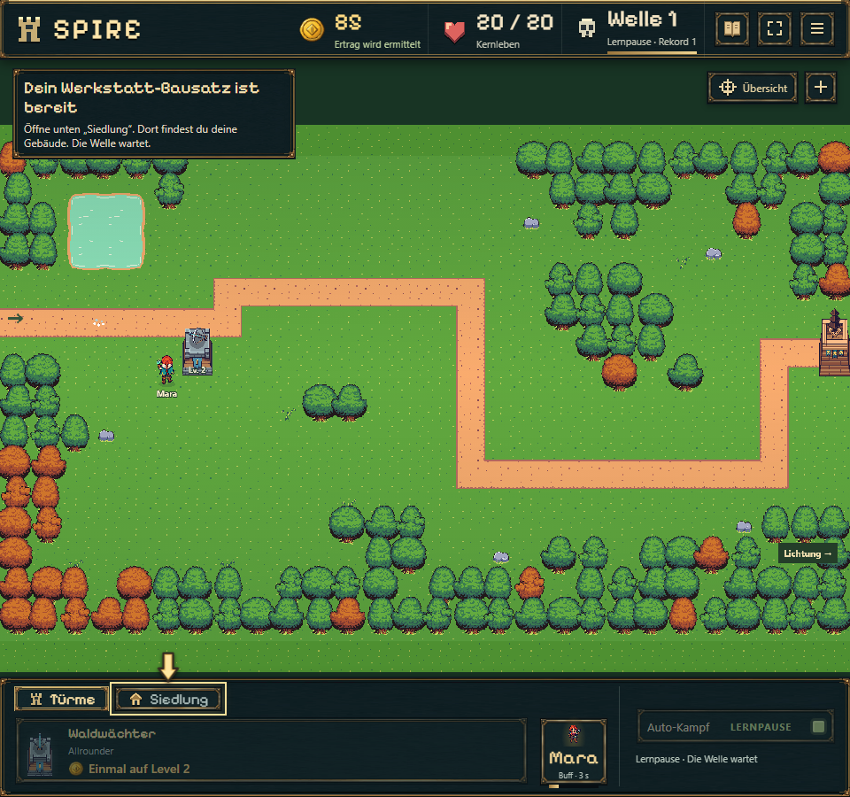

# Einstieg: echte Menüführung und Werkstatt-Bausatz

19.10.2026 · Branch `codex/idle-bastion-vertical-slice`. Keine neue G2-/15-Minuten-Abnahme.

## Ergebnis

Der Pfeil folgt den tatsächlich benutzten Bedienelementen: Türme → Startturm → Kartenfeld; Turm → Aufwerten; Siedlung → Werkstatt → Kartenfeld; gebautes Gebäude → Frostfassung; Türme → Frostkristall → Kartenfeld. Bereits passende Menüs werden übersprungen. Erklärende Kacheln haben keine Bauabkürzungen mehr. Begrüßung, Kampfbeginn und abgeschlossene Lernschritte behalten bewusste Bestätigungen.

Nach Level 2 und dem ersten Wellensieg wird die angeleitete Werkstatt kostenlos. Im Browser blieben beim Bau **85 Gold vor/nach Kauf** erhalten. Bereits bezahlte Werkstätten erhalten keine Erstattung. Normale Partien bzw. übersprungene Anleitung verwenden weiterhin 200 Gold. Bausatz und Lernfortschritt werden aus bestehenden gespeicherten Meilensteinen abgeleitet; kein Schemawechsel.

Die Hinweise sind klein am oberen Rand. Beim Werkstattbau bleiben sie 1,8 Sekunden vollständig verborgen; Konstruktion/Staub laufen während der Lernpause. Erst danach geht es bewusst zur Forschung. Skip liegt im Spielmenü.

## Kompakte Prüfung

- `node --import tsx --test experiments/idle-bastion/tests/onboarding.test.ts`: **11 bestanden**, darunter alle neun angebotenen Startplätze, Reload vor/nach Bausatz, Verhinderung wiederholter Geschenke, fehlschlagende/gleichzeitige Save-Transaktionen und Übernahme früherer Spielstände.
- Modellreferenz `tower-start`: Werkstatt nach 7,7 s Kampf; erste Frost-Kombination nach 23,325 s Kampf plus 58,025 s vorgegebener Vorbereitung/Lesezeit. Kein Echtspieler-Zeitversprechen.
- Echter Chromium-Durchlauf in **430×932, Touch/DPR2**, 1× und nur reguläre Klicks/verdientes Gold: vollständige Folge einschließlich Reload vor dem Werkstattbau. **20/20 Leben**, 2 Türme, 3 Gold; Werkstatt nach **8,575 s**, Frost-Verständnis nach **25,95 s Kampfzeit**. Lesezeit, Browserklicks und Reload kommen hinzu. Keine JavaScriptfehler oder horizontales Seitenüberlaufen. [Gespeicherte Ergebnisse und Zielabfolge](browser.json).
- Desktop: erste Baukarte bei 1600×1000; zusätzliche echte Folge bis Werkstatt/Forschung bei 960×900. Kein zweiter vollständiger Durchlauf und keine große Geräte-/Browsermatrix.
- `npm run idle:build`: erfolgreich. Der abschließende Build enthält zusätzlich konsistente Bausatztexte in Platzierung und Chronik; Desktopprobe darauf ausgeführt.

Bestehende Originalgrafiken verwendet. Keine neuen Imagegen-Assets. Ältere Berichte dokumentieren vorherige Preise und Abläufe; ihre Messwerte sind keine aktuelle Balanceabnahme.

## Ansichten

## Veröffentlichung

Codecommit `82a5a99`; [GitHub Pages 39268268295](https://github.com/emfau88/TD/actions/runs/39268268295) erfolgreich. Öffentlicher Playlink liefert `battle-OzF1aTOT.js` und `battle-BDiJOrpc.css`; beide per SHA-256 identisch zum lokalen Build. HTML enthält die neue Menüführung. [Normale Partie](https://emfau88.github.io/TD/idle-bastion/) · [Unabhängige frische Probe](https://emfau88.github.io/TD/idle-bastion/?fresh=1).
