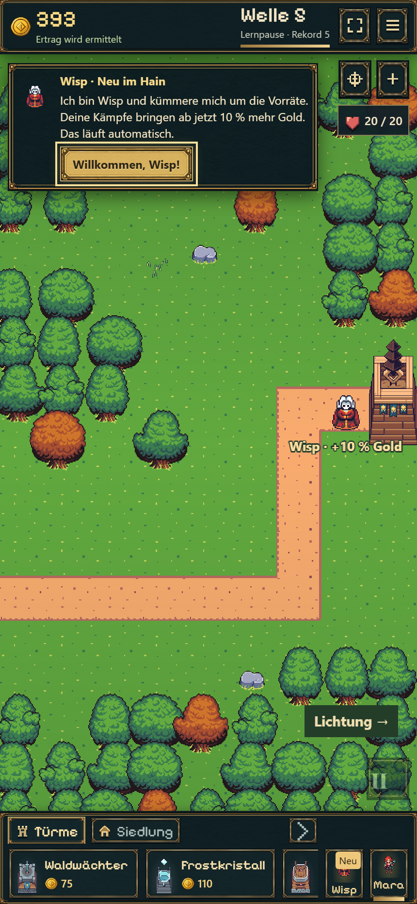
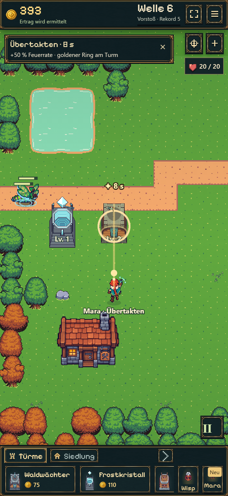
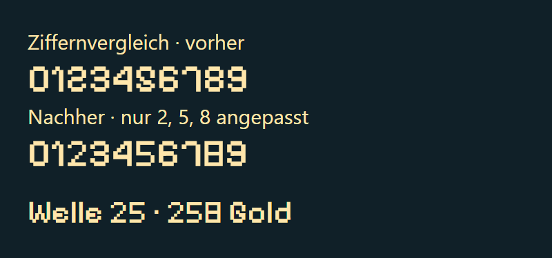
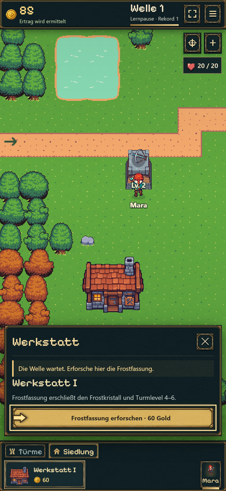

# Lesbare Hinweise, Wisp-Ankunft und ununterbrochener Tanz

19.10.2026 · aktuelle Nachbesserung im Idle-Branch.

## Ergebnis

- Niederlagenhinweis per × schließbar, auch nach Reload; neue verlorene Versuche können erneut informieren. Chronik bleibt erhalten.
- Wisp läuft vom eigenen Kern zur Werkstatt. Sein Weg bleibt während der Begrüßung sichtbar; eigene Kameraeingabe beendet das Folgen.
- Frost verlangsamt Rosenspiegel ohne Tanzabbruch. Tanzfenster und Klickbereich sind in beiden Dimensionen 15 % kleiner; Originalanimation, Herzen und Turmwirkung bleiben.
- Tutorialpfeile belegen freien Platz an echten Buttons, ohne Erklärungstext zu überdecken. Auf Bestätigungskarten genügt die Button-Umrandung.
- Mara wartet bei neuen angeleiteten Partien bis nach Wisp und der bestätigten Zauberankündigung. Danach nur eine kleine schließbare Leiste während der echten acht Sekunden Wirkung. Bereits laufende Altsave-Effekte bleiben erhalten.

Zusätzlich im selben Auftrag: Nur die Ziffern 2/5/8 erhalten klarere eigene Pixelglyphen, gleiche Breite, übrige Schrift unverändert. Maras Boost bekommt eine goldene Verbindung mit Lichtpunkt und sanfte Turmaura. Beides ist reine Darstellung des bestehenden Effekts und verändert keine Kampfwerte.

## Kompakte Prüfung

17 Tests aus `discovery.test.ts`/`onboarding.test.ts`, zwei neue Tests aus `readability.test.ts` und zwei gezielte Saveprüfungen aus `battle-save.test.ts` bestanden. Abgedeckt: neun sichere Startplätze durch Frost, frischer Standardstart bis Wisp ohne frühen Mara-Zauber und ohne verlorene Leben; Einführung, echter Cooldown, Pause/Reload, Migration und Niederlagenübergang. Frosttreffer auf einen regulär erreichten Bosskanal isoliert geprüft, einschließlich anschließendem Reload und weiterlaufendem Tanz.

`npm run idle:build` erfolgreich. Kurze Chromium-Kontrolle bei 430×932 mit DPR 2 und Desktop 1440×960: Wisp läuft während der Lernpause vom Kern; Ankündigung → echter Mara-Zauber → schließbare Leiste; Forschungspfeil im reservierten Buttonrand; Niederlagenhinweis schließen und neu laden; Bossfenster sichtbar. Wirkungsleiste gemessen: 320×54,84 CSS-Pixel. Keine Browser-JavaScriptfehler. [Messungen](browser.json), [regulär vorbereitete Prüfszenen](fixtures.json).

Prüfgrenzen: Der alte B10-Pakettest scheitert bereits in seinem historischen Aufbau an der 7–10-Minuten-Untergrenze (heute 6:33, alter Kaufablauf ohne gebauten Frostturm). Deshalb keine grüne Gesamtsuite behauptet: Der konkrete Frostfehler wurde separat mit aktuellen regulären Käufen und tatsächlich vorhandenem Frostturm geprüft. Keine vollständige neue 15-Minuten-Balanceprüfung oder physische Smartphone-/Safari-Abnahme. Die Einführung bleibt abschaltbar; Veteranen erhalten keinen neuen Zwangsdialog.

Zusätzliche kurze Hochkantprobe nach dieser Ergänzung: Schrift geladen, Ziffernvergleich visuell geprüft; regulärer Mara-Lauf und echter Boost zeigen Goldverbindung und Aura. Keine neuen Browserfehler. Die Ziffern-Vergleichsgrafik ist eine isolierte Typografieprobe, kein manipulierter Spielstand.

## Ansichten

[Wisp läuft weiter](mobile-wisp-walking.png) · [Bossfenster am Desktop](desktop-boss.png)

## Veröffentlichung

Commit/Push und öffentliche Auslieferung werden nach Abschluss ergänzt. [Playlink](https://emfau88.github.io/TD/idle-bastion/) · [Frische Probe](https://emfau88.github.io/TD/idle-bastion/?fresh=1).
