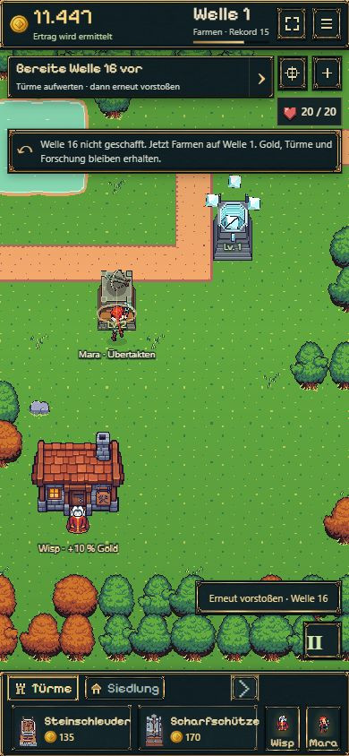

# B08 — Wisp, Turmrollen und Bauplätze

18.10.2026 · Umsetzung auf `codex/idle-bastion-vertical-slice` · [Spielen](https://emfau88.github.io/TD/idle-bastion/) · [Frische getrennte Probe](https://emfau88.github.io/TD/idle-bastion/?fresh=1).

Der Nutzer gab G1 und B08 ausdrücklich frei: „Ok go, halte deine Tests so kompakt und klein wie möglich“. Paketstatus ausschließlich in der [Roadmap](../../../../experiments/idle-bastion/ROADMAP.md).

## Spielbares Ergebnis

- Nach Frostfassung und Welle 5 kommt Wisp kostenlos. Er erledigt sichtbare Werkstattgänge; +10 % Gegner-/Wellen-Gold wirkt automatisch und bleibt durch Reload erhalten. Keine Sammelobjekte oder Charakterlevel.
- Steinschleuder: 135 Gold, Flächenschaden; Scharfschütze: ab Welle 10, 170 Gold, bevorzugt Rüstung und durchdringt sie. Frost bleibt der Kontrollturm, Waldwächter der günstige Allrounder.
- Zwei weitere Plätze bei Welle 5 und zwei bei 10: acht nutzbare Plätze im bestehenden Startgebiet. Die östliche Erweiterung bleibt für B11 reserviert.
- Ab Welle 6 kommen engere Käfergruppen, ab 11 einzelne Panzerskorpione mit 45 % Rüstung. Anfängliche Werte, Preise und Wellen 1–5 bleiben erhalten.
- Dock, Ziele, Bauplatzwahl und Chronik erklären die neuen Rollen. Mobile Turmkarten scrollen horizontal; HUD und Dock behalten 56 / 96 px. Der beim Farmen sichtbar gewordene abgeschnittene Vorstoßknopf wurde korrigiert.

## Kompakte Prüfung

Gezielt ausgeführt: `b08`, `battle-save`, `farming`, `offline`, `progress`, `save-store` — zusammen 72 Tests, rund 3,5 Sekunden für den gemeinsamen Lauf. Sechs neue Szenarien decken Freischaltungen/Reload, Flächenschaden, Rüstungsdurchdringung, Schema-5-Migration, exakte Bonus-/Offline-Abrechnung und einen regulär finanzierten Verlauf ab. Keine zusätzliche vollständige Testsuite und keine erneute lange Nutzerabnahme.

Im ersten Lauf aufgedeckter Fehler: Ein Spawn-Timer lag durch Gleitkommarundung knapp über 1,65 s und machte einen gültigen späteren Kampf unspeicherbar. Positive Rundungsreste werden beim nächsten Spawn auf null begrenzt. Alte Tests mit absichtlich zukünftigen Versionsnummern wurden auf Schema 7 / Regeln 5 aktualisiert; der Welle-15-Speichertest kauft und verbessert nun regulär die in B08 verfügbaren Türme. Nach den Korrekturen bestanden die drei zuletzt betroffenen Szenarien separat; die übrigen gezielten Prüfungen waren bereits grün. `npm run idle:build` inklusive TypeScript erfolgreich.

Automatisierter 1×-Modellverlauf mit sofortigen legalen Käufen: Werkstatt 83,95 s, Frostfassung 102,075 s, Wisp 102,075 s; alle vier Rollen genutzt und Welle 12 erreicht. Das sind Simulationszeiten, keine neuen Browser-/Nutzerzeiten. Wisp kommt bei optimalem Kaufen etwas früher als das weiche 2–4-Minuten-Ziel. Kein Timer und keine Preiserhöhung verzögern künstlich den bereits gemessenen Einstieg. Der Speicher-Regressionslauf erreichte zusätzlich Welle 16 mit regulären Käufen/Upgrades.

Browser: bestehende agenteneigene Partie `premium-ui-1` mit Forschung und Rekord 15 übernommen. Historische Offline-Belohnung regulär eingesammelt, Steinschleuder am Engpass und Scharfschütze am Südweg gekauft, Wisp-Erklärung geöffnet, neu geladen und neue Türme/Freischaltungen wiederhergestellt. Nach Niederlage regulärer Rückfall auf Welle 1 und neuer sicherer Farmnachweis. Keine manipulierten Browserressourcen oder Eingriffe in den Hauptspielstand.

Desktop 1280×721 und Hochkant ca. 390×844 angesehen. Mobile Messung: Header 55,99 px, Dock 96,00 px; kein horizontaler Dokumentüberlauf. Neue Turmkarten über den Pfeil erreichbar, Vorstoß und Pause vollständig sichtbar. Keine erfassten Browserwarnungen oder -fehler. Eine weitere reale Handy-/Safari-Abnahme wurde nicht durchgeführt.

## Speicherung und Grenzen

Kampfschema 6 / Regeln 4 erhalten Gold, Statistik, Mara und laufenden Kampf aus älteren Versionen. Bereits gestartete Wellen behalten bis zum nächsten Versuch ihre alte Gegnerfolge. Aktive Farmnachweise werden nach dem Regelwechsel neu verdient; historische Offline-Ansprüche behalten ihre damalige Rate. Wisps Bonus ist in neuen Zertifikaten enthalten und wird beim Claim nicht erneut aufgeschlagen.

Neue Assets waren nicht nötig: Original-Wisp, Tower 03/04 und Scorpion aus dem vorhandenen Bestand. Framegrößen, Richtungen und Skalierung sind in der [Art Direction](../../../../experiments/idle-bastion/docs/ART_DIRECTION.md) dokumentiert. Premium-Materialien bleiben unverändert.

Offen bleiben Lager (B09), Boss (B10), Kartenerweiterung (B11), Werkstatt II (B12), vollständige 15-Minuten-Abnahme und die separat vorgemerkte Mara-/Werkstattschild-Überarbeitung. Balance nach dem Einstieg bleibt ein erster spielbarer Stand.

## Echte Spielaufnahmen

