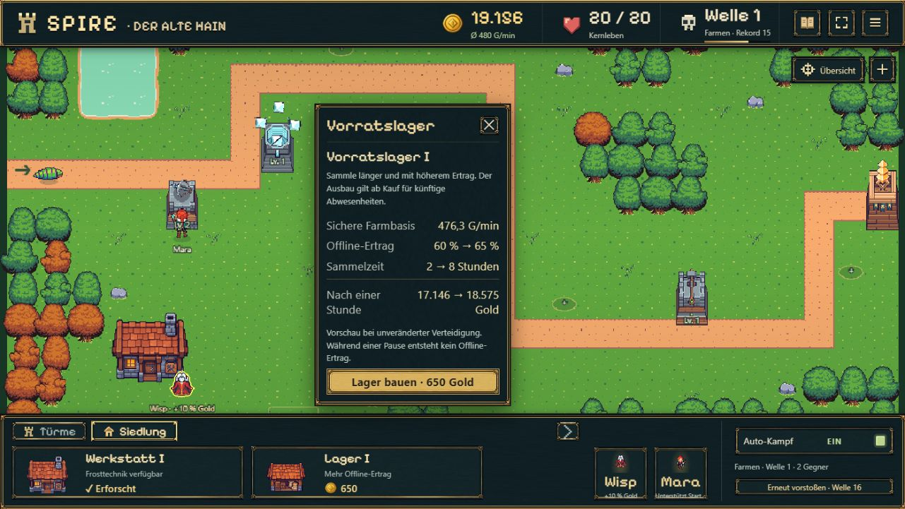
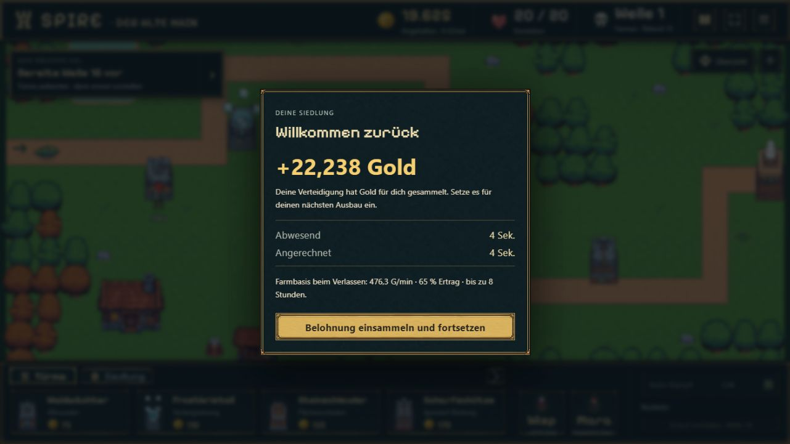
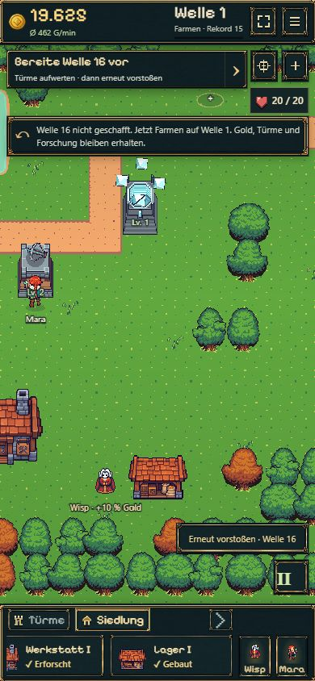
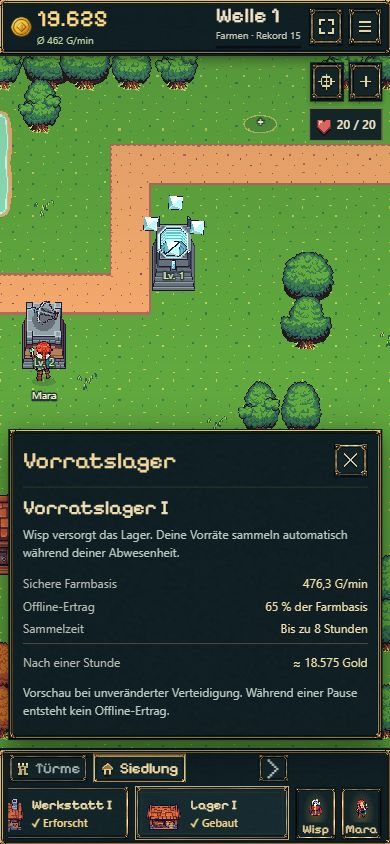

# B09 — Vorratslager und befriedigende Rückkehr

18.10.2026 · `codex/idle-bastion-vertical-slice` · [Spielen](https://emfau88.github.io/TD/idle-bastion/) · [Frische getrennte Probe](https://emfau88.github.io/TD/idle-bastion/?fresh=1). Paketstatus ausschließlich in der [Roadmap](../../../../experiments/idle-bastion/ROADMAP.md).

## Ergebnis

- Vorratslager I nach Wisp und gemeisterter Welle 8, einmalig 650 Gold. Eigenes kleineres Gebäude, kurzer Staubimpuls, Bauplatzmarkierung verschwindet nach Kauf.
- Wisp versorgt Werkstatt und Lager über die vorhandenen freien Wege. Der bestehende +10-%-Kampfbonus ändert sich nicht.
- Künftige Abwesenheiten: 65 % der sicheren Farmbasis, höchstens acht Stunden. Kaufvorschau zeigt Basis, bisherigen/neuen Satz, Limit und Ein-Stunden-Ertrag; Pause ist ausdrücklich null.
- Rückkehrbeleg mit hervorgehobenem Gold, lesbaren Zeitangaben, angerechneter Zeit und tatsächlich eingefrorener Policy. Zusätzliche Zeit bis zum Einsammeln zählt bis zur bestehenden Grenze mit.
- Schema 7 / Kampfregeln 4 übernimmt B08 ohne Verlust von Farmnachweisen, Geld oder laufendem Kampf. Historische Abwesenheiten bleiben bei ihren alten Werten; Claim und Gold werden gemeinsam gespeichert.

## Kompakte Prüfung

Gezielter Lauf: neue `b09`-Szenarien plus `offline`, `battle-save`, `save-store`; 53 Tests, etwa drei Sekunden Testlaufzeit. 52 sofort grün; ein neuer Wegtest verwendete versehentlich Set statt des vorhandenen Zellarrays. Nach Korrektur und Ergänzung der 30-Sekunden-Fortsetzung bestanden alle fünf B09-Szenarien separat in etwa zwei Sekunden. Keine vollständige Testsuite. TypeScript und Produktionsbuild erfolgreich.

Regulärer 1×-Modellverlauf ohne geschenktes Geld oder gesetzte Freischaltungen: Waldwächter Nordost, Mara zuweisen, erstes Upgrade, Werkstatt, Frostfassung, Frost Nordwest, Steinschleuder am Engpass, Türme bis Level 3. Lager nach **316,4 Sekunden (5:16), Wellenrekord 13** finanzierbar. Die Bedingung ist Welle 8; weitere bewusste Turmkäufe verschieben den tatsächlichen Zeitpunkt. Kein künstlicher Tutorialtimer.

Auf genau diesem erspielten Stand: Lager über BattleSession gekauft, gespeichert und geschlossen; Uhr des isolierten Tests um eine Stunde vorgerückt. Wieder geöffnet, **19.219,2 Gold** genau einmal erhalten, zwei echte Turmupgrades bezahlt, 30 Sekunden mit weiteren Abschüssen regulär weitergespielt und erneut dauerhaft gespeichert. Das ist ein kontrollierter Integrationstest mit injizierter Uhr und isolierter IndexedDB, keine behauptete Stunde Browserwartezeit.

Weitere gezielte Nachweise: altes 60-%-/2-h-Fenster bleibt beim Upgrade unverändert; nächstes Fenster 65 % / 8 h; 12 und 20 Stunden Abwesenheit, wiederholte Rückkehr vor Claim, JSON-Reload, doppelte Claims, Pause, ungültige gemischte Policy, Kaufpreis/Voraussetzungen und Weg zum Lagereingang. Ältere absichtlich zukünftige Schemaversionen in Tests auf 8 angehoben.

Browser: agenteneigene bestehende Partie `premium-ui-1`, Rekord 15, regulär übernommen. Alte 60-%-Rückkehr eingesammelt, Lagervorschau geöffnet, 650 Gold bezahlt, Lager gebaut. Nach Reload erschien der neue Beleg mit **65 % / 8 Stunden** und wurde regulär eingesammelt. Kein Eingriff in Ressourcen oder Spielstände über Browser-Injektion.

Desktop und Hochkant geprüft: circa 1280 × 721 bzw. 390 × 844. Mobil Header 55,99 px, Dock 96,00 px, kein horizontaler Dokumentüberlauf. Beide Siedlungskarten erreichbar, Lagerdetails lesbar, Karte und Wisp sichtbar. Keine erfassten Browserwarnungen oder -fehler. Keine zusätzliche reale Handy-/Safari-Geräteabnahme.

## Grafik und Grenzen

Ein neues Asset mit dem eingebauten Imagegen-Tool, Stilreferenz vorhandene Werkstatt und echte B08-Karte. Original, vollständiger Prompt und reproduzierbare technische Aufbereitung im [Assetnachweis](../../../../experiments/idle-bastion/assets/warehouse/README.md). Keine weitere UI-Grafikserie.

Die Stundenvorschau setzt unveränderte sichere Farmbasis voraus. Offline-Kampf, neue Wellen, Bosse oder Freischaltungen werden nicht simuliert. Der Stundenbetrag ist der konkrete Teststand, kein allgemeines Ertragsversprechen. B10 (Boss), B11 (Erweiterung), B12 (Werkstatt II) und spätere Gesamtabnahmen bleiben offen.

## Echte Aufnahmen

