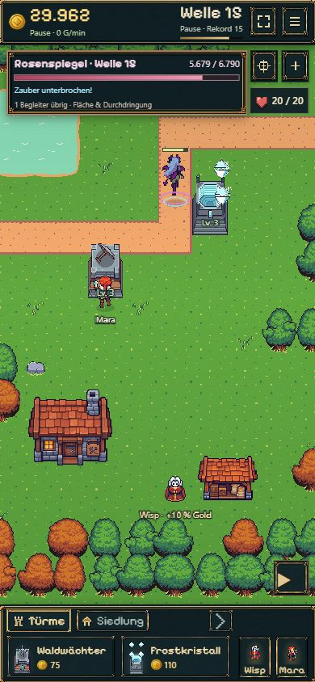
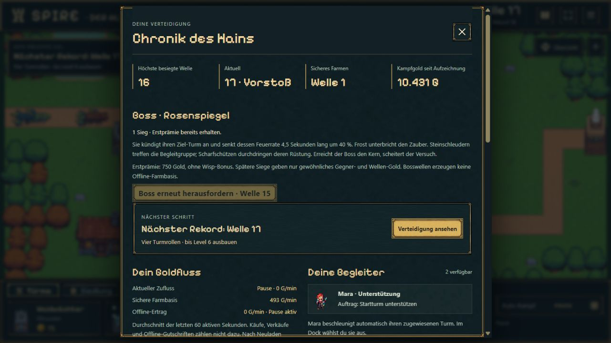

# B10 — Rosenspiegel als erste Bossherausforderung

18.10.2026 · Auftrag „Go b10“ plus Nutzervorschlag, den Succubus aus dem Hauptstrang zu verwenden. Paketstatus und Veröffentlichung: [Roadmap](../../../../experiments/idle-bastion/ROADMAP.md#b10--erste-bossherausforderung).

## Ergebnis

Rosenspiegel ersetzt die ursprünglich vorgesehene Magmakrabbe in Welle 15. Ein Boss und acht Begleiter, darunter ein Panzerskorpion, verwenden vorhandene Grafiken. Der Herzfaden kündigt einen Turm an; ihre Verführung senkt dessen Feuerrate 4,5 Sekunden lang um 40 %. Frost unterbricht den Zauber. Flächentreffer helfen gegen die Gruppe; der Scharfschütze ignoriert Rüstung. Bei Erreichen des Kerns scheitert die Welle sofort und geht ins sichere Farmen über. Wiederholen erfolgt bewusst über Vorstoß oder Chronik.

Der Bossrahmen ersetzt den Zielstreifen und zeigt HP, Fähigkeit/Ziel/Restdauer sowie übrige Begleiter. Verführte Türme werden rosa markiert. Der erste vollständige Wellenabschluss vergibt einmalig 750 Gold, ohne Wisp-Bonus und ohne künstlichen Anstieg des laufenden Goldzuflusses. Wiederholungen vergeben nur gewöhnliches Kampf-Gold. Bosswellen erzeugen keine Farm-/Offline-Basis.

Kampfschema 8 / Regeln 5 speichern Bosszähler, angeforderte Herausforderung und sämtliche Zaubertimer. Vorhandene Rekorde werden nicht nachträglich als Bosssieg ausgegeben; alte laufende Rezepte werden unverändert beendet. Die Chronik erlaubt auch mit einem höheren alten Rekord die neue Herausforderung. Geld, Käufe, Statistik und historische Offline-Ansprüche bleiben erhalten; aktive Farmnachweise werden für die neuen Regeln erneuert.

## Kompakte Prüfung

- TypeScript und Produktionsbuild (`npm run idle:build`) erfolgreich.
- 74 gezielte Tests aus B10, B08/B09-Migration, Kampfspeicherung, Farming, Offline und IndexedDB erfolgreich, zusammen rund 6,5 Sekunden Testlauf. Keine vollständige klassische Testsuite. Die vier B10-Tests nach Bereinigung der Messausgabe erneut erfolgreich.
- Frischer Modelllauf ausschließlich über normale Käufe: Werkstatt/Frost, Frostturm, Steinschleuder, Level 3, Lager, Scharfschütze und weiterer Waldwächter. Kein geschenktes Gold, keine manipulierten Freischaltungen. Lager bei **5:16,4**, erste Bossbegegnung bei **5:49,7**. **Erster Sieg bei 9:41,7**, im zweiten Versuch nach einer Niederlage/Farmphase und bewusstem Vorstoß. Ziel 7–10 Minuten bezieht sich auf den ersten Sieg. Fünf Türme auf Level 3, zusätzlicher Waldwächter auf Level 1; sechs Frost-Unterbrechungen über den Ablauf.
- Zahlung am Sieg exakt geprüft; Wiederholung zahlt keine zweite Erstprämie. Boss-/Offline-Ausschluss, Niederlage, expliziter Wiederholungsauftrag, Verkauf des verführten Turms sowie ungültige Zauberreferenz geprüft. Save mitten in der Verführung ergibt nach 20 weiteren simulierten Sekunden exakt denselben Kampfzustand.
- Echter Browser: vorhandene isolierte Agenten-Probe `premium-ui-1` aus B09 migriert. Historischen Offline-Beleg eingesammelt, bestehende fünf Türme mit verdientem Gold auf Level 3 gebracht, Herausforderung über Chronik gestartet. Verführung, Herzfaden, Frost-Unterbrechung und späterer Sieg sichtbar. Dieser ältere, goldreiche Spielstand dient der UI-/Migrationsprüfung, nicht dem obigen Frischstart-Zeitnachweis.
- Browser-Reload während Frost-Unterbrechung: **5.679 / 6.790 HP**, ein Begleiter und Unterbrechungszustand nach Rückkehr identisch. Anschließend bis zum Sieg weitergespielt; Chronik bestätigt **1 Sieg · Erstprämie bereits erhalten**. Keine Browser-Konsolenfehler beobachtet.
- Desktop 1281 × 720 und Hochkant 390 × 844 angesehen. Mobile HUD-/Dock-Höhen, Pause, Kamerasteuerung und Bossrahmen bleiben kompakt. Keine neue echte Smartphone-/Safari-Abnahme.

## Echte Spielaufnahmen

## Grenzen

Ein legaler zielgerichteter Spielablauf belegt den ersten Sieg, keine umfassende Balance aller Kauf-/Platzierungsvarianten. Karte und vorhandene Figurensteuerung bleiben unverändert. Östliche Lichtung, Werkstatt II und zweiter Boss gehören zu späteren Paketen. Es wurden keine neuen Bilder erzeugt; verwendet wird das vorhandene 64-px-Succubus-Sheet, im Spiel leicht auf 1,15 skaliert, sowie die bestehenden Premium-UI-Materialien. Das große Tanzfenster des klassischen Spiels wurde bewusst nicht übernommen, damit die Karte frei bleibt.
