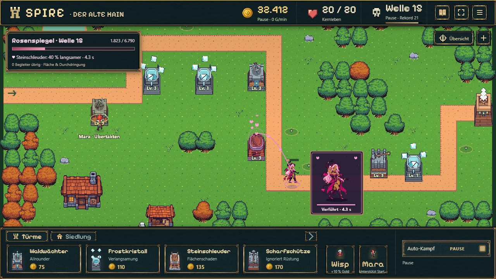
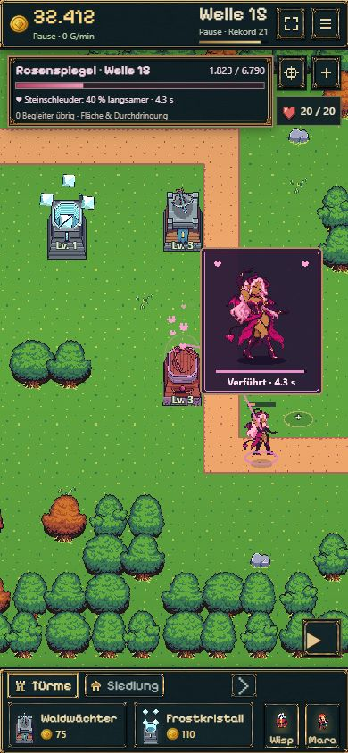

# Rosenspiegels Tanzfenster und Turmeffekte

18.10.2026 · ausdrückliche Ergänzung nach B10. Paketstatus und Veröffentlichung in der [Roadmap](../../../../experiments/idle-bastion/ROADMAP.md#ergänzung-nach-b10--rosenspiegels-tanzdarstellung).

## Ergebnis

Das vorher fehlende große Tanzfenster ist integriert. Es verwendet die acht eigenständigen 128er Posen aus `public/assets/Succubus Dance HD v1.png`, unverändert und per SHA-256 identisch mit dem Hauptcheckout. Die Framefolge und 190-ms-Bilddauer stammen aus `reference/src/succubus-art.ts`; Fenster, Herzfaden, Partikel, Glanz und Turmwackeln sind gezielt aus `reference/src/scene.ts` übernommen. Keine neue Bildgenerierung.

Der kleine Körper bleibt auf der Karte. Das zusätzliche Fenster zeigt dieselbe Tanzphase größer, dazu Restdauer und Ablaufbalken. Es bleibt beim Kartenzoom 136 × 164 CSS-Pixel groß und im sichtbaren Bereich. Die Platzierung vermeidet nach Möglichkeit Boss und Zielturm; ein Klick durch das Fenster kann keinen darunterliegenden Bauplatz auswählen. Der betroffene Turm pulsiert rosa, wackelt leicht und gibt Herzen ab. Ein geschwungener Herzfaden zeigt die Verbindung zur Quelle.

Die Darstellung berechnet ihre Zeit aus der gespeicherten Vorbereitungs-/Wirkungsphase und Restdauer. Kein eigener Animationstimer und keine Änderung an Simulation, Balancing oder Speicherformat. Bei Frostunterbrechung, fehlendem Ziel, Tod oder Effektende werden Fenster/Herzen entfernt und die Turmposition und -farbe im nächsten Bild zurückgesetzt.

## Kompakte Prüfung

- TypeScript und `npm run idle:build` erfolgreich; der zusätzliche Originalatlas ist im Produktionspaket enthalten (20,59 kB). `git diff --check` ohne Befund.
- Reguläre Boss-Wiederholung über die Chronik in der bereits vorhandenen isolierten Browserpartie `premium-ui-1`; keine Injektion von Gold, Bossen oder Spielzustand. Für die Sichtprüfung den Frostturm am Mittelpass regulär verkauft und danach wieder regulär gebaut.
- Desktop 1280 × 720: Vorbereitung mit 0,2 s Restzeit und aktive Verführung der Steinschleuder mit 4,3 s beobachtet. Großes Fenster, Originalpose, Turmfärbung, Herzfaden und aufsteigende Herzen sichtbar.
- Hochkant 390 × 844: Fenster bleibt gleich groß, HUD/Dock bleiben kompakt. Durch Ziehen der Karte Boss und Turm neben dem Fenster sichtbar. Nach Fortsetzen bis 3,8 s deutlich andere Tanzpose und Herzposition; Pause hält den Zustand während der weiteren Bedienung konstant.
- Regulärer Frostbau am Mittelpass unterbricht den laufenden Zauber. Meldung „Zauber unterbrochen!“ sichtbar; Fenster und Herzen verschwinden, Turm wieder normal. Keine Browser-Konsolenfehler.
- Keine breite Testsuite oder erneute Balance-Runde; ausschließlich Darstellung verändert. Hochkant ist eine Browserprüfung, keine vollständige Smartphone-Abnahme. B11 nicht begonnen.

## Spielaufnahmen

