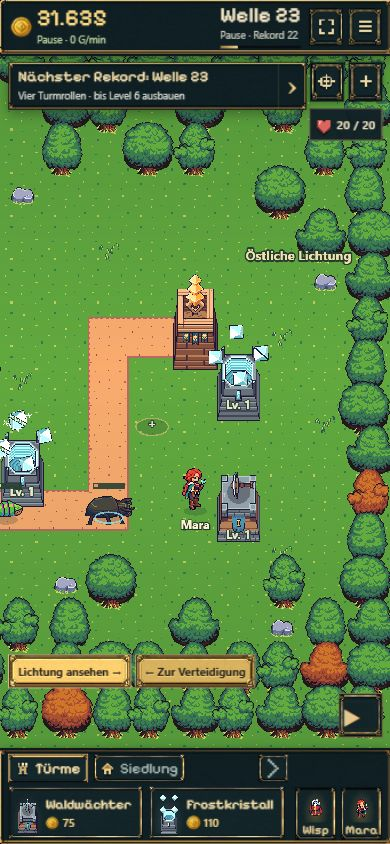

# B11: Östliche Lichtung

18.10.2026 · Paketstatus und Veröffentlichung in der [Roadmap](../../../../experiments/idle-bastion/ROADMAP.md#b11--scrollbare-lichtung-mit-tatsächlichem-nutzen).

## Ergebnis und Bedienung

Nach dem ersten echten Rosenspiegel-Sieg: **Siedlung → Östliche Lichtung → 900 Gold**. Die vier zusätzlichen Spalten vergrößern die Welt von 28×16 auf 32×16 Zellen. Östlicher Sporn (28,7) und Ostbogen (28,10) sind die zwei neuen Turmplätze. Beide erreichen den letzten Wegabschnitt und überlappen bereits mit Frost Level 1 den Schussbereich eines Waldwächters Level 1 an der Kernwache (26,8). Keine künstliche Reichweitenänderung.

Beim Kauf bleiben Gegnerpfad, Kern, Kampf und Zoom erhalten. Der bisherige Waldrand öffnet sich, die neue Außenkante wird mit vorhandenen Waldassets gestaltet. Alte Baumvarianten und Positionen bleiben stabil. Keine Bildgenerierung oder zusätzliche Gebäudeserie. Die Kamera wechselt erst über „Lichtung ansehen“; Ziehen und „Zur Verteidigung“ führen zurück. Die kompakte mobile Oberfläche behält ihre Abmessungen.

Schema 9 speichert Kaufzeit und Gebietszustand. Alte Spielstände öffnen das Gebiet erst nach dem regulären Kauf. Der bereits gewonnene Boss zählt weiterhin; ein bloßer alter Welle-15-Rekord zählt nicht als Bosssieg. Beim fehlgeschlagenen Speichern werden Gold und Geometrie gemeinsam zurückgerollt.

## Kompakte Prüfung

- `npm run idle:build`: TypeScript und Produktionsbuild erfolgreich.
- Gezielt `b11.test.ts`, `b10.test.ts`, `battle-save.test.ts`, `save-store.test.ts` und `usability.test.ts`; außerdem drei bestehende Migrations-/Validierungsfälle aus `farming.test.ts` und `mara.test.ts`. Alle betroffenen Tests nach Korrekturen erfolgreich, keine vollständige Gesamtsuite oder neue Endlos-Balancerunde.
- Kaufbedingungen, einmalige Abbuchung, unveränderter laufender Kampf, gesperrte Plätze, Schussüberschneidungen, Mara-Zugänge, Farmzertifizierung, Reload und gezielter IndexedDB-Schreibfehler geprüft.
- Im vorhandenen legalen Modellablauf erster Boss nach **581,675 s (9:42)**, 933 Gold; Lichtung unmittelbar danach für 900 Gold geöffnet, 33 Gold übrig. Keine geschenkten Testressourcen in dieser Zeitmessung. Das ist ein konkreter Spielweg, keine Garantie für andere Kaufentscheidungen.
- Vorhandene isolierte Browserpartie `premium-ui-1` regulär übernommen, ohne Zustands-/Goldinjektion. Dabei wurde eine Ablehnung von Schema-8-Spielständen mit laufendem Boss entdeckt und vor Veröffentlichung korrigiert; eigener Regressionstest mit aktivem Tanzkanal ergänzt. Der alte Browserstand lud danach mit unverändertem Boss, Gold und Pause.
- Desktop **1280×720**: Lichtung im laufenden Kampf gekauft, anschließend bewusst angesehen; Frostkristall am Sporn und Waldwächter am Ostbogen regulär gebaut. Kampf an der letzten Wegkurve beobachtet. Verwaltung schließt nach dem Bau. Mara zum Ostbogen geschickt und Ankunft sichtbar bestätigt. Manuelles Ziehen und Gebietswechsel funktionieren.
- Hochkant **390×844**: erreichbare Gebietsschaltflächen, kompakter Kopf/Dock, neue Türme und Mara im Ausschnitt sichtbar. Regulärer Reload erhält Ausbau, beide Käufe und Maras Ziel; Rückkehr zur Startverteidigung geprüft. Keine Konsolenfehler beim finalen Browserdurchgang.
- Hochkantprüfung im Browser, keine vollständige Smartphone-/Safari-Abnahme. B12 und ein neuer vollständiger 15-Minuten-Abnahmelauf gehören nicht zu dieser Prüfung.

## Spielaufnahmen

Lokaler Produktionsbuild, vorhandene reguläre Testpartie nach Kauf und Reload; für klare Aufnahmen pausiert.

## Veröffentlichung

Wird nach erfolgreichem Pages-Lauf mit Codecommit und öffentlicher Prüfung ergänzt.
