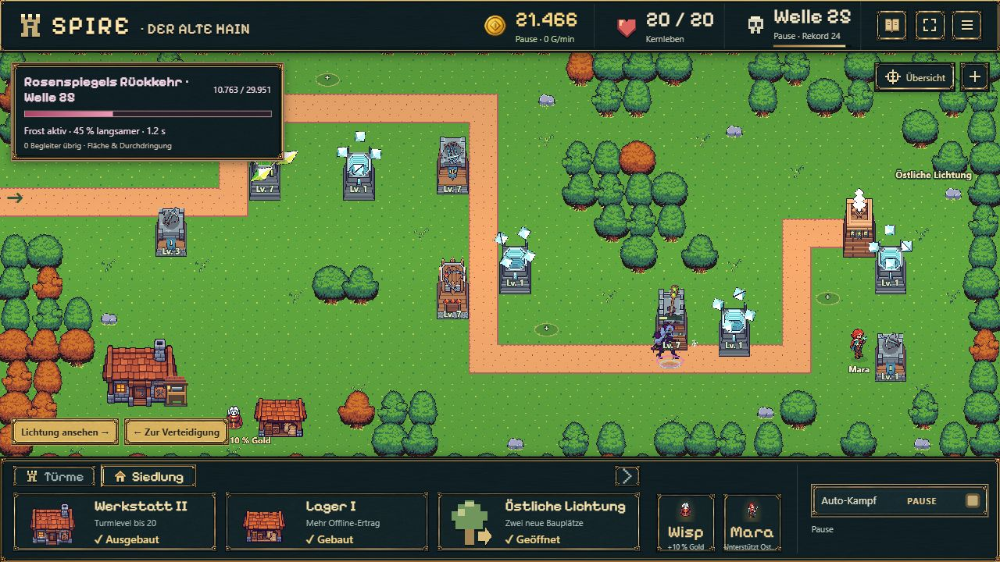
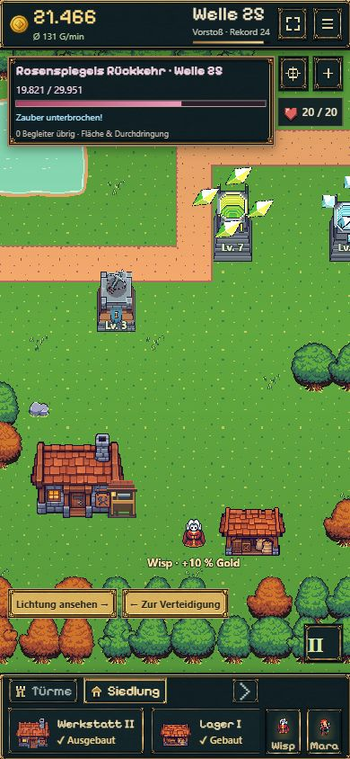

# B12 – Werkstatt II und Fortsetzung

Geprüft am 18.10.2026 auf `codex/idle-bastion-vertical-slice`. Paketstatus und Freigaben stehen ausschließlich in der [Roadmap](../../../../experiments/idle-bastion/ROADMAP.md).

## Spielbare Änderung

- Nach geöffneter Lichtung und Frostfassung: Siedlung → Werkstatt → **Werkstatt II, 1.200 Gold**. Ein kleiner überdachter Arbeitsplatz erscheint am bisherigen Haus.
- **Level 7–20** mit normalen Goldkäufen. Grafikstufen I / II / III entsprechen Level 1–3 / 4–6 / 7–20. Höhere Level bringen Schaden, keine unbegrenzte Reichweite oder Feuerrate.
- **Welle 25:** Rosenspiegels Rückkehr mit zwölf Begleitern, bestehendem Tanzfenster und separater einmaliger **1.200-Gold-Prämie**. Welle 15 bleibt wiederholbar; beide Begegnungen sind aus dem Offline-Farmen ausgeschlossen.
- Nach Niederlage weiter sicher farmen, Verbesserungen kaufen und bewusst erneut vorstoßen. Nächstes Ziel nennt einen real verfügbaren Kauf; nach Vollausbau bleibt weiteres Vorstoßen möglich.
- Schema 10 / Regeln 6 übernehmen vorherige Spielstände einschließlich Lichtung, Gold und laufendem Kampf. Historische Offline-Belege bleiben erhalten; ein alter Welle-25-Rekord zählt nicht als neuer Bossgewinn.

## Kompakte technische Prüfung

`npm run idle:build` erfolgreich, einschließlich TypeScript-Prüfung. Sieben gezielte B12-Tests erfolgreich: Kaufbedingungen/Einmaligkeit, Level-20-Grenzen und Originalstufen, Schema-9-Migration, zweiter Boss mit Reload und einmaliger Prämie, Bossniederlage mit manuellem Wiederanlauf, atomarer Speicherkauf samt Rollback, legaler Folgeablauf und begrenzte Spätwellen/Ziele.

Zusätzlich die betroffenen B10/B11- und Kampf-Speicherfälle geprüft (22 erfolgreich); neue Versionsannahmen durch gezielte Migrations-/Zukunftsformat-Fälle geprüft. Keine komplette Regression oder Gerätetestmatrix. Ein zunächst aufgefallenes Zielproblem bei maximal ausgebauten Veteranenständen wurde korrigiert und erneut geprüft: spätere Spielstände fallen nicht in alte Turmrollen-Tutorials zurück.

## Tempo: ehrlich getrennt von B13

Der Modellablauf verdient sämtliches Gold durch reguläre Kämpfe; keine Guthabeninjektion. Nach der vorhandenen B10-Eröffnung: erster Boss und Lichtung bei **9:42**, Werkstatt II bei **13:01**. Nach 15 Minuten **Rekord 20**, Turmlevel 3–4 und nächster konkreter Kauf für 169 Gold. Welle 25 ist das sichtbare nächste Bossziel, in diesem Ablauf noch nicht erreicht. Die ambitionierte ursprüngliche Vorstellung von Level 7–10 innerhalb der ersten 15 Minuten ist damit **noch nicht nachgewiesen**. Diese gesamte Balancekurve ist der nächste Prüfgegenstand in B13; B12 behauptet weder einen garantierten 15-Minuten-Bosssieg noch eine G2-Abnahme.

Die Grenztests verwenden ausdrücklich reiche Einheiten-Fixtures; diese sind keine Zeit- oder Wirtschaftsnachweise. Der folgende Browsercheck nutzt einen bestehenden Teststand mit zuvor angesammeltem Offline-Gold.

## Tatsächlicher Browsercheck

Vorhandenen lokalen B11-Teststand übernommen, Werkstatt II für 1.200 Gold gekauft und alle vier Rollen regulär auf Level 7 aufgewertet. Reload erhält Anbau, Level und vorgemerkten Vorstoß. Welle 23/24 gespielt und Welle 25 erreicht: eigenes Bossbanner mit 13 Gegnern, HP, Frost-/Verführungseffekt und getrennte Chronikzähler sichtbar. Keine gemeldeten Konsolenfehler/-warnungen im geprüften Abschnitt.

Desktop 1280×720 und kompakte Hochkantansicht 390×844 geprüft. Mobil bleiben rund 56 px HUD und 96 px Dock; Werkstattdetails sind aufrufbar, Bossanzeige und Kartenbedienung bleiben nutzbar. Kein horizontaler Seitenüberlauf in der Probe. Kein vollständiger Test auf echter Smartphone-Hardware/Safari.

## Grafiken

Kein neues Imagegen-Bild. Der Anbau ist eine kleine eigene Phaser-Pixelgrafik; das bestehende Werkstattasset wurde nicht verändert. Die dritten Waffenatlanten stammen unverändert aus den vorhandenen Foozle-Paketen. Raster, Anker und Herkunft stehen in [ART_DIRECTION.md](../../../../experiments/idle-bastion/docs/ART_DIRECTION.md).

## Veröffentlichung

Codecommit **`c40864cc278d95222429cfe5f202a4cd5f6c2489`** gepusht. [GitHub-Pages-Lauf 39147533177](https://github.com/emfau88/TD/actions/runs/39147533177) erfolgreich; bestehendes Spiel und Idle-Build liefen auch in CI durch. Öffentlicher Playlink im Browser geladen, Bundle `battle-CqIGhtYi.js` bestätigt, vorherigen pausierten Spielstand mit unverändertem Gold/Rekord übernommen und neue getrennte Bosschronik gesehen. Keine Konsolenfehler im öffentlichen Check. [Playlink](https://emfau88.github.io/TD/idle-bastion/).
