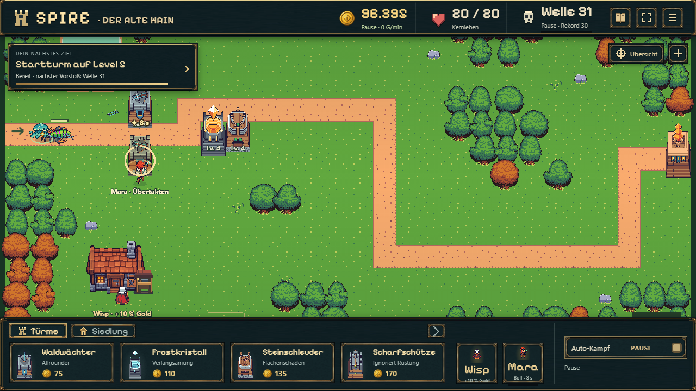
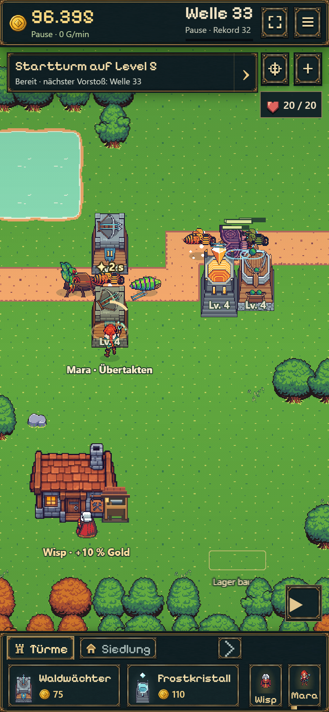
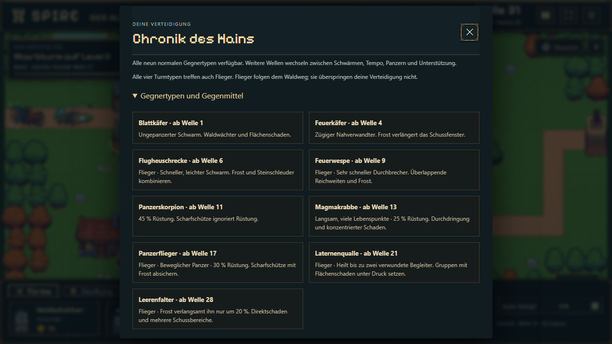

# B12c — Vorhandene Gegner und spürbare Rollen

Geprüft am 18.10.2026 auf `codex/idle-bastion-vertical-slice`. Status und Veröffentlichung führt die [Roadmap](../../../../experiments/idle-bastion/ROADMAP.md). [Spielregeln und Grafikherkunft](../../../../experiments/idle-bastion/docs/ENEMIES.md).

## Ergebnis

Sechs weitere vorhandene Figuren: Flugheuschrecke ab Welle 6, Feuerwespe ab 9, Magmakrabbe ab 13, Panzerflieger ab 17, Laternenqualle ab 21, Leerenfalter ab 28. Damit neun normale Typen plus die bestehenden Bossbegegnungen. Gestaffelte Einführung, wechselnde Gruppenmuster, unterschiedliche Geschwindigkeit/Rüstung, begrenzte Heilung und Frostresistenz. Alle vier Türme treffen Flieger. Keine neuen Bilder erzeugt und keine klassischen Spielregeln geändert.

Die Chronik zeigt Wellenzusammensetzung, nächstes neues Wesen und einklappbare Gegenmittel. Ein kurzer Hinweis begleitet die erste Begegnung im Vorstoß. Das mobile HUD bleibt kompakt.

## Kompakte Prüfung

- Produktionsbuild einschließlich TypeScript erfolgreich.
- 35 verschiedene gezielte Checks aus `enemies.test.ts` (7), `battle-save.test.ts` (11), `offline.test.ts` (13), `map-camera.test.ts` (4) bestanden. Nach einer Korrektur nur betroffene Dateien/Fälle erneut geprüft, keine vollständige Regression oder lange Dauerserie.
- Einführung und alte Rezepte, spätere Mischungen bis Welle 64, maximal 28 Gegner/zwei Heiler; physische Atlaszellen, Bilddauern und Ausrichtung; begrenzte Heilung, Pause/Reload, tödlicher Treffer vor Heilimpuls, Frostresistenz und alle vier Turmrollen gegen Flieger.
- Echter veröffentlichter Schema-12-Spielstand als Fixture: laufende Gegner/Queue/Geschosse bleiben erhalten, nächster Versuch wechselt auf Regeln 9. Historische Offline-Belege inklusive Regeln 8 bleiben erhalten; sichere Farmbasis wird neu geprüft. Bestehender Kartenmigrationstest bleibt erfolgreich.
- In der Browserprobe fiel eine zuvor zu strenge HP-Prüfung auf: Node und Chromium berechnen `1.16^32` mit einem Unterschied von etwa 1,4e−14. Die Prüfung akzeptiert jetzt nur wenige Maschinenrundungsschritte bei abgeleiteten HP/Schusswerten, bewahrt gespeicherte Zahlen exakt und weist echte Änderungen weiter zurück. Gezielter Regressionstest und tatsächliches Laden in Chromium erfolgreich.

## Tatsächliche Browserprobe

1280×720 und 390×844 bei DPR 2. Vorbereitete isolierte Teststände auf Wellen 30, 31 und 33 mit künstlichem Guthaben; dies ist ausdrücklich kein Nachweis des regulären Fortschrittstempos. Persönliche Spielstände bleiben unberührt.

Panzer-/Fluggruppen, Qualle im Heilzustand und alle neun Chronikrollen tatsächlich dargestellt. Kampf fortgesetzt und wieder pausiert; die Qualle heilt im Browser einen verletzten Begleiter. Der bestätigte pausierte Kampfzustand bleibt nach Reload exakt gleich. Desktop/Hochkant ohne Seitenüberlauf, fehlende Ressourcen oder JavaScript-Fehler im abschließenden Check. [Maschinenprotokoll](enemies-browser.json).

Die Originalrichtungsansichten wurden gesondert angesehen. Bei der Wespe zeigt der Kopf nach rechts, der spitze gestreifte Hinterleib nach links; sie wird anders als Krabbe/Panzerflieger nicht invers gespiegelt. Diese letzte Grafikberichtigung wurde gezielt mit Atlasprüfung und Build bestätigt.

## Grenzen

Kein vollständiger 15-Minuten-Echtzeitdurchlauf und keine echte Smartphone-/Safari-Gerätematrix. Vorhandene HP-Skalierung, Levelgrenzen und Endspielgrenzen bleiben bestehen; B13 muss den Gesamtverlauf und die neue Mischung abstimmen. B12d (Produktion neuer Gegner) ist weiterhin nur vorgemerkt. Die ersten fünf Wellen und beide Bosszusammenstellungen bleiben unverändert.

## Veröffentlichung

Codecommit **`592b42a232dd9d0920c62fffcf1d244a2c0a5e41`** gepusht. [Pages-Lauf 39168061415](https://github.com/emfau88/TD/actions/runs/39168061415) erfolgreich; bestehendes Spiel und Idle-Fassung in CI gebaut. Öffentliche Hochkantprobe lädt `battle-CmaPzvKp.js`, sämtliche sechs zusätzlichen PNG-Atlanten antworten mit HTTP 200. Kampf gestartet, Gegnerchronik geöffnet, keine JavaScript-Fehler oder horizontaler Seitenüberlauf. Nachweis im verlinkten Browserprotokoll. [Playlink](https://emfau88.github.io/TD/idle-bastion/).
