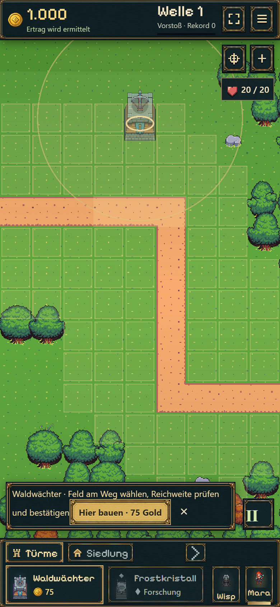
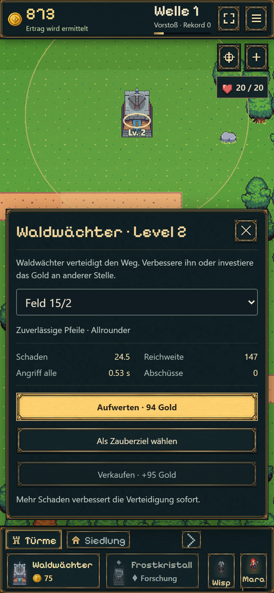
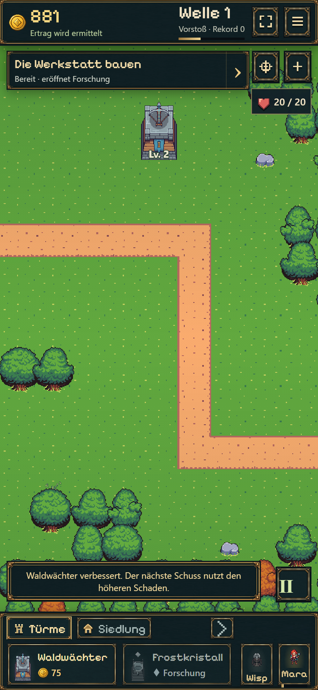
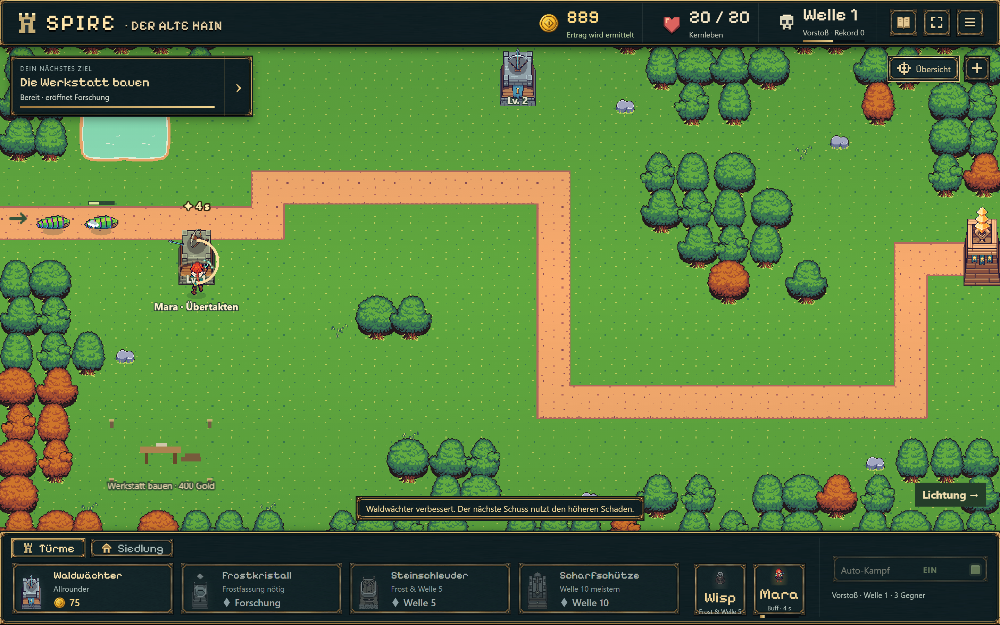

# Nordbogen und mobile Kamera

18.10.2026. Umsetzung des zusätzlichen Kartenauftrags nach B12a.

- Oberer Weg zwei Rasterfelder tiefer; 27 zusammenhängende freie Bauzellen in drei Reihen oberhalb des Nordbogens.
- Einstieg, restlicher Weg, Kern und Siedlung bleiben an ihren Positionen. Route 1.680 → 1.520 Weltpixel; keine abgeschlossene B13-Balance behauptet.
- Mobile Kamera erhält vertikalen Spielraum und passenden Objektfokus; Basis und Waffe eines Turms sind zusätzlich zum Bodenfeld antippbar.
- Schema 12 / Regeln 8 / Layout 4. Alte laufende Kämpfe bleiben bis zum Wellenübergang auf Layout 3. Nur betroffene Türme werden kostenlos auf nahe gültige Plätze versetzt; ihre Werte bleiben erhalten.

## Kompakte Prüfung

37 gezielte Checks aus Kartenmigration, Kampfspeicherung, B12a-Regeln und Offline-Abrechnung bestanden (nach Korrektur der historischen Testreferenz). Die vier neuen Kartenprüfungen decken vollständige obere Reihen, laufenden Altversuch inklusive Geschossen/Reload, maximal belegte alte Karte und beschädigte Altgeometrie/erweiterte Siedlung ab. Die Referenz `tests/fixtures/map-v3.json` wurde mit der zuvor veröffentlichten Kampfsimulation erzeugt; Testgold ist ausdrücklich künstlich.

TypeScript und Produktionsbuild bestanden. Chromium-Hochkantprobe 390 × 844, DPR 2: oberste Reihe antippen, Waldwächter bauen, automatische Rückkehr zur Karte, sichtbaren Turmkörper antippen und auf Level 2 verbessern. IndexedDB enthält genau diesen Level-2-Turm. Vertikales Ziehen öffnet kein Baumenü. Desktopansicht zusätzlich angesehen. Keine Seitenfehler und kein horizontaler Dokumentüberlauf. Die UI-Probe verwendet eine separate Testdatenbank mit 1.000 Gold; keine Aussage zur Kaufbalance. Ein physisches Handy wurde nicht zusätzlich geprüft.

[Browserbefund](map-browser.json). Roadmap führt Veröffentlichungsstand und nächste Aufgaben.
