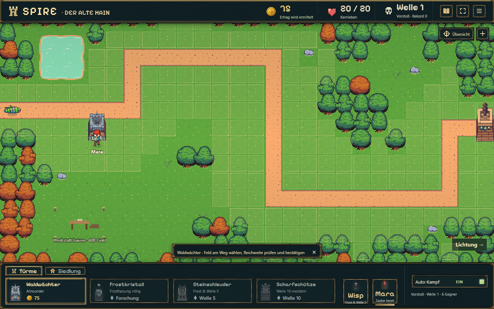
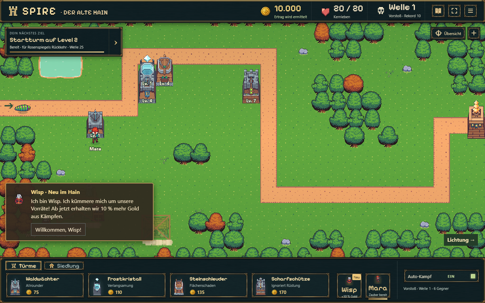
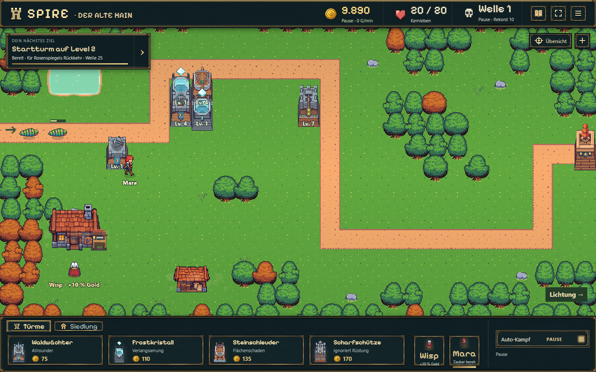
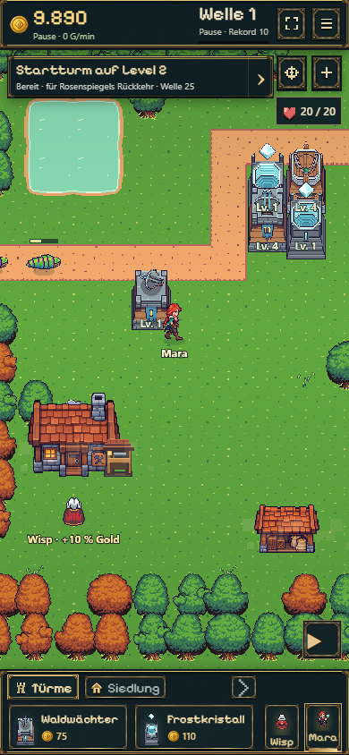
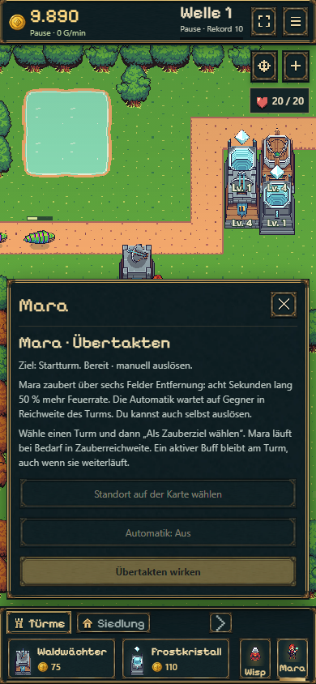

# B12a — Freie Verteidigung, Begleiter und Kampfdarstellung

Stand: 18.10.2026. Zusätzlicher ausdrücklich beauftragter Umbau vor B13; keine Gesamtabnahme oder neue Balancefreigabe.

## Ergebnis

- Geeignete Felder beidseits des Gegnerwegs bis zu drei Rasterzellen tief; Weg, äußere Baumkante, Gelände und Siedlungszone ausgespart. Alte Turmkoordinaten erhalten, keine neuen Wellen-Sperren für Startflächen.
- Turm wählen → Feld wählen → echte Reichweite und abgedeckten Weg ansehen → Kauf bestätigen → Karte. Drag baut nichts. Kurze Speichertransaktionen verschlucken keine Kartentipps.
- Mara bewegt sich unabhängig und unterstützt über sechs Felder. Auto wartet auf Gegner beim Ziel; Auto/Manuell teilen denselben 30-s-Cooldown. Der 8-s-Buff bleibt bei Bewegung und Zielwechsel am alten Turm. Lichtimpuls, Ring und Restdauer am Turm; Cooldown am Porträt.
- Wisp kommt mit kurzem Laufweg und eigener einmaliger Begrüßung. Sein 10-%-Bonus gilt sofort und unabhängig vom Dialog. Begrüßung nach Bestätigung dauerhaft erledigt.
- Werkstatt und Lager in eigener Siedlungsfläche platzieren; bestehende Gebäude während Pause kostenlos versetzen. Werkbank/Material statt beschädigtem Haus zu Beginn. Sichtbare Gerüst-/Staubabfolge; kurze Original-Staubanimation beim Turmbau ohne zusätzliche Figuren.
- Lichtung bleibt optional. Werkstatt II benötigt Frostforschung und 1.200 Gold, keinen Landkauf. Herausforderungen im Osten sind ausdrücklich Zukunftsplanung; kein Dungeon oder zweiter Eingang implementiert.
- Frost I/II/III korrekt 48×48 / 64×64 / 64×64, inklusive sparsamer Frame-Maps und Idle/Attack-Folge. Jeweils ein Kristall. Alle vier Rollen verwenden stufengerechte Originalprojektile und Treffer. Keine neuen generierten Assets.

## Gezielte Prüfung

54 Tests bestanden (vier betroffene Dateien):

```sh
npx tsx --test --test-reporter=dot experiments/idle-bastion/tests/defense-redesign.test.ts experiments/idle-bastion/tests/battle-save.test.ts experiments/idle-bastion/tests/battle-session.test.ts experiments/idle-bastion/tests/offline.test.ts
npm run idle:build
```

Abgedeckt: gültige/ungültige Bauflächen, enge Frost-Schaden-Kombination, volle Baufelder ohne übergroßen Farmfingerabdruck, Save-10-Migration, exakte Fortsetzung, Fernbuff/Bewegung/Zielwechsel, Gebäudeüberlappung und Positionen, einmaliger Wisp-Einstieg, IndexedDB-Kauf, Rollback, mehrere Tabs, Offline-Grenzen sowie Original-Atlasmaße und Frame-Maps. Build einschließlich TypeScript erfolgreich. Keine vollständige historische Testsuite oder neue 15-Minuten-Balancemessung ausgeführt.

Browser: Produktionsvorschau auf Port 5191, Chromium, Desktop 1440×900 und Hochkant 390×844. Der Ablauf von UI-Auswahl über Spielbefehl und IndexedDB bis zum Reload wurde tatsächlich durchgeklickt. Freier Frostturm auf Feld 9/4 (nullbasiert), Mara-Automatik ausgeschaltet, Mara bewegt, Werkstatt bei Pause auf 2/10 versetzt; sechs Türme, Positionen und bestätigte Wisp-Begrüßung blieben gespeichert. Keine JavaScript-Seitenfehler, kein horizontaler Überlauf. [Kompaktes Browserergebnis](redesign-browser.json).

Die Browseraufnahmen verwenden einen getrennten, künstlich ausgestatteten Probe-Spielstand zur Funktions-/Sichtprüfung. Das ist kein Nachweis, dass diese Wirtschaft oder Turmverteilung in Minute eins erreichbar wäre. Kein privater Spielerstand verändert. Eine physische Handy-/Safari-Prüfung wurde nicht durchgeführt. B13 muss die neue Platzierungsfreiheit und intelligenten Buffs balancieren.

## Spielaufnahmen

| Freie Bauflächen | Frost mit Reichweitenvorschau |
| --- | --- |
|  |  |





| Kompakte Hochkantkarte | Mara auf Abruf |
| --- | --- |
|  |  |

Die Aufnahmen zeigen die geprüften UI-/Figurenabläufe. Die abschließende Zielkorrektur richtet auch einen frühen Werkstatt-II-Kauf zuerst auf den noch unbesiegten Boss 15 aus; ältere Aufnahmen können im Zielband noch Boss 25 nennen.

## Veröffentlichung

Codecommit `6dbdd639b076b4bff1481506e9ca069123f152ec` auf `codex/idle-bastion-vertical-slice` gepusht. [Pages-Lauf 39164594184](https://github.com/emfau88/TD/actions/runs/39164594184) erfolgreich; klassisches Spiel und Idle-Produktionsbuild im Workflow erfolgreich.

Öffentliche Kontrolle: HTTP 200, Bundle `battle-LDNvrmBq.js`, neue Mara-Automatik und Drei-Felder-Platzierung vorhanden, keine Seitenfehler und kein horizontaler Überlauf. Chromium-Hochkantprobe 390×844 mit Gerätefaktor 2 und Touch-Emulation; kein physischer Gerätetest. [Spiel öffnen](https://emfau88.github.io/TD/idle-bastion/?v=6dbdd63).
