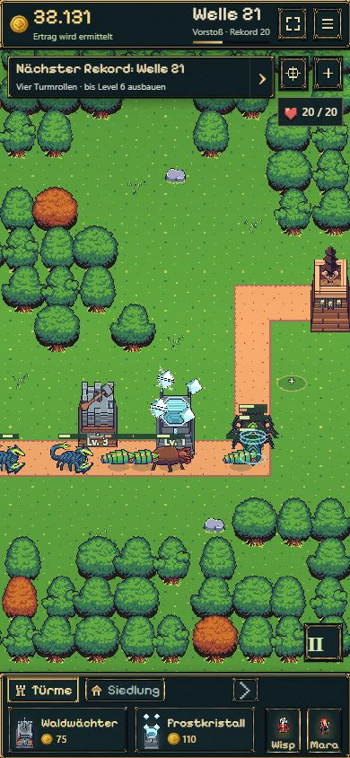
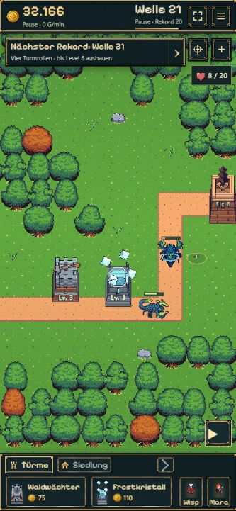

# Nachbesserung nach B10 — Bedienung und Turmkombinationen

18.10.2026 · ausdrücklicher Nutzerauftrag nach dem B10-Spieltest. Paketstatus und Veröffentlichung: [Roadmap](../../../../experiments/idle-bastion/ROADMAP.md#nachbesserung-nach-b10--baukomfort-schärfe-und-turmkombinationen).

## Änderungen

- Skorpione verwenden nach links blickende Seitenframes; ihre horizontale Spiegelung ist jetzt gegenüber den anderen Gegneratlanten invertiert. Auf-/Abwärtsframes bleiben unverändert. Kampfweg und Geschwindigkeit ändern sich nicht.
- Nach einem bestätigten Turmbau schließen Platzierung und Turmverwaltung automatisch. Die kurze Baumeldung bestätigt den Kauf; Antippen des Turms öffnet seine Werte. Das gilt für alle vier Typen und beide Bauwege (Dock/Platzwahl sowie Verwaltungsfenster). Fehlgeschlagene Käufe schließen ihren Hinweis nicht. Mobile Platzwahl richtet die Kamera auf den gebauten Turm.
- Die Spielfläche rendert bei `devicePixelRatio >= 1.5` intern doppelt so groß, höchstens Faktor 2, bei gleicher CSS-Fläche. Phaser übersetzt Eingaben über seine Display-Skalierung. Kamera, Portrait-Erkennung und Ziehschwelle berücksichtigen die Renderdichte. ResizeObserver erhält die Größe bei Hochkant/Querformat/Vollbild. Kleine Spielfeldtexte sind 11 px fett mit doppelter Texturauflösung und weniger breiter Kontur. Pixelgrafiken behalten Nearest-Neighbor-Filterung.
- Drei zusätzliche feste Bauplätze im bisherigen Startgebiet: **Nordbogen (11,4)** anfangs, **Mittelpass (16,7)** nach Welle 5 und **Südbogen (23,9)** nach Welle 10. Damit 5 / 8 / 11 verfügbare Plätze einschließlich Startturm. Zwei weitere Plätze bleiben für B11 reserviert. Originalplätze, vorhandene Türme, Weg und Gebäude bleiben unverändert. Frost wird im Einstieg neben dem Nordost-Waldwächter am Nordbogen vorgeschlagen.
- Ein Frostturm auf jedem neuen Platz teilt mit mindestens zwei bisherigen Schadensplätzen schon bei Level-1-Reichweiten wenigstens 60 Weltpixel Gegnerweg. Entscheidend ist der gemeinsame Wegabschnitt, nicht ob die Türme selbst im Radius des anderen stehen. Keine globale Reichweitensteigerung oder kostenlose Umplatzierung.

## Spielstandübernahme

Kampfschema 8 und Regeln 5 bleiben bestehen; die Geometrie erhält **Layoutversion 2**. Ein alter Stand wird zuerst gegen das vollständige alte Layout geprüft. Geld, Türme, HP, Projektile, Boss-/Forschungsfortschritt und Kampfuhren bleiben erhalten. Nur eine durch neue Reservierungen ungültig gewordene Mara-Route wird korrigiert. Falls sie genau auf einem neuen Platz stand, erhält sie das nächstgelegene begehbare Feld und einen neuen Weg zu ihrem bisherigen Auftrag; der Cooldown bleibt erhalten. Vorhandene Farmnachweise werden wegen des neuen Layout-Fingerabdrucks neu geprüft, alte Offline-Ansprüche behalten ihre Basis. Ältere Clients lehnen die neue Layoutversion geschützt ab.

## Kompakte Prüfung

- TypeScript/Produktionsbuild erfolgreich; `git diff --check` ohne Befund.
- 64 gezielte Fälle für Ausrichtung, neue Schussfenster, Layout/Wege, Speicherung, B08–B10 und IndexedDB; nach Korrektur der betroffenen Testfixtures alle erfolgreich. Zusätzlich vier gezielte Migrationstests älterer Schemata erfolgreich. Testläufe jeweils rund sechs Sekunden oder weniger; keine klassische Gesamtsuite.
- Neuer Regressionstest: Migration eines echten gültigen alten Mara-Weges durch den späteren Nordbogen. Danach Kampfzustand unverändert, Route legal, kein Cooldownreset. Alle elf bebauten Plätze lassen sich speichern und wiederherstellen.
- Der bisherige reguläre B10-Kaufablauf mit den alten Plätzen behält seine Zeit: erster Bosssieg **9:41,7**, zweiter Versuch. Das belegt Erhalt des bisherigen Ablaufs, nicht die Balance jeder neu möglichen Aufstellung.
- Browser: bestehende isolierte B10-Probe `premium-ui-1` mit Bosssieg und fünf Türmen migriert. Zusätzliche Frosttürme regulär aus vorhandenem Gold am Nordbogen, Mittelpass und Südbogen gebaut. Nach Bau `contextHidden: true` und `placementHidden: true`; Antippen öffnet wieder „Frostkristall · Level 1“. Nordbogen und Mittelpass nach Reload weiterhin vorhanden; Kauf am Südbogen fokussiert mobil den neuen Turm.
- Skorpion auf horizontalem Weg visuell mit Scheren in Bewegungsrichtung bestätigt. Desktop und 390 × 844 Hochkant geprüft, dynamische Anpassung der Zeichenfläche und unverändert kompaktes HUD/Dock bestätigt. Keine Browser-Konsolenfehler beobachtet.
- Die Browserprobe ist kein echtes Smartphone und kein Gerätetest bei DPR 2/3. Die höhere Renderauflösung ist implementiert; die wahrgenommene Schärfe und Leistung auf dem konkreten Handy bleiben dort zu beurteilen. Keine neue Grafikproduktion, keine vollständige Balance-Runde und kein Beginn von B11.

## Spielaufnahmen

