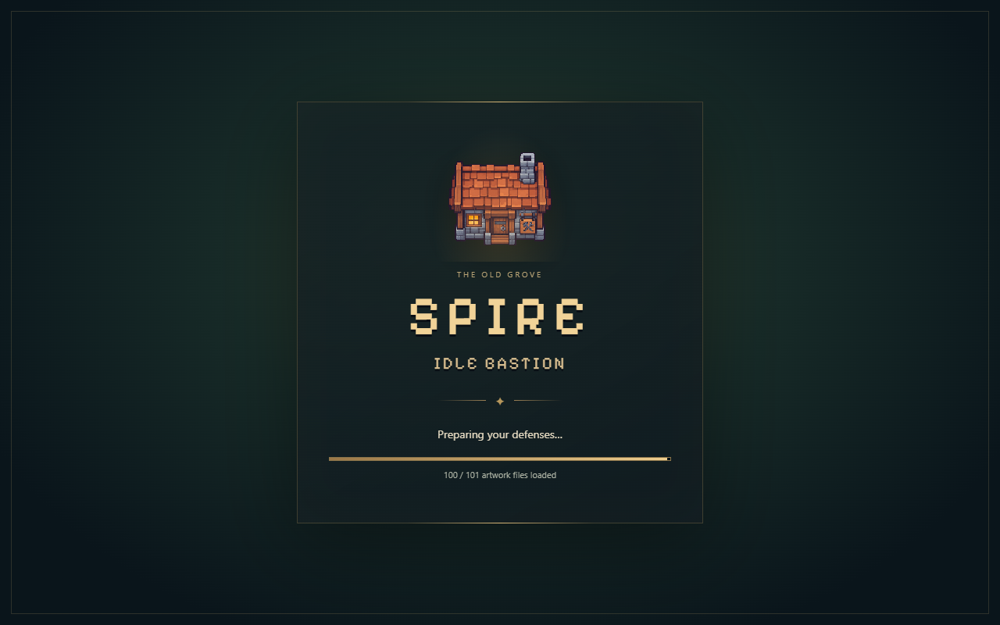
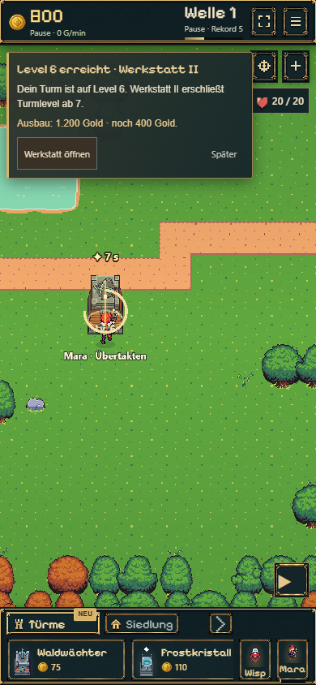

# SPIRE · Quick Wins Q1 + Q2

24.10.2026 · Basis `origin/main` **908a41b** · Arbeitsbranch `codex/quick-wins-q1-q2`.

Beim Arbeitsbeginn war A1 noch nicht in main enthalten. Q1/Q2 wurden zunächst vollständig darauf isoliert umgesetzt. Anschließend hat der Nutzer die gemeinsame Übernahme der abgeschlossenen Pakete A1 und Q1/Q2 ausdrücklich freigegeben. Q3 ist separat zur temporären Variantenansicht beauftragt; seine Turmempfehlungen werden hier nicht geändert.

## Umsetzung

**Q1:** Früher Ladebildschirm mit vorhandener Werkstattgrafik und Pixel-Schrift, dunklem Hain, Goldakzenten und schmalem Balken. Der kleine Einstieg lädt das Hauptspiel dynamisch. Speicherinitialisierung und Szenenaufbau zeigen ihre Phase ohne Prozentzahl. Der Balken zählt tatsächlich fertig geladene Grafikdateien des Phaser-Loaders; 101 Dateien in der geprüften Fassung, einschließlich Cachetreffern. Bei allen vier Produktionsproben echter Teilstand **87–93 / 101**, anschließend bedienbares Spiel. Weder Wartezeit noch Fortschritt werden künstlich ergänzt.

Fehlende Downloads, ungültige Bilddaten und fehlgeschlagene Spiel-/Einstiegsmodule zeigen einen verständlichen Fehler mit Wiederholungsmöglichkeit. Phaser-Downloads haben 15 s Zeitgrenze und einen begrenzten Retry; nach 30 s ohne tatsächlichen Fortschritt bietet die Oberfläche eine erneute Seitenladung an. Verborgene Tabs lösen diesen Hinweis nicht aus. Vor vollständiger Szene läuft keine Simulation. Bei Speicherproblemen bleibt die bestehende Wiederherstellungs-/Tab-Eigentümeroberfläche erreichbar. Offline-Ansprüche werden vom Ladebildschirm weder automatisch angenommen noch verändert. Vollständige Tavernenanimationsbilder werden beim Start nicht geladen.

**Q2:** Steinschleuder und Turm-Tab bekommen nach echter Freischaltung eine kleine NEU/NEW-Marke. Ein kurzer optionaler Hinweis erklärt Flächenschaden und die Kombination mit Frost. Schließen erhält die Marke; Inspektion des Katalogeintrags oder erster Bau quittiert sie. Werkstatt II wird beim ersten Turm ab Level 6 erklärt, sofern Frost erforscht und die Werkstatt noch I ist. Direktzugriff, 1.200-Gold-Preis und genauer Fehlbetrag sind sichtbar. Ein Level-6-Turm behält den Werkstattlink auch nach dem Schließen des Hinweises. Persönliche Lesebestätigungen liegen als UI-Präferenz je Slot, zusätzlich zu den bisherigen Hinweisbits; kein neues Savefeld.

Kampfregeln, Wirtschaft, Preise, Freischaltungen, Charaktersteuerung und Animationsbestand des Ausgangsstands bleiben in Q1/Q2 unverändert. Es wurden keine Grafiken erzeugt. Die spätere ausdrücklich freigegebene A1-Übernahme bleibt als eigenes Paket dokumentiert.

## Prüfung

- **Build:** `npm run build` bestanden, einschließlich TypeScript und Pages-Packung. Alte `/idle-bastion/`-Weiterleitungen erhalten.
- **Gesamtsuite Q1/Q2:** `npm test` **301/318 erfolgreich**, 17 bestehende Fehler, keine Skips. Frische main-Baseline **291/308**, exakt dieselben 17 Fehlernamen. Die zehn neuen Lade-/Guidance-Tests bestehen. Die vollständige Suite enthält die relevanten Session-/Save-/Offline- und Sprachregressionen. [Testzusammenfassung und getrennte Altfehler](tests.json).
- **36 Browserprüfungen:** Desktop 1280×800 und Smartphone-Hochkant 390×844, Chrome, Deutsch und Englisch. Neue Partie und gespeicherte Zustände, tatsächlicher Teilfortschritt, währenddessen gesperrte Eingabe und sofortige Freigabe bei Bereitschaft. Keine unerwarteten JavaScriptfehler oder Tavernenanimationsdownloads. [Browserbelege](browser-checks.json).
- **Q2:** Noch gesperrte Steinschleuder, Freischaltung, Hinweis schließen/Reload bei erhaltener NEU-Marke, optionale Katalogaktion ohne Kauf; Werkstatt bei Level 5, Level 6 mit 800/1.200 Gold und bereits ausgebauter Werkstatt geprüft. Bei 800 Gold fehlen korrekt 400; reguläre Pausen-/Kaufregeln erhalten. Keine neue Kaufpflicht.
- **Speicher/Offline:** Eigene `?probe=`-Spielstände, kein Zugriff auf die Nutzerpartie. Tatsächlich zertifizierter positiver Offline-Anspruch angenommen, anschließend gespeicherte Goldsumme nach Reload exakt unverändert. Desktop 3.765 / mobil 3.764 Gold nach Anspruch und kurzer tatsächlicher Fortsetzung; keine zweite Auszahlung.
- **Fehler:** HTTP 500 und HTTP 200 mit ungültigen PNG-Daten je mit korrektem Fehlerbild und erfolgreichem Retry; außerdem fehlgeschlagener dynamischer Hauptspielimport und fehlgeschlagenes Einstiegsmodul. Beide Grafikfehler im Prüfablauf mit zwei Requests. Mock-Timer-Tests prüfen zusätzlich Timeout, echten Fortschrittsreset, verborgenen Tab und Timerabbau bei Bereitschaft.
- **Produktion:** Vier zusätzliche Proben auf dem gebauten Wurzeleinstieg, jeweils echte Teilstände, passende DE/EN-Anzeige und erhaltene Einführung/Goldsumme nach Reload. [Produktionsbelege](production-checks.json). Hochkantprüfung ist Browseremulation, keine physische Smartphone-Abnahme.

Reproduktion: `PLAYWRIGHT_MODULE` auf eine vorhandene Playwright-Installation setzen, `BASE_URL=http://127.0.0.1:5242`, dann `node experiments/idle-bastion/scripts/check-quick-wins.mjs`. Vorbereitete getrennte Teststände: `/tests/browser/quick-wins-session.html`, nur im Entwicklungsserver und nicht in den Produktionsinputs. Rohprotokolle/temporäre Produktionsproben liegen unter ignoriertem `qa/quick-wins-q1-q2/`.

**Freigegebene gemeinsame Übernahme:** A1 einschließlich des späteren Roadmap-Vermerks aus `1eb6a93` mit Q1/Q2 aus `e0d2578` zusammengeführt. Nur die Roadmap und die beiden QA-Ausschlüsse mussten unter Erhalt beider Inhalte aufgelöst werden; kein Codekonflikt. Kombinierter Produktions-/Pages-Build erfolgreich, Gesamtsuite **306/323** mit exakt denselben 17 Altfehlern, erneut **36/36 Browserprüfungen** erfolgreich. [Kombinierte Browserbelege](combined-browser-checks.json). Damit bleiben auch A1 und die spätere Hand-/Schulter-Nachbesserung erhalten. Q3 verändert weiterhin weder den regulären Positionscode noch die Tutorial-Kamera.

## Geänderte Dateien

| Bereich | Dateien |
| --- | --- |
| Früher Einstieg und Ladeansicht | `index.html`, `src/bootstrap.ts`, `src/loading-screen.ts`, `src/loading-screen.css` |
| Echte Ladeereignisse, Fehler und UI-Anbindung | `src/battle-scene.ts`, `src/main.ts` |
| Kontexthinweise | `src/quick-win-guidance.ts`, `src/quick-win-guidance.css` |
| Sprache | `src/locales/en.ts`, `src/locales/startup.ts` |
| Gezielte Tests | `tests/loading-screen.test.ts`, `tests/quick-win-guidance.test.ts` |
| Isolierte Browserprüfung | `tests/browser/quick-wins-session.html`, `tests/browser/quick-wins-session.ts`, `scripts/check-quick-wins.mjs` |
| Nachweise | `.gitignore`, `ROADMAP.md`, dieser Bericht mit JSON-Ergebnissen und ausgewählten Screenshots |

Alle Spielpfade liegen unter `experiments/idle-bastion/`. Die folgende gemeinsame A1-Übernahme ergänzt ihre separat dokumentierten Dateien.

## Screenshots

| Ansicht | Ladebildschirm (Produktionsbuild) | Steinschleuder | Werkstatt II |
| --- | --- | --- | --- |
| Desktop | [Englisch](screenshots/desktop-loading.png) | [Englisch](screenshots/desktop-cannon.png) | [Englisch](screenshots/desktop-workshop.png) |
| Smartphone-Hochkant | [Deutsch](screenshots/mobile-loading.png) | [Deutsch](screenshots/mobile-cannon.png) | [Deutsch](screenshots/mobile-workshop.png) |

Zusätzlich: [mobiler Werkstatt-Fehlbetrag](screenshots/mobile-workshop-details.png), [Ladefehler mit Wiederholung](screenshots/mobile-loading-error.png).

