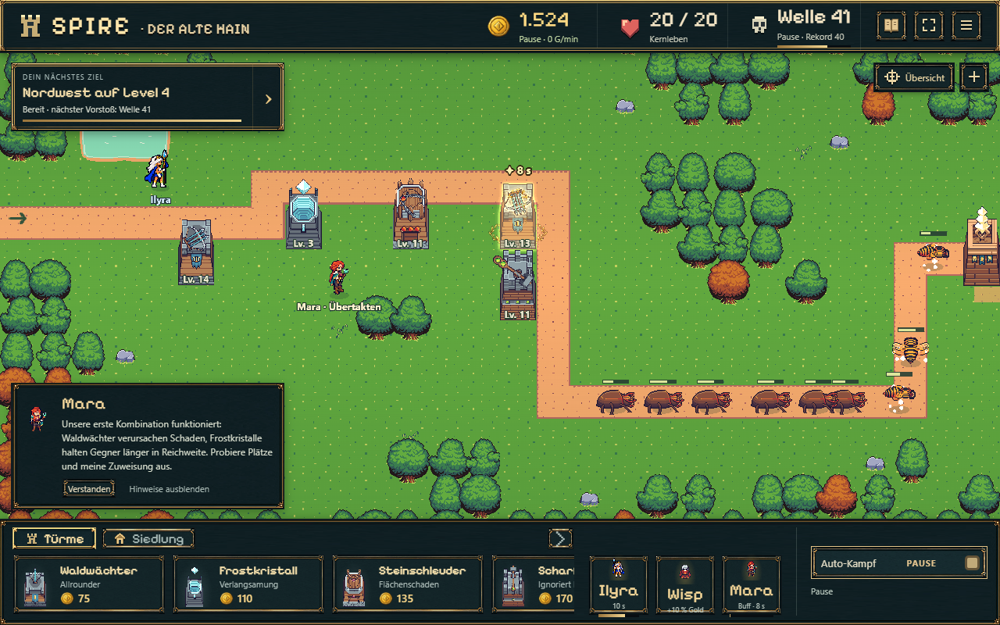
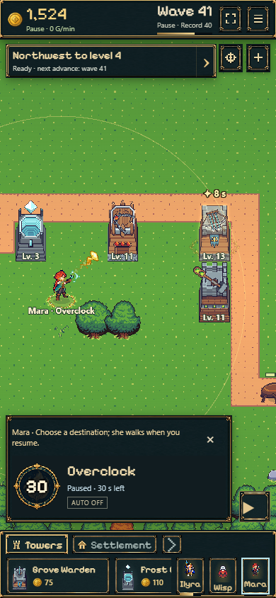
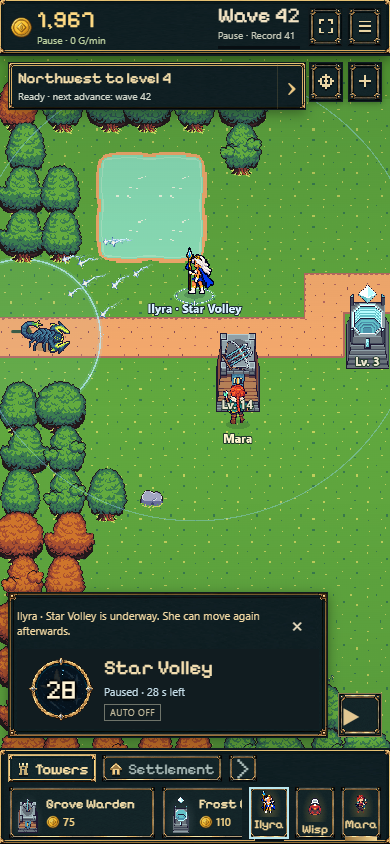

# Frost, Figuren und Zauberoptik: vollständige Merge-Prüfung

25.10.2026 · Arbeitsbranch `codex/frost-kit-hero-controls`.
Verglichen mit Main `537b5e8c9cf09b696b41644da4c56dbc8633d720`.
**Kein Main-Merge durchgeführt.**

Geprüfte Integration: `5e0589f9b5d8c81affcc9eb15fa6fb64e88553a8`.
[Spielbare Vorschau](https://emfau88.github.io/TD/previews/frost-hero/feature-check.html) ·
[erfolgreicher Pages-Lauf](https://github.com/emfau88/TD/actions/runs/40149636478).
Alle drei öffentlichen Testeinstiege wurden anschließend erneut auf Desktop/Touch
einschließlich Grafikladung und Speicherisolation geprüft. Der Workflow erhielt
alle **401 Main-Dateien bytegleich**; die öffentliche Main-Hauptseite hat weiterhin
denselben SHA-256. [Veröffentlichungsnachweis](publication.json) ·
[öffentliche Bedienprobe](public-browser.json).

## Ergebnis

**Technisch zur Übernahme empfohlen.** Die besprochene Optik ist jetzt im echten
Spiel eingebunden. Es wurden keine zusätzlichen blockierenden Fehler gegenüber
Main gefunden. Der Branch enthält den aktuellen Main-Stand; Konfliktauflösung
ist für diese Basis nicht erforderlich. Die abschließende Merge-Freigabe fehlt weiterhin.

Die Testsuite ist nicht vollständig grün: **17 bereits auf Main vorhandene Fehler**
bleiben offen. Die Prüfung umfasst Desktop und mobile Browseremulation, keine
physischen iPhones/Android-Geräte und keine langfristige Geräte-Leistungsmessung.

## Was der Branch mitbringt

| Paket | Tatsächliches Verhalten |
| --- | --- |
| Kostenloser Tutorial-Frost | Einmaliger Bausatz nach bezahlter Forschung; Verbrauch bleibt nach Verkauf/Reload erhalten. Weitere Frosttürme kosten unverändert 110 Gold. |
| Direkte Figurensteuerung | Figur wählen, wiederholt Boden antippen; zweiter Figurentipp öffnet das Menü. Rechtsklick am Desktop, saubere Trennung von Touch-Ziehen, Auswahl und Baubefehlen. |
| Ilyras Einführung | Erreichbarer Standort am echten Gegnerweg, Ankunft abwarten, erste Salve bewusst zielen; Reload unterwegs bleibt möglich. |
| Runde Zauberaktionen | Mara und Ilyra: echter radialer Cooldown, Restsekunden, verständlicher Sperrgrund, Automatikstatus. Ganze Schaltfläche antippbar; während Cooldown weiterhin korrekt gesperrt. Mara auch direkt bei Kartenwahl auslösbar. |
| Boden- und Zaubereffekte | Enge leuchtende Figurenringe, Weg-/Zielzeichen, wiederholte Mara-Impulse während des achtsekündigen Buffs, transparenter Goldüberzug über dem ganzen Turm plus fünf Trefferfunken. Ilyra zeigt neun Sterne über dem echten AoE-Radius 72. |
| Teststarter und Galerie | Drei direkte, getrennte Probe-Spielstände. Geteilte Test-/Galerieadressen bleiben nach Main-Übernahme durch Weiterleitungen nutzbar. |

Frost und Figurensteuerung wurden zuvor getrennt committet. Die Grafik ergänzt
nur die Darstellung vorhandener Regeln: Ilyra verursacht weiterhin **einen**
Flächentreffer; Maras Impulse verlängern oder vervielfachen den Buff nicht.
Q4-Logik, Gegner-/Bosswerte und normale Turmwerte wurden durch die Grafik nicht geändert.

## Nachweise

| Prüfung | Ergebnis |
| --- | --- |
| Vollständige Tests auf unverändertem Main | 326/343 bestanden, 17 Fehler; vorheriger separater Export desselben Main-SHA |
| Vollständige Tests mit Integration | **345/362 bestanden, dieselben 17 Fehler**, keine neuen, keine Skips |
| Gezielte Zauber-/Sprach-/Ebenentests | 14/14 bestanden |
| Normales Produktionspaket ohne Preview-Flag | TypeScript, Vite und Pages-Paket erfolgreich |
| Figurensteuerung auf Desktop/Touch | Auswahl, Laufbefehle, Drag-Abgrenzung, Menüs, Pause, echte Rekrutierung, Reload unterwegs und erste bewusste Salve bestanden |
| Tatsächliche Zaubereffekte | Pause friert Frames ein; Reload erhält aktive Buffs/Salven; Zielwechsel lässt Buff am ursprünglichen Turm; Verkauf und Verzauberung entfernen Glow; Effekte verschwinden nach Ablauf |
| Manueller Mara-Kartenbutton | Löst den echten Modellbefehl aus; Auswahl bleibt bestehen; kein zweiter Zauber während Cooldown |
| Render-/Modelltrennung | 120 zusätzliche Renderdurchläufe verändern keinen Snapshot; Pools bleiben begrenzt. Gemessen 45 Mara- und 39 Ilyra-Bildobjekte in den untersuchten Phasen |
| Darstellung | Desktop 1280×800, Touch 390×844, kleines Menü 320×568; keine gefundenen Browserfehler, fehlenden Ressourcen oder horizontalen Überläufe |
| Q4-Neueinstieg im Produktionsbuild | Start, Überspringen und Reload bei 1280/390/320 Pixeln erfolgreich |
| Vorhandener Main-Spielstand | Version 29 wird übernommen; Gold, Türme und gespeicherte Pause bleiben erhalten; Reload auf Desktop/Touch erfolgreich |
| Testisolation | Regulärer Speicher bleibt `spire-idle-bastion`; Teststarter schreibt eigene Probe-Slots; alte `/idle-bastion/`-Adresse erhält Query/Hash |

[Testvergleich](tests.json) · [Effekt-/Bedienprüfung](effects.json) ·
[Figurenprüfung](hero-controls.json) · [Produktionsprüfung](production-browser.json) ·
[Weiterleitungen und Galerie](release-links.json) ·
[Speicherformatprüfung](../frost-hero-merge-review/migration.json).

Die Effektprobe beginnt mit einem tatsächlich verdienten Welle-40-Spielstand;
bezahlte Rekrutierung und Modellbefehle erzeugen die untersuchten Zustände. Zielwechsel
und Verkauf werden auf einem getrennten Klon geprüft. Der Verzauberungsfall wird
gezielt am lesenden Renderer-Eingang simuliert; dies ist kein neuer kompletter Bosslauf.

Die neue Grafik benötigt insgesamt **168.708 Bytes** für acht WebP-Dateien.
Die größeren Entwurfsbilder und Videos werden ausschließlich beim Öffnen der
Galerie geladen. Die ursprüngliche Gestaltungsprobe bleibt als historische
Dokumentation erhalten; die folgenden Bilder zeigen den echten Spielrenderer.

## Bedeutung von Speicherformat 30

Das ist lediglich die Kennzeichnung der gespeicherten Daten. Sie merkt sich den
verbrauchten kostenlosen Frostbausatz. Bestehende Version-29-Partien werden übernommen;
ein Neustart ist nicht erforderlich. Die Grafik benötigt keine weitere Formatänderung.

Ein späterer Rückwechsel auf den alten Main-Code könnte neue Version-30-Saves nicht
lesen. Er überschreibt sie dabei nicht. Falls nach Veröffentlichung ein Rollback
nötig wird, muss die Version-30-Lesefähigkeit erhalten bleiben.

**Empfehlung:** Den geprüften Gesamtstand nach Nutzerfreigabe gemeinsam übernehmen.
Ein Merge nur der früheren Grafikdateien würde nicht ausreichen; diese Integration
enthält die dazugehörigen echten UI- und Renderwege. Die 17 bestehenden Altfehler
bleiben eine separate offene Qualitätsaufgabe.
