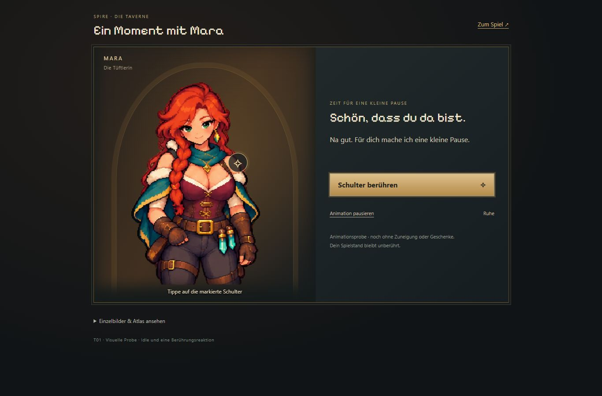
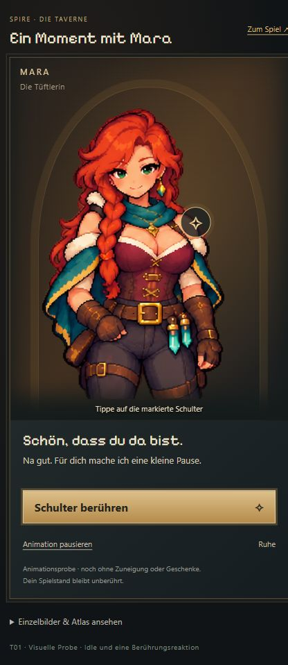
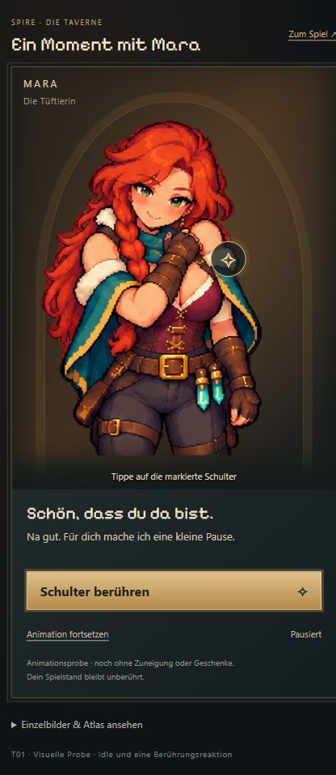

# T01 — Mara Animationsprobe

Stand: 21.10.2026. Ausschließlich separate Vorschau; visuelle Nutzerabnahme offen.

Geliefert: ein transparenter, mit Imagegen erzeugter Atlas mit zwölf echten Zeichnungen, vier für Idle/Blinzeln und acht für eine Schulterreaktion. Eine gezielte Generierung korrigierte den zunächst wechselnden Arm. Rendering registriert die Frames am Gürtel, ohne die Bilder zu verformen. Metadaten und exakte Prompts liegen bei den Assets.

Prüfungen vor Veröffentlichung:
- `node scripts/check-mara-preview.mjs` bestanden: Idle-Frames, Reaktion mit Rückkehr, Mehrfachklickschutz, Pause/Einzelbild/Weiter, versteckter Tab, Atlasgrenzen und kein Spielstandzugriff.
- `npm run idle:build` einschließlich TypeScript bestanden.
- `git diff --check` bestanden.
- Lokale Browserprüfung durch `ERR_BLOCKED_BY_CLIENT` für 127.0.0.1 und localhost verhindert. Anschließende Prüfung über die veröffentlichte Pages-Vorschau erfolgreich; keine lokale Browserprüfung behauptet.

Keine Änderung an Kampf, Rekrutierung, Tavernenpreisen, Save-Migrationen oder Karten-Idle-Animationen. T02–T07 nicht begonnen. Keine vollständige Kampf-/Balancetestserie nötig. Bildausschnitt bis Oberschenkel und verbleibende zeichnerische Unterschiede sind in der visuellen Abnahme zu bewerten; dies ist kein Nachweis für eine fertig abgenommene Produktionspipeline.

## Veröffentlichte Vorschau

Implementierung: `89fa694`. [Pages-Deployment erfolgreich](https://github.com/emfau88/TD/actions/runs/39601320721). [Interaktive Vorschau](https://emfau88.github.io/TD/idle-bastion/mara-check.html).

Browserprüfung über Pages: Desktop 1366 × 900 und Hochkant-Viewport 430 × 932. Keine Prüfung auf physischem Handy. Figur/Hotspot/Bedienelemente lesbar und erreichbar. Schulteraktion löst die Reaktion aus, deaktiviert erneutes Auslösen und kehrt zu Ruhe zurück. Einzelbildregler zeigt die Reaktionspose und pausiert; Auslösen aus Pause setzt den Ablauf fort. Keine Browserfehler/-warnungen beobachtet. Viewport anschließend zurückgesetzt.

Die Frames wurden als Atlas und in der dargestellten Reaktionspose angesehen. Das belegt die Funktion und Darstellung der Probe, nicht die subjektive Freigabe von Bewegungsqualität/Zeichenstil. Weitere Animationen oder Integration warten ausdrücklich auf Nutzerabnahme.

 
