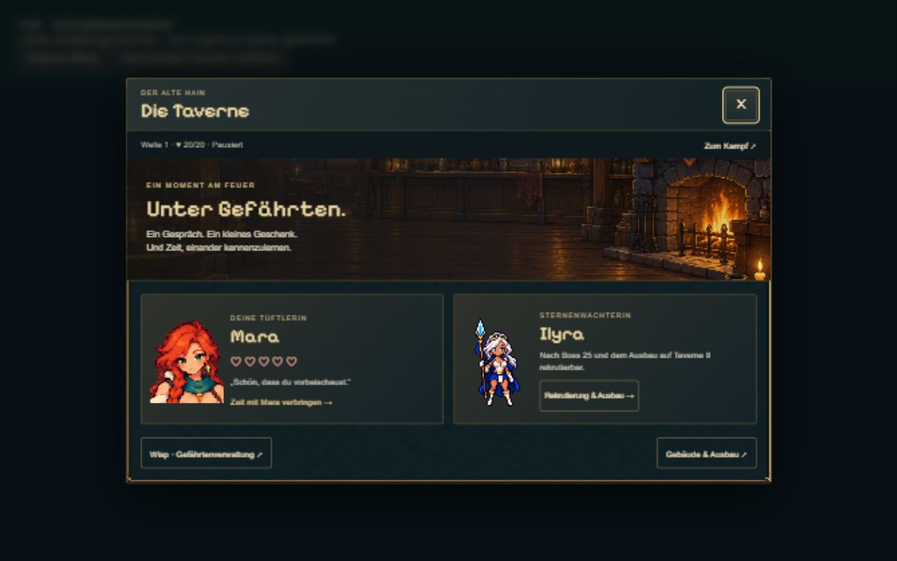
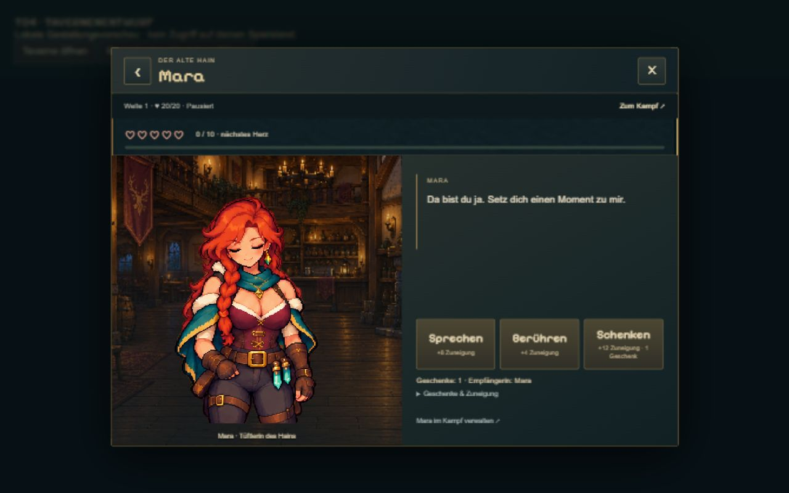
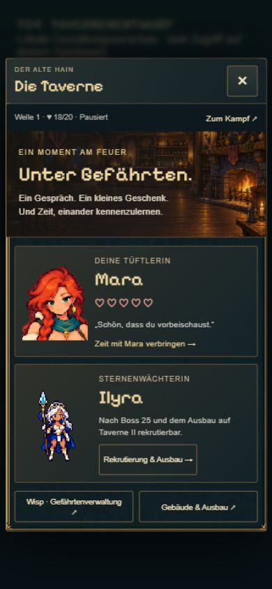
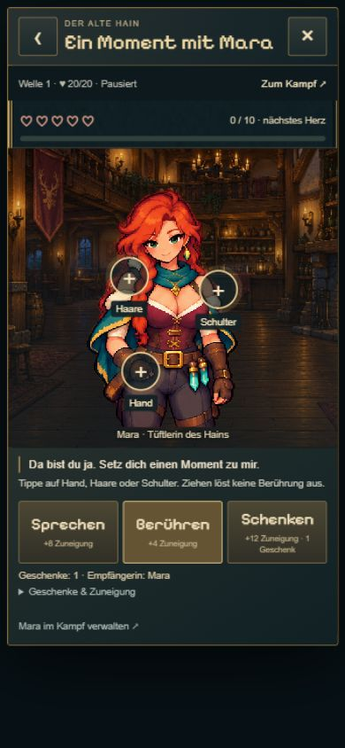
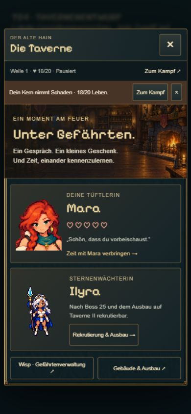

# T04 · Tavernenansicht zur visuellen Abnahme

21.10.2026 · lokaler Entwurf auf `codex/idle-bastion-vertical-slice`.
**Visuelle Nutzerfreigabe am 21.10.2026 erteilt; Commit/Push ausdrücklich beauftragt. T05 folgt separat.**

## Ergebnis

Ein modales Fenster mit Übersicht, Maras Charakteransicht und darin umschaltbarem Berührungsmodus. Warmer generierter Raum, vorhandene Messingrahmen, lesbare Fließtexte, Pixelüberschriften. Auf Hochkant steht die Figur über Dialog und drei Aktionen. Hand/Haare/Schulter haben echte 44px-Ziele; Markierungen werden während der Reaktion ausgeblendet. Schließen/Zurück bleiben bedienbar.

Sprechen, Berühren und Geschenke verwenden T03s Session-Transaktionen. Punkte, nächste Herzschwelle, Empfängerin und Geschenkbestand sind sichtbar. Unbelohnte Berührungen/Gespräche bleiben möglich, ausgeschöpfte Geschenke sind gesperrt. Zusätzliche Erläuterungen sind einklappbar.

Die bestehende Mara-Idle-/Schulteranimation bleibt unverändert; Hand/Haarreaktionen sind ein separater neuer Atlas mit zwölf gezeichneten Frames. Registrierung/Timing liegen als JSON bei. [Assetnachweis](../../../../experiments/idle-bastion/assets/tavern-ui/README.md).

Ilyras Boss-/Tavernenbedingungen sind erklärt. Rekrutierung, Gefährtenbefehle und Gebäudeausbau bleiben in den bestehenden Kampf-/Gebäudemenüs erreichbar. Keine neuen Herzsperren für Rekrutierung. Ilyras persönliche Interaktionen folgen erst in T06.

Der Kampf wird beim Öffnen weder pausiert noch fortgesetzt; bestehende Pause bleibt bestehen. Kleine Statuszeile und wegklickbare Warnung bei neuem Kernschaden/Niederlage. Keine Wiederholung eines bloß historischen Hinweises.

## Kompakte Prüfung

- `npm run idle:build`: erfolgreich (TypeScript + Produktionsbuild).
- Zwei neue Transaktionsprüfungen plus zehn bestehende T03-Regressionen: **12/12 bestanden**. Mehrfachtippen, ein Geschenk pro Aktion, Pause erhalten, unbelohnte Wiederholung ohne Schreibvorgang, kein positiver UI-Abschluss bei abgelehntem Speichern; bestehende Tests prüfen persistente Rücknahme/Save-Bestand.
- Browser: 1280 × 800 sowie 390 × 844 Hochkant. Übersicht → Mara → Sprechen → Schenken → Berühren; Hand und Haare gespielt, Punkte/Geschenkbestand korrekt, zurück/schließen und erneutes Öffnen geprüft. Keine Browserfehler.
- Hochkant bei langer Reaktion: Dialog 373px breit, Scrollbreite ebenfalls 373px, 763px Inhalts-/Anzeigehöhe; keine seitliche Überbreite.
- Kernschaden gezielt in separater Vorschau ausgelöst; Warnung sichtbar, geschlossen und bei unverändertem Zustand geschlossen geblieben.
- Browser-Hochkantemulation, **kein Test auf einem physischen Handy**. Keine neue vollständige Kampagne durchgespielt. Neue Hand-/Haaranimationen wurden anschließend vom Nutzer visuell freigegeben.

## Vorschau

Mit `npm run idle:dev`: [Tavernenentwurf lokal öffnen](http://127.0.0.1:5190/tavern-check.html).
Die lokale, vom Produktionsbuild ausgeschlossene Prüfszene verwendet dieselbe Oberfläche mit einer temporären Session; kein Zugriff auf bestehende Spielstände. Kampf ist in dieser Gestaltungsvorschau bewusst pausiert. Gebäudeverwaltungslinks melden hier nur ihr Ziel; im Hauptspiel öffnen sie die bestehenden Menüs.

  
