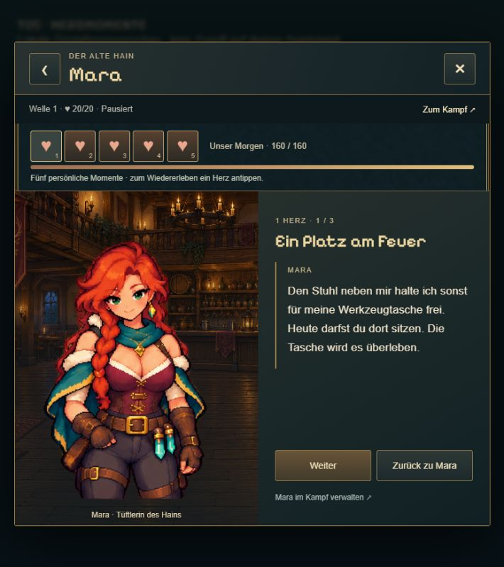
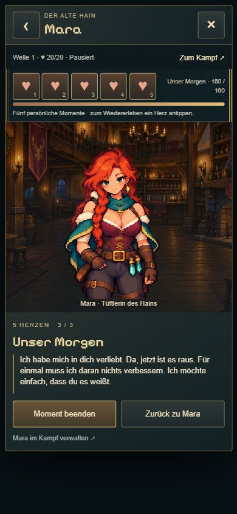

# T05 · Maras fünf Herz-Momente

21.10.2026 · `codex/idle-bastion-vertical-slice` · nach der ausdrücklichen T04-Abnahme als nächster Schritt beauftragt.

## Ergebnis

Fünf freischaltbare, jederzeit wieder abspielbare persönliche Momente mit je drei Abschnitten:

1. **Ein Platz am Feuer** (10): Maras Ankunft im Hain und ein eigener Platz neben ihr.
2. **Mein Glücksstück** (35): Das Zahnrad ihrer ersten Uhr, Unvollkommenheit und Vertrauen.
3. **Was ich nicht reparieren kann** (70): Angst um den Hain und das Zulassen von Verletzlichkeit.
4. **Bleib noch ein bisschen** (110): Bewusst Zeit füreinander und eine Einladung zur Nähe.
5. **Unser Morgen** (160): Gemeinsame Zukunftspläne und ein Liebesgeständnis.

Für 0–5 Herzen außerdem jeweils eine Begrüßung, zwei Gesprächsantworten und eigene Antworten auf Geschenk, Hand, Haare und Schulter. Vorhandene freigegebene Animationen begleiten die Szenen. Kein neuer Bildatlas, keine Änderung der Kartenfiguren oder Kampffähigkeiten.

Die Herzen sind antippbare Einstiege. Gesperrte Herzen zeigen Voraussetzung/Titel, der nächste Inhalt ist sichtbar angekündigt. Nach einem Herzgewinn erscheint ein optionaler Szeneneinstieg. Szenen schließen die normalen Belohnungsaktionen aus; Wiederholen kostet kein Geschenk und erzeugt keine Punkte. Zurück/Schließen und Kampfverwaltung bleiben zugänglich. Kein automatischer Szenenstart beim Herzgewinn.

## Speicherung und Balance

Alle Freischaltungen leiten sich aus den dauerhaft gespeicherten T03-Punkten ab. Keine zusätzliche Schemaänderung oder Scene-Seen-Währung. Nach Reload stehen auch abgebrochene Momente weiter bereit. Alte Saves unverändert verwendbar.

T03-Schwellen und Aktionsbudgets bleiben bestehen. Die Modellprüfung erreicht mit 2 Gesprächen, 3 Berührungen und 1 Geschenk pro aktivem Abschnitt fünf Herzen nach vier Abschnitten; ohne Geschenke nach sechs. Die subjektive Langzeitbalance bleibt für T07 offen.

## Kompakte Prüfung

- **14/14 gezielte Tests bestanden:** zwei neue Inhalts-/Freischaltungsprüfungen plus T04-Transaktionen und T03-Regeln. Alle fünf Schwellen unmittelbar davor/danach, Snapshot-Restore, wiederholtes Lesen ohne Mutation, unterschiedliche Begrüßungen/Aktionen, Geschenkgrenzen, Pause und Schreibfehler.
- `npm run idle:build`: TypeScript und Produktionsbuild bestanden.
- Browser: null Herzen → Geschenk → erstes Herz → sichtbarer neuer Moment; erster Moment geöffnet und weitergeschaltet. Fünfte Stufe in isolierter Vorschau aufgerufen, alle drei Abschnitte abgespielt, beendet und früheren Moment erneut geöffnet. Geschenkbestand/Punkte bleiben beim Szenenabspielen unverändert.
- Desktop im App-Browser und **390 × 844 Hochkant**. Längster geprüfter Abschluss: Dialog 373px breit, identische Scrollbreite, 731px Höhe ohne Überlauf. Keine Browserfehler. Keine physische Handyprüfung und keine komplette neue Kampagne.
- Lokale Vorschau `tavern-check.html` bietet einen ausdrücklich temporären Herzstufenwähler außerhalb des Tavernenfensters. Nicht im Produktionsbuild, kein Zugriff auf echte Spielstände.

Die lokale Erweiterung verwendet die visuell freigegebene T04-Gestaltung und Animation. T06/Ilyras persönliche Szenen sind weiterhin separat geplant.
