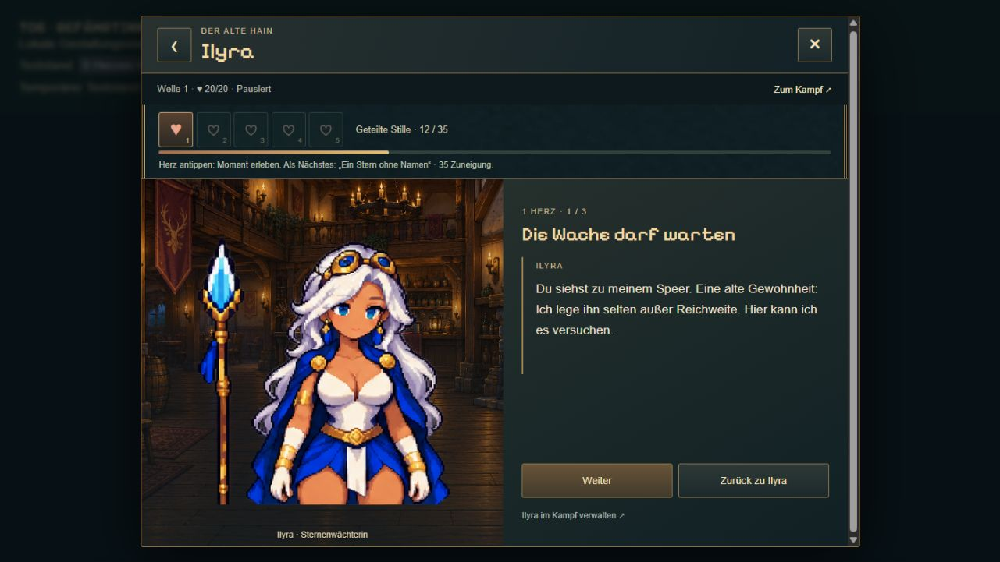
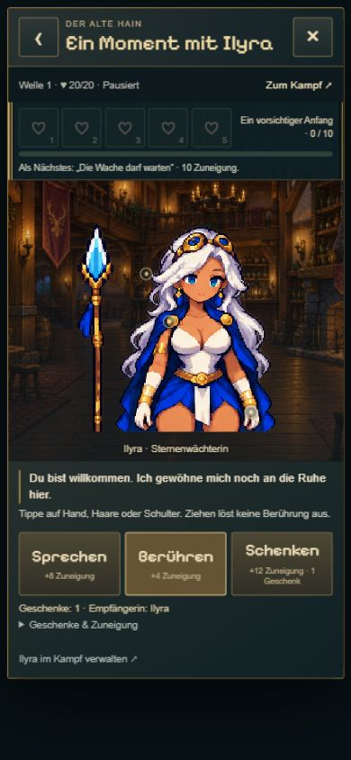
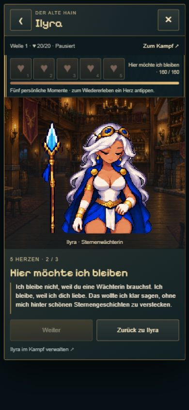

# T06 · Ilyra in der Taverne

21.10.2026 · Branch `codex/idle-bastion-vertical-slice`, aufbauend auf T05 `6c21876` (T04 `2013108`). T06 ausdrücklich mit „danach t06“ beauftragt. Visuelles Nutzerfeedback: „ok sieht gut aus“, anschließend gewünschte dezente Berührungspunkte umgesetzt.

## Ergebnis

Eigene erwachsene Ilyra-Animation mit Idle, Hand, Haare und Schulter; fünf Drei-Abschnitt-Herzmomente, sechs eigene Dialogstufen. Wiederverwendete Tavernenoberfläche/Transaktionslogik, getrennte Punkte, gemeinsamer Geschenkbestand. Ilyra bleibt bis zur tatsächlichen Rekrutierung gesperrt. Kampfeinführung, Position, Sternensalve, Automatik und Saveformat unverändert. Die Karte und das klassische Spiel wurden nicht geändert.

Zwei ausgewählte Original-Imagegen-Atlanten mit expliziten Frames und Gürtelankern. Speer als abgestellte, feste Requisite mit transparentem Zwischenraum. Drei verworfene Entwürfe nicht eingebunden. [Prompts, Quellen und Ladebudget](../../../../experiments/idle-bastion/assets/ilyra-tavern/README.md). Kleine sichtbare Goldpunkte (14 px), weiterhin 44-px-Touchflächen; permanente große Pluskreise/Labels entfernt, auch bei Mara. Während einer Reaktion verschwinden die Marker.

## Kompakte Prüfung

- 16/16 gezielte Tests aus `tavern-social`, `tavern-interactions`, `tavern-mara-content`, `tavern-ilyra`: Rekrutierungssperre, getrennter Empfänger auch bei parallelem Klick, geteilter Geschenkbestand, Restore, bestehende Migration/Budgets, unveränderte Kampfposition/Spielpause, fünf eigene Herzszenen und sechs Dialogstufen.
- `npm run idle:build`: TypeScript und Produktionsbuild einschließlich separater Tavernen-Vorschau.
- Browser: gesperrte Ilyra vor Rekrutierung, danach Geschenk/Herzfreischaltung, alle drei Reaktionstypen, erster dreiteiliger Moment, fünfte Herzszene und Wechsel zurück zu Mara. Mara bleibt bei 0 Punkten, während Ilyra Punkte erhält; Empfängername und Figur wechseln korrekt. Keine Browserfehler im geprüften Ablauf.
- Desktop 1280 × 720; Hochkant 390 × 844. Berührungsansicht ohne horizontalen Überlauf; gemessen vor der Marker-Verkleinerung 373 px Inhalt/Scrollbreite, 784 px Höhe/Scrollhöhe. Nach Verkleinerung Marker ca. 14 × 14 und Touchfläche ca. 44 × 44; Antippen löst weiter die richtige Reaktion aus. Langer Fünf-Herz-Dialog bleibt mit Weiter/Zurück erreichbar.
- Asset-Ansichten auf Tavernenhintergrund: Speerzwischenraum transparent, zwei Arme, zurück zu Idle, kein Rahmenübergriff. Porträts werden erst beim Tavernenöffnen geladen, Zusatzatlas erst bei Figurenwahl; keine dauerhaft laufende Tavernenanimation nach Verlassen.

Keine komplette Kampagne, kein physisches Smartphone und keine neue Langzeitbalance geprüft. Screenshots zeigen eine ausdrücklich isolierte, pausierte Testsitzung ohne Speicheradapter. Die normale Kampfstatus-/Warntechnik bleibt erhalten; die gemeinsame weiterführende Abnahme T07 ist weiterhin offen.

## Ansichten

 

[Spiel](https://emfau88.github.io/TD/idle-bastion/) · [Isolierte Ilyra-Tavernenprobe](https://emfau88.github.io/TD/idle-bastion/tavern-check.html?hero=ilyra). GitHub-Pages-Veröffentlichung über den bestehenden Branch-Workflow; Abschlussstatus im Chat nach Push prüfen.
