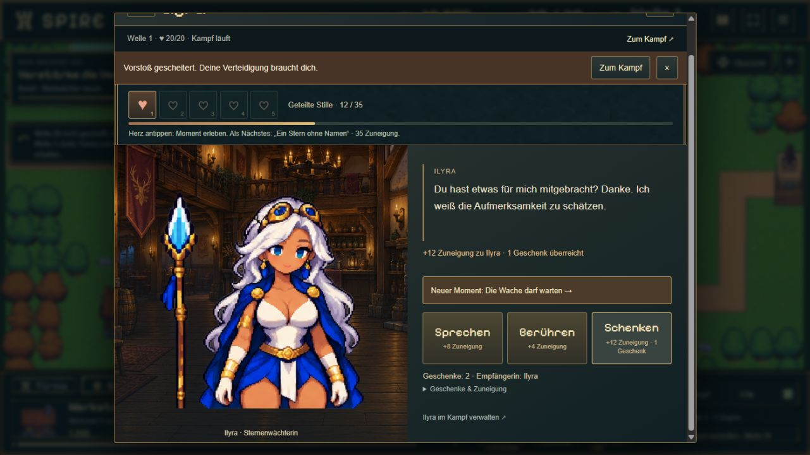
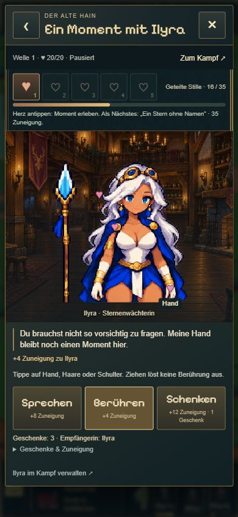

# T07 · Gemeinsame Tavernenprüfung

21.10.2026 · `codex/idle-bastion-vertical-slice`, aufbauend auf `dc63856` (rosa Herzen bereits committed, gepusht und veröffentlicht). T07 ausdrücklich beauftragt. Keine neuen Figuren, Spielregeln oder Saveformate.

## Ergebnis und Umfang

T01–T06 funktionieren im gemeinsamen Ablauf. Kein neuer Produktionsfehler im geprüften Umfang gefunden; keine vorsorglichen Gameplayänderungen. Ergänzt wurde eine wiederverwendbare, ausschließlich lokale Prüfhilfe unter `experiments/idle-bastion/tests/browser/tavern-session.html`: Sie legt per Button einen neuen zufälligen `probe=t07-…`-Speicherplatz an und führt in den echten Spieleinstieg. Der normale Spielstand wird nicht überschrieben. Nicht Teil der Produktions-Build-Einstiege; zusätzlich durch `import.meta.env.DEV` geschützt.

## Durchgeführt

- **25/25 Tests bestanden:** `tavern.test.ts`, `tavern-social.test.ts`, `tavern-interactions.test.ts`, `tavern-mara-content.test.ts`, `tavern-ilyra.test.ts`. Alte bezahlte Taverne ohne/mit Ilyra, Rekrutierungssperren, aktive Zeitabschnitte, gemeinsamer Geschenkbestand bei getrennten Punkten, Einmal-/Farmbelohnungen, Offline-Abgrenzung, Schreibfehler-Rollback und parallele Aktionen. Bestehende Tests gezielt erneut ausgeführt, keine komplette Altserie.
- **Echtes Spiel / Desktop 1280 × 720:** Gebaute Taverne über Siedlung öffnen, Ilyra auswählen, Geschenk überreichen. Zuneigung 0 → 12, Geschenkbestand um eins reduziert. Währenddessen läuft der Kampf weiter. Kernleben fallen auf 8/20: Warnung sichtbar. Anschließende Niederlage: neue Warnung sichtbar, schließbar; „Zum Kampf“ führt zur Karte mit tatsächlichem Farmrückfall.
- **Pause und Reload:** Im Spiel bewusst pausiert, Taverne geöffnet: „Pausiert“. Mara erhält durch Gespräch 8 Punkte. Reload und Rückkehrdialog behalten Pause bei, kein Offline-Gold während Pause. Ilyra weiterhin 12 Punkte, Mara weiterhin 8. Der während des vorigen laufenden Farmens gewachsene Geschenkbestand bleibt nach Reload 3; kein neuer Bonus durch Laden.
- **Hochkant angefordert 390 × 844 (Browser-DOM 391 px breit):** Taverne aus Siedlung öffnen, Ilyra auswählen, Berührung aktivieren und Hand antippen: 12 → 16 Punkte, passende Reaktion. Rückkehr zur Charakteransicht/Übersicht, Wechsel zu Mara: weiterhin 8 Punkte. Wisp-Verwaltungslink öffnet dessen reguläres Spielpanel; Pause bleibt bestehen. Kein horizontaler Überlauf (Bodybreite = Viewport), Tavernenbreite rund 375 px, Kopf/Zurück/Schließen erreichbar.
- **`npm run idle:build` bestanden:** TypeScript und Vite-Produktionsbuild. Lokale Prüfhilfe nicht im erzeugten Build enthalten.

## Grenzen

Vorbereiteter isolierter Funktionsspielstand mit Boss-25-Freigabe und absichtlich schwacher Verteidigung, kein regulär erspielter Kampagnen-/Balancenachweis. Mobiler Browserausschnitt, kein physischer Gerätetest. Vorherige visuelle Nutzerfreigaben bleiben gültig; diese technische Prüfung erfindet keine neue Nutzerabnahme. Langfristiges Spielgefühl über mehrere Sitzungen sowie B14/G2 bleiben offen. Keine Umsetzung von F03 oder weiteren Paketen.

## Aufnahmen

