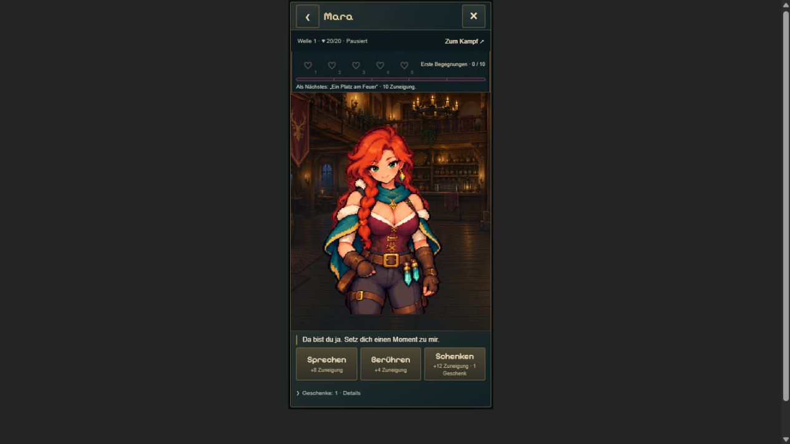

# T08 — Mobile Charakteransicht

21.10.2026. Mobile Dialoghöhe nutzt den verfügbaren Viewport; freie Höhe geht an Mara/Ilyra. Kopf, Herzen und drei Aktionen kompakter, Geschenkbestand/Regeln und Kampfverwaltung unter Details. Lange Inhalte scrollen im unteren Bereich; Figur und Navigation bleiben frei. Keine Asset-, Save- oder Freischaltänderung.

Kompakte Prüfung: 390 × 780 CSS-Pixel in einem Browser-Iframe (keine echte Geräteprüfung), Mara/Ilyra, Schulterberührung mit +4 Punkten, Gespräch/Herzfreischaltung und persönliche Szene, Details öffnen/schließen, Rücknavigation und vollständiges Schließen. Desktop mit zwei Spalten weiterhin funktionsfähig. Bei geöffneten Details gefundene Textüberlappung durch Flex-Schrumpfen behoben und visuell nachgeprüft.

`npm run build` und `node experiments/idle-bastion/scripts/check-tavern-loading.mjs` bestanden; keine vollständige alte Testsuite. Fehlende deklarierte Abhängigkeit fake-indexeddb lokal installiert, Lockfile unverändert. Gemeinsamer Abschlussbuild mit der Audiostufe ebenfalls bestanden.

