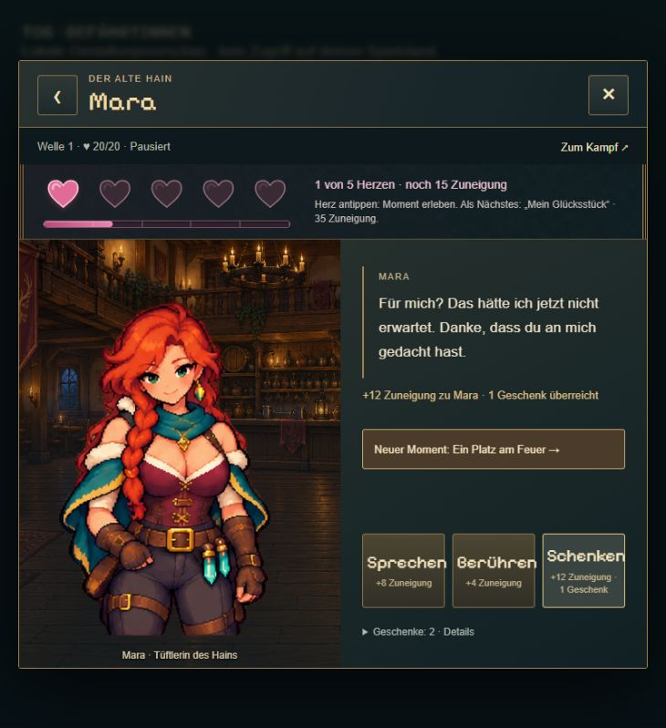
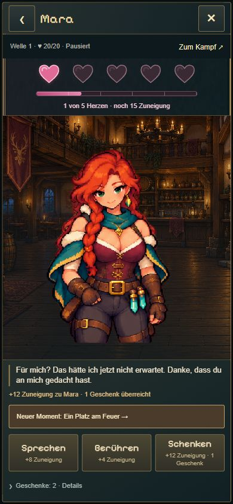

# T08b · Zuneigungsanzeige und gezieltes Nachladen

21.10.2026. Keine Änderung an Punkten, Freischaltungen, Spielständen oder Animationsbewegungen.

## Darstellung

Fünf große rosa Herzgrafiken (38 × 36 px) in mindestens 44 px großen transparenten Schaltflächen. Keine einzelnen Kästen oder winzigen Nummern. Passend breiter, getrennt platzierter Fortschrittsbalken mit bestehender weicher Füllanimation; klare Anzeige der Herzanzahl und fehlenden Punkte. Desktop mit erläuterndem Momenttext daneben, Hochkant kompakter. SVG statt zusätzlicher Rasterbilder: scharfe Konturen ohne Bilddownload.

## Laden bei leerem Cache

| Ausgewählte Figur | Bisher vor erster Animation | Jetzt vor erster Animation | Reduktion |
| --- | ---: | ---: | ---: |
| Mara | 3.319.036 Bytes | 534.796 Bytes | 83,9 % |
| Ilyra | 3.577.806 Bytes | 598.100 Bytes | 83,3 % |

Idle und Schulter aus bestehenden Atlanten verlustfrei getrennt. Alle RGBA-Pixel nach Dekodierung mit den Originalausschnitten verglichen. Kleine vorhandene Porträts überbrücken das Laden. Reaktionen erst bei Berührungen oder einem Herzmoment; keine Belohnung/Stimme vor geladener Reaktion. Verspätete Antworten dürfen die Übersicht nicht wieder öffnen oder eine andere Figur überschreiben. Gespräche bleiben während des Reaktionsdownloads verfügbar.

Tavernen-Vorschau lädt nur drei benötigte UI-Klänge (769.934 statt 4.274.392 Bytes, rund 82 % weniger) statt aller 18 Kurzklänge und keine Feldmusik. Raumhintergrund und Musikqualität unverändert. Die Prozentwerte betreffen nur die erstmals benötigten Animationsbilder, keine behauptete proportionale Zeitersparnis der ganzen Seite. Hauptspiel-Audio bleibt vollständig.

## Kompakte Prüfung

- Verlustfreie Slice-Erzeugung mit vollständigem RGBA-Vergleich erfolgreich.
- DOM-Integration: Porträt/Idle/Reaktion getrennt, verzögerte Antworten, Herzszene, Füllanimation und Autosave-Flackerregression bestanden.
- Audio-Lifecycle einschließlich nur drei Vorschau-Klängen, Musikwechsel und Stimmen bestanden.
- TypeScript und Produktionsbuild bestanden.
- Echter Browser: Desktop und 390 × 844 Hochkant, Geschenk/Herzfreischaltung, Mara- und Ilyra-Schulterreaktion, Figurenwechsel. 7 px Abstand zwischen Herz-Touchflächen und Balken, kein horizontaler Überlauf, keine Browserfehler.

Zusätzliche Zwischenbilder und zweite Idle-Animationen wurden nur besprochen, nicht produziert. Nutzerfreigabe der neuen Darstellung nicht vorweggenommen.
