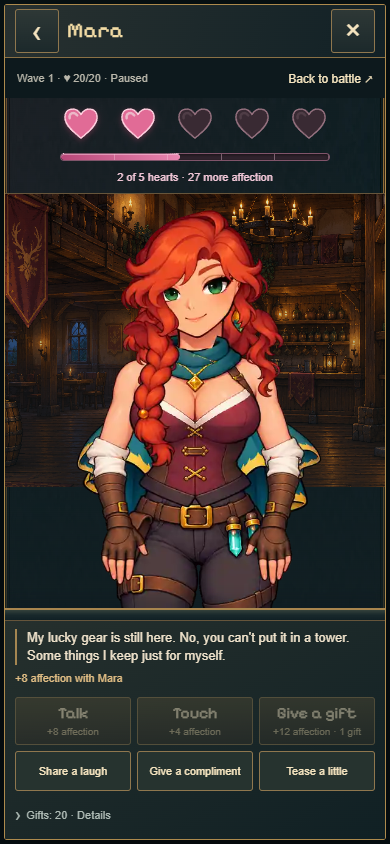
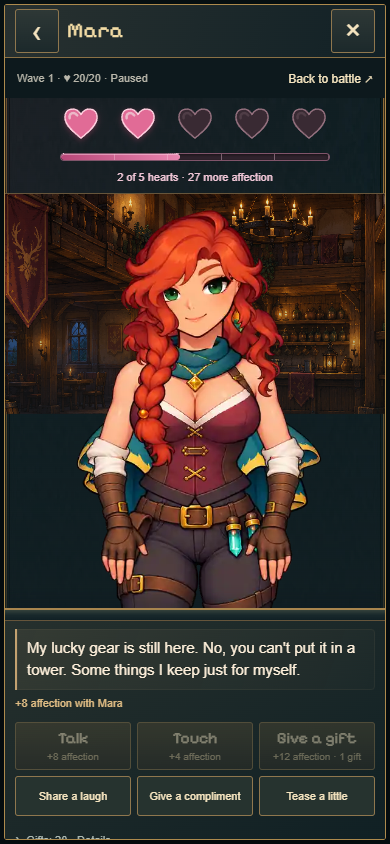

# A1 · Tavernen-Polish und Stabilität

24.10.2026 · Basis: aktuelles `origin/main`, `908a41b` · Arbeitsbranch: `codex/tavern-a1-polish`.

Häufige Reaktionen werden während der Idle und anschließend mit niedrigerer Priorität weiter vorbereitet. Ein begrenzter Cache hält höchstens 14 angefragte/decodierte Atlas-Seiten; zwei Downloads laufen parallel. Die Wiedergabe startet mit 32 vorbereiteten Frames und lädt voraus. Sprechen, Berührung und Schenken werden gezielt vorgewärmt; seltene Gesten erst bei Anforderung. Die 48,63 MB große vollständige Animationssammlung wird beim Öffnen nicht komplett geladen. Grafikquellen, Frames, Bildqualität und Spielregeln bleiben erhalten.

Jeder Download hat höchstens zwei Versuche, jeweils maximal fünf Sekunden, mit 250 ms Abstand. Ein endgültiger Fehler wird aus dem Cache entfernt; der Player kehrt zur Idle oder zum richtigen Porträt zurück. Eine erneute bewusste Aktion darf erneut laden. Eine gescheiterte automatische Idle-Variation bleibt für diese Ansicht unterdrückt. Laden und Decodieren vergeben keine Belohnung. Der Figurenwechsel leert Canvas, Bildkennungen, Warteschlange und alte Downloads synchron; das neue Ladeporträt wird vor dem Playerstart gesetzt.

Antworten haben eine dezente 1,6-Sekunden-Hervorhebung, mobil 15 statt 13 px Schrift und erscheinen oben im eigenen Textbereich. Der Scrollstand dieses Bereichs wird zurückgesetzt. Figur und Bühne behalten bei allen geprüften Antworten/Aktionen exakt dieselben Maße und Positionen.

## Vorher / nachher

Lokale **Produktionsbuilds**, Chrome 155, 1280×800 bzw. 390×844 mit Touch-Emulation, 10 Mbit/s Download und 80 ms Latenz. Je Figur ein leerer Browsercache und anschließend ein Reload mit warmem Browsercache. Erste Aktion eine Sekunde nach Beginn der Idle; danach Sprechen → Schulter → Geschenk → Lachen → Kompliment → Gesprächswiederholung. Alle Zeiten ab Klick bis zum ersten tatsächlichen Reaktionsframe, einschließlich vorhandenem Rückweg zum Ruhepunkt. Je Szenario ein Messlauf; keine statistischen Gerätebenchmarks.

Die häufigen Folgeaktionen starten kalt deutlich schneller. **Das allererste Gespräch und erstmals geladene besondere Gesten warten durch den größeren Startpuffer länger.** Dafür laufen die gemessenen Reaktionen anschließend mit ihrer vorgesehenen Clipdauer. Das erste Idle-Bild erscheint kalt nach 1,45–1,48 s statt 1,25–1,30 s; warm nach 0,31–0,33 s statt 0,24–0,27 s.

Alle Werte **vorher → nachher**, Millisekunden. „Kompliment“ zeigt die größte besondere Geste.

| Leerer Cache | Sprechen | Berühren | Geschenk | Kompliment | Bildtransfer MB |
| --- | ---: | ---: | ---: | ---: | ---: |
| Mara · Desktop | 752 → 1101 | 256 → 23 | 300 → 18 | 286 → 1255 | 15,328 → 15,329 |
| Mara · Hochkant | 757 → 1079 | 266 → 28 | 313 → 20 | 286 → 1255 | 15,328 → 15,329 |
| Ilyra · Desktop | 741 → 1050 | 293 → 105 | 259 → 50 | 295 → 1337 | 17,240 → 17,241 |
| Ilyra · Hochkant | 773 → 1053 | 266 → 63 | 259 → 52 | 294 → 1351 | 17,240 → 17,241 |

| Warmer Cache nach vollständiger Runde | Sprechen | Berühren | Geschenk | Kompliment | Bildtransfer MB |
| --- | ---: | ---: | ---: | ---: | ---: |
| Mara · Desktop | 308 → 283 | 16 → 24 | 22 → 21 | 13 → 261 | 0,411 → 0,208 |
| Mara · Hochkant | 322 → 284 | 28 → 17 | 306 → 21 | 291 → 259 | 14,251 → 0,208 |
| Ilyra · Desktop | 283 → 282 | 91 → 57 | 51 → 55 | 46 → 323 | 0,219 → 0,219 |
| Ilyra · Hochkant | 283 → 279 | 52 → 51 | 49 → 51 | 13 → 332 | 0,219 → 0,219 |

Vor der ersten Aktion werden nach Beginn der Idle etwa **0,98–0,99 MB** Bilddaten übertragen, zuvor 0,77–0,81 MB. Der gesamte kalte Prüfablauf braucht weiterhin rund **15,33 MB / 17,24 MB**, nicht sämtliche 48,63 MB. Transfers stammen aus `PerformanceResourceTiming.transferSize`, für abgeschlossene Atlas-/Porträt-Requests, ohne JavaScript/CSS/Audio. Browsercache und der begrenzte Playercache sind getrennt. Der große warme Mara-Altwert zeigt tatsächliche Cacheverdrängung dieser Runde; daraus wird keine allgemeine prozentuale Ersparnis abgeleitet. Teilbytes abgebrochener Hintergrundrequests sind in dieser Browser-API nicht vollständig enthalten.

In der finalen Messreihe hatten alle **40 Aktionsclips** keine Frameabstände über 100 ms; größte gemessene Lücke 48 ms. Vorher gab es besonders in Ilyras langer Hüftgeste 20–21 Abstände über 100 ms und etwa 7,45–7,50 s Wiedergabe statt 6 s. Nachher etwa 6,00 s. Screenshots während des Laufs können einzelne Framezeiten beeinflussen. Wiederholtes Sprechen startete nachher nach 13–136 ms. [Rohdaten vorher](before-metrics.json), [Rohdaten nachher](after-metrics.json).

14 RGBA-Atlanten entsprechen rechnerisch maximal etwa **144 MiB** Bilddaten, zusätzlich zu Canvas und browserinternem Speicher. Der Player gibt seine Referenzen beim Schließen/Wechsel frei; browserinterne Cache-/GPU-Freigabe liegt beim Browser. Smartphone-Hardwareleistung wurde nicht gemessen.

## Prüfungen

- `npm run build` erfolgreich, einschließlich TypeScript und Pages-Packung. [Buildprotokoll](build.txt). Ausschließlich Arbeitsbranch; kein Merge/Deployment nach main.
- `npm test`: **296/313 bestanden**, 17 Fehler, keine Skips. Unverändertes main: **291/308 bestanden**, dieselben 17 Fehler. Die fünf neuen Loaderprüfungen bestehen. Betroffene Tavernen-/Atlasfälle: 30 erfolgreich. [Vorher-Protokoll](before-tests.tap), [Nachher-Protokoll](after-tests.tap), [identische bestehende Fehler separat](existing-failures.json). Frühere Einordnung: [Testpflege-Bericht](../test-refresh/critical/REPORT.md).
- Bestehende DOM-Regression: verzögertes Laden, Autosave ohne Buttonflackern, Zuneigungsbalken und sichere Herzszenen bestanden. Kein Umbau von Kampf, Balance, Social-Transaktionen, Freischaltung oder Saveformat.
- Beide Figuren auf beiden Bildschirmgrößen: erster Download, wiederholtes Sprechen, Schulter, Geschenk, Lachen und Kompliment, konstante Figurenmaße und automatisch sichtbare Antworten. Mara und Ilyra verwenden 15 px mobil / 17 px am Desktop.
- Pro Figur/Größe sechs schnelle Wechsel während verzögerter Manifestantworten: **24 synchrone Canvas-Prüfungen**, keine alten Pixel, stets passendes Porträt und keine falschen späteren Draws. Absichtlich gescheiterte erste Kopfseite, spätere Geschenkseite und erste Idle-Seite: Rückfall, erneutes Abspielen und weiterhin erreichbare Navigation/Aktionen bestätigt. Geschenk 20 → 19, genau +12 Punkte; Laderetries vergeben nichts zusätzlich. [Fehler-/Wechselbelege](failure-checks.json).
- Zusätzlich beide automatischen Idle-Variationen absichtlich blockiert, Animationsuhr beschleunigt und mehrere weitere Loops geprüft: genau zwei Versuche, anschließend für die Ansicht unterdrückt. [Belege](variant-checks.json).
- Regulärer Spieleinstieg über vorhandene getrennte Probe-Slots, keine Nutzerpartie: Mara auf Deutsch und Ilyra auf Englisch, Desktop/Hochkant, Sprechen und Haare, je genau +12 Punkte, anschließend Reload mit unveränderten Punkten. Keine JavaScriptfehler. [Belege](main-checks.json).

Reproduktion der kompakten Browserläufe: `PLAYWRIGHT_MODULE` auf eine vorhandene Playwright-Installation setzen, `BASE_URL` auf die lokale Probe; `node experiments/idle-bastion/scripts/check-tavern-a1.mjs` bzw. `check-tavern-a1-failures.mjs`. Die Messung verwendet `tavern-rig-check.html` mit derselben Tavernenoberfläche und einer temporären Sitzung. Für Produktionsmessungen diesen Einstieg zusätzlich als Vite-Input bauen. Rohproben/Buildkopien bleiben unter ignoriertem `qa/tavern-a1/`.

## Screenshots

Vergleich derselben temporären Herz-2-Probe:

| Figur / Ansicht | Vorher | Nachher |
| --- | --- | --- |
| Mara · Desktop | [Ansicht](screenshots/mara-desktop-before.png) | [Ansicht](screenshots/mara-desktop-after.png) |
| Mara · Hochkant | [Ansicht](screenshots/mara-mobile-before.png) | [Ansicht](screenshots/mara-mobile-after.png) |
| Ilyra · Desktop | [Ansicht](screenshots/ilyra-desktop-before.png) | [Ansicht](screenshots/ilyra-desktop-after.png) |
| Ilyra · Hochkant | [Ansicht](screenshots/ilyra-mobile-before.png) | [Ansicht](screenshots/ilyra-mobile-after.png) |

Zusätzlich im regulären Spiel: [Mara Desktop](screenshots/mara-desktop-main.png), [Mara Hochkant](screenshots/mara-mobile-main.png), [Ilyra Desktop](screenshots/ilyra-desktop-main.png), [Ilyra Hochkant](screenshots/ilyra-mobile-main.png).

Die technische und eigene visuelle Prüfung ersetzt die ausstehende Nutzer-Sichtfreigabe nicht. Physische Smartphone-Abnahme bleibt offen. Commit/Push auf den Arbeitsbranch sind beauftragt; main bleibt bis zur gesonderten Freigabe unverändert.
