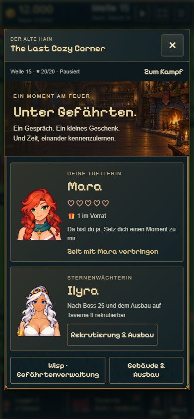
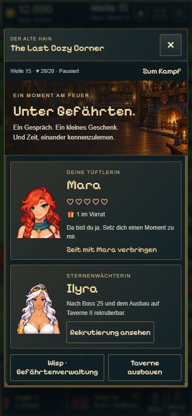
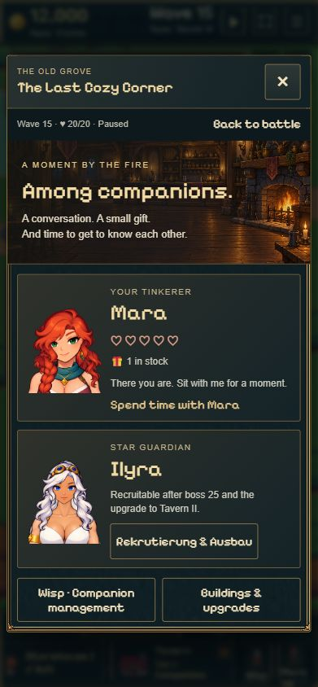
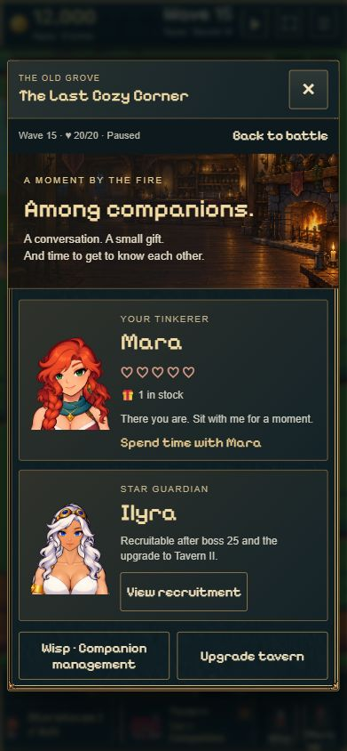

# Tavernen-Ausbau und Ilyras Rekrutierung · 14.11.2026

Auf `codex/kongregate-leaderboards` zunächst lokal umgesetzt und geprüft.
Anschließend hat der Nutzer am 14.11.2026 Commit und Push ausdrücklich beauftragt.
Kein Upload oder Publish. Bereits vorhandene Arbeitsänderungen einschließlich
der zuvor beauftragten Farmkorrektur wurden erhalten.

## Änderung

Nur `src/tavern-ui.ts` und drei passende Einträge in `src/locales/en.ts`:

- Ilyras bislang auch auf Englisch deutscher Button „Rekrutierung & Ausbau“
  verwendet jetzt „Rekrutierung ansehen / View recruitment“ und öffnet
  Ilyras vorhandene Rekrutierungsansicht. Dort bleiben die Voraussetzungen
  sichtbar; es wird kein vorzeitiger Rekrutierungsbutton angeboten.
- Der Gebäude-Button im bestehenden unteren Bereich heißt jetzt
  „Taverne ausbauen / Upgrade tavern“; nach dem Ausbau
  „Taverne verwalten / Manage tavern“. Er öffnet weiterhin die bestehende
  Tavernenverwaltung mit Ausbau-/Verschiebeaktionen.
- Nach Boss 25 und vor Taverne II erklärt Ilyras Text nur die noch fehlende
  Rekrutierungsvoraussetzung. Keine zusätzliche Ausbauaktion an ihrer Karte.
- Bei verfügbarer Rekrutierung bleiben „Ilyra kennenlernen / Meet Ilyra“
  und der echte Rekrutierungsbutton erhalten; bei bereits rekrutierter
  Ilyra bleibt ihre bestehende Charakteransicht erreichbar.

Keine Änderung an Werkstatt, Kosten, Freischaltbedingungen, Speicherständen,
Kampf, Assets oder CSS. Schrift, Größe, Gewicht, Farbe, Hintergrund, Rahmen
und Innenabstände beider Buttons sind vor/nach der Änderung identisch:
[vorher](styles-before.json), [nachher](styles-after.json).
`tavern-ui.css` blieb unverändert (SHA256
`42431845529b238c6d3e3bfdcd4642ab601be457fa09c034cdc1da4b0cc7fa7d`).

## Prüfung

- 16/16 bestehende gezielte Tests für Taverne, Ilyra und Übersetzungen bestanden:
  [Testprotokoll](tests.txt).
- `npm run build` einschließlich TypeScript erfolgreich: [Buildprotokoll](build.txt).
- Echte lokale Browserprüfung im Handyformat 390×844, vom Browser als
  391×844 JPEG gerundet. Keine physische Handyprobe und kein Portaltest.
- Gesperrte Ilyra: ihr Button öffnet ihre Infos, kein Gebäude-/Kaufmenü.
- Separater Gebäude-Button: öffnet Tavernenverwaltung und die weiterhin
  an Boss 25 gebundene Ausbauaktion.
- Ausgebaute Taverne ohne Ilyra: „Manage tavern“ / „Meet Ilyra“;
  der echte Rekrutierungsbutton ist sichtbar und aktiv.
- Keine erfassten Browserfehler. [Browsernachweis](browser-checks.json).

## Vorher / Nachher

Die Vorher-Aufnahmen stammen aus der unmittelbar vorhergehenden Prüfung des
unveränderten Ausgangscodes. Sie wurden unverändert aus deren temporärem
Nachweisordner übernommen. Nachher wurde exakt derselbe isolierte,
pausierte Probe-Spielstand bei Welle 15 verwendet. Keine echten Spielersaves.

| Sprache | Vorher | Nachher |
| --- | --- | --- |
| Deutsch |  |  |
| Englisch |  |  |

Die technische und eigene visuelle Prüfung ist abgeschlossen. Die visuelle
Nutzerfreigabe wird dadurch nicht vorweggenommen.
