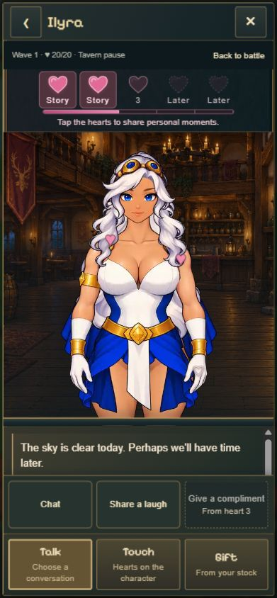
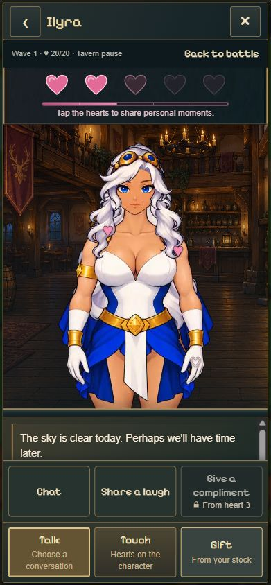
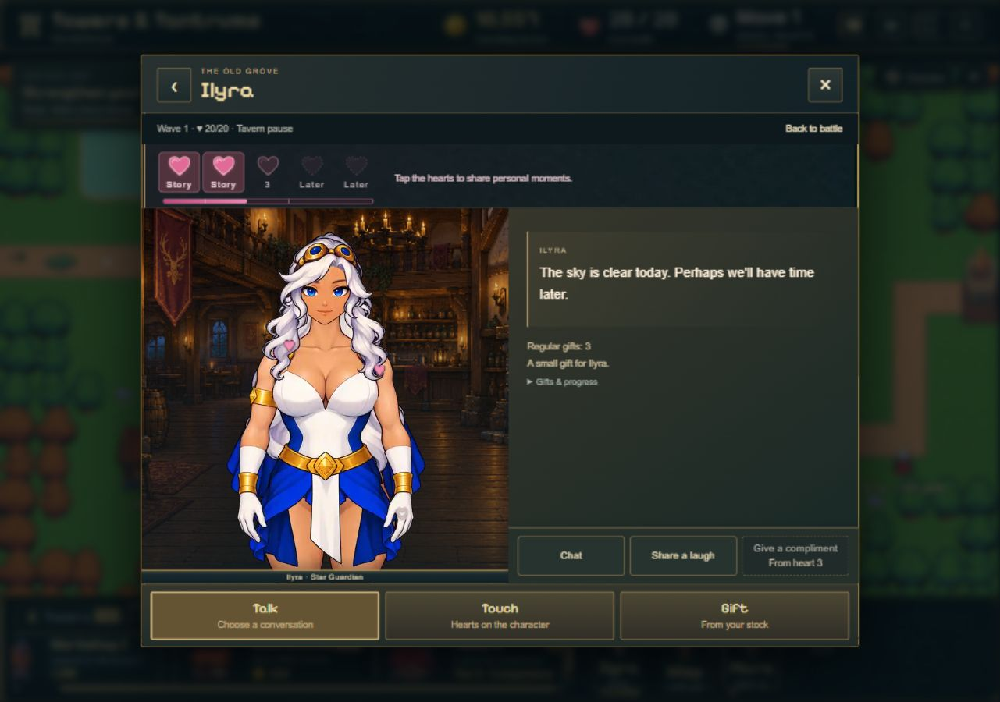
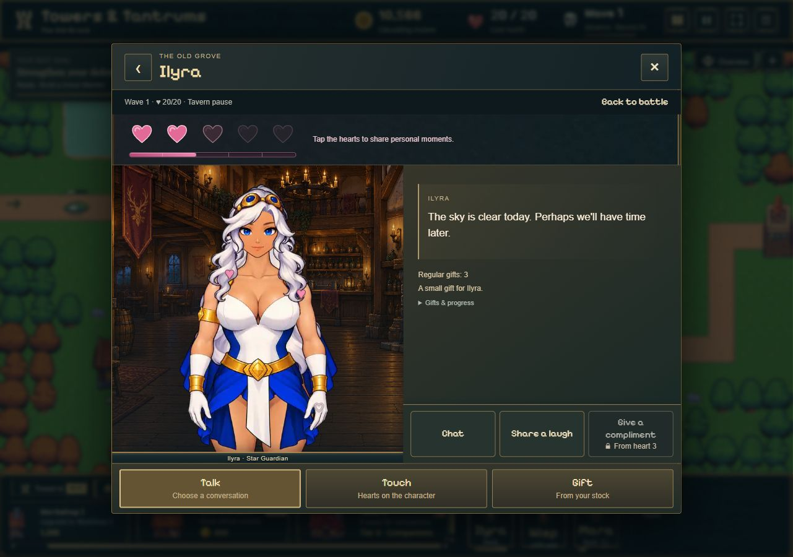

# Tavernenherzen und Aktionsschrift · 28.10.2026

Status: **Abgeschlossen und veröffentlicht.** Codecommit `d73ed50fdf99a2715e9a759703f9040e0d2399d2` auf `main`; erfolgreiche Pages-Veröffentlichung und neuer ZIP-Export geprüft.
Ausgangsstand: `c30060a2e740aebe95a5841fe93fc4ec3cd9c566` (`main`, mit `origin/main` synchronisiert). Der fremd bearbeitete Checkout in Documents/TowerDefense wurde nicht verändert.

## Gezielte Änderungen

- Beschriftungen unter allen fünf großen Herzen entfernt. Zugängliche Namen, Kapitelname, Voraussetzung, Tooltip, Tastaturbedienung und 44-px-Zielflächen bleiben erhalten.
- Neue, ungeöffnete Geschichten haben einen sanften rosa Randglanz und einen 2-Sekunden-Puls mit maximal 4 % Vergrößerung. Bereits geöffnete Herzen bleiben rosa, gesperrte dunkel; beide ohne Animation. `prefers-reduced-motion` deaktiviert die Bewegung und erhält für ungeöffnete Geschichten einen statischen dezenten Glanz.
- Erstaufruf wird erst nach erfolgreicher Vorbereitung der Geschichte vermerkt. Ein Ladefehler verbraucht den Hinweis nicht. Jede Geschichte und beide Figuren werden getrennt verfolgt.
- Alle textlichen Tavernenaktionen verwenden dieselbe Pixelify-Sans-Anzeigeschrift; erklärende Untertexte Arial. Auch Übersicht, Storynavigation und Verwaltungsbuttons abgeglichen. Gesperrte Gespräche haben durchgezogene gedämpfte Rahmen und ein kleines Schlosssymbol neben ihrer Voraussetzung.
- Keine Änderungen an Punkten, Geschenken, Kampf, Offline-Regeln, Charakterclips, Audio, Assets oder Bibliotheken.

## Rückwärtskompatibilität

Bisher existierte kein gespeicherter Erstaufruf. Die neue Merkliste liegt als optionale lokale UI-Präferenz unter `spire-ui-tavern-stories-v1:<Spielstand>` außerhalb des Spielstandformats. Sie schreibt weder das Kampfenvelope noch dessen Zeitstempel.

Bei einem bestehenden Spielstand ohne Merkliste werden schon verdiente Herzen konservativ als bekannt behandelt: Ob sie früher geöffnet wurden, lässt sich nicht rekonstruieren. Sie bleiben ruhig und wiederholbar. Später erreichte Herzen erhalten regulär den neuen Hinweis. Ein neues Spiel setzt nur seine eigene Merkliste zurück. Beschädigte, gesperrte oder volle Präferenzspeicher verhindern keinen Spielstart; in diesem Fall funktioniert die Merkliste für die Sitzung. Ohne funktionierenden Browser-Präferenzspeicher ist keine dauerhafte UI-Historie möglich. Sie ist lokal und wird nicht mit einem exportierten Spielstand übertragen.

## Prüfung

| Prüfung | Ergebnis |
| --- | --- |
| `npm test` | **417/417 bestanden**, 0 übersprungen; vorher 413, ergänzt um 4 gezielte Historientests |
| `node experiments/idle-bastion/scripts/check-tavern-pause.mjs` | Bestanden: beide Figuren H0–3, fehlgeschlagene/erfolgreiche Erstöffnung, unveränderte Kampfsnapshots, alle bisherigen Menü-/Pause-/Speicherbestätigungsfälle |
| `npm run build` | TypeScript und Produktionsbuild bestanden, nach letzter CSS-Korrektur erneut ausgeführt |
| Mara und Ilyra H0–3 | Im tatsächlichen Spiel geprüft; gesperrt/ungeöffnet/geöffnet, Gesprächsoptionen, DE/EN |
| Neu freigeschaltete Geschichte | Ilyra durch zweimaliges Plaudern von H0 auf H1; Puls und Hinweis erschienen, Geschichte durchgespielt, Herz danach ruhig |
| Tastatur und Wiederholung | Mara Herz 1 mit Enter geöffnet; bereits erlebte Geschichte erneut geöffnet |
| Reload und Produktionsfassung | Mara H3: nur Herz 1 gelesen; Ilyra H3: nur Herz 2 gelesen; beide unabhängig und nach Reload erhalten |
| Alter Spielstand | Derselbe H2-Spielstand wie beim Vorher-Bild: vorhandene Herzen ruhig, unverändert nutzbar |
| Bildschirmgrößen | 390×844, 360×800, 320×568 und Desktop 1280×900 visuell geprüft |
| Browserfehler | Keine Warnungen/Fehler im abschließend abgefragten lokalen Browserprotokoll |

Ein Browser-Steuerungstimeout wurde durch einen neuen Tab behoben; danach konnten alle vorgesehenen Herzstufen geprüft werden. Screenshots stammen aus dem echten Spiel mit isolierten, über die vorhandene DEV-Testseite angelegten Spielständen. Kein produktiver Nutzerspielstand wurde verändert. Die Testseite gehört nicht zum Produktionspaket. `browser-checks.json` enthält ergänzende DOM-/Schrift-/Animationsmessungen; sie ersetzt keine Sichtprüfung.

`prefers-reduced-motion` wurde am CSS-Pfad geprüft, nicht durch Umschalten der Betriebssystemeinstellung. Die Smartphoneprüfung erfolgte mit Chromium-Viewportgrößen, nicht auf physischen Geräten.

## Vorher / Nachher

Gleiche Figur, Herzstufe, Sprache und Bildschirmgröße; Momentaufnahmen der laufenden Idle-Animation können abweichen.

| Vorher, 390×844 | Nachher, 390×844 |
| --- | --- |
|  |  |

| Vorher, Desktop | Nachher, Desktop |
| --- | --- |
|  |  |

Weitere Nachweise: [neue Freischaltung](screenshots/hearts-after-new-unlock.jpg), [getrennte gelesene/ungelesene Herzen](screenshots/hearts-after-seen-unseen-390.jpg), [320 px](screenshots/hearts-after-320.jpg), [H0 / 360 px](screenshots/hearts-after-h0-360.jpg), [H1 / 360 px](screenshots/hearts-after-h1-360.jpg).

## Dateien und kritische Einordnung

Laufzeit: `src/tavern-story-history.ts`, `src/main.ts`, `src/tavern-ui.ts`, `src/tavern-ui.css`, `src/tavern-rig.css`, `src/locales/en.ts` unter `experiments/idle-bastion/`. Tests: neuer Historientest, erweiterte DOM-Regression und DEV-Teststandoptionen.

Die Herzleiste wirkt ruhiger und weniger wie ein Upgrade-Menü. Die einheitlichen Aktionsnamen und klar gedämpften Sperren passen zur bestehenden Gestaltung; Figur und Hauptaktionen bleiben sichtbar. Bei 320×568 bleibt der Dialogbereich bewusst knapp und scrollbar. Die lokale UI-Historie und ihre konservative Behandlung alter Herzen sind die genannten Grenzen. Kein technischer Release-Blocker durch dieses Paket festgestellt; die endgültige visuelle Nutzerfreigabe und Kongregate-Abnahme werden dadurch nicht ersetzt.

## Veröffentlichung

- Codecommit: [`d73ed50`](https://github.com/emfau88/TD/commit/d73ed50fdf99a2715e9a759703f9040e0d2399d2). Nachfolgender Dokumentationscommit enthält ausschließlich ergänzte Nachweise und sprachlich identisch abgestimmte Vergleichsbilder.
- [Pages-Lauf 40756913675](https://github.com/emfau88/TD/actions/runs/40756913675): **success**, veröffentlicht am 28.10.2026 um 19:46 UTC. Ausgelieferte Dateien zusätzlich direkt geprüft: neue Merkliste, 2-s-/4-%-Animation, Reduced-Motion-Regel und entfernte Herzbeschriftungen bestätigt; siehe `live-checks.json`.
- `npm run build:kongregate` bestanden. Neuer vollständiger Lieferordner: `C:\Users\madde\Documents\Towers-and-Tantrums-Kongregate-2026-10-28-Hearts-d73ed50`.
- Vollständiges ZIP: `01-game/Towers-and-Tantrums.zip`, **77.682.261 Byte**, 359 Dateien. SHA-256 `e24946754355ef1497a71e20c9a9a42e0f5110425a8b0dca900594bf20ebdf7f`.
- Beide ZIPs CRC-geprüft, Einzelupload und Voll-ZIP inhaltsgleich; sämtliche Dateien stimmen mit dem neuen Build überein. Manifest dokumentiert sauberen Codecommit. `zip-validation.json` enthält die Prüfdaten.
- Tatsächlich entpacktes ZIP lokal im Browser geladen: bestehender isolierter Spielstand nach Reload, Ilyra H2, ruhige erlebte Herzen, englisches Gesprächsmenü und Pixelify-Schrift bei 390×844 bestätigt; keine Browserwarnungen/-fehler. [Screenshot](screenshots/hearts-zip-smoke-390.jpg). Vorhandene Beigabentexte/Icon übernommen, Tavernenscreenshots aktualisiert.
- Kein Kongregate-Upload oder Submit.
