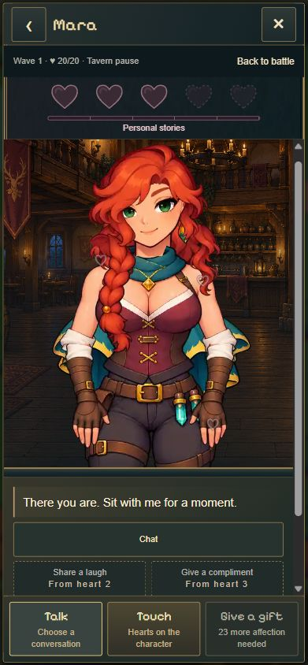
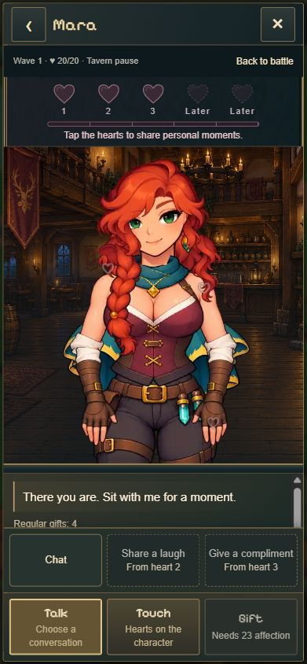

# Tavernen-UI Final Polish · 28.10.2026

Ausgangsstand: `c8dedb53537d759bc6f8ab87277383f022d402e1`, aktueller Main vor Beginn synchronisiert. Ein abgeschlossenes UI-Paket; Umsetzung auf dem vorhandenen sauberen Main-Checkout. Fremde Änderungen im anderen Checkout unangetastet. Vor dem Commit erneut mit `origin/main` verglichen: keine zwischenzeitlichen Änderungen.

## Ergebnis

- Gesprächsauswahl unmittelbar über Sprechen / Berühren / Schenken, ohne zusätzliche Suche. Alle drei Optionen sichtbar, gesperrte Optionen mit Herzvoraussetzung. Aktives Sprechen hat eine gefüllte, umrandete Auswahlfläche. Erneutes Antippen oder Escape schließt; eine Auswahl gibt den Dialogtext wieder frei.
- Nur der Text-/Fortschrittsbereich scrollt. Figur und Hauptaktionen bleiben stehen. Das Menü überdeckt weder Figur noch Hauptbuttons. Auf Desktop liegt es ausschließlich auf der Dialogseite. Öffnen/Schließen verändert die Figurenhöhe nicht.
- Verfügbare große Herzen haben eigene Schaltflächen und die Beschriftung „Moment“ / „Story“. Kurzer Bedienhinweis, spätere Kapitel 4/5 weiterhin gesperrt und beschriftet. Neue Herzgeschichte mit direktem Zugang im sichtbaren Herzbereich; bereits vorhandene Geschichten bleiben wiederholbar.
- Geschichten haben feste Weiter-/Zurück-Buttons. Ihr längerer Text nutzt denselben einzelnen Scrollbereich. Die Hauptaktionen werden während Geschichten wie bisher durch die Geschichtensteuerung ersetzt.
- Einheitliche kompakte Menübuttons, lesbare 12-Pixel-Unterzeilen, keine Link-Unterstreichungen. Englische Hauptaktion auf „Gift“ verkürzt. Vorhandene Farben, Figuren, Hintergründe, Clips und Audio erhalten.
- Keine Änderung an Beziehungspunkten, Reserven, Geschenken, Tavernenpause, Offline-Regeln, Saveformat, Tutorial, Türmen oder Balance.

## Echte Browserprüfung

In-App-Chromium, lokales Hauptspiel `index.html`, anschließend derselbe gespeicherte Testslot im gebauten Produktionsstand. Die bestehende DEV-Testseite erhielt Herz-/Sprachwahl: künstlich vorbereitete, über den normalen Loader validierte und separat gespeicherte Teststände; keine Mockups, kein Zugriff auf den regulären Spielstand. Die Testseite gehört nicht zu den Produktionsinputs.

| Szenario | Ergebnis |
| --- | --- |
| Mara und Ilyra, Herz 0/1/2/3 | Alle acht Kombinationen geöffnet; Storyherzen, Sperren und Gesprächsmenü korrekt |
| Plaudern / Lachen / Kompliment | Reale Clips `head`, `giggle`, `hip` sichtbar; Clip/Frame und Figurengeometrie in `browser-evidence.json` |
| Gesperrte Optionen | H0/H1/H2: Voraussetzungen sichtbar; Antippen erklärt Herz 2/3, löst keine freigeschaltete Geste aus |
| Story | Mara H3 und Ilyra H1 vollständig durchgespielt, Ilyra erneut geöffnet und verlassen |
| Neue Freischaltung | Ilyra von 0 über zwei echte Gespräche auf 16 Zuneigung; neues Herz, Schulterhinweis, kurze `head`-Reaktion, Geschichte direkt geöffnet |
| Scrollen | Fortschritt aufgeklappt und Text gescrollt; Figur bei y≈187 unverändert. Neue Antwort setzt nur den Textscroll auf 0 |
| Mobile | 390×844 DE/EN, 360×800 EN, 320×568 DE geprüft; alle Haupt-/Storybuttons erreichbar |
| Desktop | 1280×900, Figur links / Dialog und Menü rechts ohne Überdeckung |
| Verlassen / Reload | Tavernenpause beendet, Kampf läuft weiter (Gegnerzahl 4→3), gespeichertes H3 und später tatsächlich verdientes H1 erhalten |
| Produktionsbuild | H1-Testslot übernommen, echte ausgelieferte JS-Bundles geladen, Menü und Figur korrekt |
| Browserfehler | Keine Warnungen/Fehler im abschließend abgefragten Browserlog |

Die Entwicklungsseite wurde während der Umsetzung neu geladen; ein vorübergehender Übersetzungs-Syntaxfehler wurde vor der Abnahme korrigiert. Keine solche Störung im abschließenden Build/Browserlauf.

## Vorher / Nachher

Gleicher Viewport 390×844, Mara H0, Sprechen geöffnet:

| Vorher | Nachher |
| --- | --- |
|  |  |

Weitere geprüfte Ansichten:

- [Ilyra H1 · DE · 390×844](after/tavern-after-ilyra-h1-de-390.jpg)
- [Mara H2 · EN · 360×800](after/tavern-after-mara-h2-en-360.jpg)
- [Mara H3 · DE · 320×568](after/tavern-after-mara-h3-de-320.jpg)
- [Lange Geschichte mit erreichbarer Steuerung · 320×568](after/tavern-after-story-de-320.jpg)
- [Neues Herz und direkter Storyzugang · 390×844](after/tavern-after-new-heart-en-390.jpg)
- [Desktop · 1280×900](after/tavern-after-ilyra-h3-de-desktop.jpg)
- [Produktionsbuild und gespeichertes Herz](after/tavern-after-production-390.jpg)

Alle Aufnahmen stammen aus der echten gerenderten Spieloberfläche und wurden visuell geprüft.

## Technische Prüfung

- `npm test`: **413/413 bestanden**, keine übersprungenen Tests; [Log](tests.log).
- `node experiments/idle-bastion/scripts/check-tavern-pause.mjs`: bestanden, inklusive ergänzter Menü-/Escape-/Story-Dock-Regressionen, beide Figuren H0–3, 14 Pause-/Ausgangsfälle und sechs verzögerte/fehlgeschlagene Speicherfälle für Herzfeedback; [Log](dom-regressions.log).
- `npm run build`: TypeScript und Produktionsbuild erfolgreich; [Log](build.log).
- `git diff --check`: erfolgreich.
- Produktionsdateien: `src/tavern-ui.ts`, `src/tavern-rig.css`, `src/locales/en.ts`. Prüfdateien: `scripts/check-tavern-pause.mjs`, `tests/browser/tavern-session.{html,ts}`; dazu Roadmap und dieser Abnahmeordner.

## Grenzen und Releaseeinschätzung

Bei 390/360 Pixeln bleibt die Figur mit etwa 378–424 Pixel Bühnenhöhe im Mittelpunkt. Beim kleinen 320×568-Referenzfall ist sie deutlich kleiner (ca. 170 Pixel; während langer Geschichten noch kompakter). Längere Texte müssen dort gescrollt werden, die Navigation bleibt fest erreichbar. Das ist ein bewusster Kompromiss für den begrenzten Platz, kein versteckter zweiter Scrollbereich.

Geprüft wurde Chromium mit vorgegebenen Viewports, kein physisches iPhone/Android-Gerät. Audio wurde in diesem Paket nicht akustisch abgenommen; vorhandene Audioaufrufe bleiben unverändert, das Speicher-/Herzfeedback ist automatisiert geprüft.

**Für die Tavernen-UI sehe ich keinen technischen Release-Blocker mehr; sie ist ausreichend ausgereift für den Kongregate-Review.** Dies ersetzt keine finale Abnahme des gesamten Spiels im Kongregate-iframe. Keine automatische Einreichung.

## Veröffentlichung

Implementierungscommit und tatsächlicher Pages-Status werden nach dem Push hier ergänzt. Der vorhandene Kongregate-Export wird wegen der UI-Laufzeitänderung neu gebaut und separat geprüft.
